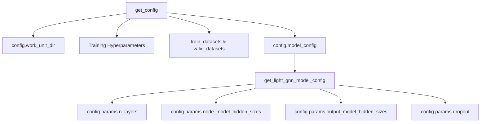
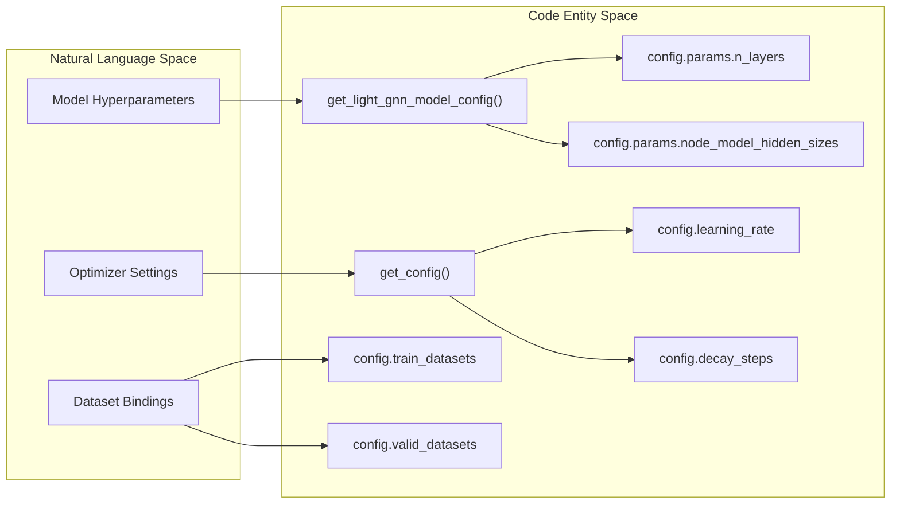

<!-- source: DeepWiki mcp.deepwiki.com · repo google-deepmind/neural_lns · page 4.3 Training Configuration · fetched 2026-10-26 -->

# Training Configuration

Relevant source files

The following files were used as context for generating this wiki page:

- [config_train.py](config_train.py)

## Purpose and Scope

This page documents the configuration infrastructure defined in `config_train.py` [config_train.py:15-57](). It covers the configuration layout used to supply hyperparameters to the training loop, define model architectures via `ml_collections.ConfigDict`, and bind TFRecord dataset paths for training and validation splits.

Sources: `config_train.py` [config_train.py:15-57]()

---

## Configuration Architecture

The training configuration relies on `ml_collections.ConfigDict` to maintain immutable, strongly-structured configuration trees [config_train.py:17](). Two core functions expose the hyperparameters: `get_light_gnn_model_config()` and `get_config()` [config_train.py:20-57]().

Sources: `config_train.py` [config_train.py:20-57]()

---

## Model Hyperparameters (`get_light_gnn_model_config`)

The function `get_light_gnn_model_config()` constructs the model-specific architecture parameters for the LightGNN network [config_train.py:20-31](). It returns a nested `ConfigDict` under `config.params` containing:

* `n_layers`: Integer number of message passing layers, defaulted to `2` [config_train.py:26]().
* `node_model_hidden_sizes`: List of integers representing hidden layer dimensions for node update networks, defaulted to `[64, 64]` [config_train.py:27]().
* `output_model_hidden_sizes`: List of integers representing hidden layer dimensions for the output classification head, defaulted to `[32, 1]` [config_train.py:28]().
* `dropout`: Float dropout rate applied across network layers, defaulted to `0.1` [config_train.py:29]().

Sources: `config_train.py` [config_train.py:20-31]()

---

## Training Hyperparameters and Dataset Bindings (`get_config`)

The primary entry point `get_config()` defines optimization parameters, evaluation cadences, directory bindings, and dataset paths [config_train.py:34-57]().

### Optimization and Execution Parameters
* `work_unit_dir`: Directory path for model checkpoints and logs, set to `/tmp/models/` [config_train.py:37]().
* `learning_rate`: Initial learning rate for the optimizer, set to `1e-2` [config_train.py:40]().
* `decay_steps`: Number of steps before applying learning rate decay, set to `300` [config_train.py:41]().
* `num_train_run_steps`: Steps per training loop invocation, set to `10` [config_train.py:42]().
* `num_train_steps`: Total number of training steps, set to `1000` [config_train.py:43]().
* `grad_clip_norm`: Maximum norm for gradient clipping, set to `1.0` [config_train.py:46]().

### Evaluation Parameters
* `eval_every_steps`: Frequency of evaluation runs in steps, set to `500` [config_train.py:44]().
* `eval_steps`: Number of evaluation batches processed per evaluation cycle, set to `128` [config_train.py:45]().

### Dataset Path Bindings
Datasets are defined as lists of tuples, where each entry is a pair comprising a `<dataset_path>` string and a `<prefix>` string [config_train.py:48-55]().
* `train_datasets`: List of training TFRecord splits, defaulted to `[('/tmp/neural_lns/data/example.tfrecord', 'train')]` [config_train.py:49-51]().
* `valid_datasets`: List of validation TFRecord splits, defaulted to `[('/tmp/neural_lns/data/example.tfrecord', 'valid')]` [config_train.py:53-55]().

Sources: `config_train.py` [config_train.py:34-57]()

---

## Code Entity Mapping

The following diagram illustrates how natural language configuration concepts map directly to code entities and variables inside `config_train.py`.

Sources: `config_train.py` [config_train.py:20-57]()

---

