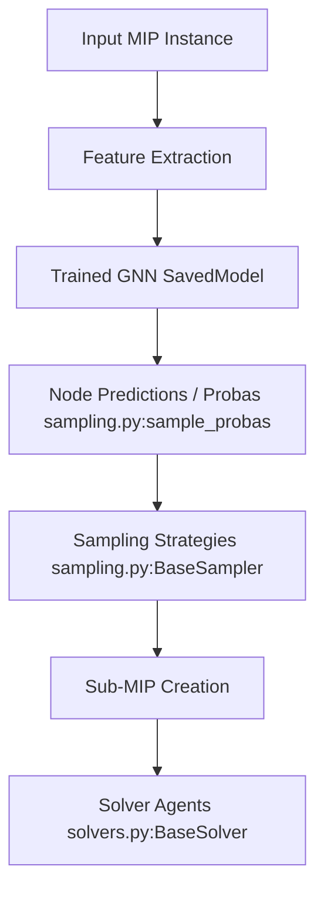
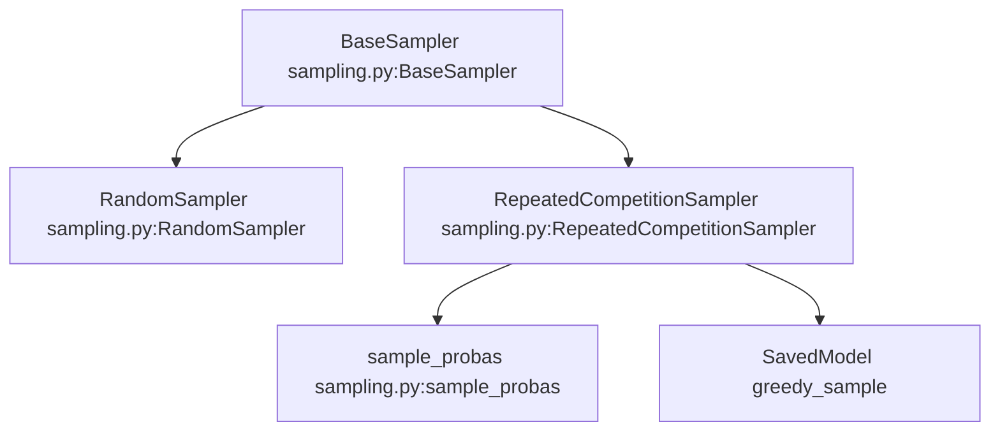
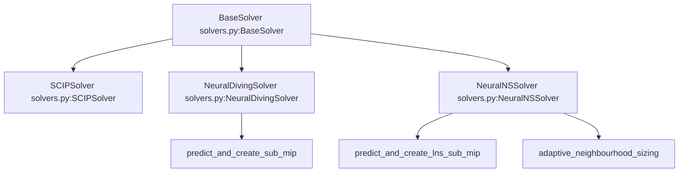

<!-- source: DeepWiki mcp.deepwiki.com · repo google-deepmind/neural_lns · page 5 Inference and Solving · fetched 2026-10-26 -->

# Inference and Solving

Relevant source files

The following files were used as context for generating this wiki page:

- [sampling.py](sampling.py)
- [solvers.py](solvers.py)

The inference and solving phase marks the execution stage of Neural LNS, where trained Graph Neural Network (GNN) models are deployed to assist mixed-integer programming (MIP) solvers. Given an input MIP, trained models predict variable likelihoods (such as whether a binary variable should be flipped or kept fixed), which are translated into sub-MIP restrictions by sampling strategies [sampling.py:15-195](). These restricted sub-MIPs are then solved by specialized agent architectures that orchestrate search rounds, handle restarts, and adapt neighbourhood sizes dynamically [solvers.py:35-170]().

This page serves as a high-level overview of the inference and solving pipelines. For comprehensive technical details, refer to the child pages:
- [Sampling Strategies](#5.1)
- [Solver Agents: SCIP, Neural Diving, Neural Neighbourhood Selection](#5.2)

---

*Figure 1: High-level inference pipeline bridging problem instances to solver execution.*

**Sources:** `sampling.py:15-195`, `solvers.py:35-170`

---

## 5.1. Sampling Strategies

Sampling strategies bridge probabilistic GNN predictions to concrete variable assignments in MIP sub-problems. The `sampling.py` module defines the core data structures and sampler implementations used to select which variables to fix or leave free during diving or neighbourhood search [sampling.py:15-195](). 

Key components include the `Assignment` named tuple representing variable bounds, the abstract `BaseSampler` interface, and concrete samplers like `RandomSampler` and `RepeatedCompetitionSampler` [sampling.py:25-195](). These classes determine how model logits or probabilities are consumed to construct restricted sub-MIP domains.

*Figure 2: Sampler class hierarchy and dependency mapping.*

For a detailed breakdown of sampling implementations, probability scaling, and dictionary mappings, see [Sampling Strategies](#5.1).

**Sources:** `sampling.py:25-195`

---

## 5.2. Solver Agents: SCIP, Neural Diving, Neural Neighbourhood Selection

Solver agents encapsulate the search orchestration logic, interacting with underlying solvers (such as SCIP) to discover and improve primal solutions [solvers.py:35-60](). The `solvers.py` module establishes a unified `BaseSolver` hierarchy supporting classical solving, one-shot Neural Diving, and iterative Neural Neighbourhood Selection (NLNS) [solvers.py:35-170]().

These agents manage solution logging via `BaseSolutionData`, handle adaptive neighbourhood sizing based on integer variable counts, and execute multi-step optimization loops with incumbent passing and restarts [solvers.py:35-170]().

*Figure 3: Solver agent class hierarchy and orchestration methods.*

For detailed descriptions of the solver state transitions, sub-MIP generation workflows, and end-to-end execution stages, see [Solver Agents: SCIP, Neural Diving, Neural Neighbourhood Selection](#5.2).

**Sources:** `solvers.py:35-170`

---

