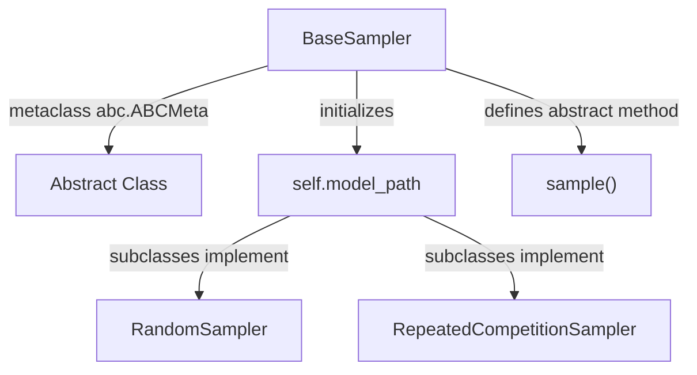
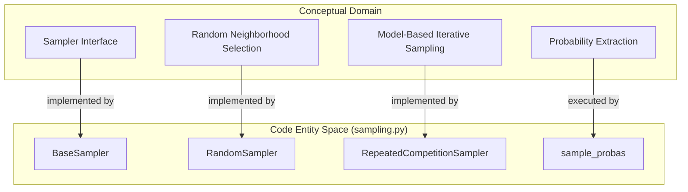
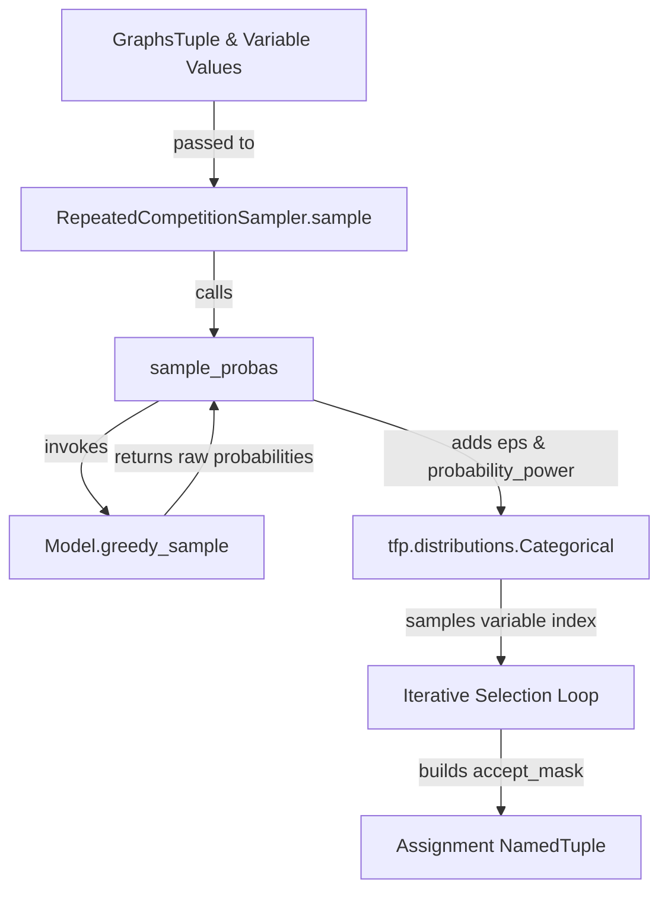

<!-- source: DeepWiki mcp.deepwiki.com · repo google-deepmind/neural_lns · page 5.1 Sampling Strategies · fetched 2026-10-26 -->

# Sampling Strategies

<details>
<summary>Relevant source files</summary>

The following files were used as context for generating this wiki page:

- [light_gnn.py](light_gnn.py)
- [sampling.py](sampling.py)

</details>


## Purpose and Scope
The sampling module (`sampling.py`) defines the strategy interfaces and concrete implementations used during Neural Large Neighborhood Search (LNS) to generate sub-MIPs. Samplers decide which variables to fix and which to leave unassigned (free) for the underlying solver, utilizing either random selection or probability distributions predicted by a trained Graph Neural Network (GNN) model [sampling.py:15-16]().

Sources: [sampling.py:1-16]()

---

## Core Data Structures and Utilities

### `Assignment`
The `Assignment` `NamedTuple` represents the variable fixings and bounds applied when constructing a sub-MIP [sampling.py:25-29](). It contains:
- `names`: A `List[str]` of variable names [sampling.py:26]().
- `lower_bounds`: A `List[int]` representing the lower bounds assigned to those variables [sampling.py:27]().
- `upper_bounds`: A `List[int]` representing the upper bounds assigned to those variables [sampling.py:28]().

### `sample_probas`
The `sample_probas` function extracts node-level probabilities from a conditionally independent SavedModel [sampling.py:31-44](). It invokes the model's `greedy_sample` signature on the input `GraphsTuple` and `node_indices`, returning a NumPy array of probabilities [sampling.py:31-44]().

```python
def sample_probas(model: Any, gt: graphs.GraphsTuple,
                  node_indices: np.ndarray) -> np.ndarray:
  _, probas = model.greedy_sample(gt, node_indices)
  return probas.numpy()
```

Sources: [sampling.py:25-45]()

---

## Abstract Sampler Interface: `BaseSampler`

`BaseSampler` is an abstract base class enforcing an interface for all sampling strategies via `abc.ABCMeta` [sampling.py:47-82](). It manages model path initialization and defines the abstract `sample` method [sampling.py:50-82]().



Sources: [sampling.py:47-82]()

---

## Concrete Sampler Implementations

### `RandomSampler`
`RandomSampler` selects a random subset of binary variables to leave unassigned while fixing the remaining binary variables to their current values [sampling.py:84-138](). Non-binary variables are left unfixed [sampling.py:123]().
- It accepts `num_unassigned_vars` to limit the size of the neighborhood [sampling.py:99]().
- It uses `np.random.choice` with a uniform distribution over `node_indices` to pick variables for flipping [sampling.py:117-118]().

### `RepeatedCompetitionSampler`
`RepeatedCompetitionSampler` uses model-predicted probabilities to iteratively sample variables for unassignment [sampling.py:140-195]().
1. Loads the model from `model_path` using `tf.saved_model.load` [sampling.py:144-146]().
2. Obtains base probabilities via `sample_probas` and adds an `eps` offset [sampling.py:171-172]().
3. Iteratively samples up to `num_unassigned_vars` using `tfp.distributions.Categorical`, optionally adjusting the distribution via `probability_power` (acting similarly to a temperature parameter) [sampling.py:174-188]().
4. Zeroes out selected probabilities in subsequent iterations to prevent duplicate selection and builds the final `Assignment` [sampling.py:189-195]().

Sources: [sampling.py:84-195]()

---

## Mapping Concepts to Code Entities

The following diagram associates the abstract conceptual architecture of sampling strategies with their concrete Python classes and functions in `sampling.py`.



Sources: [sampling.py:31-195]()

---

## Data Flow in `RepeatedCompetitionSampler`

The execution flow for generating a sub-MIP assignment using `RepeatedCompetitionSampler` is detailed below.



Sources: [sampling.py:31-44](), [sampling.py:148-195]()

---

