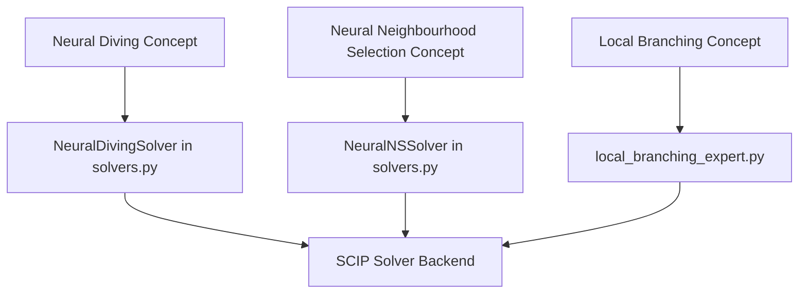
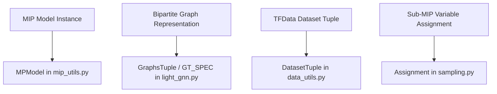

<!-- source: DeepWiki mcp.deepwiki.com · repo google-deepmind/neural_lns · page 6 Glossary · fetched 2026-10-26 -->

# Glossary

Relevant source files

The following files were used as context for generating this wiki page:

- [data_utils.py](data_utils.py)
- [light_gnn.py](light_gnn.py)
- [local_branching_expert.py](local_branching_expert.py)
- [mip_utils.py](mip_utils.py)
- [sampling.py](sampling.py)
- [solvers.py](solvers.py)

## Purpose and Scope
This page provides definitions of key domain terms, optimization concepts, and core code entities utilized across the `neural_lns` codebase. It serves as a technical reference linking high-level mathematical and heuristic terms from Mixed-Integer Linear Programming (MIP) and Neural Large Neighborhood Search (Neural LNS) directly to their implementation points in the repository.

---

## Domain and Optimization Concepts

### MIP (Mixed-Integer Linear Programming)
A mathematical optimization problem where an objective function is minimized or maximized subject to linear constraints, and some or all variables are restricted to integer values. 
- **Code Representation**: Encoded via `MPModel`, `MPVariable`, and `MPConstraint` data classes in `[neural_lns/mip_utils.py:74-86]()`.

### LNS (Large Neighborhood Search)
A metaheuristic framework that iteratively explores large neighborhoods of a MIP solution by destroying and repairing parts of the solution using a sub-solver (typically a MIP solver like SCIP).
- **Code Representation**: Implemented as part of `NeuralNSSolver` in `[neural_lns/solvers.py:98-170]`.

### Neural Diving
A primal heuristic where a Graph Neural Network (GNN) predicts complete variable assignments or probabilities for binary variables, fixing a large subset of variables to form a highly restricted sub-MIP that is solved directly by SCIP.
- **Code Representation**: Implemented in `NeuralDivingSolver` and `predict_and_create_sub_mip` within `[neural_lns/solvers.py:78-95]()`.

### Neural NS (Neural Neighbourhood Selection)
An iterative Neural LNS approach where a GNN predicts variable assignments or flip probabilities, and local branching constraints are used to construct targeted sub-MIPs around current incumbents over multiple refinement steps.
- **Code Representation**: Implemented in `NeuralNSSolver` within `[neural_lns/solvers.py:98-170]()`.

### Incumbent
The best known feasible solution found during the branch-and-bound search or local search trajectory.
- **Code Representation**: Represented as `MPSolutionResponse` (`[neural_lns/mip_utils.py:89-102]()`) and tracked via `SolutionData` (`[neural_lns/solution_data.py]()`).

### Neighbourhood Size & Hamming Distance
The maximum allowed distance (typically measured by the Hamming distance across integer or binary variables) between an incumbent solution and solutions permitted within a sub-MIP.
- **Code Representation**: Parameterized via `neighbourhood_size` (`[neural_lns/local_branching_expert.py:28-41]()`) and `num_unassigned_vars` (`[neural_lns/sampling.py:94-111]()`).

### Local Branching & Invalid Cut
A MIP-based local search technique that adds valid inequalities (cuts) to restrict the search space to a Hamming ball around a reference solution (incumbent).
- **Code Representation**: Implemented via `get_binary_local_branching_mip` (`[neural_lns/local_branching_expert.py:28-54]()`), `get_general_local_branching_mip` (`[neural_lns/local_branching_expert.py:57-143]()`), and `add_binary_invalid_cut` (`[neural_lns/mip_utils.py:144-195]()`).

### Sub-MIP
A restricted subset of the original MIP instance obtained by fixing variables, tightening bounds, or adding local branching cuts.
- **Code Representation**: Generated using `make_sub_mip` (`[neural_lns/mip_utils.py:197-203]()`).

### Presolve & LP Relaxation
Simplification techniques applied to MIP models to reduce size and tighten bounds (Presolve), alongside the relaxation of integrality constraints to solve linear programs (LP Relaxation).
- **Code Representation**: Handled by `Preprocessor` in `[neural_lns/preprocessor.py]()` and solver wrappers in `[neural_lns/solving_utils.py]()`.

### Diagram: Natural Language Space to Code Entity Space (Solvers)

*Sources: `[neural_lns/solvers.py:78-170]()`, `[neural_lns/local_branching_expert.py:28-143]()`*

---

## Code Data Structures and Tensor Specifications

### GraphsTuple & GT_SPEC
Data structures from the `graph_nets` library used to represent bipartite constraint-variable graphs of MIP models, along with fixed tensor specification signatures for TensorFlow compilation.
- **Code Representation**: Defined in `[neural_lns/light_gnn.py:26-33]()` and constructed in `[neural_lns/data_utils.py:89-147]()`.

### DatasetTuple
A named tuple representing batches of decoded training features, graph structures, labels, and indices used within the `tf.data` pipeline.
- **Code Representation**: Defined in `[neural_lns/data_utils.py:59-65]()`.

### Calibrated Time
A timing abstraction used to measure wall-clock or normalized work units, ensuring fair performance comparisons across different hardware environments.
- **Code Representation**: Implemented via `Timer` in `[neural_lns/calibration.py]()`.

### SolutionData
A logging container structure (`BaseSolutionData`, `SolutionData`, `SolutionDataWrapper`) that records primal objective values, search statuses, and improvements over time.
- **Code Representation**: Implemented in `[neural_lns/solution_data.py]()`.

### Sampler & greedy_sample
The strategy pattern interface used to instantiate different sampling heuristics (e.g., `RandomSampler`, `RepeatedCompetitionSampler`), paired with the GNN model's greedy prediction method.
- **Code Representation**: Base sampler defined in `[neural_lns/sampling.py:47-82]()`; `greedy_sample` defined in `[neural_lns/light_gnn.py:136-141]()`.

### SCIP params & work_unit_dir
Configuration dictionaries controlling SCIP solver heuristics, cut generation, and time limits (`scip_params`), alongside directory paths used for output logging (`work_unit_dir`).
- **Code Representation**: Defined in `[neural_lns/data_utils.py:50-56]()` and configuration scripts.

### Diagram: Natural Language Space to Code Entity Space (Data & Representations)

*Sources: `[neural_lns/mip_utils.py:74-86]()`, `[neural_lns/light_gnn.py:26-33]()`, `[neural_lns/data_utils.py:59-65]()`, `[neural_lns/sampling.py:25-29]()`*