# Page: Overview

# Overview

<details>
<summary>Relevant source files</summary>

The following files were used as context for generating this wiki page:

- [README.md](README.md)
- [solvers.py](solvers.py)
- [train.py](train.py)

</details>


## Purpose and Scope

Neural Large Neighborhood Search (Neural LNS) and Neural Diving are machine learning frameworks designed to accelerate the solution of Mixed Integer Programs (MIPs) [README.md:1-7]. Developed by DeepMind, the codebase integrates Graph Neural Networks (GNNs) with exact mathematical programming solvers (such as SCIP) to predict promising variable assignments or variable neighborhoods, effectively guiding combinatorial search. This parent page outlines the end-to-end pipeline—spanning imitation data generation, GNN training, and inference orchestration—and links to child pages for detailed configuration, execution instructions, and repository conventions [README.md:1-10].

Sources: `README.md:1-10`, `solvers.py:35-45`

---

## End-to-End Pipeline and Architecture

The workflow implemented across the repository is divided into three primary phases: data generation, model training, and solver deployment. 

1. **Data Generation**: Expert heuristics (`local_branching_expert.py`) explore MIP instances to generate high-quality imitation trajectories and variable labels, serialized into TFRecord datasets (`data_utils.py`) [README.md:16-22, README.md:31].
2. **Training**: The training script (`train.py`) coordinates distributed training loops using TensorFlow and Sonnet, optimizing the LightGNN architecture (`light_gnn.py`) against binary cross-entropy loss and tracking validation accuracy/AUC [train.py:40-78].
3. **Inference and Solving**: Solvers (`solvers.py`) leverage trained models via sampling modules (`sampling.py`) to execute **Neural Diving** or **Neural Neighbourhood Selection (Neural LNS)**, iteratively repairing or shrinking neighborhoods to find optimal or near-optimal solutions [solvers.py:35-104].

```mermaid
graph TD
  sub_mip["MIP Instances"] -->| "Expert Trajectories" | datagen["Data Generation\n(local_branching_expert.py)"]
  datagen -->| "TFRecords" | ds["Dataset Pipeline\n(data_utils.py)"]
  ds -->| "DatasetTuple" | train["Training Loop\n(train.py)"]
  train -->| "Model Weights" | model["LightGNN Model\n(light_gnn.py)"]
  model -->| "Probabilities" | sampler["Sampling Engine\n(sampling.py)"]
  sampler -->| "Sub-MIPs" | solver["Solver Agents\n(solvers.py)"]
  solver -->| "Incumbent Solutions" | final["Optimized Solution"]
```
Sources: `README.md:14-31`, `train.py:40-78`, `solvers.py:35-104`

---

## Repository Layout and Module Interactions

The codebase is structured around clear separation of concerns between MIP domain utilities, data pipelines, model definitions, and solver agent loops. 

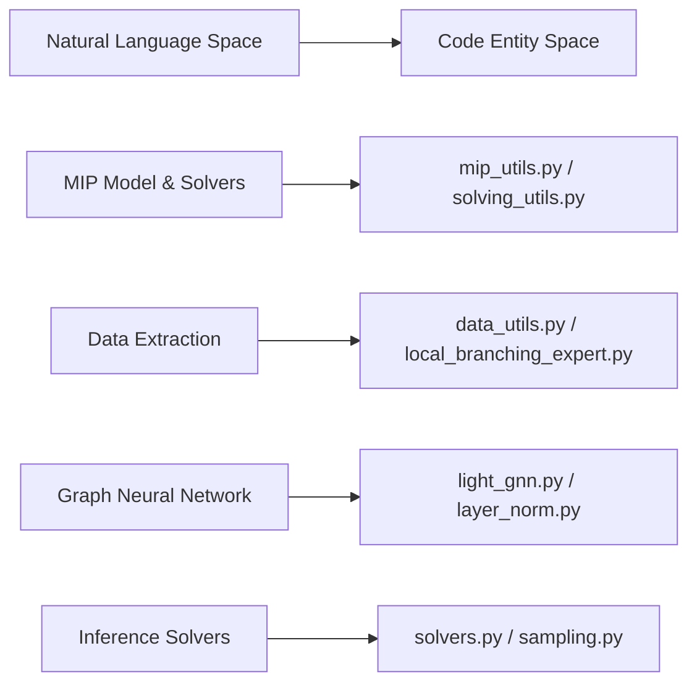
Sources: `README.md:14-30`

---

## Child Pages

For further technical details, implementation steps, and contribution guidelines, refer to the following child pages:

- **[Getting Started](#1.1)** — Installation guides, environment setup (`requirements.txt`), dependency management (TensorFlow, Sonnet, graph_nets, ml_collections, SCIP), working with example TFRecords in `data/example.tfrecord`, and instructions for implementing abstract interfaces.
- **[Repository Conventions and Contributing](#1.2)** — Licensing terms (Apache 2.0), code style policies, pull request workflows, and interface design patterns.

Sources: `README.md:33-72`

---

# Page: Getting Started

# Getting Started

<details>
<summary>Relevant source files</summary>

The following files were used as context for generating this wiki page:

- [README.md](README.md)
- [config_train.py](config_train.py)
- [data/example.tfrecord](data/example.tfrecord)
- [requirements.txt](requirements.txt)

</details>


## Purpose and Scope

This page covers the initial setup and configuration required to run the `neural_lns` codebase. It details the virtual environment installation, external package requirements (including TensorFlow, Sonnet, `graph_nets`, `ml_collections`, and SCIP), local implementation requirements for stubbed abstract classes, the structure of the example dataset located at `data/example.tfrecord`, and how to launch the training pipeline.

Sources: [README.md:1-32](), [config_train.py:1-57](), [requirements.txt:1-9]()

---

## Installation and Virtual Environment

To isolate dependencies, the repository recommends creating a Python virtual environment, upgrading `pip`, and installing the packages specified in `requirements.txt`.

```bash
python3 -m venv /tmp/neural_lns_venv
source /tmp/neural_lns_venv/bin/activate
pip install -U pip
pip install -r requirements.txt
```

Sources: [README.md:33-43]()

---

## Dependencies and Solver Requirements

The project relies on several core machine learning and graph neural network frameworks, alongside a Mixed-Integer Programming (MIP) solver backend. 

*   `absl-py`: Abseil Python common libraries [requirements.txt:2]().
*   `ml_collections`: Configuration management used in `config_train.py` [requirements.txt:3]().
*   `numpy`: Numerical computations [requirements.txt:4]().
*   `dm-sonnet`: DeepMind's neural network library (`dm-sonnet==2.0.0`) [requirements.txt:5]().
*   `tensorflow`: Deep learning backend (`tensorflow>=2.5.0`) [requirements.txt:6]().
*   `tensorflow_probability`: Probabilistic reasoning layers [requirements.txt:7]().
*   `graph_nets`: DeepMind's graph neural network library pinned to a specific commit [requirements.txt:8-9]().
*   `SCIP`: An underlying MIP solver required by the solver wrappers and branching routines.

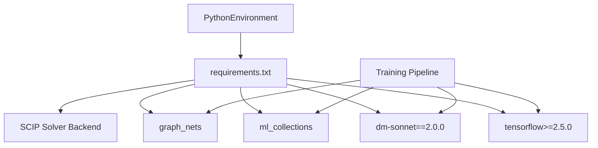
*Diagram 1: Dependency mapping from configuration to libraries.*

Sources: [requirements.txt:1-9]()

---

## Local Implementation Requirements (Stubbed Classes)

Before deploying the codebase for full inference or custom data generation, users must implement specific abstract interfaces left stubbed in the release:
1.  **Timer Abstraction**: Implemented via `calibration.py` to handle real versus calibrated execution time [README.md:14,47-49]().
2.  **Preprocessor Interface**: Implemented via `preprocessor.py` for MIP presolving and mapping solutions back to original problem spaces [README.md:24,47-49]().
3.  **Solver Wrapper**: Implemented via `solving_utils.py` to handle model loading, solving, and solution injection (`load_model`, `solve`, `add_solution`, `extract_lp_features_at_root`) [README.md:29,47-49]().

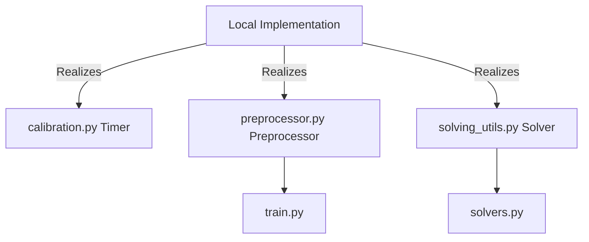
*Diagram 2: Bridging abstract interfaces to local code implementations.*

Sources: [README.md:14-29](), [README.md:45-49]()

---

## Example Dataset

The repository provides an example TFRecord dataset located at `data/example.tfrecord` [README.md:31](). This file is a derivative of the open-sourced Neural MIP Verification Dataset and is referenced directly in the default training configuration (`config_train.py`) for validation and training steps [config_train.py:49-55]().

Sources: [README.md:31](), [config_train.py:34-57]()

---

## Running Training

Training parameters and dataset bindings are defined in `config_train.py`. The configuration exposes hyperparameters like learning rate (`1e-2`), decay steps (`300`), layer dimensions, and dataset paths [config_train.py:34-57]().

To start the training loop after configuring dataset paths:

```bash
cd <parent-directory-of-neural_lns>
python3 -m neural_lns.train
```

Sources: [README.md:45-57](), [config_train.py:34-57]()

---

# Page: Repository Conventions and Contributing

# Repository Conventions and Contributing

<details>
<summary>Relevant source files</summary>

The following files were used as context for generating this wiki page:

- [CONTRIBUTING.md](CONTRIBUTING.md)
- [LICENSE](LICENSE)

</details>


## Purpose and Scope

This page details the licensing terms, contribution workflows, and architectural design patterns utilized across the `neural_lns` repository. It outlines the legal framework governing the codebase (Apache 2.0), the procedures for submitting modifications via GitHub Pull Requests and Contributor License Agreements (CLAs), and the software engineering conventions—specifically abstract interfaces and modular base classes—that enforce consistency across MIP solvers, samplers, and data pipelines.

---

## Licensing (Apache 2.0)

The repository is made available under the Apache License, Version 2.0. This license grants users a perpetual, worldwide, non-exclusive, no-charge, royalty-free, irrevocable copyright and patent license to reproduce, prepare derivative works of, publicly display, publicly perform, sublicense, and distribute the software source and object forms.

Key provisions of the Apache 2.0 license as applied to this codebase include:
- **Redistribution Conditions:** Any distribution of derivative works must include a copy of the license, prominent notices of file modifications, and retention of original copyright, patent, trademark, and attribution notices [LICENSE:90-123]().
- **Patent Grant:** Contributors grant explicit patent licenses for contributions that are necessarily infringed by their contributions alone or combined with the work [LICENSE:74-88]().
- **Limitation of Liability:** The work is provided "as is" without warranties or conditions of any kind [LICENSE:1-126]().

### Contributor Workflow and Governance Entity Mapping

```mermaid
graph TD
    Developer[""Developer/Contributor""] -->|"Submits modifications"| PullRequest[""GitHub Pull Request (CONTRIBUTING.md:3)""]
    PullRequest -->|"Requires verification"| CLA[""Contributor License Agreement (CONTRIBUTING.md:7)""]
    PullRequest -->|"Subject to mandatory"| CodeReview[""Code Reviews (CONTRIBUTING.md:19)""]
    CodeReview -->|"Governed by terms"| ApacheLicense[""Apache 2.0 License (LICENSE:2)""]
```

Sources: `CONTRIBUTING.md:1-25`, `LICENSE:1-126`

---

## Contribution Process

Contributions to `neural_lns` follow standard open-source review protocols hosted on GitHub. 

1. **Pull Requests:** All bug fixes, optimizations, and feature additions must be submitted via GitHub Pull Requests [CONTRIBUTING.md:3-5]().
2. **Contributor License Agreement (CLA):** Contributions must be accompanied by a signed CLA. This preserves copyright for the author or their employer while granting DeepMind the necessary permissions to use and redistribute the contribution [CONTRIBUTING.md:7-17](). CLAs are managed centrally through Google developer agreements (`https://cla.developers.google.com/`) [CONTRIBUTING.md:12]().
3. **Code Reviews:** All submissions—including those from core project members—require formal code review via GitHub Pull Request tooling before merging into the main branch [CONTRIBUTING.md:19-24]().

Sources: `CONTRIBUTING.md:1-25`

---

## Code Style and Abstract-Interface Conventions

The codebase enforces a modular object-oriented design using abstract base classes (ABCs) and strict interface contracts. This ensures that different solver backends, feature extractors, and sampling strategies can be swapped interchangeably without altering downstream execution loops.

Key architectural conventions include:
- **Solver Abstractions:** Core solver interactions are defined through abstract interfaces in `solving_utils.py` and implemented via hierarchical classes in `solvers.py` (e.g., `BaseSolver`) [solving_utils.py](), [solvers.py]().
- **Sampling Framework:** Inference-time sub-MIP generation relies on modular sampler classes inheriting from base definitions in `sampling.py` [sampling.py]().
- **Data Model Separation:** Mathematical programming entities (`MPModel`, `MPVariable`, `MPConstraint`) are cleanly separated from solver execution states and feature representations (`mip_utils.py`, `data_utils.py`) [mip_utils.py](), [data_utils.py]().

### Abstract Interface and Modular Component Hierarchy

```mermaid
graph TD
    SolvingUtils[""Abstract Solver API (solving_utils.py)""] --> Solvers[""Solver Hierarchy (solvers.py)""]
    Sampling[""Base Sampler (sampling.py)""] --> SamplerImplementations[""Random and Competition Samplers (sampling.py)""]
    Preprocessor[""Preprocessor Contract (solving_utils.py)""] --> MIPData[""MIP Data Structures (mip_utils.py)""]
    DataUtils[""TFRecord and Feature Scaling (data_utils.py)""] --> GNNModel[""LightGNN Architecture (models.py)""]
```

Sources: `solving_utils.py`, `solvers.py`, `sampling.py`, `mip_utils.py`, `data_utils.py`

---

# Page: MIP Domain Model and Solver Abstractions

# MIP Domain Model and Solver Abstractions

<details>
<summary>Relevant source files</summary>

The following files were used as context for generating this wiki page:

- [mip_utils.py](mip_utils.py)
- [preprocessor.py](preprocessor.py)
- [solving_utils.py](solving_utils.py)

</details>


The purpose of this page is to provide a high-level overview of how mixed-integer programming (MIP) problems, solutions, solver backends, preprocessing steps, and logging utilities are represented within the `neural_lns` repository. 

For detailed information, refer to the child pages:
- [MIP Data Structures (mip_utils.py)](#2.1)
- [Solver Wrapper and Presolving Interfaces](#2.2)
- [Timing and Solution Logging](#2.3)

---

## MIP Domain Model and Solver Abstractions Overview

The core domain model centers around representing MIP instances, variables, constraints, and solver responses in Python data classes [mip_utils.py:43-103](). Solvers interact with these models through an abstract solver API [solving_utils.py:32-61]() and preprocessors [preprocessor.py:23-54]().

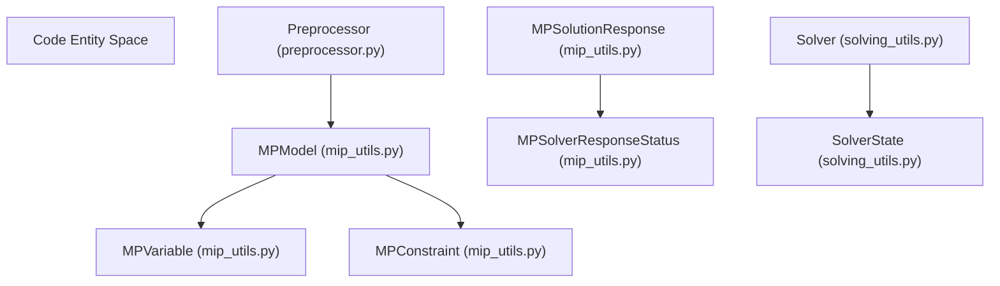
*Sources: [mip_utils.py:29-103](), [preprocessor.py:23-54](), [solving_utils.py:26-61]()*

---

## 2.1 MIP Data Structures (`mip_utils.py`)

Mixed-integer linear programs are represented via `MPModel`, which collects lists of `MPVariable` and `MPConstraint` objects alongside objective parameters [mip_utils.py:73-86](). Solver outputs are encapsulated in `MPSolutionResponse` using status enums defined by `MPSolverResponseStatus` [mip_utils.py:29-102](). 

Additionally, `mip_utils.py` provides core helper functions for tightening variable bounds in place (`tighten_variable_bounds`), checking integrality and binary conditions (`is_var_binary`), adding weighted binary invalid cuts (`add_binary_invalid_cut`), and constructing sub-MIP neighborhoods (`make_sub_mip`) [mip_utils.py:104-198]().

For details, see [MIP Data Structures (mip_utils.py)](#2.1).

*Sources: [mip_utils.py:29-198]*

---

## 2.2 Solver Wrapper and Presolving Interfaces

Interactions with external classical MIP solvers (such as SCIP) are standardized via the abstract `Solver` interface defined in `solving_utils.py` [solving_utils.py:32-61]() and the `Preprocessor` interface in `preprocessor.py` [preprocessor.py:23-54](). 

The `Solver` API manages model loading (`load_model`), execution (`solve`), solution injection (`add_solution`), solution retrieval (`get_best_solution`), and root node LP feature extraction (`extract_lp_features_at_root`) tracked via `SolverState` [solving_utils.py:26-61](). The `Preprocessor` class provides a contract for transforming an `MPModel` via `presolve` and mapping solutions back to the original space via `get_original_solution` [preprocessor.py:23-54]().

For details, see [Solver Wrapper and Presolving Interfaces](#2.2).

*Sources: [preprocessor.py:23-54](), [solving_utils.py:26-62]*

---

## 2.3 Timing and Solution Logging

Execution monitoring and objective tracking during solve routines are managed through specialized timer and logging abstractions. The `calibration.Timer` class handles wall-clock versus calibrated time measurements, while the `solution_data` module (`BaseSolutionData`, `SolutionData`, and `SolutionDataWrapper`) records primal bound improvements and trajectory progression over time.

For details, see [Timing and Solution Logging](#2.3).

*Sources: [mip_utils.py:15-27]*

---

# Page: MIP Data Structures (mip_utils.py)

# MIP Data Structures (mip_utils.py)

<details>
<summary>Relevant source files</summary>

The following files were used as context for generating this wiki page:

- [mip_utils.py](mip_utils.py)

</details>


## Purpose and Scope
The `mip_utils.py` module defines the core data structures and manipulation utilities for Mixed-Integer Linear Programming (MIP) models within the Neural LNS framework. It provides lightweight Python dataclasses (`MPModel`, `MPVariable`, `MPConstraint`, `MPSolutionResponse`) to represent optimization problems and solver responses independently of specific solver backends (such as SCIP), alongside utility functions for bound tightening, variable inspection, invalid cut generation, and sub-MIP creation used in Large Neighborhood Search (LNS) and Neural Diving.

Sources: `[mip_utils.py:1-202]()`

---

## Core Data Structures

The module abstracts MIP components into Python dataclasses, facilitating memory efficiency and straightforward inspection or serialization.

### MPSolverResponseStatus
An enumeration (`[mip_utils.py:29-41]`) representing the outcome status of a solver run. 
* `OPTIMAL` (0): Proven optimal solution found.
* `FEASIBLE` (1): Feasible solution found, but optimality not proven.
* `NOT_SOLVED` (2): Problem has not been solved.
* `INFEASIBLE` (3): Problem is proven infeasible.
* `UNBOUNDED` (4): Problem is proven unbounded.
* `INFEASIBLE_OR_UNBOUNDED` (5): Problem is either infeasible or unbounded.
* `STOPPED` (6): Solver stopped (e.g., due to limits).
* `UNKNOWN` (7): Status unknown.
* `FAILED` (8): Solver failed.
* `BESTSOLLIMIT` (9): Best solution limit reached.

### MPVariable
Represents a single decision variable in a MIP model (`[mip_utils.py:43-55]()`).
* `lower_bound` (`float`): Lower bound of the variable (default: `-math.inf`).
* `upper_bound` (`float`): Upper bound of the variable (default: `math.inf`).
* `objective_coefficient` (`float`): Coefficient of the variable in the linear objective function (default: `0.0`).
* `is_integer` (`bool`): Flag indicating if the variable is constrained to take integer values (default: `True`).
* `name` (`str`): Identifier string for the variable.

### MPConstraint
Represents a linear constraint in a MIP model (`[mip_utils.py:57-70]()`).
* `var_index` (`List[int]`): Indices of variables with non-zero coefficients in this constraint, referencing `MPModel.variable`.
* `coefficient` (`List[float]`): Numerical coefficients corresponding to `var_index`.
* `lower_bound` (`float`): Lower bound of the linear expression (default: `-math.inf`).
* `upper_bound` (`float`): Upper bound of the linear expression (default: `math.inf`).
* `name` (`str`): Identifier string for the constraint.

### MPModel
Encapsulates an entire Mixed-Integer Linear Programming model (`[mip_utils.py:73-86]()`).
* `variable` (`List[MPVariable]`): Collection of all variables in the model.
* `constraint` (`List[MPConstraint]`): Collection of all constraints in the model.
* `maximize` (`bool`): `True` if the optimization objective is maximization; `False` for minimization (default: `False`).
* `objective_offset` (`float`): Constant offset added to the objective value (default: `0.0`).
* `name` (`str`): Name of the model instance.

### MPSolutionResponse
Encodes the solution returned by a solver backend (`[mip_utils.py:88-102]()`).
* `objective_value` (`float`): Evaluated objective value including offsets and coefficients.
* `variable_value` (`List[float]`): Dense list of primal variable values aligned with `MPModel.variable`. Populated only when status is `OPTIMAL` or `FEASIBLE`.
* `status_str` (`str`): Human-readable status message.
* `status` (`MPSolverResponseStatus`): Structured solver status enum.

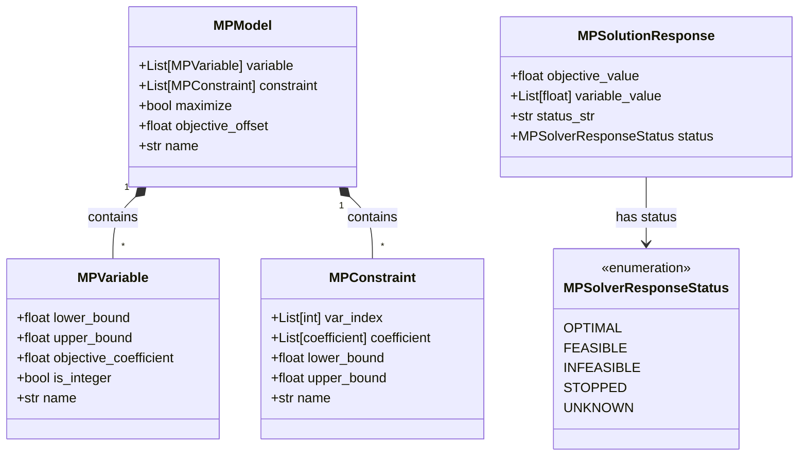
*Sources: `[mip_utils.py:29-102]()`*

---

## MIP Manipulation and Sub-MIP Construction

`mip_utils.py` supplies helper functions to manipulate models in-place, validate variable types, generate invalid cuts, and construct sub-MIPs for neighborhood search algorithms.

### Bound Tightening and Binary Checking
* `tighten_variable_bounds(mip, names, lbs, ubs)` (`[mip_utils.py:104-135]()`): Updates variable bounds in `mip` in-place. It maps input names to lower and upper bounds, ensuring bounds only tighten (`max(lb, current_lb)` and `min(ub, current_ub)`).
* `is_var_binary(variable)` (`[mip_utils.py:137-142]()`): Returns `True` if `variable` is integer-constrained with a lower bound close to `0` and an upper bound close to `1` (`np.isclose`).

### Weighted Binary Invalid Cuts
* `add_binary_invalid_cut(mip, names, values, weights, depth)` (`[mip_utils.py:144-196]()`): Adds a cut constraint to restrict the search space around a predicted binary assignment. Given predicted values $v_i \in \{0, 1\}$ and penalties $w_i$, it constructs a linear constraint enforcing that the weighted Hamming distance from the predicted assignment does not exceed `depth`:

$$\sum_{i \in Z} w_i x_i + \sum_{j \in O} w_j (1 - x_j) \le \text{depth}$$

where $Z$ are variables predicted as $0$ and $O$ are variables predicted as $1$.

### Sub-MIP Generation
* `make_sub_mip(mip, assignment)` (`[mip_utils.py:197-198]()`): Takes an input `mip` and a `sampling.Assignment` object to construct a restricted sub-MIP via variable domain tightening and cut application.

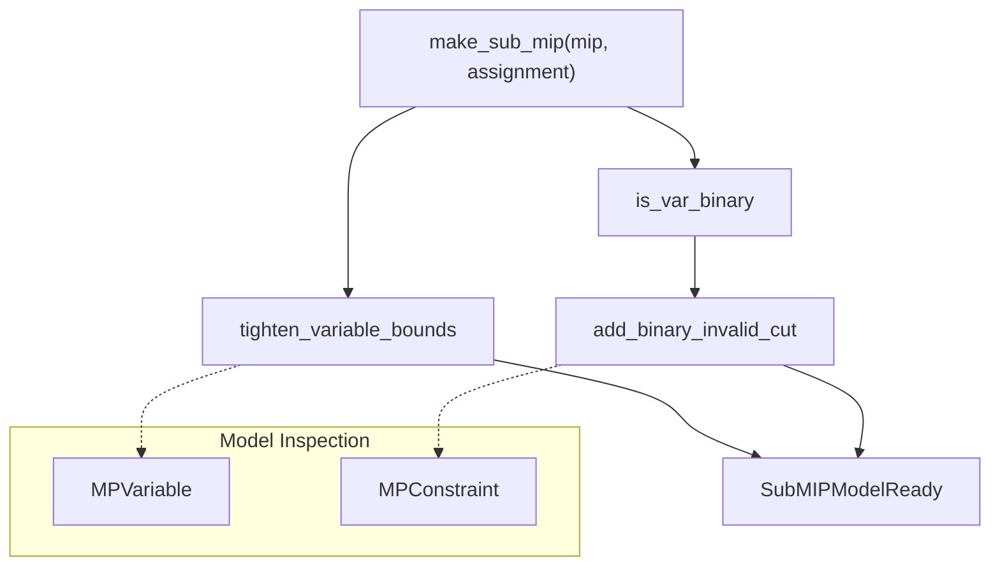
*Sources: `[mip_utils.py:104-198]()`*

---

# Page: Solver Wrapper and Presolving Interfaces

# Solver Wrapper and Preresolving Interfaces

<details>
<summary>Relevant source files</summary>

The following files were used as context for generating this wiki page:

- [preprocessor.py](preprocessor.py)
- [solving_utils.py](solving_utils.py)

</details>


This page details the abstract interfaces used to interact with classical Mixed-Integer Programming (MIP) solvers and presolvers within the Neural Large Neighborhood Search (`neural_lns`) framework. By defining decoupled abstract classes (`Solver` and `Preprocessor`), the codebase insulates high-level neural network operations, sampling strategies, and search orchestration from backend-specific solver implementations (such as SCIP).

---

## 1. The Solver Abstraction (`solving_utils.py`)

The `Solver` abstract base class defines the standard protocol for loading, modifying, solving, and inspecting a MIP model [solving_utils.py:32-37](). It manages the state machine of the underlying solver via the `SolverState` enumeration [solving_utils.py:26-30]().

### SolverState Lifecycle
The lifecycle of a solver interaction is tracked using the `SolverState` enum:
- `INIT` (`0`): The solver instance has been instantiated, but no model is loaded [solving_utils.py:27]().
- `MODEL_LOADED` (`1`): A MIP model (`MPModel`) has been successfully ingested by the backend [solving_utils.py:28]().
- `FINISHED` (`2`): The solve procedure has terminated (either optimally, via time limit, or node limit) [solving_utils.py:29]().

### The `Solver` Interface Contract
Subclasses must implement the following core methods:
- `load_model(mip: Any) -> SolverState`: Ingests a problem model (typically an `MPModel`) into the backend solver, transitioning the state to `MODEL_LOADED` [solving_utils.py:39-42]().
- `solve(solving_params: ml_collections.ConfigDict) -> mip_utils.MPSolverResponseStatus`: Executes the optimization routine using configuration parameters defined via `ml_collections` [solving_utils.py:43-47]().
- `get_best_solution() -> Optional[Any]`: Retrieves the best primal solution discovered during the most recent `solve` call [solving_utils.py:49-51]().
- `add_solution(solution: Any) -> bool`: Injects an externally computed solution (such as one generated via Neural Diving or a local branching step) into the solver's pool, returning a boolean indicating acceptance [solving_utils.py:53-55]().
- `extract_lp_features_at_root(solving_params: ml_collections.ConfigDict) -> Dict[str, Any]`: Solves the root Linear Programming (LP) relaxation and extracts feature dictionaries required for GNN feature extraction [solving_utils.py:57-61]().

```mermaid
graph TD
    A["SolverState.INIT"] -->|load_model| B["SolverState.MODEL_LOADED"]
    B -->|solve| C["SolverState.FINISHED"]
    C -->|load_model (new sub-MIP)| B
    
    sub:Solver["Solver Abstract API"]
    sub -.->|load_model| B
    sub -.->|solve| C
    sub -.->|add_solution| B
    sub -.->|extract_lp_features_at_root| C
```
*Sources: [solving_utils.py:26-61]()*

---

## 2. The Preprocessor Contract (`preprocessor.py`)

Many large-scale MIP instances contain redundancies, fixed variables, and tight bound implications that can be simplified prior to solving. The `Preprocessor` abstract base class provides the interface for model presolving [preprocessor.py:23-31]().

### Preprocessor Methods
- `presolve(mip: mip_utils.MPModel) -> Tuple[mip_utils.MPSolverResponseStatus, Optional[mip_utils.MPModel]]`: Accepts an original `MPModel` instance, applies presolving reductions, and returns the presolved status alongside a reduced `MPModel` [preprocessor.py:36-48]().
- `get_original_solution(solution: mip_utils.MPSolutionResponse) -> mip_utils.MPSolutionResponse`: Maps a solution obtained on the presolved (reduced) model back to the variable space and domain of the original problem [preprocessor.py:50-54]().

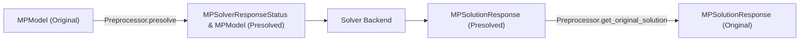
*Sources: [preprocessor.py:23-54]()*

---

## 3. Integrated Solver and Presolver Architecture

When combining the `Preprocessor` contract with the `Solver` API, the system handles transformations between the raw problem space and the solved problem space seamlessly.

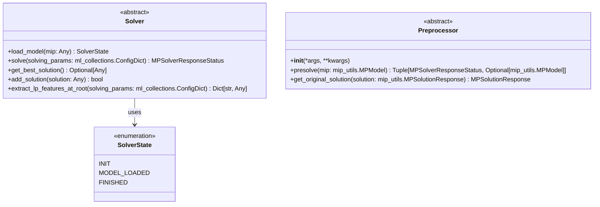
*Sources: [preprocessor.py:23-54](), [solving_utils.py:26-61]()*

---

# Page: Timing and Solution Logging

# Timing and Solution Logging

<details>
<summary>Relevant source files</summary>

The following files were used as context for generating this wiki page:

- [calibration.py](calibration.py)
- [solution_data.py](solution_data.py)

</details>


## Purpose and Scope
This page covers the technical implementation of timing and solution tracking within the Neural LNS codebase. Specifically, it details the `Timer` abstraction defined in [calibration.py:21-49]() for measuring solving duration (supporting both wall-clock real time and machine-calibrated time), and the solution logging infrastructure in [solution_data.py:24-177](), which tracks primal bound improvements, intermediate solutions, and incumbent trajectories via `BaseSolutionData` and `SolutionData`.

---

## 1. The `Timer` Abstraction

The MIP solving process requires precise duration tracking to enforce time limits and benchmark performance across different hardware environments. The `Timer` abstract base class defines the expected lifecycle and query interface for timers used by solvers [calibration.py:21-35]().

### Key Methods of `Timer`
* **`start_and_wait(self)`**: Starts the timer instance and blocks or waits for further interaction [calibration.py:27-38]().
* **`terminate_and_wait(self)`**: Terminates the active timing session and waits for subsequent commands [calibration.py:28-41]().
* **`elapsed_real_time(self) -> float`**: Returns the wall-clock time elapsed in seconds since the timer was started [calibration.py:30-45]().
* **`elapsed_calibrated_time(self) -> Optional[float]`**: Returns a machine-speed calibrated version of elapsed time to ensure fair benchmarking across disparate hardware [calibration.py:33-49]().

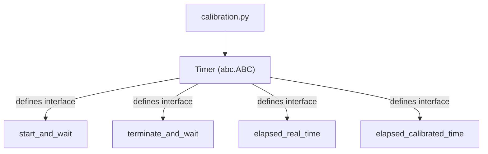
*Sources: [calibration.py:21-49]()*

---

## 2. Solution Data Logging Architecture

To monitor search progress, record incumbent updates, and evaluate performance, the repository uses an abstract logging interface (`BaseSolutionData`) and a concrete implementation (`SolutionData`).

### `BaseSolutionData` Contract
`BaseSolutionData` is an abstract base class encapsulating the state recorded during the solving process [solution_data.py:24-30](). It defines properties for tracking objective evaluation functions, primal bound trajectories, calibrated and uncalibrated timestamps, original solutions, and elapsed times [solution_data.py:32-68](). 

It also implements a protective wrapper method `write(log_entry, force_save_sol)` which filters out invalid or trivial bounds (e.g., bounds greater than or equal to $10^{19}$) before delegating to the internal `_write` method [solution_data.py:70-78]().

### `SolutionData` Implementation
`SolutionData` inherits from `BaseSolutionData` and provides concrete storage and maintenance for solution metrics [solution_data.py:80-177](). 

* **Monotonicity Enforcement**: Because primal bounds should monotonically improve during minimization or maximization, `_ensure_valid_primal_bound_update()` checks the sequence of recorded bounds against the configured `objective_type` [solution_data.py:102-113](). If a violation exceeds a relative or absolute tolerance of `1e-5`, a warning is logged via `absl.logging`, and the bound is repaired [solution_data.py:108-112]().
* **Intermediate Solution Handling**: Depending on whether `write_intermediate_sols` is enabled, intermediate solutions are either preserved in `_original_solutions` or discarded (except when `force_save_sol` is set to `True` for final results) [solution_data.py:91-96](), [solution_data.py:171-176]().

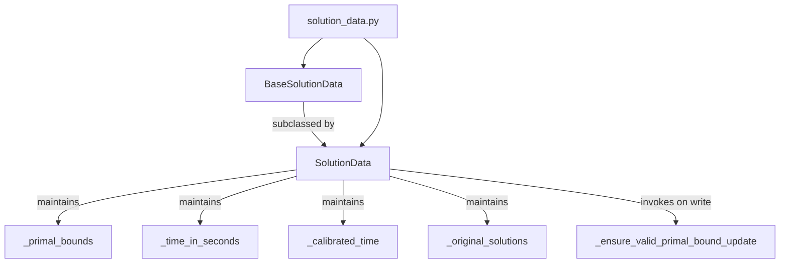
*Sources: [solution_data.py:24-177]()*

---

## Data Flow: Solution Logging Pipeline

The following diagram illustrates how solver log entries flow into `SolutionData`, pass through validity filters, undergo monotonicity verification, and update internal metrics.

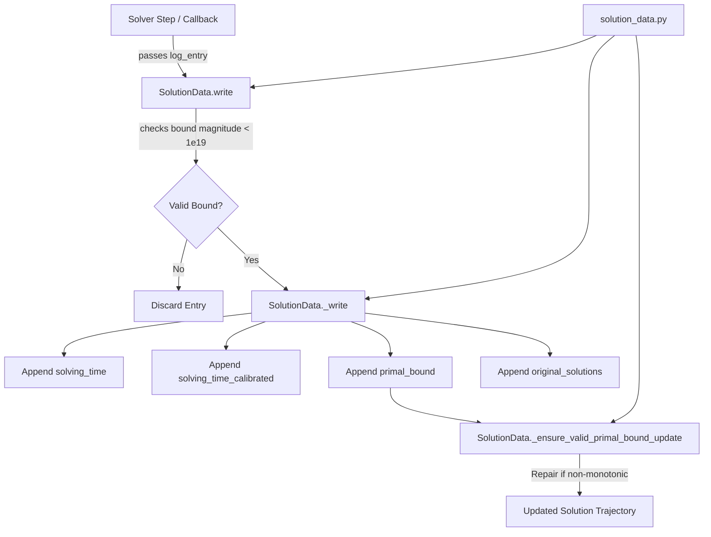
*Sources: [solution_data.py:73-177]()*

---

# Page: Data Generation and Feature Extraction

# Data Generation and Feature Extraction

<details>
<summary>Relevant source files</summary>

The following files were used as context for generating this wiki page:

- [data_utils.py](data_utils.py)
- [local_branching_data_generation.py](local_branching_data_generation.py)

</details>


The purpose of this page is to provide a high-level overview of how training data is produced from Mixed-Integer Programming (MIP) instances within the `neural_lns` codebase. This entails generating expert imitation labels via local branching and extracting bipartite graph features suitable for Graph Neural Networks (GNNs). 

This is a parent page. For deep technical details, refer to the child pages:
- [Local Branching Expert](#3.1)
- [Imitation Data Generation Pipeline](#3.2)
- [Feature Extraction and tf.data Pipeline](#3.3)

---

## 3.1 Local Branching Expert

The local branching expert acts as an oracle that iteratively improves incumbent solutions for a MIP instance by restricting the search space to a neighborhood defined by a Hamming distance bound. The expert constructs sub-MIPs where binary variables are constrained to remain close to a known incumbent solution, solves the resulting restricted MIP using SCIP, and returns improved solutions and expert labels.

For details on binary and general local branching sub-MIP construction, LP relaxation solving, and the `improve_solution` implementation, see [Local Branching Expert](#3.1).

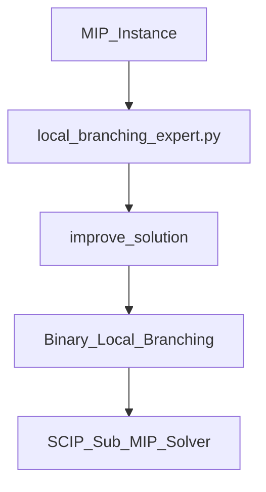
*Figure 1: Conceptual mapping from the local branching sub-MIP generation logic to `local_branching_expert.py`.*

Sources: `local_branching_expert.py`

---

## 3.2 Imitation Data Generation Pipeline

The imitation data generation pipeline automates the collection of training sequences across MIP instances. Driven by `generate_data_for_instance` [local_branching_data_generation.py:152-181](), the pipeline loads initial solutions via `get_incumbent` [local_branching_data_generation.py:43-57](), invokes the local branching expert iteratively, determines binary variable flips using `get_flipped_vars` [local_branching_data_generation.py:60-84](), and enriches root node representations via `enhance_root_features` [local_branching_data_generation.py:87-149]() to capture past incumbents and LP relaxation solutions.

For details on the sequence generation loop, configuration parameters, and SCIP integration, see [Imitation Data Generation Pipeline](#3.2).

Sources: `local_branching_data_generation.py`

---

## 3.3 Feature Extraction and tf.data Pipeline

To feed graph neural networks, raw MIP states and branching decisions must be transformed into structured tensor formats. The module `data_utils.py` handles TFRecord decoding, bipartite graph representation construction via `bnb_node_state_to_model_inputs` [data_utils.py:89-147](), minimization problem conversions via `convert_to_minimization` [data_utils.py:150-174](), and batching through `DatasetTuple` [data_utils.py:59-65]().

For details on the TFRecord schema, feature scaling, bipartite `GraphsTuple` construction, and `get_dataset`, see [Feature Extraction and tf.data Pipeline](#3.3).

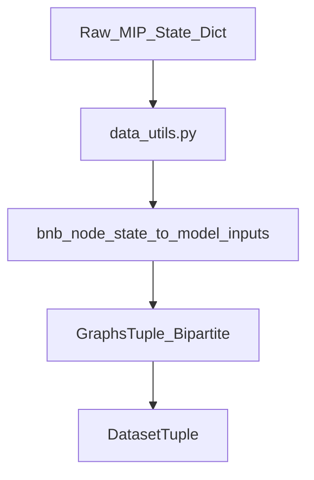
*Figure 2: Feature extraction data flow from raw state dictionaries to `DatasetTuple` instances managed by `data_utils.py`.*

Sources: `data_utils.py`

---

# Page: Local Branching Expert

# Local Branching Expert

<details>
<summary>Relevant source files</summary>

The following files were used as context for generating this wiki page:

- [local_branching_expert.py](local_branching_expert.py)
- [mip_utils.py](mip_utils.py)

</details>


## Purpose and Scope

The `local_branching_expert.py` module implements local branching strategies for Neural Large Neighborhood Search (Neural LNS) and Neural Neighborhood Selection [local_branching_expert.py:15](). It provides mechanisms to construct restricted sub-MIPs around an incumbent solution using Hamming distance metrics, supporting both binary variables [local_branching_expert.py:28-54]() and general integer variables [local_branching_expert.py:57-143](). Additionally, it supports solving the LP relaxations of these local branching formulations [local_branching_expert.py:146-183]() and executing solution improvement routines [local_branching_expert.py:185-193]().

Sources:
- `local_branching_expert.py:15-193`

---

## Binary Local Branching Sub-MIP Construction

Binary local branching restricts the search space around a known `incumbent` solution by limiting the Hamming distance across binary variables [local_branching_expert.py:28-37](). The function `get_binary_local_branching_mip` deepcopies the input model and invokes utility functions to add a weighted binary invalid cut [local_branching_expert.py:42-54]().

### Implementation Details

1. **Model Deepcopy**: A deep copy of the input `mip_utils.MPModel` is created to avoid mutating the original problem instance [local_branching_expert.py:42]().
2. **Variable Filtering and Rounding**: Iterates through variables, identifies binary variables using `mip_utils.is_var_binary()`, and rounds the incumbent solution's values to ensure valid integer representations [local_branching_expert.py:46-50]().
3. **Invalid Cut Addition**: Calls `mip_utils.add_binary_invalid_cut()` with uniform weights (`np.ones`) and a depth parameter equal to the `neighbourhood_size` [local_branching_expert.py:51-53]() (see `mip_utils.py` for cut formulation [mip_utils.py:144-195]()).

```mermaid
title "Binary Local Branching Flow"
[InputMIP] --> [DeepCopyModel]
[DeepCopyModel] --> [FilterBinaryVars]
[FilterBinaryVars] --> [RoundIncumbentValues]
[RoundIncumbentValues] --> [AddBinaryInvalidCut]
[AddBinaryInvalidCut] --> [OutputLNSMIP]
```

Sources:
- `local_branching_expert.py:28-54`
- `mip_utils.py:137-195`

---

## General Local Branching Sub-MIP Construction

For general integer variables, binary invalid cuts are insufficient. The `get_general_local_branching_mip` function implements general local branching by introducing auxiliary variables and constraints as described in local branching literature [local_branching_expert.py:57-73]().

### Implementation Details

1. **Auxiliary Variables**: For every non-binary integer variable `v`, two auxiliary variables, `v_plus` and `v_minus`, with lower bound `0` are added to the model [local_branching_expert.py:83-99](). Name collisions are resolved by appending underscores [local_branching_expert.py:87-91]().
2. **Auxiliary Constraints**: For each general integer variable, an equality constraint `v + v_plus - v_minus == val` is enforced to track the absolute deviation from the incumbent value `val` [local_branching_expert.py:125-134]().
3. **Distance Metric and Weights**: Weights are computed as $w = \frac{1}{\text{upper\_bound} - \text{lower\_bound}}$ [local_branching_expert.py:110](). Depending on whether the incumbent value rests on its lower bound, upper bound, or an interior point, coefficients and constraint upper bounds (`constraint_ub`) are adjusted [local_branching_expert.py:111-124]().
4. **Local Branching Constraint**: A final constraint named `local_branching` is appended with an upper bound equal to `neighbourhood_size` [local_branching_expert.py:137-141]().

Sources:
- `local_branching_expert.py:57-143`

---

## LP Relaxation Solving

To evaluate the neighborhood or extract linear programming features, `get_lns_lp_solution` constructs either a binary or general local branching MIP and solves its continuous LP relaxation [local_branching_expert.py:146-183]().

### Workflow

```mermaid
title "LP Relaxation Solving Pipeline"
[GetLnsLpSolution] --> [BuildBranchingMIP]
[BuildBranchingMIP] --> [DeepCopyLPModel]
[DeepCopyLPModel] --> [RelaxIntegrality]
[RelaxIntegrality] --> [LoadModelIntoSolver]
[LoadModelIntoSolver] --> [SolveWithSCIP]
[SolveWithSCIP] --> [ReturnBestSolution]
```

1. **MIP Construction**: Depending on `binary_only`, calls `get_binary_local_branching_mip` or `get_general_local_branching_mip` [local_branching_expert.py:166-170]().
2. **Integrality Relaxation**: Creates a deep copy of the LNS MIP and sets `var.is_integer = False` for all variables [local_branching_expert.py:175-178]().
3. **Solver Execution**: Instantiates `solving_utils.Solver`, loads the relaxed model, solves it using provided `scip_params`, and returns the best solution response [local_branching_expert.py:179-182]().

Sources:
- `local_branching_expert.py:146-183`
- `solving_utils.py`

---

## Solution Improvement (`improve_solution`)

The `improve_solution` function orchestrates the search for a better primal solution within the defined local branching neighborhood [local_branching_expert.py:185-193](). It builds upon the sub-MIP structures defined above and integrates solver parameters and incumbent solutions to drive the local search forward.

```mermaid
title "Local Branching Expert Architecture and Code Entities"
[LocalBranchingExpertModule] --> [BinaryBranchingFunc]
[LocalBranchingExpertModule] --> [GeneralBranchingFunc]
[LocalBranchingExpertModule] --> [LpsolutionFunc]
[LocalBranchingExpertModule] --> [ImproveSolutionFunc]

[BinaryBranchingFunc] --> [get_binary_local_branching_mip]
[GeneralBranchingFunc] --> [get_general_local_branching_mip]
[LpsolutionFunc] --> [get_lns_lp_solution]
[ImproveSolutionFunc] --> [improve_solution]

[BinaryBranchingFunc] --> [add_binary_invalid_cut]
[LpsolutionFunc] --> [Solver]
```

Sources:
- `local_branching_expert.py:28-193`
- `mip_utils.py:144-195`

---

# Page: Imitation Data Generation Pipeline

# Imitation Data Generation Pipeline

<details>
<summary>Relevant source files</summary>

The following files were used as context for generating this wiki page:

- [local_branching_data_generation.py](local_branching_data_generation.py)

</details>


The purpose of this section is to detail the imitation data generation pipeline implemented in `local_branching_data_generation.py`. This pipeline produces training data for Neural Large Neighborhood Search (Neural LNS) by running a local branching expert over MIP instances, tracking incumbent solutions, identifying flipped binary variables as target labels, and enhancing root node features with historical context and LP relaxation solutions.

---

## 1. Constants and Configuration

The data generation process relies on predefined solver configurations and time limits to ensure sufficient root node processing and search depth.

* `MIN_SOLVE_TIME`: Set to `1800` seconds to allow full root node processing during LP feature extraction [local_branching_data_generation.py:33-33]().
* `SCIP_SOLVING_PARAMS`: An `ml_collections.ConfigDict` containing default solver parameters including a `seed` of `42`, a `time_limit_seconds` of `1800`, and a `relative_gap` of `0` [local_branching_data_generation.py:36-40]().

```
Sources: [local_branching_data_generation.py:33-40]()
```

---

## 2. Incumbent Retrieval

The function `get_incumbent` is responsible for loading pre-computed or initial feasible solutions for a given MIP instance from a dataset pickle file.

```python
def get_incumbent(
    instance_name: Text,
    dataset: Text,
    solution_index: int) -> Optional[mip_utils.MPSolutionResponse]:
```
It constructs the instance path using `os.path.join`, loads the solution list via `pickle.load`, and validates that the requested `solution_index` exists before returning the `mip_utils.MPSolutionResponse` [local_branching_data_generation.py:43-57]().

```
Sources: [local_branching_data_generation.py:43-57]()
```

---

## 3. Flipped-Variable Label Generation

To train the Neural LNS model to imitate the local branching expert, target labels must indicate which binary variables changed values between an incumbent solution and an improved solution found by the expert.

The function `get_flipped_vars` performs this comparison:
* It iterates over all variables in the MIP model (`mip.variable`) [local_branching_data_generation.py:68-68]().
* For binary variables (verified via `mip_utils.is_var_binary`), it checks if rounded values differ between `incumbent` and `improved` [local_branching_data_generation.py:69-70]().
* If they differ, the label is set to `1.0`; otherwise `0.0` [local_branching_data_generation.py:71-73]().
* Non-binary variables are assigned `0.0` [local_branching_data_generation.py:67-67]().
* The resulting array is reordered to match the variable order expected by the feature extractor, masking out any constant variables [local_branching_data_generation.py:75-84]().

```
Sources: [local_branching_data_generation.py:60-84]()
```

---

## 4. Root Feature Enhancement

Root features extracted from the base MIP model are enriched with historical context using `enhance_root_features`. This function injects past incumbent solutions, LP relaxation solutions, and an integer variable mask into the variable feature matrix.

```python
def enhance_root_features(
    root_features: Dict[str, Any],
    incumbents: Sequence[Any],
    lp_sol: Optional[Any] = None
    ) -> Dict[str, Any]:
```

### Feature Matrix Layout Modification
1. **Past Incumbents**: For each incumbent in `incumbents` (ordered from most recent to least, up to `NUM_PAST_INCUMBENTS`), two columns are added:
   - Variable values from the incumbent [local_branching_data_generation.py:115-123]().
   - An all-ones presence indicator column [local_branching_data_generation.py:125-127]().
2. **LP Relaxation Solution**: If provided, `lp_sol` values are inserted into the designated feature column [local_branching_data_generation.py:129-139]().
3. **Integer Mask**: The final column acts as a binary mask where integer-constrained variables are marked `1.0` and continuous variables are marked `0.0` [local_branching_data_generation.py:140-147]().

```
Sources: [local_branching_data_generation.py:87-149]()
```

---

## 5. Main Generation Loop: `generate_data_for_instance`

The `generate_data_for_instance` function orchestrates the end-to-end imitation data generation loop for a single MIP instance.

```python
def generate_data_for_instance(
    instance_name: Text,
    dataset: Text,
    neighbourhood_size: int = 20,
    percentage: bool = False,
    sequence_length: int = 10,
    add_incumbent_to_scip: bool = True,
    solution_index: int = 0,
    scip_params: ml_collections.ConfigDict = SCIP_SOLVING_PARAMS,
    num_var_features: int = data_utils.NUM_VARIABLE_FEATURES) -> int:
```

### Pipeline Execution Flow

```mermaid
graph TD
    A["Start: generate_data_for_instance"] --> B["get_incumbent"]
    B --> C["Extract Root Features & LP Relaxation"]
    C --> D["Initialize Local Branching Expert"]
    D --> E["Sequence Generation Loop"]
    E --> F["Solve Sub-MIP with local_branching_expert"]
    F --> G{Improved Solution Found?}
    G -- Yes --> H["Compute Flipped Variables get_flipped_vars"]
    H --> I["Enhance Features enhance_root_features"]
    I --> J["Save Training Sample Sequence"]
    J --> K{Sequence Length Reached?}
    K -- No --> E
    K -- Yes --> L["Return Success Status 1"]
    G -- No --> M["Return Failure Status 0"]
```
*Diagram 1: Data Generation Pipeline Flow bridging system concepts to `generate_data_for_instance` and `local_branching_expert`.*

```
Sources: [local_branching_data_generation.py:152-181]()
```

---

## 6. Feature Enrichment Architecture

```mermaid
graph TD
    subgraph "Code Entity Space"
    R["root_features"] --> V["variable_features Matrix"]
    I["incumbents Sequence"] --> V
    L["lp_sol Solution"] --> V
    M["Integer Mask Logic"] --> V
    end

    subgraph "Feature Columns"
    V --> C1["Base Variable Features"]
    V --> C2["Past Incumbent Values & Indicators"]
    V --> C3["LP Solution Values"]
    V --> C4["Integer Variable Mask Column"]
    end
```
*Diagram 2: Feature Matrix Expansion mapping `enhance_root_features` variables to matrix columns.*

```
Sources: [local_branching_data_generation.py:87-149]()
```

---

# Page: Feature Extraction and tf.data Pipeline

# Feature Extraction and tf.data Pipeline

<details>
<summary>Relevant source files</summary>

The following files were used as context for generating this wiki page:

- [data/example.tfrecord](data/example.tfrecord)
- [data_utils.py](data_utils.py)

</details>


## Purpose and Scope

This page documents the feature extraction and data loading mechanisms implemented in `data_utils.py`. The module is responsible for bridging raw mixed-integer programming (MIP) instance data and branch-and-bound node states with the graph neural network architecture via `tf.data` pipelines and `graph_nets.graphs.GraphsTuple` representations. This includes the TFRecord serialization schema, decoding utilities, feature dimension metadata, minimization normalization, and bipartite graph construction.

---

## TFRecord Schema and Metadata

Serialized Neural LNS training and evaluation datasets are stored as TFRecords. The schema is defined by `get_dataset_feature_metadata()`, which maps feature names to variable-length tensor features (`tf.io.VarLenFeature`).

The schema includes:
* **Constraint and Variable Features**: `constraint_features`, `variable_features`, `variable_lbs`, `variable_ubs` [data_utils.py:70-75]()
* **Graph Topology**: `edge_features`, `edge_indices` [data_utils.py:71-72]()
* **Metadata & Indexing**: `binary_variable_indices`, `all_integer_variable_indices`, `model_maximize`, `variable_names` [data_utils.py:79-82]()
* **Feature & Label Names**: `constraint_feature_names`, `variable_feature_names`, `edge_features_names`, `best_solution_labels` [data_utils.py:76-83]()

```
Title: "TFRecord Decoding and Feature Schema Flow"
graph TD
    A["TFRecordFile"] -->|tf.io.parse_single_example| B["get_dataset_feature_metadata"]
    B --> C["ParsedFeaturesDict"]
    C --> D["decode_fn"]
    D --> E["DatasetTuple"]
```

Sources: `[data_utils.py:67-86]()`

---

## DatasetTuple Data Structure

Decoded dataset elements are encapsulated within the `DatasetTuple` named tuple. This structure aggregates raw state dictionaries, graph representations, and learning labels for model ingestion.

Fields of `DatasetTuple`:
* `state`: A dictionary containing raw tensors for variable bounds, feature matrices, and identifiers [data_utils.py:60]()
* `graphs_tuple`: A `graphs.GraphsTuple` representing the bipartite constraint-variable graph [data_utils.py:61]()
* `labels`: Continuous or binary labels indicating variable branching or solution assignments [data_utils.py:62]()
* `integer_labels`: Integer-specific labels for integer/binary variables [data_utils.py:63]()
* `integer_node_indices`: Indices pointing to integer variables within the graph node set [data_utils.py:64]()

Sources: `[data_utils.py:59-65]()`

---

## Feature Scaling and Constants

Feature dimensions and indexing offsets are configured globally in `data_utils.py`:
* `BIAS_FEATURE_INDEX = 1` [data_utils.py:28]()
* `SOLUTION_FEATURE_INDEX = 14` [data_utils.py:29]()
* `BINARY_FEATURE_INDEX = 15` [data_utils.py:30]()
* `NUM_ROOT_VARIABLE_FEATURES = 19` (base features excluding incumbents) [data_utils.py:33]()
* `NUM_PAST_INCUMBENTS = 3` (number of historical incumbent solutions tracked) [data_utils.py:36]()
* `NUM_VARIABLE_FEATURES = 25` (total variable feature dimension) [data_utils.py:39]()
* `_CON_FEATURE_DIM = 5` (constraint feature dimension) [data_utils.py:42]()

SCIP feature extraction parameters are defined via an `ml_collections.ConfigDict` in `SCIP_FEATURE_EXTRACTION_PARAMS`, specifying deterministic seeds, time limits, and disabling root cuts and heuristics during feature collection [data_utils.py:50-56]().

Sources: `[data_utils.py:28-56]()`

---

## Bipartite GraphsTuple Construction

The graph structure passed to the LightGNN model is a bipartite graph containing two node types: variable nodes and constraint nodes. `bnb_node_state_to_model_inputs()` transforms branch-and-bound node states into a `graphs.GraphsTuple` [data_utils.py:89-147]().

```
Title: "Bipartite GraphsTuple Construction Pipeline"
graph TD
    A["RawStateDict"] -->|get_features| B["state_with_bounds"]
    B -->|bnb_node_state_to_model_inputs| C["PadVariablesAndConstraints"]
    C --> D["ConcatenateNodes"]
    D --> E["ConstructGraphsTuple"]
    E --> F["convert_to_minimization"]
    F --> G["FinalGraphsTuple"]
```

1. **Feature Nan Replacement**: `tf.math.is_nan` checks are performed on `variable_features`, replacing invalid entries with zeros [data_utils.py:101-104]().
2. **Padding and Indicators**: Variable features and constraint features are padded to align dimensions, and indicator dimensions are appended to distinguish variable nodes from constraint nodes [data_utils.py:114-128]().
3. **Node Concatenation**: Padded variables and constraints are concatenated along axis 0 to form the unified `nodes` tensor [data_utils.py:130]().
4. **Edge Indices & Globals**: Receiver and sender edge indices are adjusted by offsetting constraint indices by the total number of variables `n_variables`. Node depth is stored in the `globals` field [data_utils.py:131-146]().

Sources: `[data_utils.py:89-188]()`

---

## Minimization Conversion

MIP models can be formulated as either minimization or maximization problems. LightGNN models train internally assuming a minimization objective. 

`convert_to_minimization()` normalizes objective coefficients [data_utils.py:150-174]():
* Checks the `model_maximize` flag from the state dictionary [data_utils.py:161]().
* If maximization is active (`model_maximize == True`), it retrieves the objective coefficient feature index (`ORDER_TO_FEATURE_INDEX['coefficient']`) [data_utils.py:162-163]().
* Applies `tf.tensor_scatter_nd_update` to flip the sign of objective coefficients for all variable nodes [data_utils.py:169-172]().

```
Title: "Code Entity Mapping for Feature Extraction"
graph TD
    subgraph CodeEntities
      A["data_utils.py:get_dataset_feature_metadata"]
      B["data_utils.py:DatasetTuple"]
      C["data_utils.py:bnb_node_state_to_model_inputs"]
      D["data_utils.py:convert_to_minimization"]
      E["data_utils.py:get_graphs_tuple"]
    end
    subgraph ProcessingStages
      F["TFRecordParsing"]
      G["ContainerEncapsulation"]
      H["BipartiteGraphAssembly"]
      I["ObjectiveSignNormalization"]
    end
    A --> F
    B --> G
    C --> H
    D --> I
    E --> C
    E --> D
```

Sources: `[data_utils.py:150-188]()`

---

# Page: Model and Training

# Model and Training

<details>
<summary>Relevant source files</summary>

The following files were used as context for generating this wiki page:

- [light_gnn.py](light_gnn.py)
- [train.py](train.py)

</details>


This page provides a high-level overview of the Graph Neural Network (GNN) model architecture, the training and evaluation loop, and training configurations used in Neural LNS. The neural network parameterizes variable selection probabilities over the bipartite constraint-variable graph of Mixed-Integer Programs (MIPs).

For deeper technical details, refer to the child pages:
- **LightGNN Architecture**: See [LightGNN Architecture](#4.1).
- **Training Loop and Distribution**: See [Training Loop and Distribution](#4.2).
- **Training Configuration**: See [Training Configuration](#4.3).

Sources: `light_gnn.py:15-34`, `train.py:15-48`

---

### System to Code Entity Mapping

The following diagram maps the high-level architectural components of the model and training pipeline to their corresponding code entities in the repository.

```mermaid
graph TD
    ModelArch["LightGNN Architecture"] --> LightGNNClass["light_gnn.py:LightGNN"]
    ModelArch --> LayerClass["light_gnn.py:LightGNNLayer"]
    ModelArch --> Subclass["light_gnn.py:NeuralLnsLightGNN"]
    
    TrainingLoop["Training Loop and Distribution"] --> TrainEval["train.py:train_and_evaluate"]
    TrainingLoop --> TrainStep["train.py:train_step"]
    TrainingLoop --> EvalStep["train.py:eval_step"]
    
    ConfigSys["Training Configuration"] --> ConfigFile["config_train.py:get_config"]
    ConfigSys --> ModelConfig["config_train.py:get_light_gnn_model_config"]
```
Sources: `light_gnn.py:48-190`, `train.py:40-175`

---

## 4.1. LightGNN Architecture

The core model architecture is a lightweight Graph Neural Network called `LightGNN` [light_gnn.py:72-158]() and its subclass `NeuralLnsLightGNN` [light_gnn.py:160-190](). It operates on bipartite `GraphsTuple` instances representing MIP constraints and variables, defined by the input signature `GT_SPEC` [light_gnn.py:26-33](). 

Key responsibilities include constructing sparse adjacency matrices from graph senders/receivers via `get_adjacency_matrix` [light_gnn.py:36-45](), stacking `LightGNNLayer` modules combined with residual dropout wrappers [light_gnn.py:93-99](), and providing evaluation signatures such as `greedy_sample` and `predict_logits` [light_gnn.py:132-152]().

For detailed specifications, see [LightGNN Architecture](#4.1).

Sources: `light_gnn.py:26-190`

---

## 4.2. Training Loop and Distribution

Training is orchestrated through `train_and_evaluate` in `train.py` [train.py:40-48](). It supports multi-device distribution via `tf.distribute.Strategy`, samples training and validation datasets using `tf.data.Dataset.sample_from_datasets` [train.py:53-63](), and tracks metrics such as binary accuracy and area under the ROC curve (`AUC`) [train.py:74-77]().

The training loop processes `DatasetTuple` inputs [train.py:83](), computes sigmoid cross-entropy loss [train.py:92-94](), performs gradient clipping [train.py:116-117](), and applies updates via an Adam optimizer [train.py:73,120]().

For detailed specifications, see [Training Loop and Distribution](#4.2).

Sources: `train.py:40-175`

---

## 4.3. Training Configuration

Hyperparameters, network dimensions, learning rate schedules, and dataset path bindings are managed centrally via configuration functions defined in `config_train.py`. These configurations supply dictionary structures (`ml_collections.ConfigDict`) that parameterize both model instantiation and dataset generation paths.

For detailed specifications, see [Training Configuration](#4.3).

Sources: `train.py:23-34`, `config_train.py`

---

### Data and Training Execution Flow

The following diagram illustrates how incoming graph datasets flow into the training and evaluation execution pipeline.

```mermaid
graph TD
    DataTuple["data_utils.DatasetTuple"] --> TrainStep["train.py:train_step"]
    TrainStep --> ModelCall["light_gnn.py:LightGNN.__call__"]
    ModelCall --> EncodeGraph["light_gnn.py:LightGNN.encode_graph"]
    EncodeGraph --> AdjMatrix["light_gnn.py:get_adjacency_matrix"]
    ModelCall --> Logits["Sigmoid Cross-Entropy Loss"]
    TrainStep --> GreedySample["light_gnn.py:LightGNN.greedy_sample"]
    GreedySample --> Metrics["Binary Accuracy & AUC Metrics"]
```
Sources: `light_gnn.py:36-141`, `train.py:79-164`

---

# Page: LightGNN Architecture

# LightGNN Architecture

<details>
<summary>Relevant source files</summary>

The following files were used as context for generating this wiki page:

- [light_gnn.py](light_gnn.py)

</details>


## Purpose and Scope

Section 4.1 outlines the Graph Neural Network (GNN) architecture utilized across the Neural LNS codebase to process bipartite constraint-variable graphs. Defined primarily in `light_gnn.py`, the architecture comprises graph specification signatures (`GT_SPEC`), sparse adjacency construction utilities, individual message-passing layers (`LightGNNLayer`), and stack-level models (`LightGNN` and `NeuralLnsLightGNN`) [light_gnn.py:1-190]().

As a parent page, this document provides a high-level overview of the tensor specifications, graph convolution modules, and export mechanisms. For low-level details regarding residual addition, conditional dropout, and integration with Sonnet layer normalization, see [Residual Dropout and Layer Norm Wrapper](#4.1.1).

Sources: `light_gnn.py` [light_gnn.py:1-190]()

---

## Graph Specification (`GT_SPEC`)

The model expects inputs structured as `graph_nets.graphs.GraphsTuple` objects. `GT_SPEC` formally defines the `tf.TensorSpec` signatures for feeding data through compiled TensorFlow functions. It specifies 34-dimensional node features, scalar edge weights, sender and receiver indices, global context features, and graph boundary counts (`n_node`, `n_edge`) [light_gnn.py:26-33]().

```mermaid
graph TD
    A["GT_SPEC"] --> B["nodes (None, 34)"]
    A --> C["edges (None, 1)"]
    A --> D["receivers (None,)"]
    A --> E["senders (None,)"]
    A --> F["globals ()"]
    A --> G["n_node (None,)"]
    A --> H["n_edge (None,)"]

    classDef default fill:#fff,stroke:#000,stroke-width:1px;
```
*Figure 1: `GT_SPEC` Tensor Signature Schema.*

Sources: `light_gnn.py` [light_gnn.py:26-33]()

---

## Adjacency Matrix Construction

To perform graph convolutions over the bipartite graph without relying on heavy message-passing frameworks for every operation, `light_gnn.py` extracts a sparse adjacency tensor from the `GraphsTuple` representation. 

The `get_adjacency_matrix` function constructs upper and lower index stacks from `graph.senders` and `graph.receivers`, concatenates edge features, builds a symmetric `tf.SparseTensor`, and reorders the indices to ensure compatibility with sparse-dense matrix multiplication `[light_gnn.py:36-45]()`.

```mermaid
graph TD
    A["GraphsTuple"] -->|Extract| B["get_adjacency_matrix"]
    B --> C["upper_stack"]
    B --> D["lower_stack"]
    C & D --> E["indices_concat"]
    E --> F["tf.sparse.SparseTensor"]
    F --> G["tf.sparse.reorder"]

    classDef default fill:#fff,stroke:#000,stroke-width:1px;
```
*Figure 2: Adjacency Matrix Extraction Pipeline.*

Sources: `light_gnn.py` [light_gnn.py:36-45]()

---

## Component Hierarchy: LightGNNLayer, LightGNN, and NeuralLnsLightGNN

The GNN architecture is modularly organized into Sonnet modules (`snt.Module`). 

*   **`LightGNNLayer`**: Represents a single graph convolution layer. It applies an MLP (`_node_model_hidden_sizes`) to node features and performs a sparse-dense matrix multiplication with the adjacency matrix `[light_gnn.py:48-69]()`.
*   **`LightGNN`**: A stack of `LightGNNLayer` instances wrapped with residual connections and layer normalization, paired with an input linear embedding and an output MLP model `[light_gnn.py:72-158]()`.
*   **`NeuralLnsLightGNN`**: A specialized subclass of `LightGNN` tailored for Neural Large Neighborhood Search inference routines [light_gnn.py:160-190]().

```mermaid
graph TD
    A["snt.Module"] -->|Subclass| B["LightGNNLayer"]
    A -->|Subclass| C["LightGNN"]
    C -->|Subclass| D["NeuralLnsLightGNN"]
    C -->|Contains| B
    C -->|Contains| E["ResidualDropoutLayerNormWrapper"]

    classDef default fill:#fff,stroke:#000,stroke-width:1px;
```
*Figure 3: Model Class Hierarchy.*

Sources: `light_gnn.py` [light_gnn.py:48-190]()

---

## Inference Signatures and SavedModel Export

Both `LightGNN` and `NeuralLnsLightGNN` expose tf.function-decorated methods for inference and deployment:

*   **`greedy_sample`**: Encodes the graph, computes logits via `output_model`, applies a sigmoid activation on gathered `node_indices`, and rounds probabilities to generate discrete assignments `[light_gnn.py:132-141](), [light_gnn.py:174-184]()`.
*   **`predict_logits`**: Evaluates model logits given graph inputs, node indices, and label targets `[light_gnn.py:143-152](), [light_gnn.py:185-190]()`.
*   **`save_model`**: Exports the TensorFlow model to disk using `tf.saved_model.save`, binding the `greedy_sample` signature `[light_gnn.py:154-158]()`.

For details on the normalization and dropout wrapper applied within these layers, refer to [Residual Dropout and Layer Norm Wrapper](#4.1.1).

Sources: `light_gnn.py` [light_gnn.py:132-190]()

---

# Page: Residual Dropout and Layer Norm Wrapper

# Residual Dropout and Layer Norm Wrapper

<details>
<summary>Relevant source files</summary>

The following files were used as context for generating this wiki page:

- [layer_norm.py](layer_norm.py)

</details>


This page documents the `ResidualDropoutWrapper` class implemented in `layer_norm.py`, which provides a Sonnet-based wrapper combining residual connections, conditional dropout, and layer normalization for graph neural network layers and other architectures.

## Purpose and Scope

The `ResidualDropoutWrapper` encapsulates standard neural network regularization and structural patterns. It wraps an arbitrary inner Sonnet module (`snt.Module`) and automatically applies:
1. The inner module computation on given inputs.
2. Conditional dropout during training.
3. Residual (skip) connection addition using either standard inputs or designated query inputs.
4. Optional layer normalization along the feature axis.

Sources: [layer_norm.py:15-68]()

---

## Class Architecture and Initialization

The `ResidualDropoutWrapper` inherits from `snt.Module` [layer_norm.py:21-21](). Its constructor `__init__` sets up the inner layer and configures the layer normalization operator if requested.

### Constructor Parameters

- `layer`: The inner module to wrap (e.g., a GNN layer or message passing block) [layer_norm.py:28-28]().
- `dropout_rate`: The float rate for dropout. A value of `0.0` disables dropout [layer_norm.py:29-29]().
- `apply_layer_norm`: A boolean (default `True`) determining whether to apply layer normalization after the residual addition [layer_norm.py:30-31]().
- `name`: Optional name string for the Sonnet module [layer_norm.py:32-32]().

If `apply_layer_norm` is enabled, the wrapper instantiates a Sonnet LayerNorm layer configured to normalize over the last axis (`axis=-1`) with scale and offset parameters enabled [layer_norm.py:40-43]().

```mermaid
graph TD
    A["ResidualDropoutWrapper.__init__"] --> B["snt.Module"]
    A --> C["self._layer"]
    A --> D["self._dropout_rate"]
    A --> E{self._apply_layer_norm}
    E -- True --> F["snt.LayerNorm(axis=-1, create_scale=True, create_offset=True)"]
    E -- False --> G["Skip LayerNorm"]

    sub: "Code Entity Space"
    class A,B,C,D,E,F,G codeNode;
```

Sources: [layer_norm.py:21-43]()

---

## Forward Computation and Data Flow

The forward pass is executed via the `__call__` method [layer_norm.py:44-68](). It processes inputs through a structured sequence of operations.

### Execution Steps

1. **Inner Layer Execution**: Computes initial `outputs` by passing `inputs`, along with any additional `*args` and `**kwargs`, to `self._layer` [layer_norm.py:54-54]().
2. **Conditional Dropout**: Checks `kwargs.get('is_training', False)`. If true, applies `tf.nn.dropout` using `self._dropout_rate` [layer_norm.py:57-58]().
3. **Residual Addition**: 
   - If `'query_inputs'` is present in `kwargs`, adds `kwargs['query_inputs']` to `outputs` [layer_norm.py:60-61]().
   - Otherwise, performs a standard residual connection by adding the primary `inputs` to `outputs` [layer_norm.py:62-63]().
4. **Layer Normalization**: If `self._apply_layer_norm` is enabled, passes the summed tensor through `self._layer_norm` [layer_norm.py:65-66]().
5. **Return**: Returns the finalized tensor [layer_norm.py:68-68]().

```mermaid
graph TD
    H["Inputs & Kwargs"] --> I["self._layer(inputs, *args, **kwargs)"]
    I --> J{is_training?}
    J -- True --> K["tf.nn.dropout(outputs, rate=self._dropout_rate)"]
    J -- False --> L["Bypass Dropout"]
    K --> M{query_inputs in kwargs?}
    L --> M
    M -- True --> N["outputs += kwargs['query_inputs']"]
    M -- False --> O["outputs += inputs"]
    N --> P{self._apply_layer_norm?}
    O --> P
    P -- True --> Q["self._layer_norm(outputs)"]
    P -- False --> R["Return outputs"]
    Q --> R

    sub: "Data Flow Space"
    class H,I,J,K,L,M,N,O,P,Q,R codeNode;
```

Sources: [layer_norm.py:44-68]()

---

# Page: Training Loop and Distribution

# Training Loop and Distribution

<details>
<summary>Relevant source files</summary>

The following files were used as context for generating this wiki page:

- [train.py](train.py)

</details>


## Purpose and Scope

This page covers the implementation of the core training and evaluation infrastructure for Neural Large Neighborhood Search (Neural LNS) located in `train.py`. The module handles TensorFlow distribution strategies (`tf.distribute.Strategy`), multi-dataset sampling via `tf.data`, loss computation using binary cross-entropy, tracking metrics (Binary Accuracy and AUC via greedy sampling), gradient clipping, exponential learning rate decay, and the execution of training and evaluation steps across replicas.

Sources: `[train.py:1-255]()`

---

## 1. Strategy Selection and Dataset Sampling

The training entry point is `train_and_evaluate`, which accepts a `tf.distribute.Strategy` (such as `MirroredStrategy` or `TPUStrategy`) to enable distributed training across multiple devices [train.py:40-47](). 

To train on diverse problem distributions, multiple TFRecord datasets are loaded via `data_utils.get_dataset(path)` and combined using `tf.data.Dataset.sample_from_datasets` [train.py:53-63](). This applies similarly to both training and validation datasets.

```mermaid
graph TD
    sub5["Train Datasets Paths"] -->|"data_utils.get_dataset"| ds1["Dataset 1"]
    sub5 -->|"data_utils.get_dataset"| ds2["Dataset 2"]
    ds1 --> sample["tf.data.Dataset.sample_from_datasets"]
    ds2 --> sample
    sample -->|"train_inputs"| trainStep["train_step()"]
    
    strat["tf.distribute.Strategy"] --> scope["strategy.scope()"]
    scope --> model["light_gnn.get_model()"]
    scope --> opt["snt.optimizers.Adam"]
    
    style sample fill:none,stroke:#000,stroke-width:2px
    style trainStep fill:none,stroke:#000,stroke-width:2px
    style model fill:none,stroke:#000,stroke-width:2px
```
*Figure 1: Dataset Sampling and Strategy Initialization Architecture.*

Sources: `[train.py:40-64]()`, `[neural_lns/data_utils.py]()`

---

## 2. Optimizer, Metrics, and Model Initialization

Within the `strategy.scope()` context, the model and optimization primitives are instantiated [train.py:65-65]():
- **Model Construction**: `light_gnn.get_model(**model_config.params)` builds the graph neural network [train.py:66-66]().
- **Global Step**: A non-trainable `tf.Variable` tracking the global optimization step [train.py:67-68]().
- **Learning Rate Schedule**: `tf.optimizers.schedules.ExponentialDecay` with a specified decay rate and steps, bounded below by `MIN_LEARNING_RATE` (`1e-5`) [train.py:37-37](), [train.py:69-72]().
- **Optimizer**: `snt.optimizers.Adam` from Sonnet [train.py:73-73]().
- **Metrics**: `tf.keras.metrics.BinaryAccuracy` (with threshold 0.5) and `tf.keras.metrics.AUC()` maintained separately for training and validation splits [train.py:74-77]().

Sources: `[train.py:37-78](), [neural_lns/light_gnn.py]()`

---

## 3. Training Step and Gradient Computation

The `train_step` function executes a configurable number of run steps (`num_train_run_steps`) [train.py:125-125](). For each step, `strategy.run` executes `step_fn` across all replicas [train.py:126-127]().

Inside `step_fn`:
1. **Forward Pass & Loss**: The `graphs_tuple` is passed through the `model` to produce logits, which are compared against `integer_labels` using `tf.nn.sigmoid_cross_entropy_with_logits` [train.py:86-94]().
2. **Loss Scaling**: The loss is summed over the node dimension, averaged across batch dimensions, and scaled by `strategy.num_replicas_in_sync` for distributed gradient accumulation [train.py:97-99]().
3. **Metric Updates**: Greedy samples are obtained via `model.greedy_sample(...)` and compared against the best labels to update accuracy and AUC metrics [train.py:103-111]().
4. **Gradient All-Reduce and Clipping**: Gradients are computed via `tf.GradientTape()`, aggregated across replicas using `replica_ctx.all_reduce('sum', grads)`, and optionally clipped using `tf.clip_by_global_norm` based on `grad_clip_norm` [train.py:113-117]().
5. **Parameter Update**: The learning rate is updated from the schedule, and `optimizer.apply` updates the trainable variables while `global_step` increments [train.py:118-121]().

```mermaid
graph TD
    input["DatasetTuple (graphs_tuple, integer_labels)"] --> tape["tf.GradientTape()"]
    tape --> modelCall["model(graphs_tuple, is_training=True)"]
    modelCall --> loss["tf.nn.sigmoid_cross_entropy_with_logits"]
    loss --> scale["Scale by num_replicas_in_sync"]
    
    scale --> grads["tape.gradient(local_loss, model.trainable_variables)"]
    grads --> allReduce["replica_ctx.all_reduce('sum', grads)"]
    allReduce --> clip{"grad_clip_norm > 0?"}
    clip -->|Yes| clipNorm["tf.clip_by_global_norm"]
    clip -->|No| apply["optimizer.apply()"]
    clipNorm --> apply
    
    apply --> updateStep["global_step.assign_add(1)"]
    
    style tape fill:none,stroke:#000,stroke-width:2px
    style grads fill:none,stroke:#000,stroke-width:2px
    style apply fill:none,stroke:#000,stroke-width:2px
```
*Figure 2: Distributed Gradient Computation and Update Pipeline (`train_step`).*

Sources: `[train.py:79-134]()`

---

## 4. Evaluation Loop

The evaluation step (`eval_step`) mirrors the forward pass of training but omits gradient tape recording, backpropagation, and weight updates [train.py:135-175](). It computes validation loss and updates validation accuracy and AUC metrics across `eval_steps` batches [train.py:165-174](). If `use_tf_function` is enabled, `train_step` is compiled using `tf.function` for performance optimization [train.py:176-177]().

Sources: `[train.py:135-177]()`

---

# Page: Training Configuration

# Training Configuration

<details>
<summary>Relevant source files</summary>

The following files were used as context for generating this wiki page:

- [config_train.py](config_train.py)

</details>


## Purpose and Scope

This page documents the configuration infrastructure defined in `config_train.py` [config_train.py:15-57](). It covers the configuration layout used to supply hyperparameters to the training loop, define model architectures via `ml_collections.ConfigDict`, and bind TFRecord dataset paths for training and validation splits.

Sources: `config_train.py` [config_train.py:15-57]()

---

## Configuration Architecture

The training configuration relies on `ml_collections.ConfigDict` to maintain immutable, strongly-structured configuration trees [config_train.py:17](). Two core functions expose the hyperparameters: `get_light_gnn_model_config()` and `get_config()` [config_train.py:20-57]().

```mermaid
graph TD
    A["get_config"] --> B["config.work_unit_dir"]
    A --> C["Training Hyperparameters"]
    A --> D["train_datasets & valid_datasets"]
    A --> E["config.model_config"]
    E --> F["get_light_gnn_model_config"]
    F --> G["config.params.n_layers"]
    F --> H["config.params.node_model_hidden_sizes"]
    F --> I["config.params.output_model_hidden_sizes"]
    F --> J["config.params.dropout"]
```
Sources: `config_train.py` [config_train.py:20-57]()

---

## Model Hyperparameters (`get_light_gnn_model_config`)

The function `get_light_gnn_model_config()` constructs the model-specific architecture parameters for the LightGNN network [config_train.py:20-31](). It returns a nested `ConfigDict` under `config.params` containing:

* `n_layers`: Integer number of message passing layers, defaulted to `2` [config_train.py:26]().
* `node_model_hidden_sizes`: List of integers representing hidden layer dimensions for node update networks, defaulted to `[64, 64]` [config_train.py:27]().
* `output_model_hidden_sizes`: List of integers representing hidden layer dimensions for the output classification head, defaulted to `[32, 1]` [config_train.py:28]().
* `dropout`: Float dropout rate applied across network layers, defaulted to `0.1` [config_train.py:29]().

Sources: `config_train.py` [config_train.py:20-31]()

---

## Training Hyperparameters and Dataset Bindings (`get_config`)

The primary entry point `get_config()` defines optimization parameters, evaluation cadences, directory bindings, and dataset paths [config_train.py:34-57]().

### Optimization and Execution Parameters
* `work_unit_dir`: Directory path for model checkpoints and logs, set to `/tmp/models/` [config_train.py:37]().
* `learning_rate`: Initial learning rate for the optimizer, set to `1e-2` [config_train.py:40]().
* `decay_steps`: Number of steps before applying learning rate decay, set to `300` [config_train.py:41]().
* `num_train_run_steps`: Steps per training loop invocation, set to `10` [config_train.py:42]().
* `num_train_steps`: Total number of training steps, set to `1000` [config_train.py:43]().
* `grad_clip_norm`: Maximum norm for gradient clipping, set to `1.0` [config_train.py:46]().

### Evaluation Parameters
* `eval_every_steps`: Frequency of evaluation runs in steps, set to `500` [config_train.py:44]().
* `eval_steps`: Number of evaluation batches processed per evaluation cycle, set to `128` [config_train.py:45]().

### Dataset Path Bindings
Datasets are defined as lists of tuples, where each entry is a pair comprising a `<dataset_path>` string and a `<prefix>` string [config_train.py:48-55]().
* `train_datasets`: List of training TFRecord splits, defaulted to `[('/tmp/neural_lns/data/example.tfrecord', 'train')]` [config_train.py:49-51]().
* `valid_datasets`: List of validation TFRecord splits, defaulted to `[('/tmp/neural_lns/data/example.tfrecord', 'valid')]` [config_train.py:53-55]().

Sources: `config_train.py` [config_train.py:34-57]()

---

## Code Entity Mapping

The following diagram illustrates how natural language configuration concepts map directly to code entities and variables inside `config_train.py`.

```mermaid
graph LR
    subgraph "Natural Language Space"
        A["Model Hyperparameters"]
        B["Optimizer Settings"]
        C["Dataset Bindings"]
    end

    subgraph "Code Entity Space"
        A --> D["get_light_gnn_model_config()"]
        D --> E["config.params.n_layers"]
        D --> F["config.params.node_model_hidden_sizes"]
        
        B --> G["get_config()"]
        G --> H["config.learning_rate"]
        G --> I["config.decay_steps"]
        
        C --> J["config.train_datasets"]
        C --> K["config.valid_datasets"]
    end
```
Sources: `config_train.py` [config_train.py:20-57]()

---

# Page: Inference and Solving

# Inference and Solving

<details>
<summary>Relevant source files</summary>

The following files were used as context for generating this wiki page:

- [sampling.py](sampling.py)
- [solvers.py](solvers.py)

</details>


The inference and solving phase marks the execution stage of Neural LNS, where trained Graph Neural Network (GNN) models are deployed to assist mixed-integer programming (MIP) solvers. Given an input MIP, trained models predict variable likelihoods (such as whether a binary variable should be flipped or kept fixed), which are translated into sub-MIP restrictions by sampling strategies [sampling.py:15-195](). These restricted sub-MIPs are then solved by specialized agent architectures that orchestrate search rounds, handle restarts, and adapt neighbourhood sizes dynamically [solvers.py:35-170]().

This page serves as a high-level overview of the inference and solving pipelines. For comprehensive technical details, refer to the child pages:
- [Sampling Strategies](#5.1)
- [Solver Agents: SCIP, Neural Diving, Neural Neighbourhood Selection](#5.2)

---

```mermaid
graph TD
  A["Input MIP Instance"] --> B["Feature Extraction"]
  B --> C["Trained GNN SavedModel"]
  C --> D["Node Predictions / Probas sampling.py:sample_probas"]
  D --> E["Sampling Strategies sampling.py:BaseSampler"]
  E --> F["Sub-MIP Creation"]
  F --> G["Solver Agents solvers.py:BaseSolver"]
  
  classDef default font-name:monospace;
```
*Figure 1: High-level inference pipeline bridging problem instances to solver execution.*

**Sources:** `sampling.py:15-195`, `solvers.py:35-170`

---

## 5.1. Sampling Strategies

Sampling strategies bridge probabilistic GNN predictions to concrete variable assignments in MIP sub-problems. The `sampling.py` module defines the core data structures and sampler implementations used to select which variables to fix or leave free during diving or neighbourhood search [sampling.py:15-195](). 

Key components include the `Assignment` named tuple representing variable bounds, the abstract `BaseSampler` interface, and concrete samplers like `RandomSampler` and `RepeatedCompetitionSampler` [sampling.py:25-195](). These classes determine how model logits or probabilities are consumed to construct restricted sub-MIP domains.

```mermaid
graph TD
  A["BaseSampler sampling.py:BaseSampler"] --> B["RandomSampler sampling.py:RandomSampler"]
  A --> C["RepeatedCompetitionSampler sampling.py:RepeatedCompetitionSampler"]
  C --> D["sample_probas sampling.py:sample_probas"]
  C --> E["SavedModel greedy_sample"]

  classDef default font-name:monospace;
```
*Figure 2: Sampler class hierarchy and dependency mapping.*

For a detailed breakdown of sampling implementations, probability scaling, and dictionary mappings, see [Sampling Strategies](#5.1).

**Sources:** `sampling.py:25-195`

---

## 5.2. Solver Agents: SCIP, Neural Diving, Neural Neighbourhood Selection

Solver agents encapsulate the search orchestration logic, interacting with underlying solvers (such as SCIP) to discover and improve primal solutions [solvers.py:35-60](). The `solvers.py` module establishes a unified `BaseSolver` hierarchy supporting classical solving, one-shot Neural Diving, and iterative Neural Neighbourhood Selection (NLNS) [solvers.py:35-170]().

These agents manage solution logging via `BaseSolutionData`, handle adaptive neighbourhood sizing based on integer variable counts, and execute multi-step optimization loops with incumbent passing and restarts [solvers.py:35-170]().

```mermaid
graph TD
  A["BaseSolver solvers.py:BaseSolver"] --> B["SCIPSolver solvers.py:SCIPSolver"]
  A --> C["NeuralDivingSolver solvers.py:NeuralDivingSolver"]
  A --> D["NeuralNSSolver solvers.py:NeuralNSSolver"]
  C --> E["predict_and_create_sub_mip"]
  D --> F["predict_and_create_lns_sub_mip"]
  D --> G["adaptive_neighbourhood_sizing"]

  classDef default font-name:monospace;
```
*Figure 3: Solver agent class hierarchy and orchestration methods.*

For detailed descriptions of the solver state transitions, sub-MIP generation workflows, and end-to-end execution stages, see [Solver Agents: SCIP, Neural Diving, Neural Neighbourhood Selection](#5.2).

**Sources:** `solvers.py:35-170`

---

# Page: Sampling Strategies

# Sampling Strategies

<details>
<summary>Relevant source files</summary>

The following files were used as context for generating this wiki page:

- [light_gnn.py](light_gnn.py)
- [sampling.py](sampling.py)

</details>


## Purpose and Scope
The sampling module (`sampling.py`) defines the strategy interfaces and concrete implementations used during Neural Large Neighborhood Search (LNS) to generate sub-MIPs. Samplers decide which variables to fix and which to leave unassigned (free) for the underlying solver, utilizing either random selection or probability distributions predicted by a trained Graph Neural Network (GNN) model [sampling.py:15-16]().

Sources: [sampling.py:1-16]()

---

## Core Data Structures and Utilities

### `Assignment`
The `Assignment` `NamedTuple` represents the variable fixings and bounds applied when constructing a sub-MIP [sampling.py:25-29](). It contains:
- `names`: A `List[str]` of variable names [sampling.py:26]().
- `lower_bounds`: A `List[int]` representing the lower bounds assigned to those variables [sampling.py:27]().
- `upper_bounds`: A `List[int]` representing the upper bounds assigned to those variables [sampling.py:28]().

### `sample_probas`
The `sample_probas` function extracts node-level probabilities from a conditionally independent SavedModel [sampling.py:31-44](). It invokes the model's `greedy_sample` signature on the input `GraphsTuple` and `node_indices`, returning a NumPy array of probabilities [sampling.py:31-44]().

```python
def sample_probas(model: Any, gt: graphs.GraphsTuple,
                  node_indices: np.ndarray) -> np.ndarray:
  _, probas = model.greedy_sample(gt, node_indices)
  return probas.numpy()
```

Sources: [sampling.py:25-45]()

---

## Abstract Sampler Interface: `BaseSampler`

`BaseSampler` is an abstract base class enforcing an interface for all sampling strategies via `abc.ABCMeta` [sampling.py:47-82](). It manages model path initialization and defines the abstract `sample` method [sampling.py:50-82]().

```mermaid
graph TD
    A["BaseSampler"] -->|metaclass abc.ABCMeta| B["Abstract Class"]
    A -->|initializes| C["self.model_path"]
    A -->|defines abstract method| D["sample()"]
    C -->|subclasses implement| E["RandomSampler"]
    C -->|subclasses implement| F["RepeatedCompetitionSampler"]
```

Sources: [sampling.py:47-82]()

---

## Concrete Sampler Implementations

### `RandomSampler`
`RandomSampler` selects a random subset of binary variables to leave unassigned while fixing the remaining binary variables to their current values [sampling.py:84-138](). Non-binary variables are left unfixed [sampling.py:123]().
- It accepts `num_unassigned_vars` to limit the size of the neighborhood [sampling.py:99]().
- It uses `np.random.choice` with a uniform distribution over `node_indices` to pick variables for flipping [sampling.py:117-118]().

### `RepeatedCompetitionSampler`
`RepeatedCompetitionSampler` uses model-predicted probabilities to iteratively sample variables for unassignment [sampling.py:140-195]().
1. Loads the model from `model_path` using `tf.saved_model.load` [sampling.py:144-146]().
2. Obtains base probabilities via `sample_probas` and adds an `eps` offset [sampling.py:171-172]().
3. Iteratively samples up to `num_unassigned_vars` using `tfp.distributions.Categorical`, optionally adjusting the distribution via `probability_power` (acting similarly to a temperature parameter) [sampling.py:174-188]().
4. Zeroes out selected probabilities in subsequent iterations to prevent duplicate selection and builds the final `Assignment` [sampling.py:189-195]().

Sources: [sampling.py:84-195]()

---

## Mapping Concepts to Code Entities

The following diagram associates the abstract conceptual architecture of sampling strategies with their concrete Python classes and functions in `sampling.py`.

```mermaid
graph TD
    subgraph "Conceptual Domain"
        S1["Sampler Interface"]
        S2["Random Neighborhood Selection"]
        S3["Model-Based Iterative Sampling"]
        S4["Probability Extraction"]
    end

    subgraph "Code Entity Space (sampling.py)"
        C1["BaseSampler"]
        C2["RandomSampler"]
        C3["RepeatedCompetitionSampler"]
        C4["sample_probas"]
    end

    S1 -->|implemented by| C1
    S2 -->|implemented by| C2
    S3 -->|implemented by| C3
    S4 -->|executed by| C4
```

Sources: [sampling.py:31-195]()

---

## Data Flow in `RepeatedCompetitionSampler`

The execution flow for generating a sub-MIP assignment using `RepeatedCompetitionSampler` is detailed below.

```mermaid
graph TD
    Input["GraphsTuple & Variable Values"] -->|passed to| RCS["RepeatedCompetitionSampler.sample"]
    RCS -->|calls| SP["sample_probas"]
    SP -->|invokes| MS["Model.greedy_sample"]
    MS -->|returns raw probabilities| SP
    SP -->|adds eps & probability_power| Dist["tfp.distributions.Categorical"]
    Dist -->|samples variable index| Iter["Iterative Selection Loop"]
    Iter -->|builds accept_mask| Assign["Assignment NamedTuple"]
```

Sources: [sampling.py:31-44](), [sampling.py:148-195]()

---

# Page: Solver Agents: SCIP, Neural Diving, Neural Neighbourhood Selection

# Solver Agents: SCIP, Neural Diving, Neural Neighbourhood Selection

<details>
<summary>Relevant source files</summary>

The following files were used as context for generating this wiki page:

- [calibration.py](calibration.py)
- [mip_utils.py](mip_utils.py)
- [solution_data.py](solution_data.py)
- [solvers.py](solvers.py)

</details>


This page covers the technical architecture and implementation of solver agents in `neural_lns`, focusing on the `BaseSolver` hierarchy, classical SCIP solving, Neural Diving, and Neural Neighbourhood Selection (NLNS) implemented in `solvers.py`. These agents coordinate model predictions, sampler configurations, sub-MIP construction, and underlying solver executions to find high-quality primal solutions for Mixed-Integer Linear Programs (MIPs).

---

## 1. The `BaseSolver` Hierarchy (`solvers.py`)

The solving framework revolves around the `BaseSolver` abstract base class defined in `solvers.py`. Every solver agent encapsulates a primal heuristic or MIP solution strategy, exposing a unified `solve` interface that interacts with MIP models, solution logging (`BaseSolutionData`), and timing utilities (`Timer`) [solvers.py:35-60]().

```
classDiagram
    class BaseSolver {
        <<abstract>>
        #_solver_config: ml_collections.ConfigDict
        #_sampler: sampling.BaseSampler
        +solve(mip, sol_data, timer)* Tuple
    }
    class SCIPSolver {
        +solve(mip, sol_data, timer) Tuple
    }
    class NeuralDivingSolver {
        +solve(mip, sol_data, timer) Tuple
    }
    class NeuralNSSolver {
        +solve(mip, sol_data, timer) Tuple
    }

    BaseSolver <|-- SCIPSolver
    BaseSolver <|-- NeuralDivingSolver
    BaseSolver <|-- NeuralNSSolver
```

*Figure 1: Class hierarchy of solver agents mapping architectural components in `solvers.py`.*

Sources: `solvers.py:35-104`

---

## 2. Classical SCIP Solving Agent (`SCIPSolver`)

The `SCIPSolver` agent acts as a thin wrapper around classical exact MIP solvers (specifically SCIP) via `scip_solve` [solvers.py:61-76](). It does not utilize learned neural models directly but integrates into the unified solver framework to supply baselines or initial solutions.

### Key Responsibilities
* Delegates execution directly to `scip_solve`.
* Populates the `solution_data.BaseSolutionData` container with incumbent improvements.
* Records performance metrics including solution status (`MPSolverResponseStatus`), real time, and calibrated time (`calibration.Timer`).

Sources: `solvers.py:61-76`, `calibration.py:21-50`

---

## 3. Neural Diving Solver Agent (`NeuralDivingSolver`)

`NeuralDiving` reduces a large MIP into a smaller sub-MIP by fixing a subset of variable predictions derived from the GNN model and a sampling strategy [solvers.py:78-96]().

### Execution Flow
1. **Sub-MIP Creation**: Calls `predict_and_create_sub_mip` using the configured model sampler (`self._sampler`) and prediction configurations (`self._solver_config.predict_config`) [solvers.py:85-86]().
2. **Sub-MIP Optimization**: Invokes `scip_solve` on the restricted sub-MIP [solvers.py:87-88]().
3. **Optional Restart**: If `enable_restart` is configured, a secondary SCIP solve is triggered on the original full MIP, warm-started with the solution found during diving (`sub_mip_sol`) [solvers.py:89-92]().

Sources: `solvers.py:78-96`

---

## 4. Neural Neighbourhood Selection (`NeuralNSSolver`)

Neural Large Neighbourhood Selection (NLNS) iteratively explores solution neighborhoods using a GNN to guide the destruction and repair phases of local search.

### Algorithm Stages
1. **Initial Incumbent Generation**: Runs either pure SCIP or a Neural Diving step to obtain a starting feasible incumbent solution (`past_incumbents`) [solvers.py:106-123]().
2. **Feature Enhancement**: Extracts root features from the MIP via `data_utils.get_features(mip)` and augments them with historical incumbents using `lns_data_gen.enhance_root_features` [solvers.py:133-148]().
3. **Adaptive Neighbourhood Sizing**: Computes the number of unassigned variables dynamically based on the percentage of integer variables (`perc_unassigned_vars`) [solvers.py:150-156]().
4. **Iterative LNS Solve Steps**: Enters a loop (`num_solve_steps`) where `predict_and_create_lns_sub_mip` constructs sub-MIPs with weighted binary invalid cuts, and `scip_solve` optimizes within the neighborhood [solvers.py:159-170]().

---

## 5. End-to-End Solver Execution Flow

The following diagram maps natural language search concepts (destruction, repair, neighborhood restriction) to the underlying Python functions and classes in the codebase.

```
graph TD
    A["StartSolve"] --> B["SCIPSolver.solve()"]
    A --> C["NeuralDivingSolver.solve()"]
    A --> D["NeuralNSSolver.solve()"]

    C --> E["predict_and_create_sub_mip()"]
    E --> F["scip_solve()"]

    D --> G["generate_initial_incumbent()"]
    G --> H["data_utils.get_features()"]
    H --> I["enhance_root_features()"]
    I --> J["predict_and_create_lns_sub_mip()"]
    J --> K["scip_solve(sub_mip, incumbent)"]
    K --> L["UpdateIncumbent & Repeat"]
```

*Figure 2: End-to-end execution flow connecting solver agents to sub-MIP construction and SCIP execution wrappers.*

Sources: `solvers.py:61-170`, `data_utils.py`, `mip_utils.py`

---

# Page: Glossary

# Glossary

<details>
<summary>Relevant source files</summary>

The following files were used as context for generating this wiki page:

- [data_utils.py](data_utils.py)
- [light_gnn.py](light_gnn.py)
- [local_branching_expert.py](local_branching_expert.py)
- [mip_utils.py](mip_utils.py)
- [sampling.py](sampling.py)
- [solvers.py](solvers.py)

</details>


## Purpose and Scope
This page provides definitions of key domain terms, optimization concepts, and core code entities utilized across the `neural_lns` codebase. It serves as a technical reference linking high-level mathematical and heuristic terms from Mixed-Integer Linear Programming (MIP) and Neural Large Neighborhood Search (Neural LNS) directly to their implementation points in the repository.

---

## Domain and Optimization Concepts

### MIP (Mixed-Integer Linear Programming)
A mathematical optimization problem where an objective function is minimized or maximized subject to linear constraints, and some or all variables are restricted to integer values. 
- **Code Representation**: Encoded via `MPModel`, `MPVariable`, and `MPConstraint` data classes in `[neural_lns/mip_utils.py:74-86]()`.

### LNS (Large Neighborhood Search)
A metaheuristic framework that iteratively explores large neighborhoods of a MIP solution by destroying and repairing parts of the solution using a sub-solver (typically a MIP solver like SCIP).
- **Code Representation**: Implemented as part of `NeuralNSSolver` in `[neural_lns/solvers.py:98-170]`.

### Neural Diving
A primal heuristic where a Graph Neural Network (GNN) predicts complete variable assignments or probabilities for binary variables, fixing a large subset of variables to form a highly restricted sub-MIP that is solved directly by SCIP.
- **Code Representation**: Implemented in `NeuralDivingSolver` and `predict_and_create_sub_mip` within `[neural_lns/solvers.py:78-95]()`.

### Neural NS (Neural Neighbourhood Selection)
An iterative Neural LNS approach where a GNN predicts variable assignments or flip probabilities, and local branching constraints are used to construct targeted sub-MIPs around current incumbents over multiple refinement steps.
- **Code Representation**: Implemented in `NeuralNSSolver` within `[neural_lns/solvers.py:98-170]()`.

### Incumbent
The best known feasible solution found during the branch-and-bound search or local search trajectory.
- **Code Representation**: Represented as `MPSolutionResponse` (`[neural_lns/mip_utils.py:89-102]()`) and tracked via `SolutionData` (`[neural_lns/solution_data.py]()`).

### Neighbourhood Size & Hamming Distance
The maximum allowed distance (typically measured by the Hamming distance across integer or binary variables) between an incumbent solution and solutions permitted within a sub-MIP.
- **Code Representation**: Parameterized via `neighbourhood_size` (`[neural_lns/local_branching_expert.py:28-41]()`) and `num_unassigned_vars` (`[neural_lns/sampling.py:94-111]()`).

### Local Branching & Invalid Cut
A MIP-based local search technique that adds valid inequalities (cuts) to restrict the search space to a Hamming ball around a reference solution (incumbent).
- **Code Representation**: Implemented via `get_binary_local_branching_mip` (`[neural_lns/local_branching_expert.py:28-54]()`), `get_general_local_branching_mip` (`[neural_lns/local_branching_expert.py:57-143]()`), and `add_binary_invalid_cut` (`[neural_lns/mip_utils.py:144-195]()`).

### Sub-MIP
A restricted subset of the original MIP instance obtained by fixing variables, tightening bounds, or adding local branching cuts.
- **Code Representation**: Generated using `make_sub_mip` (`[neural_lns/mip_utils.py:197-203]()`).

### Presolve & LP Relaxation
Simplification techniques applied to MIP models to reduce size and tighten bounds (Presolve), alongside the relaxation of integrality constraints to solve linear programs (LP Relaxation).
- **Code Representation**: Handled by `Preprocessor` in `[neural_lns/preprocessor.py]()` and solver wrappers in `[neural_lns/solving_utils.py]()`.

### Diagram: Natural Language Space to Code Entity Space (Solvers)
```mermaid
graph TD
  NeuralDiving["Neural Diving Concept"] --> NeuralDivingSolver["NeuralDivingSolver in solvers.py"]
  NeuralNS["Neural Neighbourhood Selection Concept"] --> NeuralNSSolver["NeuralNSSolver in solvers.py"]
  LocalBranching["Local Branching Concept"] --> LocalBranchingExpert["local_branching_expert.py"]
  
  NeuralDivingSolver --> SCIP["SCIP Solver Backend"]
  NeuralNSSolver --> SCIP
  LocalBranchingExpert --> SCIP
```
*Sources: `[neural_lns/solvers.py:78-170]()`, `[neural_lns/local_branching_expert.py:28-143]()`*

---

## Code Data Structures and Tensor Specifications

### GraphsTuple & GT_SPEC
Data structures from the `graph_nets` library used to represent bipartite constraint-variable graphs of MIP models, along with fixed tensor specification signatures for TensorFlow compilation.
- **Code Representation**: Defined in `[neural_lns/light_gnn.py:26-33]()` and constructed in `[neural_lns/data_utils.py:89-147]()`.

### DatasetTuple
A named tuple representing batches of decoded training features, graph structures, labels, and indices used within the `tf.data` pipeline.
- **Code Representation**: Defined in `[neural_lns/data_utils.py:59-65]()`.

### Calibrated Time
A timing abstraction used to measure wall-clock or normalized work units, ensuring fair performance comparisons across different hardware environments.
- **Code Representation**: Implemented via `Timer` in `[neural_lns/calibration.py]()`.

### SolutionData
A logging container structure (`BaseSolutionData`, `SolutionData`, `SolutionDataWrapper`) that records primal objective values, search statuses, and improvements over time.
- **Code Representation**: Implemented in `[neural_lns/solution_data.py]()`.

### Sampler & greedy_sample
The strategy pattern interface used to instantiate different sampling heuristics (e.g., `RandomSampler`, `RepeatedCompetitionSampler`), paired with the GNN model's greedy prediction method.
- **Code Representation**: Base sampler defined in `[neural_lns/sampling.py:47-82]()`; `greedy_sample` defined in `[neural_lns/light_gnn.py:136-141]()`.

### SCIP params & work_unit_dir
Configuration dictionaries controlling SCIP solver heuristics, cut generation, and time limits (`scip_params`), alongside directory paths used for output logging (`work_unit_dir`).
- **Code Representation**: Defined in `[neural_lns/data_utils.py:50-56]()` and configuration scripts.

### Diagram: Natural Language Space to Code Entity Space (Data & Representations)
```mermaid
graph TD
  MIPModel["MIP Model Instance"] --> MPModel["MPModel in mip_utils.py"]
  GraphRepresentation["Bipartite Graph Representation"] --> GraphsTuple["GraphsTuple / GT_SPEC in light_gnn.py"]
  PipelineDataset["TFData Dataset Tuple"] --> DatasetTuple["DatasetTuple in data_utils.py"]
  SubMIPAssignment["Sub-MIP Variable Assignment"] --> Assignment["Assignment in sampling.py"]
```
*Sources: `[neural_lns/mip_utils.py:74-86]()`, `[neural_lns/light_gnn.py:26-33]()`, `[neural_lns/data_utils.py:59-65]()`, `[neural_lns/sampling.py:25-29]()`*