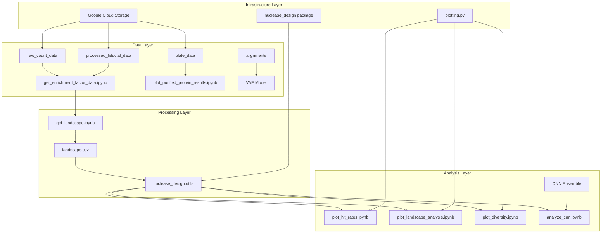
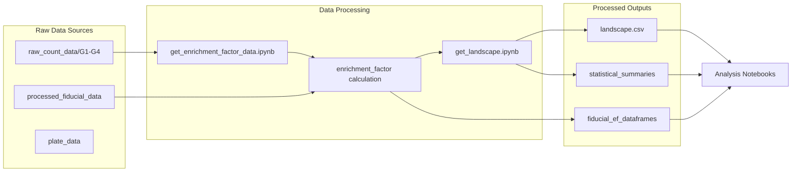
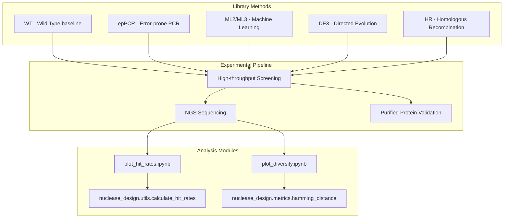
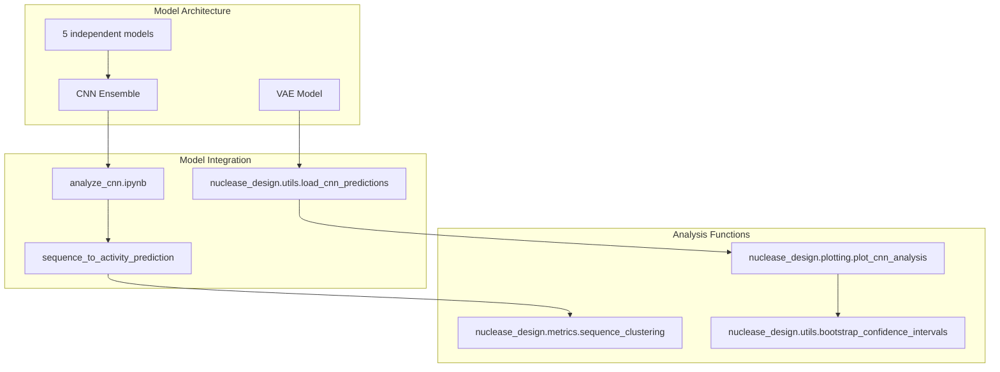

<!-- source: DeepWiki mcp.deepwiki.com · repo google-deepmind/nuclease_design · page 1 Overview · fetched 2026-10-26 -->

# Overview

Relevant source files

The following files were used as context for generating this wiki page:

- [README.md](README.md)
- [images/landscape.svg](images/landscape.svg)
- [images/overview.png](images/overview.png)
- [images/overview_wide.png](images/overview_wide.png)

## Purpose and Scope

This system implements **ML-Guided Directed Evolution for Engineering Nuclease Enzymes**, providing a comprehensive platform that combines high-throughput experimental screening with machine learning to engineer improved nuclease variants. The system processes NGS data from 55,760 NucB variants across 4 experimental generations, applies statistical analysis with multiple testing correction, and uses CNN ensembles for activity prediction.

The system encompasses the complete workflow from raw NGS count data to final analysis and visualization, supporting both pre-computed results and full data regeneration from source. For information about specific analysis notebooks, see [Analysis & Visualization](#4). For details about the machine learning models, see [Machine Learning Models](#5).

## System Architecture

The system follows a layered architecture with distinct data processing, analysis, and infrastructure components:

**Data Processing Pipeline**
Sources: [README.md:20-30](), [nuclease_design/constants.py](), [notebooks/get_enrichment_factor_data.ipynb]()

## Core Data Flow

The system processes experimental data through a well-defined pipeline that transforms raw NGS counts into statistical landscapes:

**Key Processing Steps:**
1. **Enrichment Factor Calculation**: Computes log2 ratios between post-sort and pre-sort populations with p-value estimation
2. **Statistical Correction**: Applies FDR correction using Benjamini-Hochberg method
3. **Multi-Generation Aggregation**: Combines data across G1-G4 generations into unified landscape
4. **Activity Classification**: Assigns multi-class labels (< WT, WT, > WT, >= A73R) based on statistical thresholds

Sources: [nuclease_design/preprocessing.py](), [nuclease_design/utils.py](), [notebooks/get_landscape.ipynb]()

## Library Design Methods Analysis

The system evaluates multiple nuclease library design approaches through comparative hit rate analysis:

**Hit Rate Calculation**: Uses bootstrap sampling with confidence intervals to compare method effectiveness across activity thresholds.

Sources: [nuclease_design/utils.py:200-250](), [notebooks/plot_hit_rates.ipynb](), [nuclease_design/constants.py]()

## Machine Learning Components

The system integrates pre-trained models for sequence analysis and activity prediction:

**CNN Ensemble**: Provides activity predictions with output classes (< WT, WT, > WT, >= A73R) for sequence variants.
**VAE Model**: Generates new sequences based on alignment training data for library design.

Sources: [notebooks/analyze_cnn.ipynb](), [nuclease_design/utils.py:300-350](), [README.md:37-40]()

## Core Python Package Structure

The `nuclease_design` package provides the foundational utilities and analysis functions:

| Module | Primary Functions | Purpose |
|--------|------------------|---------|
| `utils.py` | `calculate_hit_rates`, `bootstrap_sample`, `load_enrichment_data` | Statistical analysis and data loading |
| `plotting.py` | `plot_hit_rates`, `plot_landscape_heatmap`, `plot_diversity_analysis` | Visualization and figure generation |
| `preprocessing.py` | `calculate_enrichment_factors`, `apply_fdr_correction` | NGS data processing |
| `constants.py` | `FILE_PATHS`, `REFERENCE_SEQUENCES`, `ANALYSIS_PARAMETERS` | System configuration |
| `metrics.py` | `hamming_distance`, `sequence_clustering` | Distance and similarity calculations |
| `amino_acids.py` | `AA_PROPERTIES`, `ISOELECTRIC_POINTS` | Biochemical properties |

Sources: [nuclease_design/](), [nuclease_design/utils.py](), [nuclease_design/plotting.py](), [nuclease_design/constants.py]()

## Analysis Notebook Ecosystem

The system provides specialized Jupyter notebooks for different analysis tasks:

**Primary Analysis Notebooks:**
- `plot_landscape_analysis.ipynb`: Dataset exploration and landscape visualization
- `plot_hit_rates.ipynb`: Library method evaluation and comparison  
- `plot_diversity.ipynb`: Hit diversity and clustering analysis
- `analyze_cnn.ipynb`: CNN model interaction and validation

**Specialized Analysis:**
- `plot_purified_protein_results.ipynb`: Low-throughput experimental validation
- `plot_extrapolation.ipynb`: Trend prediction and forecasting
- `plot_zero_shot_results.ipynb`: Zero-shot performance evaluation

**Data Generation:**
- `get_enrichment_factor_data.ipynb`: Raw NGS data processing
- `get_landscape.ipynb`: Multi-generation landscape aggregation

All primary analysis notebooks support Google Colab integration for accessible execution without local setup.

Sources: [notebooks/](), [README.md:32-40](), [notebooks/plot_landscape_analysis.ipynb]()

## Infrastructure and Deployment

The system leverages cloud infrastructure for scalable data access and analysis:

**Google Cloud Storage**: All processed data stored in `nuclease_design` bucket with organized subdirectories for different data types and processing stages.

**Key GCS Paths:**
- `raw_count_data/`: NGS pre/post-sort populations
- `processed_data/`: Enrichment factors and statistical summaries  
- `processed_data/landscape.csv`: Primary dataset with 56K sequences
- `library_designs/`: Method-to-sequence mappings
- `analysis/`: Pre-computed clustering and diversity results

**Reproducibility**: System supports both pre-computed result loading and full regeneration from raw data by setting `LOCAL_OUTPUT_DATA_DIR` parameter.

Sources: [README.md:41-75](), [nuclease_design/constants.py](), [notebooks/get_enrichment_factor_data.ipynb:25-30]()

---

