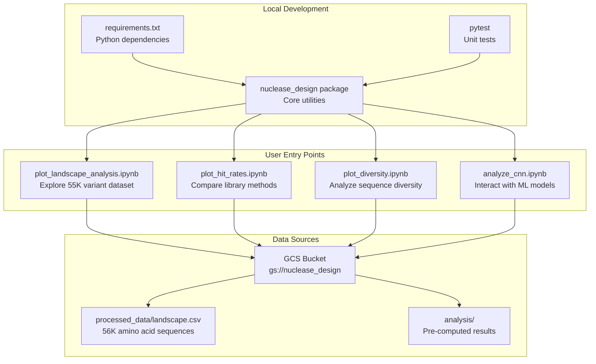
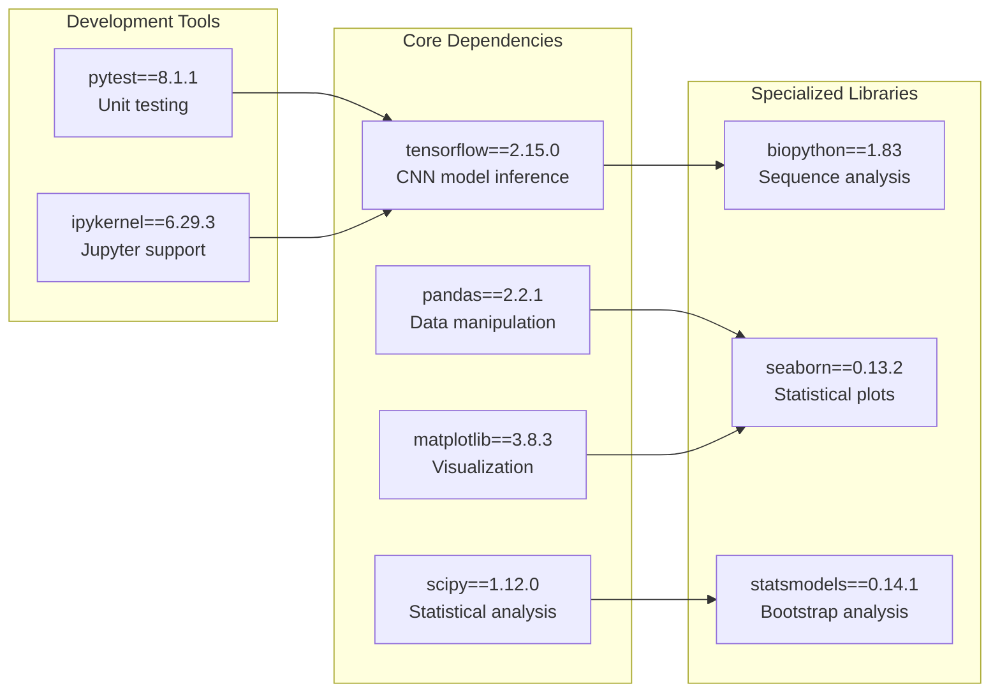
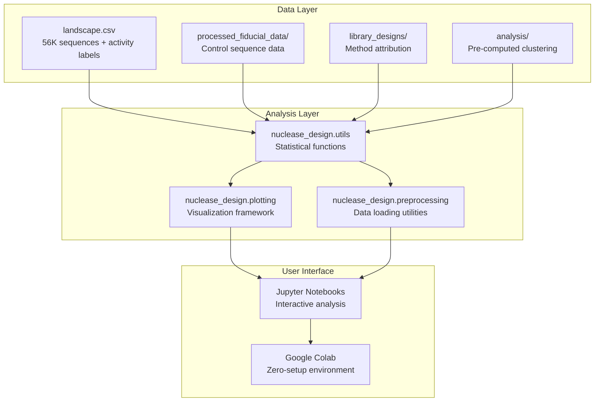

<!-- source: DeepWiki mcp.deepwiki.com · repo google-deepmind/nuclease_design · page 2 Getting Started · fetched 2026-10-26 -->

# Getting Started

Relevant source files

The following files were used as context for generating this wiki page:

- [README.md](README.md)
- [requirements.txt](requirements.txt)

This page provides the essential information needed to begin using the ML-Guided Nuclease Engineering system. It covers system prerequisites, setup options, and the main entry points for analysis. 

For detailed installation instructions and dependency management, see [Installation & Dependencies](#2.1). For step-by-step tutorials using the analysis notebooks, see [Quick Start Guide](#2.2). For information about the data processing pipeline, see [Data Processing Pipeline](#3).

## System Overview

The nuclease design system provides two primary usage modes: **interactive analysis** through Google Colab notebooks and **local development** for advanced users. The system is built around pre-computed datasets stored in Google Cloud Storage, eliminating the need for complex local data processing for most use cases.

### Main Entry Points and Data Flow

Sources: [README.md:10-40](), [README.md:76-89]()

## Prerequisites and Setup Options

### Option 1: Google Colab (Recommended for Most Users)

No local installation required. The system automatically installs dependencies and loads data from Google Cloud Storage.

**Requirements:**
- Web browser
- Google account (for Colab access)

**Capabilities:**
- Full access to pre-computed analysis
- Interactive visualization and exploration
- CNN model interaction
- Statistical analysis tools

### Option 2: Local Development Environment

Required for contributing to the codebase, running unit tests, or regenerating data from raw NGS sources.

**Requirements:**
- Python >= 3.10
- Local installation of the `nuclease_design` package
- Dependencies from `requirements.txt`

Sources: [requirements.txt:1-13](), [README.md:81-89]()

## Main Analysis Workflows

The system provides four primary analysis workflows, each accessible through dedicated notebooks:

| Workflow | Notebook | Purpose | Colab Link |
|----------|----------|---------|------------|
| Dataset Exploration | `plot_landscape_analysis.ipynb` | Analyze 55,760 NucB variant activity data | Available |
| Library Comparison | `plot_hit_rates.ipynb` | Compare performance of different design methods | Available |
| Sequence Diversity | `plot_diversity.ipynb` | Analyze diversity of active variants | Available |
| Model Interaction | `analyze_cnn.ipynb` | Explore CNN ensemble predictions | Available |

### Workflow Architecture

Sources: [README.md:32-39](), [README.md:42-74]()

## Data Access Patterns

The system uses a consistent data access pattern across all notebooks:

1. **Automatic Dependency Installation**: Notebooks install the `nuclease_design` package directly from GitHub
2. **GCS Data Loading**: Helper functions load pre-computed data from `gs://nuclease_design`
3. **Local Caching**: Data is cached locally during notebook execution
4. **Analysis Execution**: Notebooks run analysis using the loaded data

### Available Data Categories

| Data Type | GCS Location | Description |
|-----------|--------------|-------------|
| Raw NGS Counts | `raw_count_data/` | Pre/post-sort population counts |
| Processed Results | `processed_data/` | Enrichment factors and p-values |
| Master Dataset | `processed_data/landscape.csv` | 56K sequences with activity labels |
| Validation Data | `plate_data/` | Purified protein experimental results |
| Design Attribution | `library_designs/` | Method-to-sequence mappings |
| Analysis Results | `analysis/` | Pre-computed clustering and diversity metrics |

Sources: [README.md:44-74]()

## Basic Usage Patterns

### For Data Analysis Users
1. Open any of the Colab-enabled notebooks
2. Run all cells to automatically install dependencies and load data
3. Modify analysis parameters or add custom analysis code
4. Export results or visualizations as needed

### For Developers
1. Clone the repository locally
2. Set up Python virtual environment (>=3.10)
3. Install package in development mode: `pip install -e .`
4. Run unit tests: `python -m pytest nuclease_design/*test.py`
5. Use notebooks with local data regeneration capabilities

### For Model Development
1. Access the CNN ensemble through `analyze_cnn.ipynb`
2. Load the master dataset for training new models
3. Use the `nuclease_design.utils` module for statistical analysis
4. Leverage pre-computed clustering data for diversity analysis

Sources: [README.md:25-29](), [README.md:78-89]()

---

