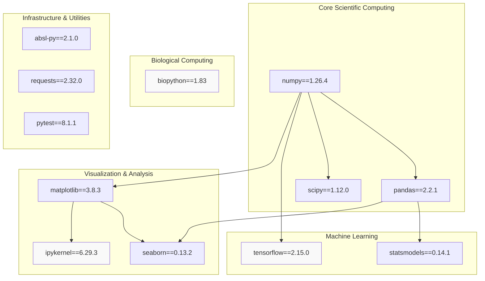
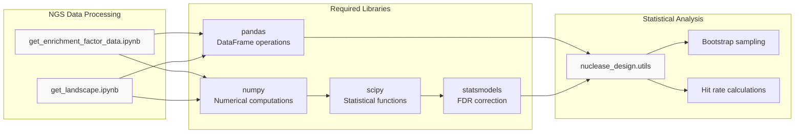
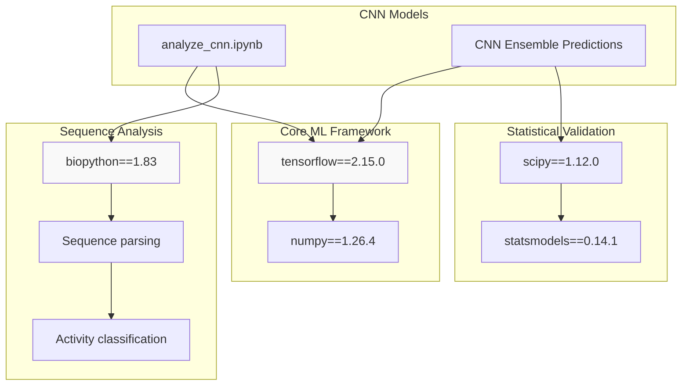
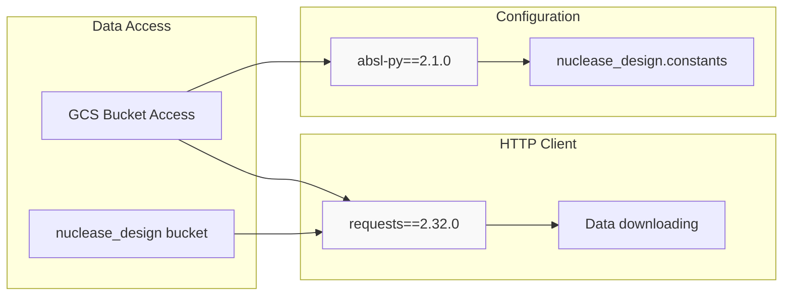

<!-- source: DeepWiki mcp.deepwiki.com · repo google-deepmind/nuclease_design · page 2.1 Installation & Dependencies · fetched 2026-10-26 -->

# Installation & Dependencies

<details>
<summary>Relevant source files</summary>

The following files were used as context for generating this wiki page:

- [requirements.txt](requirements.txt)

</details>


This document provides comprehensive installation instructions and dependency requirements for the ML-Guided Nuclease Engineering system. It covers the Python package dependencies, their specific roles in the data processing pipeline, and verification steps to ensure proper installation.

For information about basic usage patterns after installation, see [Quick Start Guide](#2.2). For details about the core libraries and utilities provided by the system, see [Core Libraries](#6).

## System Requirements

The nuclease design system requires Python 3.8+ and depends on scientific computing libraries for data processing, machine learning frameworks for CNN models, and visualization tools for analysis notebooks.

### Dependency Architecture Overview



**Dependencies mapped to system components**

Sources: [requirements.txt:1-12]()

### Core Dependencies by Function

| Dependency | Version | Primary Use Cases |
|------------|---------|-------------------|
| `numpy` | 1.26.4 | Array operations in enrichment factor calculations, statistical analysis |
| `pandas` | 2.2.1 | DataFrame operations for NGS data, landscape generation |
| `tensorflow` | 2.15.0 | CNN ensemble models for activity prediction |
| `matplotlib` | 3.8.3 | Base plotting functionality in `plotting.py` |
| `seaborn` | 0.13.2 | Statistical visualizations and heatmaps |
| `scipy` | 1.12.0 | Statistical functions, bootstrap sampling |
| `statsmodels` | 0.14.1 | Advanced statistical modeling and FDR corrections |
| `biopython` | 1.83 | Sequence analysis and biological data parsing |

Sources: [requirements.txt:1-12]()

## Installation Instructions

### Standard Installation

Install all dependencies using pip:

```bash
pip install -r requirements.txt
```

### Development Installation

For contributing to the system or running tests:

```bash
pip install -r requirements.txt
git clone https://github.com/google-deepmind/nuclease_design
cd nuclease_design
```

Sources: [requirements.txt:1-12]()

## Dependency Roles in System Components

### Data Processing Pipeline Dependencies



**Data processing pipeline dependency mapping**

Sources: [requirements.txt:2-11]()

### Machine Learning Model Dependencies



**Machine learning component dependency requirements**

Sources: [requirements.txt:1-12]()

### Visualization and Analysis Dependencies

| Component | Required Dependencies | Function |
|-----------|----------------------|----------|
| `plotting.py` | `matplotlib`, `seaborn`, `numpy` | Hit rate plots, heatmaps, diversity analysis |
| Analysis notebooks | `ipykernel`, `matplotlib`, `seaborn` | Jupyter notebook execution and visualization |
| Statistical plots | `scipy`, `statsmodels`, `pandas` | Confidence intervals, bootstrap analysis |

Sources: [requirements.txt:3-11]()

## Infrastructure Dependencies

### Google Cloud Storage Access



**Infrastructure and data access dependencies**

The `requests` library enables downloading pre-computed data from Google Cloud Storage, while `absl-py` provides configuration utilities used throughout the system.

Sources: [requirements.txt:1-8]()

## Development and Testing Dependencies

### Testing Framework

The system includes comprehensive testing capabilities:

- `pytest==8.1.1` - Primary testing framework
- Integration with CI/CD pipelines
- Unit tests for core utilities

For detailed testing information, see [Testing Framework](#7.1).

Sources: [requirements.txt:7]()

## Installation Verification

### Basic System Check

Verify core dependencies are properly installed:

```python
import numpy as np
import pandas as pd
import tensorflow as tf
import matplotlib.pyplot as plt
print(f"NumPy: {np.__version__}")
print(f"Pandas: {pd.__version__}")
print(f"TensorFlow: {tf.__version__}")
```

### Nuclease Design Package Check

Verify the nuclease design utilities are accessible:

```python
try:
    from nuclease_design import utils, plotting, constants
    print("Nuclease design package loaded successfully")
except ImportError as e:
    print(f"Import error: {e}")
```

Sources: [requirements.txt:1-12]()

## Common Installation Issues

### TensorFlow Compatibility

Ensure TensorFlow 2.15.0 is compatible with your system:
- GPU support requires CUDA 11.8+
- macOS users may need additional configuration for M1/M2 chips

### Jupyter Notebook Integration

The `ipykernel` dependency ensures proper Jupyter notebook execution. For Google Colab compatibility, no additional installation is required as dependencies are handled automatically.

Sources: [requirements.txt:3-12]()

---

