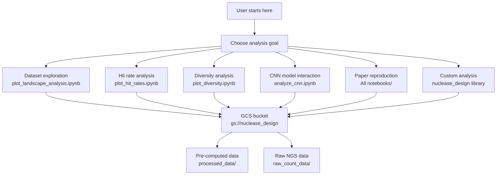
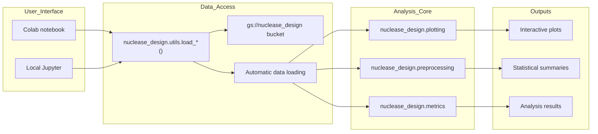
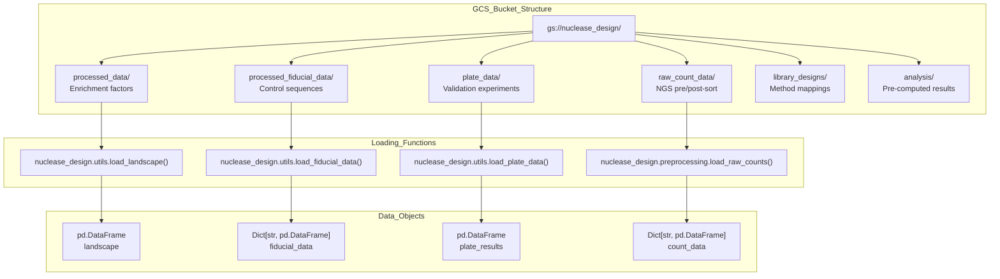

<!-- source: DeepWiki mcp.deepwiki.com · repo google-deepmind/nuclease_design · page 2.2 Quick Start Guide · fetched 2026-10-26 -->

# Quick Start Guide

<details>
<summary>Relevant source files</summary>

The following files were used as context for generating this wiki page:

- [README.md](README.md)
- [notebooks/plot_landscape_analysis.ipynb](notebooks/plot_landscape_analysis.ipynb)

</details>


This guide provides a step-by-step introduction to using the ML-Guided Nuclease Engineering system for analyzing enzyme activity datasets and reproducing research results. It covers the essential workflows and entry points for both exploratory analysis and paper reproduction.

For detailed information about data processing pipelines, see [Data Processing Pipeline](#3). For comprehensive analysis capabilities, see [Analysis & Visualization](#4). For machine learning model details, see [Machine Learning Models](#5).

## Purpose and Usage Patterns

The system supports three primary usage patterns:

1. **Dataset Analysis**: Explore the 55,760 NucB variant activity dataset for ML model development
2. **Paper Reproduction**: Recreate all figures and analyses from the research paper  
3. **Method Extension**: Use the codebase as a foundation for custom genotype-phenotype analysis

## Quick Start Workflow



**Basic Workflow Diagram**

Sources: [README.md:10-40]()

## Primary Entry Points

### Dataset Exploration

The primary entry point for dataset analysis is `plot_landscape_analysis.ipynb`, which provides comprehensive exploration of the nuclease activity landscape.

| Notebook | Purpose | Colab Ready | Key Features |
|----------|---------|-------------|--------------|
| `plot_landscape_analysis.ipynb` | Dataset exploration | ✅ | Activity distribution, variant analysis, landscape visualization |
| `plot_hit_rates.ipynb` | Library method evaluation | ✅ | Hit rate comparison, bootstrap statistics |
| `plot_diversity.ipynb` | Sequence diversity analysis | ✅ | Clustering, diversity metrics, overlap analysis |
| `analyze_cnn.ipynb` | CNN model interaction | ✅ | Model predictions, feature analysis |

### Notebook Execution Pattern



**Notebook Execution Architecture**

Sources: [README.md:25-40]()

## Basic Usage Examples

### Dataset Analysis

To analyze the nuclease activity dataset:

1. **Open the landscape analysis notebook**: Access `plot_landscape_analysis.ipynb` via Colab or locally
2. **Execute cells sequentially**: The notebook automatically loads data from GCS bucket `gs://nuclease_design`
3. **Explore key datasets**: 
   - `processed_data/landscape.csv` - 56K amino acid sequences with activity labels
   - `processed_fiducial_data/` - Control sequence enrichment factors
   - `library_designs/` - Sequence design method mappings

### Library Method Comparison

To compare different library design methods:

1. **Run hit rate analysis**: Execute `plot_hit_rates.ipynb` 
2. **Key analysis functions**:
   - `nuclease_design.utils.compute_hit_rates()` - Calculate hit rates with confidence intervals
   - `nuclease_design.plotting.plot_hit_rates()` - Visualize method performance
3. **Examine methods**: `WT`, `epPCR`, `ML2`, `ML3`, `DE3`, `HR`

### CNN Model Analysis

To interact with the pre-trained CNN ensemble:

1. **Load CNN models**: Use `analyze_cnn.ipynb` to access the 5-model ensemble
2. **Prediction workflow**:
   - Input: Amino acid sequences  
   - Output: Activity classes (`<WT`, `WT`, `>WT`, `>=A73R`)
3. **Analysis capabilities**: Model predictions, feature importance, sequence scoring

## Data Access Patterns

### Automatic Data Loading

The system uses helper functions for seamless data access:



**Data Access Architecture**

Sources: [README.md:41-75]()

### Pre-computed vs Raw Data

| Data Type | Location | Usage | Regeneration Required |
|-----------|----------|-------|----------------------|
| Pre-computed | `processed_data/` | Default notebook execution | No |
| Raw NGS counts | `raw_count_data/` | Custom analysis, verification | Yes - run `get_enrichment_factor_data.ipynb` |
| Validation data | `plate_data/` | Low-throughput confirmation | No |
| Analysis results | `analysis/` | Paper figure reproduction | No |

## Development Setup

For local development and testing:

### Installation

The notebooks install the package automatically from GitHub. For local development:

```bash
# Requirements: Python >= 3.10
venv=/tmp/nuclease_design_venv
python3 -m venv $venv
source $venv/bin/activate
pip install -e .
```

### Testing

Execute unit tests to verify installation:

```bash
python -m pytest nuclease_design/*test.py
```

### Local Data Generation

To regenerate analysis from raw data, set `LOCAL_OUTPUT_DATA_DIR` in `get_enrichment_factor_data.ipynb` and execute the notebook locally.

Sources: [README.md:76-89]()

## Next Steps

- **For dataset analysis**: Start with `plot_landscape_analysis.ipynb` in Colab
- **For method comparison**: Run `plot_hit_rates.ipynb` and `plot_diversity.ipynb` 
- **For ML model exploration**: Use `analyze_cnn.ipynb`
- **For paper reproduction**: Execute all notebooks in `notebooks/` directory
- **For custom analysis**: Import `nuclease_design` library functions

For comprehensive analysis capabilities, see [Analysis & Visualization](#4). For understanding the data processing pipeline, see [Data Processing Pipeline](#3).

---

