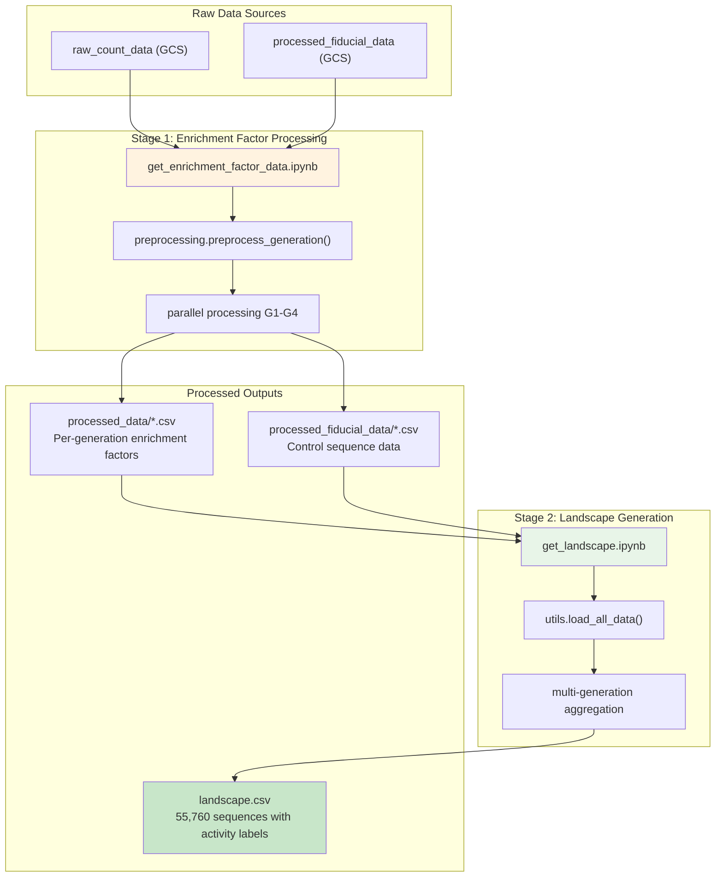
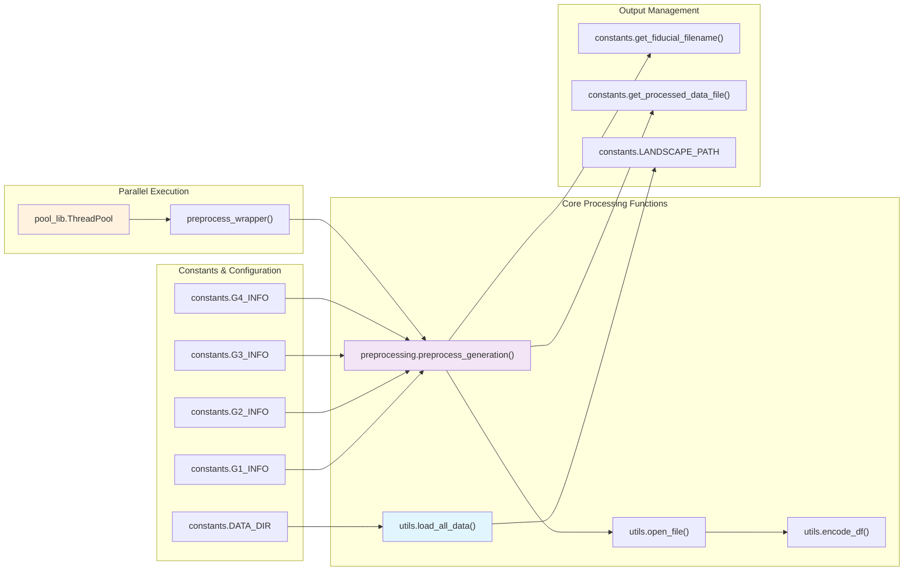
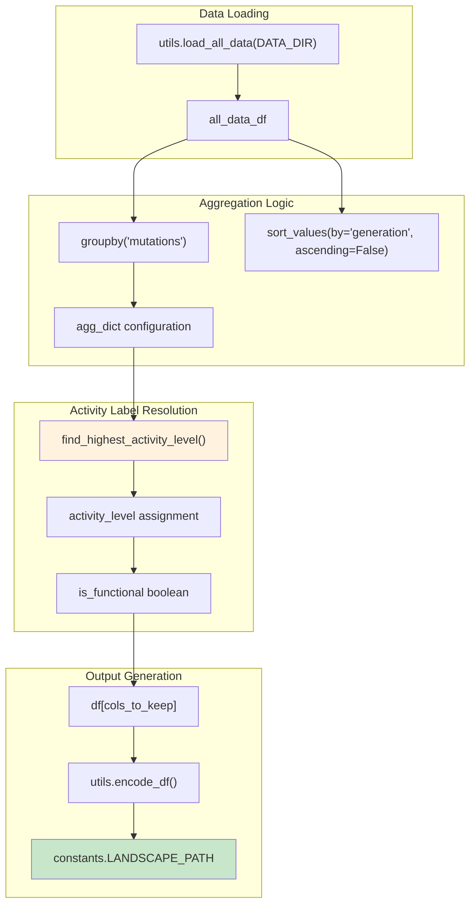

<!-- source: DeepWiki mcp.deepwiki.com · repo google-deepmind/nuclease_design · page 3 Data Processing Pipeline · fetched 2026-10-26 -->

# Data Processing Pipeline

<details>
<summary>Relevant source files</summary>

The following files were used as context for generating this wiki page:

- [README.md](README.md)
- [notebooks/get_enrichment_factor_data.ipynb](notebooks/get_enrichment_factor_data.ipynb)
- [notebooks/get_landscape.ipynb](notebooks/get_landscape.ipynb)

</details>


This document describes the core data processing pipeline that transforms raw NGS (Next Generation Sequencing) count data from four experimental generations into processed enrichment factor datasets and the final consolidated landscape dataset. The pipeline handles statistical analysis, p-value calculations, and multi-generation data aggregation.

For information about the analysis workflows that consume this processed data, see [Analysis & Visualization](#4). For details on the machine learning models that use the landscape data, see [Machine Learning Models](#5).

## Pipeline Overview

The data processing pipeline consists of two main stages executed by dedicated Jupyter notebooks that can run independently or regenerate data from raw sources:



**Sources:** [README.md:25-29](), [notebooks/get_enrichment_factor_data.ipynb:1-250](), [notebooks/get_landscape.ipynb:1-250]()

## Data Flow Architecture

The pipeline processes data through well-defined interfaces using the `nuclease_design` library components:



**Sources:** [notebooks/get_enrichment_factor_data.ipynb:111-117](), [notebooks/get_enrichment_factor_data.ipynb:196-221](), [notebooks/get_landscape.ipynb:80-83]()

## Stage 1: Enrichment Factor Processing

The first stage processes raw NGS count data through the `get_enrichment_factor_data.ipynb` notebook, which implements parallel processing across all four experimental generations.

### Core Processing Function

The `preprocess_wrapper()` function [notebooks/get_enrichment_factor_data.ipynb:196-221]() coordinates the processing for each generation:

| Function | Input | Output | Purpose |
|----------|--------|---------|---------|
| `preprocessing.preprocess_generation()` | Raw count data, generation config | `pvalue_df`, `fiducials_to_efdf` | Calculate enrichment factors and p-values |
| `constants.get_fiducial_filename()` | Fiducial name, generation | File path string | Generate output file paths |
| `utils.encode_df()` | DataFrame | Encoded DataFrame | Prepare data for CSV serialization |

### Parallel Execution Strategy

The pipeline uses `pool_lib.ThreadPool` to process all generations concurrently:

```python
all_generations = ['g4', 'g3', 'g2', 'g1']
with pool_lib.ThreadPool(len(all_generations)) as pool:
    dfs = pool.map(preprocess_wrapper, all_generations)
```

**Sources:** [notebooks/get_enrichment_factor_data.ipynb:242-248]()

### Generation Configuration

Each generation is configured through constants that specify fiducials, thresholds, and data paths:

| Generation | Configuration Constant | Key Parameters |
|------------|----------------------|----------------|
| G1 | `constants.G1_INFO` | Early generation fiducials |
| G2 | `constants.G2_INFO` | Expanded fiducial set |
| G3 | `constants.G3_INFO` | Advanced controls |
| G4 | `constants.G4_INFO` | Final generation setup |

**Sources:** [notebooks/get_enrichment_factor_data.ipynb:111-117]()

## Stage 2: Landscape Generation

The second stage aggregates processed data across generations using `get_landscape.ipynb` to create the final consolidated dataset.

### Data Loading and Aggregation



**Sources:** [notebooks/get_landscape.ipynb:122-124](), [notebooks/get_landscape.ipynb:142-157](), [notebooks/get_landscape.ipynb:168-190]()

### Activity Level Classification

The `find_highest_activity_level()` function [notebooks/get_landscape.ipynb:168-179]() implements hierarchical activity classification:

| Activity Level | Criteria | Description |
|----------------|----------|-------------|
| `non-functional` | Fails basic tests | Default for inactive variants |
| `activity_greater_than_0` | Passes negative control | Above background activity |
| `activity_greater_than_WT` | Exceeds wild-type | Improved over natural enzyme |
| `activity_greater_than_A73R` | Exceeds A73R control | Highest activity class |

### Aggregation Strategy

The pipeline resolves multi-generation data using the `agg_dict` configuration [notebooks/get_landscape.ipynb:147-155]():

```python
agg_dict = {
    'sublibrary_names': lambda x: tuple(itertools.chain.from_iterable(x)),
    'generations': lambda x: tuple(sorted(x)),
    'activity_greater_than_neg_control': 'first',
    'activity_greater_than_wt': 'first', 
    'activity_greater_than_a73r': 'first',
    'num_mutations': 'first',
    'sequence': 'first',
}
```

**Sources:** [notebooks/get_landscape.ipynb:143-156]()

## Output Data Structure

The pipeline generates three primary output categories stored in the GCS bucket structure:

### Processed Data Files

| Path Pattern | Content | Generation Scope |
|--------------|---------|------------------|
| `processed_data/g{n}.csv` | P-values and enrichment factors | Per generation |
| `processed_fiducial_data/g{n}_{fiducial}.csv` | Control sequence analysis | Per generation, per fiducial |
| `processed_data/landscape.csv` | Consolidated activity labels | All generations |

### Final Landscape Schema

The `landscape.csv` output contains 55,760 unique amino acid sequences with the following columns:

| Column | Type | Description |
|--------|------|-------------|
| `mutations` | Tuple | Amino acid changes from wild-type |
| `num_mutations` | Integer | Count of mutations |
| `sublibrary_names` | Tuple | Design methods that proposed sequence |
| `generations` | Tuple | Experimental generations where observed |
| `activity_level` | String | Hierarchical activity classification |
| `is_functional` | Boolean | Basic functionality flag |
| `sequence` | String | Full amino acid sequence |

**Sources:** [notebooks/get_landscape.ipynb:200-209](), [README.md:58-61]()

### Data Access Patterns

The processed data supports two primary access patterns:

1. **Pre-computed Access**: Load processed results directly from GCS using `utils.load_all_data()`
2. **Regenerated Access**: Execute notebooks with `LOCAL_OUTPUT_DATA_DIR` to recreate from raw data

**Sources:** [README.md:25-29](), [notebooks/get_enrichment_factor_data.ipynb:137-142]()

---

