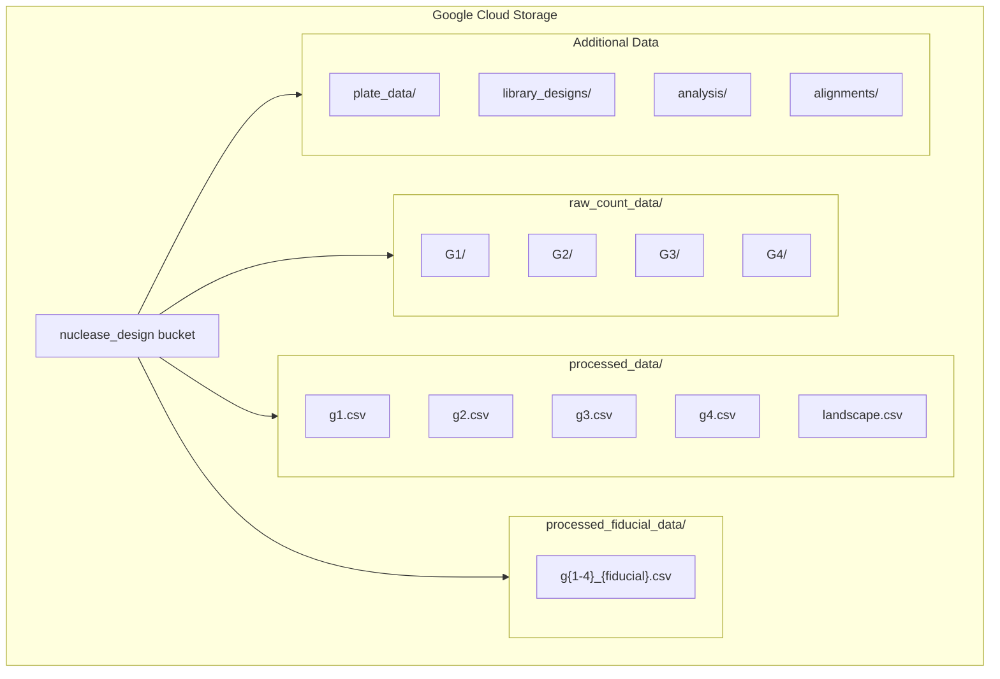
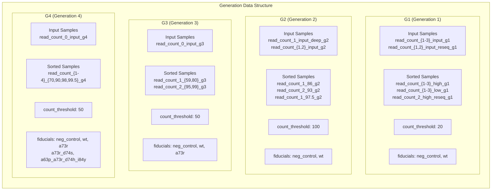
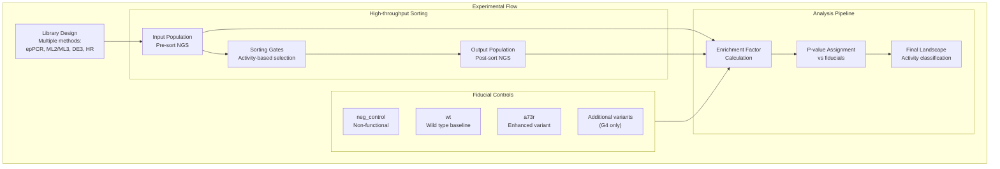
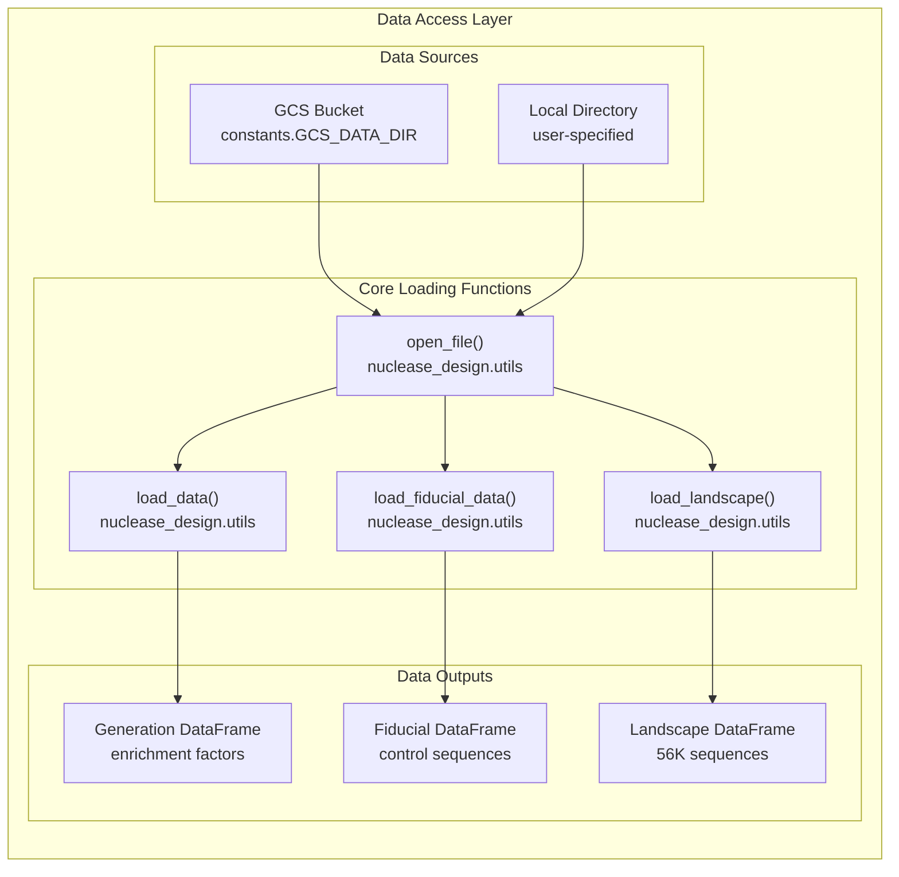

<!-- source: DeepWiki mcp.deepwiki.com · repo google-deepmind/nuclease_design · page 3.1 Raw Data Sources & Structure · fetched 2026-10-26 -->

# Raw Data Sources & Structure

<details>
<summary>Relevant source files</summary>

The following files were used as context for generating this wiki page:

- [README.md](README.md)
- [nuclease_design/cnn_model.py](nuclease_design/cnn_model.py)
- [nuclease_design/constants.py](nuclease_design/constants.py)
- [nuclease_design/utils.py](nuclease_design/utils.py)

</details>


This page documents the organization and structure of raw experimental data sources in the nuclease design system. It covers the Google Cloud Storage bucket organization, generation-specific data layouts, file formats, and experimental design structure across the four generations of directed evolution experiments.

For information about how this raw data is processed into enrichment factors, see [Enrichment Factor Calculation](#3.2). For details on the final aggregated landscape dataset, see [Landscape Generation & Aggregation](#3.3).

## Data Storage Architecture

The nuclease design system stores all experimental data in a Google Cloud Storage bucket with a well-defined hierarchical structure. The primary data repository is accessible at `https://storage.googleapis.com/nuclease_design`.



**Data Storage Hierarchy**
Sources: [README.md:44-75](), [nuclease_design/constants.py:22-23]()

## Generation-Specific Data Organization

The experimental data is organized across four generations (G1-G4) of directed evolution, each with distinct experimental parameters and file structures.



**Generation Configuration Details**
Sources: [nuclease_design/constants.py:160-229](), [nuclease_design/constants.py:231-252]()

## File Naming Conventions and Paths

Each generation follows a systematic file naming convention that encodes the experimental conditions and sorting parameters.

| Generation | Sample Files | Pattern | Example |
|------------|--------------|---------|---------|
| G1 | Input samples | `Sort_{1-3}_input_ob133_3_{1-3}.csv` | `Sort_1_input_ob133_3_1.csv` |
| G1 | Sorted samples | `Sort_{1-3}_{high,low}_gate_{output_,ob}{id}.csv` | `Sort_1_high_gate_output_ob142.csv` |
| G2 | Input samples | `ob188_{processed,ns{1,2}_processed}.csv` | `ob188_processed.csv` |
| G2 | Sorted samples | `ob{193,194,196}_processed.csv` | `ob193_processed.csv` |
| G3 | Input samples | `ob222_processed_updated.csv` | `ob222_processed_updated.csv` |
| G3 | Sorted samples | `ob{230,231,239,241}_processed.csv` | `ob230_processed.csv` |
| G4 | All samples | `OB{268-272}_reprocessed.csv` | `OB268_reprocessed.csv` |

**File Path Constants**
Sources: [nuclease_design/constants.py:26-150]()

## Experimental Design Structure

The experimental design follows a systematic approach with specific gating strategies for each generation and fiducial sequence.



**Fiducial Sequence Configuration**
Sources: [nuclease_design/constants.py:254-264](), [nuclease_design/constants.py:170-191]()

## Data Access and Loading Patterns

The system provides multiple access patterns for different use cases, supporting both cloud-based and local data access.



**Data Loading Implementation**
Sources: [nuclease_design/utils.py:43-56](), [nuclease_design/utils.py:132-177]()

## Count Thresholds and Quality Control

Each generation employs specific count thresholds to ensure data quality, with thresholds varying based on experimental conditions and sequencing depth.

| Generation | Count Threshold | Rationale |
|------------|----------------|-----------|
| G1 | 20 | Initial screening, lower stringency |
| G2 | 100 | Increased stringency for better hits |
| G3 | 50 | Balanced threshold for diverse library |
| G4 | 50 | Consistent with G3 for final selection |

These thresholds are applied during preprocessing to filter sequences with insufficient NGS read coverage, ensuring statistical reliability of enrichment factor calculations.

**Threshold Configuration**
Sources: [nuclease_design/constants.py:162-177](), [nuclease_design/constants.py:194-209]()

## Reference Sequence and Design Regions

The system is built around the full-length NucB reference sequence, with specific design regions targeted for mutagenesis in generation 4.

```python
FULL_REFERENCE_SEQ = 'MIKKWAVHLLFSALVLLGLSGGAAYSPQHAEGAARYDDVLYFPASRYPETGAHISDAIKAGHADVCTIERSGADKRRQESLKGIPTKPGFDRDEWPMAMCEEGGKGASVRYVSSSDNRGAGSWVGNRLNGYADGTRILFIVQ'
```

**Design Region Boundaries (G4)**:
- N-terminal region: positions 33-110 (1-indexed)
- C-terminal region: positions 65-142 (1-indexed)
- Variable region for CNN: position 24 to end

**Sequence Constants**
Sources: [nuclease_design/constants.py:20](), [nuclease_design/constants.py:270-285](), [nuclease_design/constants.py:359-361]()

---

