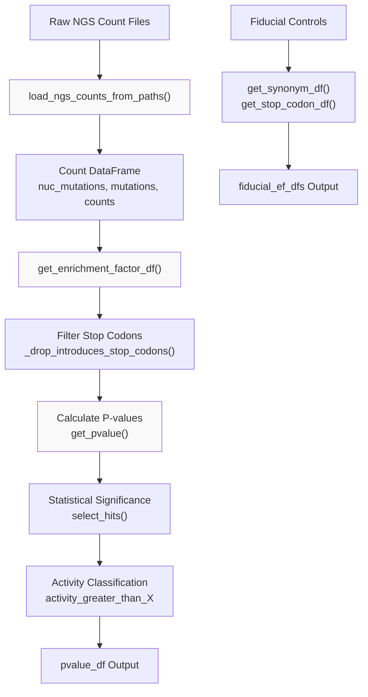
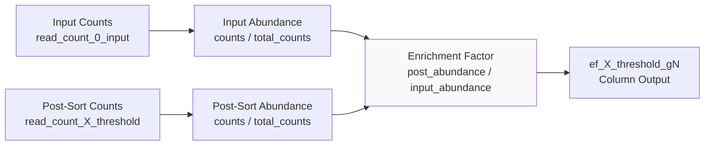
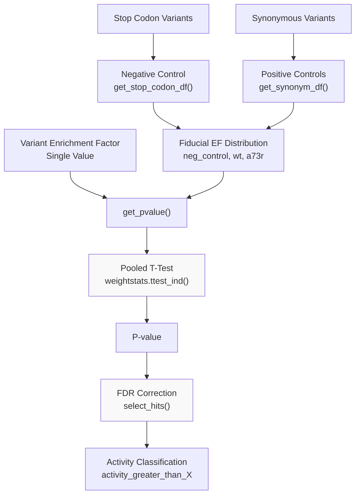
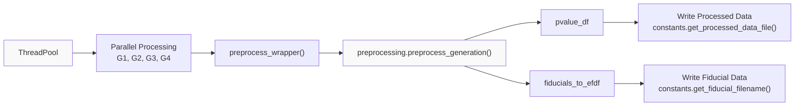

<!-- source: DeepWiki mcp.deepwiki.com · repo google-deepmind/nuclease_design · page 3.2 Enrichment Factor Calculation · fetched 2026-10-26 -->

# Enrichment Factor Calculation

Relevant source files

The following files were used as context for generating this wiki page:

- [notebooks/get_enrichment_factor_data.ipynb](notebooks/get_enrichment_factor_data.ipynb)
- [notebooks/get_landscape.ipynb](notebooks/get_landscape.ipynb)
- [nuclease_design/preprocessing.py](nuclease_design/preprocessing.py)
- [nuclease_design/preprocessing_utils.py](nuclease_design/preprocessing_utils.py)

This document covers the calculation of enrichment factors from NGS count data, which forms the core statistical framework for determining nuclease activity levels. Enrichment factors quantify how much a variant is enriched or depleted in post-sort populations compared to input populations.

For information about the landscape generation that aggregates enrichment factor data across generations, see [Landscape Generation & Aggregation](#3.3). For details about the raw data structure and experimental design, see [Raw Data Sources & Structure](#3.1).

## Overview

Enrichment factor calculation transforms raw NGS count data into quantitative measures of nuclease activity. The process involves computing abundance ratios between pre-sort and post-sort populations, followed by statistical testing against fiducial controls to determine activity classifications.

The calculation pipeline processes data for each generation (G1-G4) independently, computing enrichment factors for multiple sorting thresholds and comparing results against negative controls and positive reference variants.

## Data Processing Pipeline

**Sources:** [nuclease_design/preprocessing.py:77-151](), [nuclease_design/preprocessing_utils.py:98-136]()

## Enrichment Factor Calculation

The core enrichment factor calculation transforms raw counts into activity measurements through abundance normalization and ratio computation.

**Sources:** [nuclease_design/preprocessing_utils.py:145-150](), [nuclease_design/preprocessing_utils.py:156-220]()

### Key Functions

| Function | Purpose | Location |
|----------|---------|----------|
| `get_enrichment_factor_df()` | Computes enrichment factors from count data | [preprocessing_utils.py:156-220]() |
| `get_abundance()` | Converts counts to abundance proportions | [preprocessing_utils.py:138-142]() |
| `get_enrichment_factor()` | Calculates ratio of post-sort to input abundance | [preprocessing_utils.py:145-150]() |

## Statistical Analysis Framework

The statistical framework uses pooled t-tests to compare variant enrichment factors against fiducial control distributions, enabling quantitative activity classification.

**Sources:** [nuclease_design/preprocessing.py:30-44](), [nuclease_design/preprocessing.py:134-142]()

### Fiducial Controls

| Fiducial Type | Purpose | Implementation |
|---------------|---------|----------------|
| `neg_control` | Variants introducing stop codons | `get_stop_codon_df()` |
| `wt` | Wild-type synonymous variants | `get_synonym_df()` with WT mutations |
| `a73r` | A73R positive control variants | `get_synonym_df()` with A73R mutations |
| `double` | Double mutant controls | `get_synonym_df()` with double mutations |
| `quad` | Quadruple mutant controls | `get_synonym_df()` with quad mutations |

**Sources:** [nuclease_design/preprocessing.py:65-74](), [nuclease_design/preprocessing_utils.py:223-235](), [nuclease_design/preprocessing_utils.py:238-255]()

## Data Processing Implementation

The main processing workflow is implemented in the `get_enrichment_factor_data.ipynb` notebook, which orchestrates parallel processing across all generations.

**Sources:** [notebooks/get_enrichment_factor_data.ipynb:196-221](), [notebooks/get_enrichment_factor_data.ipynb:242-248]()

### Processing Parameters

The enrichment factor calculation uses generation-specific parameters defined in the constants module:

- **Count Threshold**: Minimum read count required in input samples (typically 10)
- **Input Columns**: Pre-sort population counts (`read_count_0_input_gN`)
- **Post-Sort Columns**: Activity-sorted population counts (`read_count_X_threshold_gN`)
- **Fiducials**: Control variants for statistical comparison

**Sources:** [nuclease_design/preprocessing.py:77-111]()

## Output Data Structure

The enrichment factor calculation produces two main outputs:

### P-value DataFrame
Contains enrichment factors, p-values, and activity classifications for all variants:

| Column Pattern | Description |
|----------------|-------------|
| `ef_X_threshold_gN` | Enrichment factor for threshold X in generation N |
| `pvalue_X_threshold_gN` | P-value from comparison to fiducial |
| `activity_greater_than_X` | Boolean activity classification |
| `mutations` | Amino acid mutation tuple |
| `num_mutations` | Number of mutations |
| `sublibrary_names` | Source library identification |

### Fiducial DataFrames
Separate DataFrames for each fiducial containing DNA-level enrichment factors for control variants, used as null distributions in statistical testing.

**Sources:** [notebooks/get_enrichment_factor_data.ipynb:606-609](), [nuclease_design/preprocessing.py:143-150]()

---

