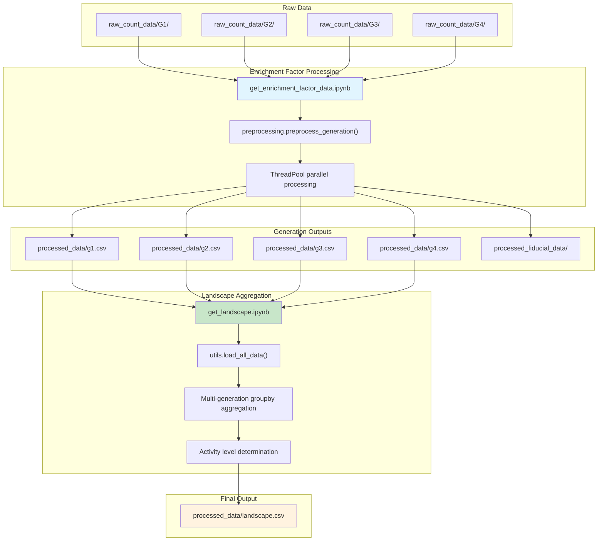
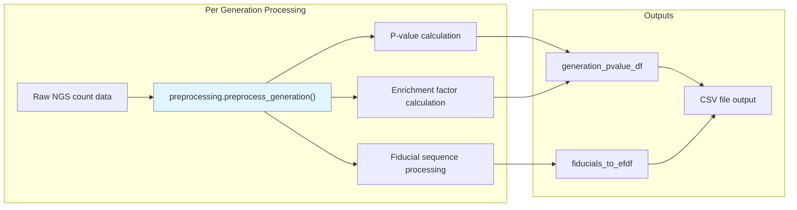
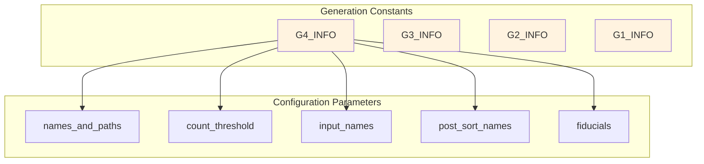
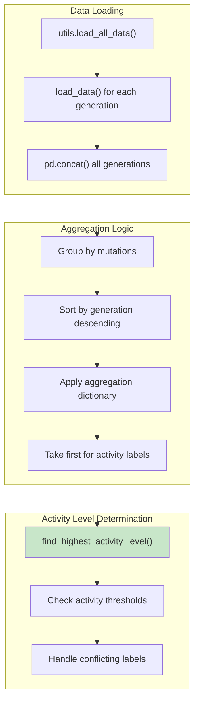
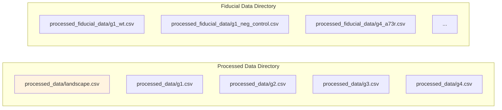
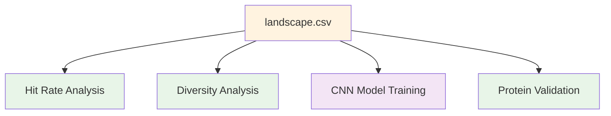

<!-- source: DeepWiki mcp.deepwiki.com · repo google-deepmind/nuclease_design · page 3.3 Landscape Generation & Aggregation · fetched 2026-10-26 -->

# Landscape Generation & Aggregation

<details>
<summary>Relevant source files</summary>

The following files were used as context for generating this wiki page:

- [notebooks/get_enrichment_factor_data.ipynb](notebooks/get_enrichment_factor_data.ipynb)
- [notebooks/get_landscape.ipynb](notebooks/get_landscape.ipynb)
- [nuclease_design/cnn_model.py](nuclease_design/cnn_model.py)
- [nuclease_design/constants.py](nuclease_design/constants.py)
- [nuclease_design/utils.py](nuclease_design/utils.py)

</details>


This document covers the core data processing pipeline that transforms raw NGS count data from multiple experimental generations into a unified landscape dataset. The landscape represents the complete set of observed nuclease variants and their activity classifications across all generations.

For information about the initial raw data sources and structure, see [Raw Data Sources & Structure](#3.1). For details on the statistical methods used in enrichment factor calculation, see [Enrichment Factor Calculation](#3.2).

## Overview

The landscape generation process consists of two main phases:

1. **Enrichment Factor Processing**: Convert raw NGS count data into enrichment factors with statistical significance testing for each generation independently
2. **Multi-Generation Aggregation**: Combine data across generations to create a unified landscape with consistent activity labels

## Processing Workflow



Sources: [notebooks/get_enrichment_factor_data.ipynb:243-248](), [notebooks/get_landscape.ipynb:122-124](), [nuclease_design/constants.py:288-297]()

## Enrichment Factor Processing

The enrichment factor processing step is implemented in `get_enrichment_factor_data.ipynb` and processes each generation independently using parallel execution.

### Key Components

| Component | Purpose | Implementation |
|-----------|---------|----------------|
| `preprocess_wrapper()` | Main processing function for each generation | [notebooks/get_enrichment_factor_data.ipynb:196-221]() |
| `preprocessing.preprocess_generation()` | Core enrichment factor calculation | [notebooks/get_enrichment_factor_data.ipynb:197-199]() |
| `ThreadPool` | Parallel processing of generations | [notebooks/get_enrichment_factor_data.ipynb:245-248]() |

### Processing Steps



Sources: [notebooks/get_enrichment_factor_data.ipynb:196-221](), [nuclease_design/constants.py:160-229]()

### Generation Configuration

Each generation has specific configuration parameters defined in `constants.py`:



Sources: [nuclease_design/constants.py:160-229](), [notebooks/get_enrichment_factor_data.ipynb:111-116]()

## Landscape Aggregation

The landscape aggregation step combines processed data from all generations into a unified dataset with consistent activity labels.

### Data Loading and Aggregation



Sources: [notebooks/get_landscape.ipynb:122-124](), [notebooks/get_landscape.ipynb:143-156](), [notebooks/get_landscape.ipynb:168-189]()

### Activity Level Classification

The system determines activity levels using a hierarchical approach:

| Priority | Activity Level | Logic |
|----------|----------------|-------|
| 1 | `activity_greater_than_A73R` | Highest activity threshold |
| 2 | `activity_greater_than_WT` | Wild-type threshold |
| 3 | `activity_greater_than_0` | Above negative control |
| 4 | `non-functional` | Default/failed thresholds |

Sources: [notebooks/get_landscape.ipynb:168-189](), [nuclease_design/constants.py:362-367]()

### Aggregation Dictionary

The aggregation strategy preserves the most recent generation's activity labels while combining metadata:

```python
agg_dict = {
    'sublibrary_names': lambda x: tuple(itertools.chain.from_iterable(x)),
    'generations': lambda x: tuple(sorted(x)),
    'activity_greater_than_neg_control': 'first',
    'activity_greater_than_wt': 'first', 
    'activity_greater_than_a73r': 'first',
    'num_mutations': 'first',
    'sequence': 'first',
}
```

Sources: [notebooks/get_landscape.ipynb:147-155]()

## Data Structures and Outputs

### Landscape Dataset Schema

The final landscape dataset contains the following columns:

| Column | Type | Description |
|--------|------|-------------|
| `mutations` | `tuple` | Amino acid mutations as tuples |
| `num_mutations` | `int` | Count of mutations |
| `sublibrary_names` | `tuple` | Library sources for variant |
| `generations` | `tuple` | Generations where variant observed |
| `activity_level` | `str` | Final activity classification |
| `is_functional` | `bool` | Whether variant is functional |
| `sequence` | `str` | Full amino acid sequence |

Sources: [notebooks/get_landscape.ipynb:200-208](), [nuclease_design/utils.py:92-120]()

### File Output Structure



Sources: [nuclease_design/constants.py:288-297](), [notebooks/get_landscape.ipynb:219-223]()

## Conflicting Labels Handling

The system handles cases where variants have conflicting activity labels across generations by prioritizing the most recent generation's assessment.

### Common Conflict Patterns

| Conflict Type | Count | Resolution |
|---------------|-------|------------|
| WT vs neg_control mismatch | 973 variants | Use most recent generation |
| A73R vs neg_control mismatch | 5 variants | Label as A73R level |
| Missing A73R assessment | ~20K variants | Only G1/G2 data available |

Sources: [notebooks/get_landscape.ipynb:575-577](), [notebooks/get_landscape.ipynb:650-652](), [notebooks/get_landscape.ipynb:612-614]()

## Integration with Analysis Pipeline

The landscape dataset serves as the primary input for downstream analysis components:



Sources: [nuclease_design/utils.py:174-176](), [nuclease_design/constants.py:321]()

---

