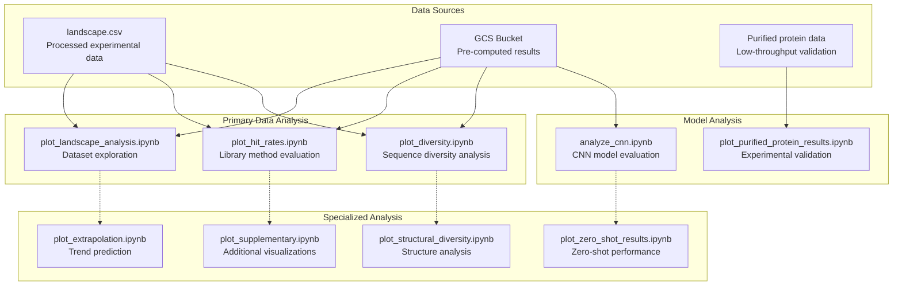
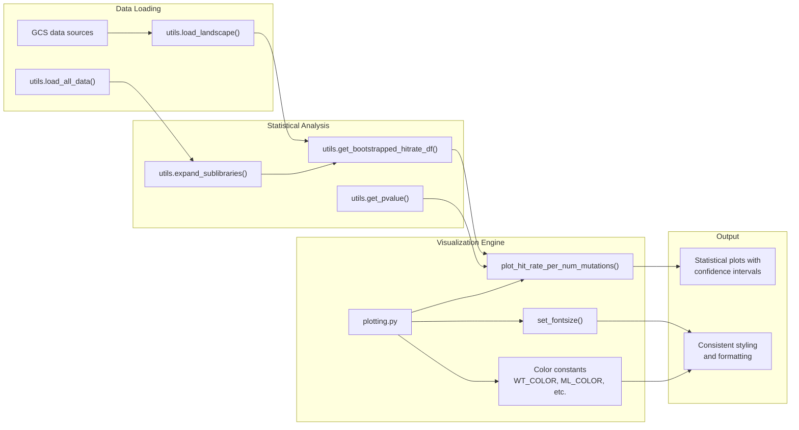
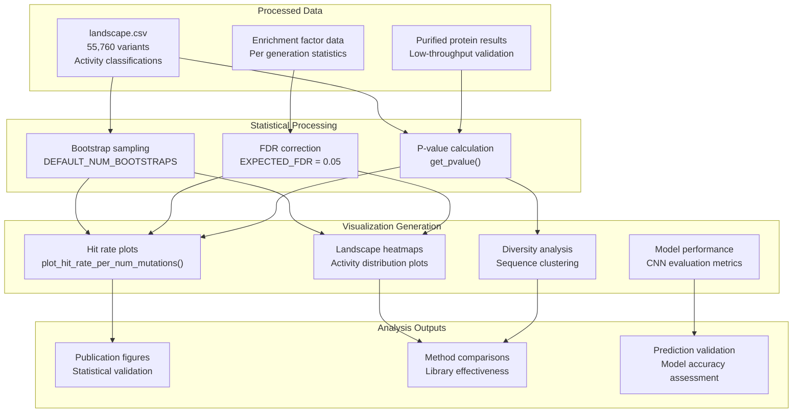

<!-- source: DeepWiki mcp.deepwiki.com · repo google-deepmind/nuclease_design · page 4 Analysis & Visualization · fetched 2026-10-26 -->

# Analysis & Visualization

Relevant source files

The following files were used as context for generating this wiki page:

- [notebooks/plot_hit_rates.ipynb](notebooks/plot_hit_rates.ipynb)
- [notebooks/plot_landscape_analysis.ipynb](notebooks/plot_landscape_analysis.ipynb)
- [nuclease_design/plotting.py](nuclease_design/plotting.py)

This document provides an overview of the analysis notebook ecosystem and visualization capabilities within the nuclease design system. The analysis framework transforms processed experimental data into scientific insights through statistical analysis, data visualization, and model evaluation.

For detailed information about data processing that feeds into these analyses, see [Data Processing Pipeline](#3). For information about the underlying utility functions and plotting infrastructure, see [Core Libraries](#6).

## Overview

The analysis and visualization system consists of an integrated ecosystem of Jupyter notebooks that provide different analytical perspectives on the nuclease engineering experimental data. These notebooks leverage a shared plotting and analysis infrastructure to ensure consistent methodology and visualization standards across all analyses.

## Analysis Notebook Ecosystem

The system is organized into several categories of analysis notebooks, each serving specific analytical purposes:

**Primary Data Analysis Notebooks**
- `plot_landscape_analysis.ipynb`: Comprehensive exploration of the nuclease activity landscape
- `plot_hit_rates.ipynb`: Evaluation of different library design methods through hit rate analysis
- `plot_diversity.ipynb`: Analysis of sequence diversity and clustering patterns

**Model Analysis Notebooks**  
- `analyze_cnn.ipynb`: CNN ensemble model performance evaluation and prediction analysis
- `plot_purified_protein_results.ipynb`: Validation of high-throughput results with purified protein experiments

**Specialized Analysis Notebooks**
- Additional notebooks providing focused analysis on specific aspects like extrapolation, zero-shot performance, and structural diversity

Sources: [High-level system architecture diagrams](), [Table of contents structure]()

## Core Plotting Infrastructure

The visualization system is built around a centralized plotting infrastructure that ensures consistency and provides statistical rigor across all analyses:

**Key Components:**
- **Data Loading**: `utils.load_landscape()` and `utils.load_all_data()` provide standardized data access
- **Statistical Analysis**: Bootstrap sampling and p-value calculations for robust statistical inference
- **Visualization**: Centralized plotting functions with consistent styling and color schemes
- **Quality Control**: Built-in confidence intervals and statistical validation

Sources: [nuclease_design/plotting.py:1-200](), [notebooks/plot_hit_rates.ipynb:114-120](), [notebooks/plot_landscape_analysis.ipynb:120-122]()

## Data Flow and Analysis Pipeline

The analysis system follows a structured data flow from raw experimental results to publication-ready visualizations:

**Statistical Rigor:**
- Bootstrap resampling for confidence interval estimation
- False Discovery Rate (FDR) correction for multiple hypothesis testing
- Minimum observation thresholds to ensure statistical power

**Visualization Standards:**
- Consistent color schemes across all plots (`WT_COLOR`, `ML_COLOR`, `DE_COLOR`, etc.)
- Standardized font sizes and styling through `set_fontsize()`
- Error bars and confidence bands for all statistical estimates

Sources: [nuclease_design/plotting.py:32-43](), [nuclease_design/plotting.py:61-164](), [nuclease_design/utils.py]()

## Integration with Google Colab

All primary analysis notebooks are designed for seamless integration with Google Colab, enabling collaborative analysis and easy sharing:

**Colab Integration Features:**
- Automatic package installation via `pip install git+https://github.com/google-deepmind/nuclease_design.git`
- Pre-computed data access from Google Cloud Storage
- Interactive plotting with matplotlib and seaborn
- Kernel restart instructions for package updates

**Notebook Structure:**
1. License headers and copyright notices
2. Package installation cell (skippable for local environments)  
3. Import statements for required libraries
4. Data loading from standardized sources
5. Analysis and visualization generation

Sources: [notebooks/plot_hit_rates.ipynb:33-36](), [notebooks/plot_landscape_analysis.ipynb:53-56]()

## Analysis Categories

The visualization system provides several distinct categories of analysis, each addressing specific research questions:

- **Hit Rate Analysis** ([#4.1](#4.1)): Quantitative evaluation of library design method effectiveness
- **Landscape Analysis** ([#4.2](#4.2)): Comprehensive exploration of the nuclease activity landscape  
- **Diversity Analysis** ([#4.3](#4.3)): Sequence diversity and clustering pattern investigation
- **Protein Activity Analysis** ([#4.4](#4.4)): Experimental validation through purified protein assays
- **Specialized Analysis** ([#4.5](#4.5)): Additional analytical capabilities for specific research questions
- **Campaign Analysis** ([#4.6](#4.6)): Performance analysis across experimental generations

Each category leverages the shared infrastructure while providing specialized analytical tools and visualizations tailored to specific research objectives.

Sources: [Table of contents structure](), [High-level system diagrams]()

---

