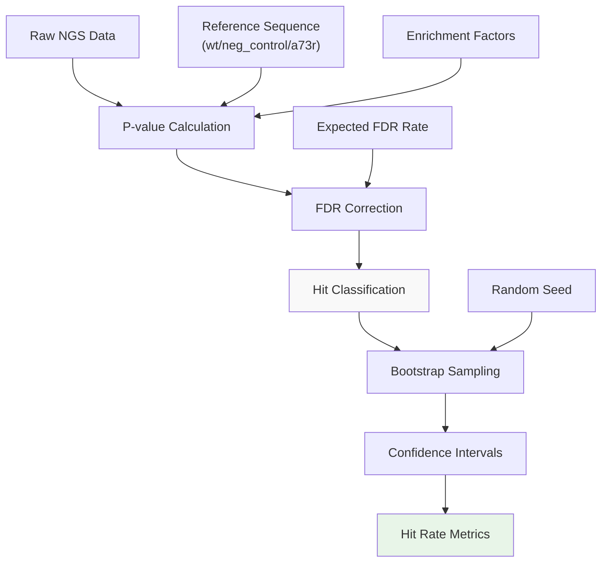
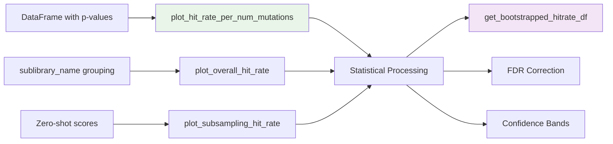
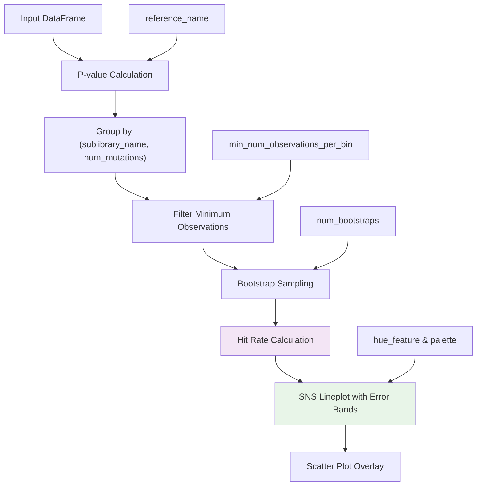
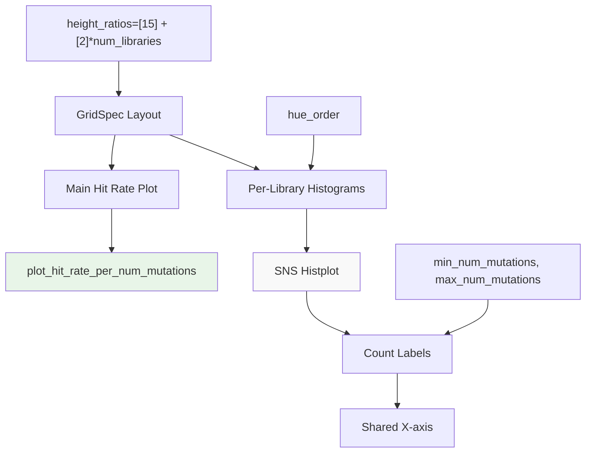
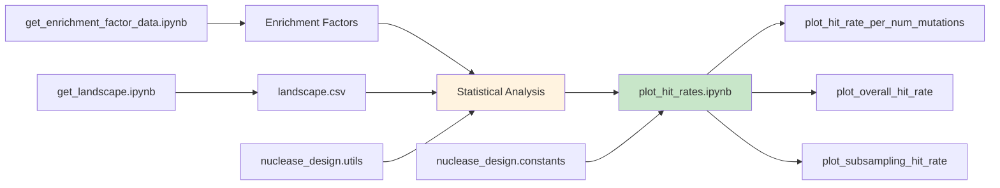
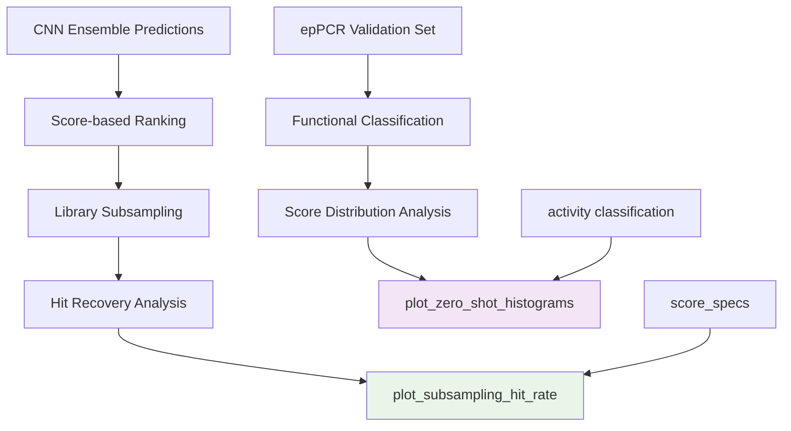

<!-- source: DeepWiki mcp.deepwiki.com · repo google-deepmind/nuclease_design · page 4.1 Hit Rate Analysis · fetched 2026-10-26 -->

# Hit Rate Analysis

Relevant source files

The following files were used as context for generating this wiki page:

- [notebooks/plot_hit_rates.ipynb](notebooks/plot_hit_rates.ipynb)
- [nuclease_design/plotting.py](nuclease_design/plotting.py)

This page documents the hit rate analysis system used to evaluate the effectiveness of different library design methods for nuclease engineering. Hit rate analysis measures the proportion of variants that achieve activity above specified thresholds, providing a quantitative comparison between experimental approaches.

For landscape-wide analysis and visualization, see [Landscape Analysis](#4.2). For diversity analysis of sequence space exploration, see [Diversity & Clustering Analysis](#4.3).

## Purpose and Core Concepts

Hit rate analysis evaluates library design method performance by calculating the fraction of variants that exceed activity thresholds relative to reference sequences. The system compares multiple library generation approaches:

- **WT**: Wild type baseline sequences
- **epPCR**: Error-prone PCR mutagenesis 
- **ML2/ML3**: Machine learning-guided design
- **DE3**: Directed evolution approaches
- **HR**: Homologous recombination methods

Activity thresholds are defined relative to control sequences:
- `neg_control`: Baseline functional activity
- `wt`: Wild type activity level
- `a73r`: Specific high-activity variant

Sources: [nuclease_design/plotting.py:32-41](), [nuclease_design/plotting.py:149-156]()

## Statistical Framework

### Hit Rate Calculation Workflow

The system implements statistical rigor through multiple correction and validation steps:

1. **P-value Computation**: Uses `utils.get_pvalue()` to calculate significance against reference sequences
2. **FDR Correction**: Applies False Discovery Rate correction with default rate of `utils.EXPECTED_FDR`
3. **Bootstrap Validation**: Generates confidence intervals through resampling with `utils.DEFAULT_NUM_BOOTSTRAPS` iterations
4. **Minimum Sample Size**: Filters groups with fewer than `DEFAULT_MIN_NUM_OBSERVATIONS_PER_BIN` (20) observations

Sources: [nuclease_design/plotting.py:61-124](), [nuclease_design/plotting.py:287-331]()

### Core Analysis Functions

The analysis pipeline centers on three primary visualization functions that each address different aspects of hit rate evaluation:

| Function | Purpose | Key Parameters |
|----------|---------|---------------|
| `plot_hit_rate_per_num_mutations` | Hit rates by mutation count | `reference_name`, `hue_feature`, `group_cols` |
| `plot_overall_hit_rate` | Library-wide hit rate comparison | `sublibrary_name`, `expected_false_discovery_rate` |
| `plot_subsampling_hit_rate` | Enrichment through score-based ranking | `score_specs`, `library_subsampling_fraction` |

Sources: [nuclease_design/plotting.py:61-165](), [nuclease_design/plotting.py:287-331](), [nuclease_design/plotting.py:589-647]()

## Visualization Components

### Hit Rate by Mutation Count

The `plot_hit_rate_per_num_mutations` function generates the primary hit rate analysis visualization:

Key features:
- **Error bands**: Confidence intervals from bootstrap resampling
- **Mutation filtering**: X-axis limits from 1 to maximum observed mutations
- **Color coding**: Library-specific palettes defined in module constants
- **Statistical validation**: Minimum observation thresholds per mutation count

Sources: [nuclease_design/plotting.py:61-165]()

### Histogram Integration

The `plot_hit_rate_per_num_mutations_with_histogram` function extends the basic hit rate plot with mutation count distributions:

This visualization provides context for hit rate patterns by showing the underlying distribution of variants across mutation counts for each library.

Sources: [nuclease_design/plotting.py:167-285]()

## Integration with Analysis Pipeline

### Data Flow from Processing to Visualization

The hit rate analysis integrates with the broader system through:

1. **Data Sources**: Processed enrichment factor data from the main pipeline
2. **Statistical Utilities**: Shared functions from `nuclease_design.utils`
3. **Configuration**: Constants for file paths and reference sequences
4. **Visualization Framework**: Shared plotting utilities and color schemes

Sources: [nuclease_design/plotting.py:27-30]()

### Zero-Shot Model Integration

The system evaluates machine learning model performance through:
- **Score-based ranking**: Sorting variants by predicted activity scores
- **Hit recovery metrics**: Measuring fraction of functional variants recovered
- **Enrichment calculation**: Comparing to random baseline performance

Sources: [nuclease_design/plotting.py:589-647](), [nuclease_design/plotting.py:649-682]()

## Configuration and Customization

### Color Palette System

The module defines standardized colors for consistent visualization across analyses:

| Library Type | Color Variable | Purpose |
|--------------|---------------|---------|
| Wild Type | `WT_COLOR` | Baseline reference |
| Machine Learning | `ML_COLOR`, `ML2_COLOR`, `ML3_COLOR` | ML-guided approaches |
| Directed Evolution | `DE_COLOR`, `DE3_COLOR`, `EPPCR_COLOR` | Traditional methods |
| Homologous Recombination | `HR_COLOR` | Recombination-based |

Sources: [nuclease_design/plotting.py:32-41]()

### Statistical Parameters

Key configuration parameters control analysis rigor:

- `DEFAULT_MIN_NUM_OBSERVATIONS_PER_BIN = 20`: Minimum sample size per mutation count
- `utils.DEFAULT_NUM_BOOTSTRAPS`: Bootstrap iteration count for confidence intervals  
- `utils.EXPECTED_FDR`: False discovery rate for hit classification
- `fontsize` parameters: Consistent text sizing across plots

Sources: [nuclease_design/plotting.py:42](), [nuclease_design/plotting.py:70-74]()

---

