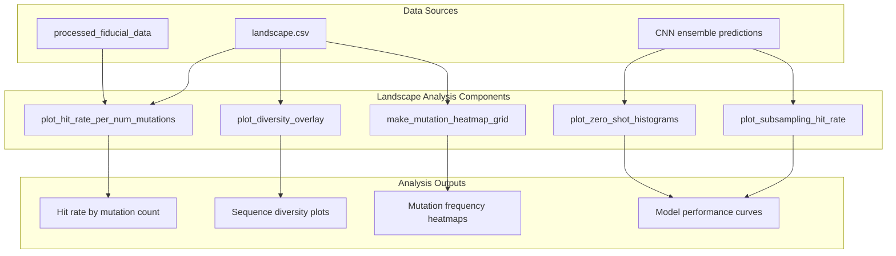
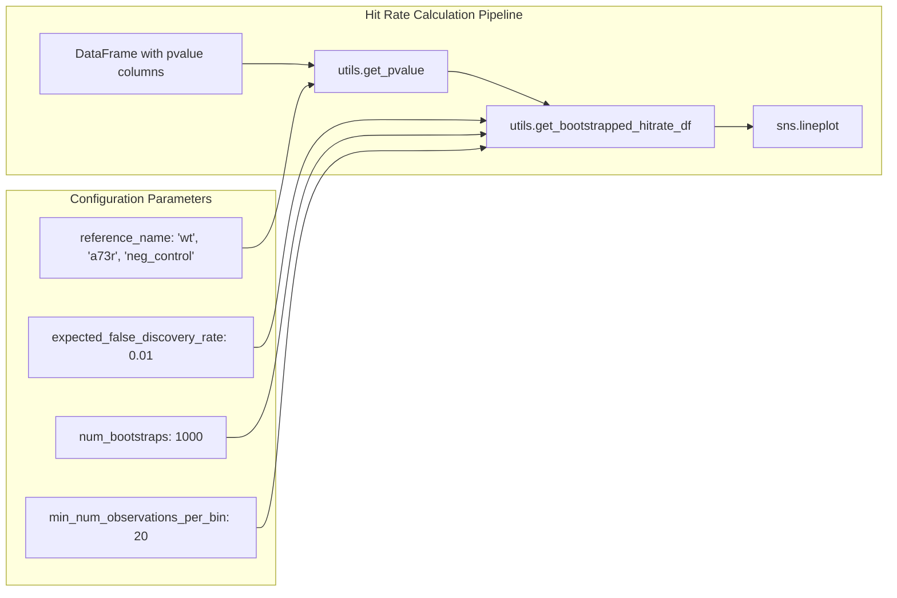
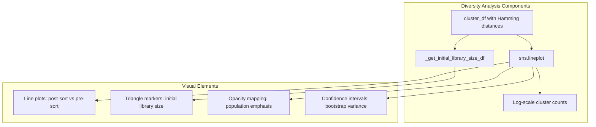
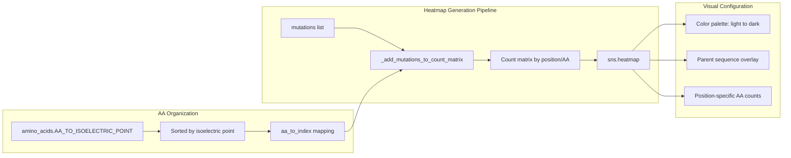
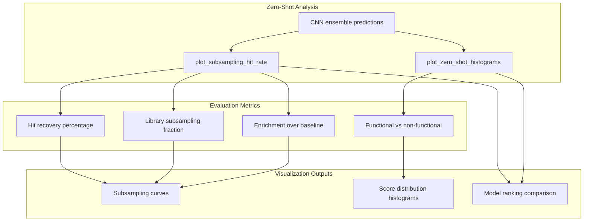

<!-- source: DeepWiki mcp.deepwiki.com · repo google-deepmind/nuclease_design · page 4.2 Landscape Analysis · fetched 2026-10-26 -->

# Landscape Analysis

<details>
<summary>Relevant source files</summary>

The following files were used as context for generating this wiki page:

- [notebooks/plot_landscape_analysis.ipynb](notebooks/plot_landscape_analysis.ipynb)
- [nuclease_design/plotting.py](nuclease_design/plotting.py)

</details>


This document covers the landscape analysis capabilities for exploring and visualizing nuclease activity patterns across the variant space. The landscape analysis framework provides tools for examining hit rates, mutation patterns, sequence diversity, and model predictions across the generated nuclease variant libraries.

For hit rate calculation methodologies, see [Hit Rate Analysis](#4.1). For diversity clustering algorithms, see [Diversity & Clustering Analysis](#4.3). For CNN model analysis capabilities, see [Model Analysis & Evaluation](#5.2).

## Overview

The landscape analysis system provides comprehensive visualization and analysis tools for understanding nuclease variant performance across different experimental conditions and library design methods. The core functionality is implemented in the `nuclease_design.plotting` module and accessed primarily through the `plot_landscape_analysis.ipynb` notebook.



**Sources:** [nuclease_design/plotting.py:1-707]()

## Core Visualization Functions

The landscape analysis system provides several key visualization functions that operate on processed landscape data:

| Function | Purpose | Key Parameters |
|----------|---------|----------------|
| `plot_hit_rate_per_num_mutations` | Hit rates vs mutation count | `reference_name`, `hue_feature` |
| `plot_diversity_overlay` | Library diversity analysis | `post_sort_population`, `hue_feature` |
| `make_mutation_heatmap_grid` | Mutation frequency visualization | `parent_sequence`, `fiducial` |
| `plot_subsampling_hit_rate` | Zero-shot model evaluation | `score_specs`, `reference_name` |

### Hit Rate Analysis Framework

The hit rate plotting system analyzes variant performance across mutation count bins:



The `plot_hit_rate_per_num_mutations` function implements statistical rigor through bootstrap resampling and FDR correction:

```python
# Key processing steps from plotting.py:100-123
df['pvalue'] = df.apply(utils.get_pvalue, reference_name=reference_name, axis=1)
df = df.groupby(group_cols).filter(lambda df: len(df) > min_num_observations_per_bin)
hit_rate_df = df.groupby(group_cols).apply(
    utils.get_bootstrapped_hitrate_df,
    pval_col='pvalue',
    expected_false_discovery_rate=expected_false_discovery_rate,
    random_state=random_state,
    num_bootstraps=num_bootstraps,
).reset_index()
```

**Sources:** [nuclease_design/plotting.py:61-164](), [nuclease_design/plotting.py:167-284]()

## Diversity Visualization

The diversity overlay system visualizes sequence clustering patterns across pre-sort and post-sort populations:



The `plot_diversity_overlay` function creates multi-element plots showing library diversity patterns:

- **Pre-sort populations**: Low opacity (0.1) with dashed lines
- **Post-sort populations**: Full opacity (1.0) with solid lines  
- **Initial library markers**: Triangle markers at cluster diameter 0
- **Log-scale y-axis**: Accommodates wide range of cluster counts

**Sources:** [nuclease_design/plotting.py:389-471](), [nuclease_design/plotting.py:375-386]()

## Mutation Heatmap Generation

The mutation heatmap system visualizes amino acid substitution patterns across protein positions:



The `make_mutation_heatmap_grid` function creates comprehensive mutation visualization:

```python
# Grid layout from plotting.py:548-549
_, axs = plt.subplots(nrows=2, ncols=2, figsize=(60, 15), sharex=True, dpi=1000)
```

Grid structure:
- **Row 1**: Library A (full library vs hits)
- **Row 2**: Library B (full library vs hits)  
- **Column 1**: Complete library populations
- **Column 2**: Activity-filtered hits only

**Sources:** [nuclease_design/plotting.py:538-587](), [nuclease_design/plotting.py:480-530](), [nuclease_design/plotting.py:474-477]()

## Zero-Shot Model Integration

The landscape analysis integrates CNN ensemble predictions for model evaluation:



The `plot_subsampling_hit_rate` function evaluates model-guided library reduction:

```python
# Subsampling analysis from plotting.py:601-619
for model_name, score_column_for_sorting in score_specs:
    sorted_df = df.sort_values(score_column_for_sorting, ascending=False)
    total_num_hits = sorted_df['is_functional'].sum()
    base_rate = sorted_df['is_functional'].mean()
    for n in np.linspace(50, len(sorted_df), 100):
        hits = sorted_df.head(int(n))['is_functional']
        hit_rate = hits.mean()
        fraction_of_total_hits_recovered = hits.sum() / total_num_hits
        enrichment = hit_rate / base_rate
```

**Sources:** [nuclease_design/plotting.py:589-647](), [nuclease_design/plotting.py:649-682]()

## Color Palette System

The landscape analysis uses consistent color schemes across all visualizations:

| Library Type | Color Constant | Purpose |
|-------------|----------------|---------|
| Wild Type | `WT_COLOR` | Baseline reference |
| Machine Learning | `ML_COLOR` | ML2/ML3 libraries |
| Directed Evolution | `DE_COLOR` | epPCR/DE3 libraries |
| Homologous Recombination | `HR_COLOR` | HR libraries |

```python
# Color definitions from plotting.py:32-40
WT_COLOR = sns.color_palette()[-3]  # grey
ML_COLOR = sns.color_palette()[1]   # orange  
DE_COLOR = sns.color_palette()[0]   # blue
HR_COLOR = sns.color_palette()[2]   # green
```

**Sources:** [nuclease_design/plotting.py:32-41]()

## Usage Patterns

The landscape analysis functions integrate with the broader analysis workflow through consistent parameter interfaces:

### Standard Analysis Pattern
```python
# Typical usage pattern
plot_hit_rate_per_num_mutations(
    df=landscape_df,
    reference_name='wt',
    random_seed=random_state,
    hue_feature='sublibrary_name',
    palette=custom_palette,
    expected_false_discovery_rate=0.01
)
```

### Bootstrap Configuration
- **Default bootstraps**: 1000 iterations via `utils.DEFAULT_NUM_BOOTSTRAPS`
- **FDR control**: 0.01 via `utils.EXPECTED_FDR`
- **Minimum bin size**: 20 observations via `DEFAULT_MIN_NUM_OBSERVATIONS_PER_BIN`

**Sources:** [nuclease_design/plotting.py:42-43](), [nuclease_design/plotting.py:61-99]()

---

