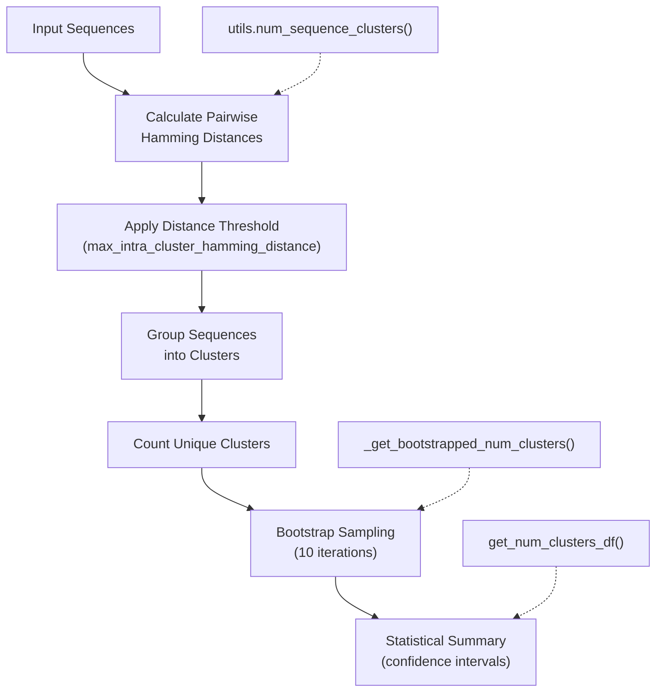
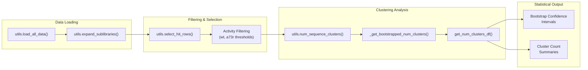
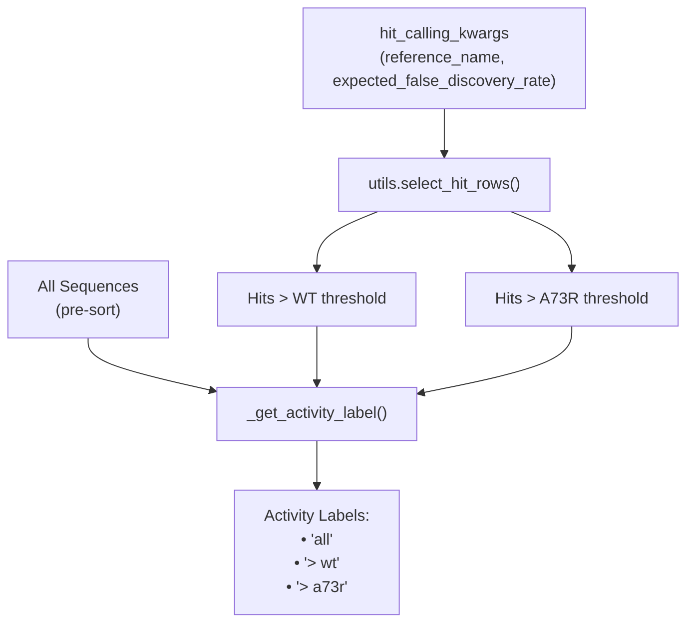
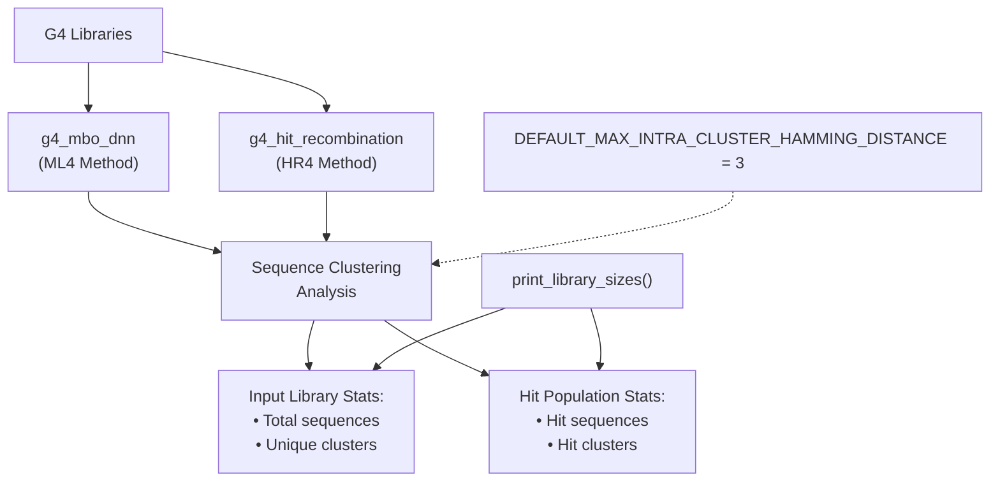
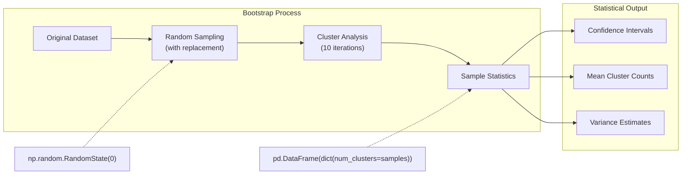

<!-- source: DeepWiki mcp.deepwiki.com · repo google-deepmind/nuclease_design · page 4.3 Diversity & Clustering Analysis · fetched 2026-10-26 -->

# Diversity & Clustering Analysis

Relevant source files

The following files were used as context for generating this wiki page:

- [notebooks/compute_sequence_clusters.ipynb](notebooks/compute_sequence_clusters.ipynb)
- [notebooks/plot_diversity.ipynb](notebooks/plot_diversity.ipynb)
- [notebooks/plot_structural_diversity.ipynb](notebooks/plot_structural_diversity.ipynb)

This document covers the sequence diversity and clustering analysis capabilities of the nuclease design system. The analysis focuses on quantifying sequence diversity within experimental libraries by clustering sequences based on Hamming distance similarity and comparing diversity metrics across different selection criteria and library design methods.

For information about landscape visualization and exploration, see [Landscape Analysis](#4.2). For hit rate calculations and method comparisons, see [Hit Rate Analysis](#4.1).

## Purpose and Scope

The diversity and clustering analysis provides tools to:

- **Cluster sequences** based on Hamming distance similarity with configurable distance thresholds
- **Quantify diversity** by counting unique sequence clusters in different populations  
- **Compare library methods** by analyzing diversity differences between ML and HR approaches
- **Validate results** through bootstrap sampling and statistical confidence intervals
- **Track diversity changes** across different activity selection criteria (pre-sort, >WT, >A73R)

## Core Clustering Methodology

The system uses Hamming distance-based clustering to group similar sequences and quantify diversity.

### Clustering Algorithm Workflow

**Sources:** [notebooks/plot_diversity.ipynb:189-207](), [notebooks/compute_sequence_clusters.ipynb:151-168]()

### Key Parameters

The clustering analysis uses several configurable parameters:

| Parameter | G1 Range | G4 Range | Purpose |
|-----------|----------|----------|---------|
| `max_intra_cluster_hamming_distance` | 0-21 | 0-26 | Maximum distance within clusters |
| `num_bootstraps` | 10 | 10 | Statistical sampling iterations |
| `random_seed` | 0 | 0 | Reproducible sampling |

**Sources:** [notebooks/compute_sequence_clusters.ipynb:113-119]()

## Diversity Analysis Implementation

### Core Functions and Data Flow

**Sources:** [notebooks/plot_diversity.ipynb:233-241](), [notebooks/compute_sequence_clusters.ipynb:177-206]()

### Hit Selection and Activity Labels

The system analyzes diversity across different activity selection criteria:

**Sources:** [notebooks/compute_sequence_clusters.ipynb:171-175](), [notebooks/plot_diversity.ipynb:350-353]()

## Library Comparison Analysis

### G4 Method Comparison

The analysis specifically compares ML and HR library design approaches:

**Sources:** [notebooks/plot_diversity.ipynb:189-203](), [notebooks/plot_diversity.ipynb:247-248]()

### Statistical Validation Framework  

The diversity analysis includes robust statistical validation:

**Sources:** [notebooks/compute_sequence_clusters.ipynb:151-168]()

## Implementation Components

### Key Utility Functions

The analysis relies on several core utility functions from the `nuclease_design.utils` module:

- **`num_sequence_clusters()`** - Computes cluster count given sequences and distance threshold
- **`select_hit_rows()`** - Filters sequences based on activity criteria and FDR correction  
- **`load_all_data()`** - Loads experimental data from the data directory
- **`expand_sublibraries()`** - Expands sublibrary data for analysis

**Sources:** [notebooks/plot_diversity.ipynb:95-97](), [notebooks/compute_sequence_clusters.ipynb:73-75]()

### Notebook Organization

The diversity analysis is implemented across two main notebooks:

1. **`plot_diversity.ipynb`** - Interactive analysis and visualization of diversity metrics
2. **`compute_sequence_clusters.ipynb`** - Batch computation of clustering data (can take ~2 hours for G1)

Both notebooks support Google Colab integration and can regenerate results from raw data.

**Sources:** [notebooks/plot_diversity.ipynb:1-47](), [notebooks/compute_sequence_clusters.ipynb:44-48]()

### Configuration and Constants

The system uses configurable parameters stored in the `constants` module and local configuration:

- **`DATA_DIR`** - Source data directory path
- **`LOCAL_OUTPUT_DATA_DIR`** - Output directory for computed results  
- **Cluster radius ranges** - Different ranges for G1 vs G4 analysis
- **`OVERWRITE`** and **`SUBSAMPLE_FRACTION`** - Control computation behavior

**Sources:** [notebooks/compute_sequence_clusters.ipynb:88-119]()

---

