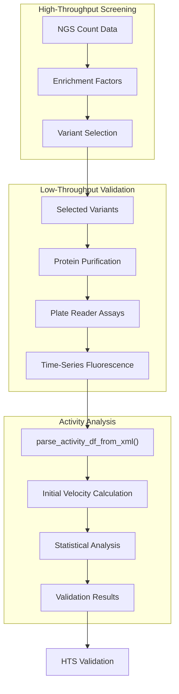
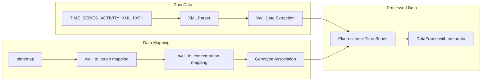
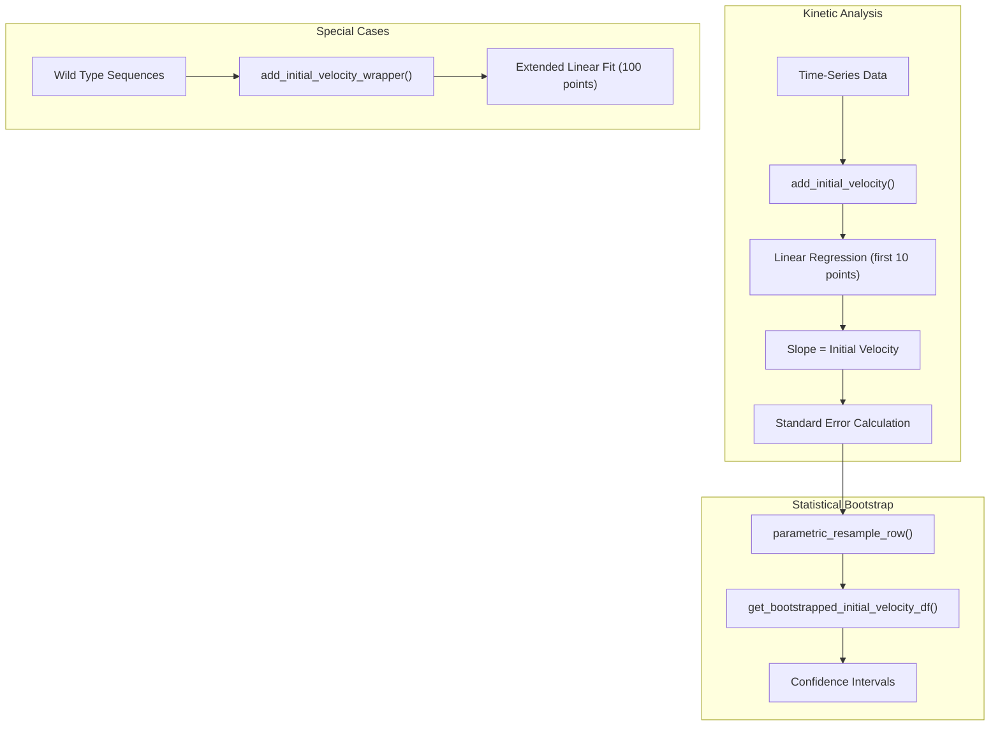
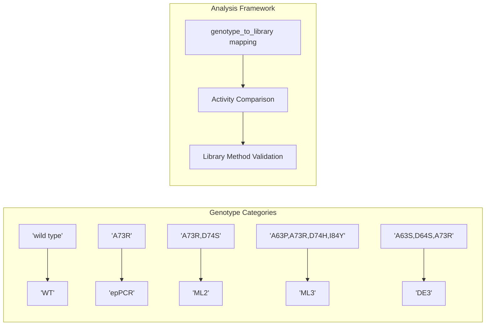

<!-- source: DeepWiki mcp.deepwiki.com · repo google-deepmind/nuclease_design · page 4.4 Protein Activity Analysis · fetched 2026-10-26 -->

# Protein Activity Analysis

Relevant source files

The following files were used as context for generating this wiki page:

- [data/liquid_culture.csv](data/liquid_culture.csv)
- [notebooks/analyze_cnn.ipynb](notebooks/analyze_cnn.ipynb)
- [notebooks/plot_liquid_culture_vs_ef_correlation.ipynb](notebooks/plot_liquid_culture_vs_ef_correlation.ipynb)
- [notebooks/plot_purified_protein_results.ipynb](notebooks/plot_purified_protein_results.ipynb)

This document covers the validation of high-throughput screening results through low-throughput purified protein experiments. The system processes time-series fluorescence data from purified protein assays to measure enzyme activity and provides statistical validation of variants identified in the broader nuclease design pipeline.

For information about the broader landscape analysis of high-throughput data, see [Landscape Analysis](#4.2). For details about machine learning model evaluation, see [Model Analysis & Evaluation](#5.2).

## Experimental Validation Framework

The protein activity analysis system validates high-throughput screening results by conducting controlled experiments with purified proteins. This approach provides precise activity measurements for selected variants to confirm their functional properties.

**Sources:** [notebooks/plot_purified_protein_results.ipynb:1-700]()

## Data Processing Pipeline

The system processes raw fluorescence measurements from plate reader experiments to extract quantitative enzyme activity data. The pipeline handles XML-formatted time-series data and applies kinetic analysis methods.

### Raw Data Input

Time-series fluorescence data is stored in XML format from plate reader experiments. The `parse_activity_df_from_xml()` function extracts fluorescence measurements and time points for each well.

**Sources:** [notebooks/plot_purified_protein_results.ipynb:167-182](), [notebooks/plot_purified_protein_results.ipynb:283-328]()

### Enzyme Kinetics Analysis

The system calculates initial reaction velocities by fitting linear regression to early time points in the linear regime of enzyme reactions. This approach follows established enzymology principles for measuring enzyme activity.

The `add_initial_velocity()` function uses `scipy.stats.linregress()` to fit the initial linear portion of the reaction curve, ensuring measurements are taken in the linear enzyme kinetics regime.

**Sources:** [notebooks/plot_purified_protein_results.ipynb:206-231](), [notebooks/plot_purified_protein_results.ipynb:436-439]()

## Statistical Analysis Methods

The system employs parametric bootstrapping to generate robust statistical estimates of enzyme activities and their uncertainties. This approach accounts for measurement uncertainty in the kinetic analysis.

### Bootstrap Resampling

For each protein variant, the system generates multiple resampled activity measurements using the standard error from the linear regression fit. This provides confidence intervals for comparative analysis.

| Component | Function | Purpose |
|-----------|----------|---------|
| `parametric_resample_row()` | Resampling | Generates bootstrap samples from normal distribution |
| `get_bootstrapped_initial_velocity_df()` | Statistical analysis | Creates ensemble of activity measurements |
| `DEFAULT_NUM_BOOTSTRAPS` | Configuration | Sets number of bootstrap iterations (1000) |

**Sources:** [notebooks/plot_purified_protein_results.ipynb:225-231](), [notebooks/plot_purified_protein_results.ipynb:114-116]()

## Validation Workflow

The protein activity analysis validates high-throughput screening results by comparing purified protein activities across different library design methods and protein concentrations.

### Genotype Mapping

The system maps experimental genotypes to library design categories, enabling systematic comparison of different approaches:

**Sources:** [notebooks/plot_purified_protein_results.ipynb:600-616](), [notebooks/plot_purified_protein_results.ipynb:637-642]()

### Correlation Analysis

The system includes correlation analysis between liquid culture experiments and enrichment factors from high-throughput screening, providing additional validation of the screening methodology.

**Sources:** [notebooks/plot_liquid_culture_vs_ef_correlation.ipynb:1-200]()

## Key Components and Implementation

### Core Analysis Functions

| Function | File Location | Purpose |
|----------|--------------|---------|
| `parse_activity_df_from_xml()` | [plot_purified_protein_results.ipynb:167-182]() | XML data parsing |
| `add_initial_velocity()` | [plot_purified_protein_results.ipynb:206-215]() | Kinetic analysis |
| `add_initial_velocity_wrapper()` | [plot_purified_protein_results.ipynb:219-223]() | Handles variant-specific analysis |
| `parametric_resample_row()` | [plot_purified_protein_results.ipynb:225-228]() | Bootstrap resampling |

### Data Structures

The system uses several key data structures for organizing experimental data:

- **Platemap**: Dictionary mapping strain IDs to well positions
- **Well mappings**: Functions converting well positions to strain names and concentrations  
- **Genotype mapping**: Dictionary linking genotypes to library design methods
- **Bootstrap DataFrame**: Expanded dataset with resampled activity measurements

### Constants and Configuration

Key configuration parameters include:
- `DEFAULT_NUM_BOOTSTRAPS`: Number of bootstrap iterations (1000)
- `RANDOM_SEED`: Random state for reproducible analysis (0)
- Plate layout mappings for strain and concentration assignments

**Sources:** [notebooks/plot_purified_protein_results.ipynb:114-138](), [notebooks/plot_purified_protein_results.ipynb:283-302]()

---

