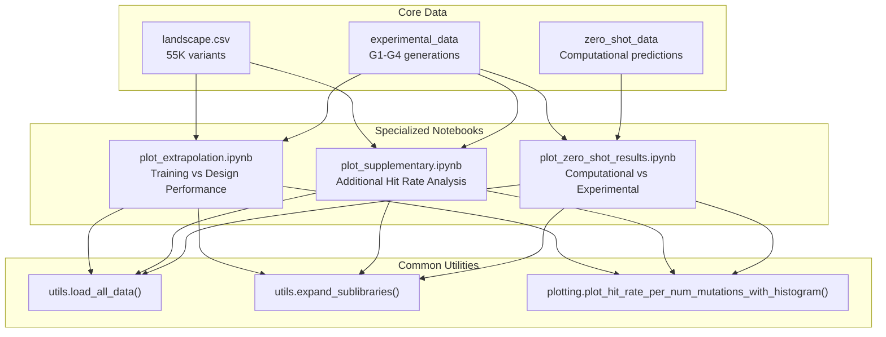
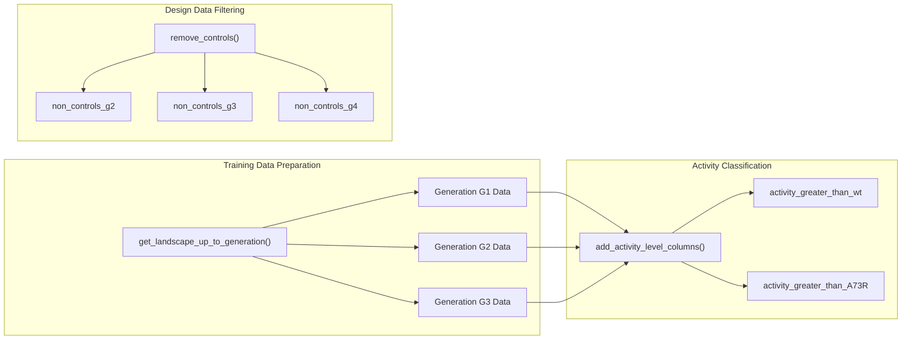
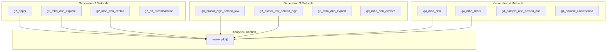
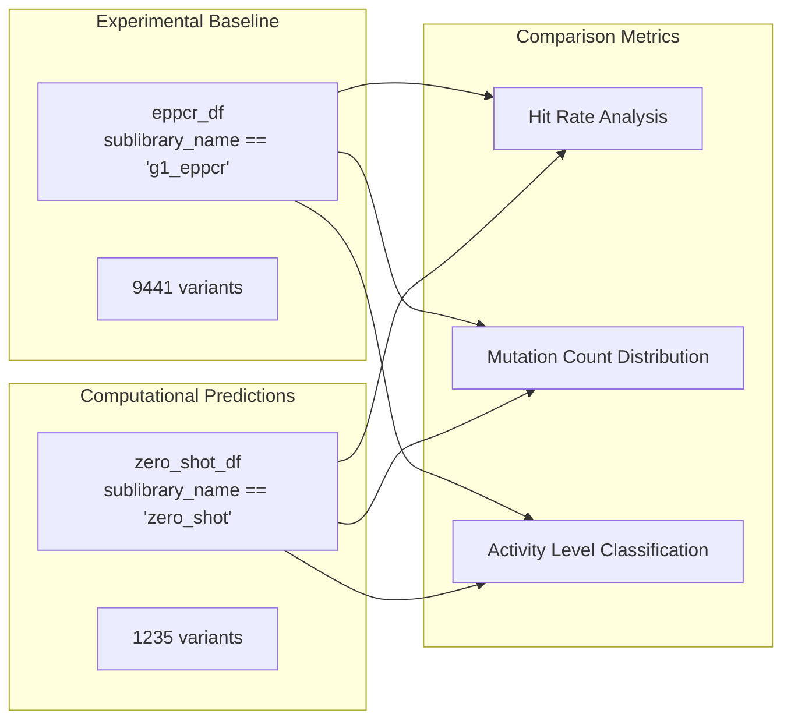
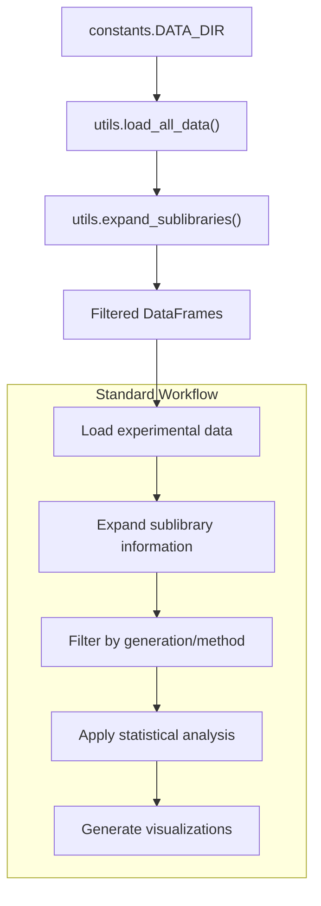

<!-- source: DeepWiki mcp.deepwiki.com · repo google-deepmind/nuclease_design · page 4.5 Specialized Analysis Notebooks · fetched 2026-10-26 -->

# Specialized Analysis Notebooks

<details>
<summary>Relevant source files</summary>

The following files were used as context for generating this wiki page:

- [notebooks/plot_extrapolation.ipynb](notebooks/plot_extrapolation.ipynb)
- [notebooks/plot_ngs_read_thresholding.ipynb](notebooks/plot_ngs_read_thresholding.ipynb)
- [notebooks/plot_supplementary.ipynb](notebooks/plot_supplementary.ipynb)
- [notebooks/plot_zero_shot_results.ipynb](notebooks/plot_zero_shot_results.ipynb)

</details>


This page documents additional analysis notebooks that provide specialized capabilities beyond the core analysis workflows. These notebooks focus on specific research questions such as extrapolation performance, supplementary visualizations, and zero-shot evaluation.

For general analysis workflows, see [Analysis & Visualization](#4). For model-specific analysis, see [Model Analysis & Evaluation](#5.2).

## Overview

The specialized analysis notebooks complement the main analysis suite by providing targeted investigations into specific aspects of the nuclease design pipeline. These notebooks typically generate publication-quality figures and perform detailed statistical comparisons.



Sources: [notebooks/plot_extrapolation.ipynb:1-400](), [notebooks/plot_supplementary.ipynb:1-300](), [notebooks/plot_zero_shot_results.ipynb:1-280]()

## Extrapolation Analysis

The `plot_extrapolation.ipynb` notebook analyzes how well machine learning-guided library design methods perform when extrapolating beyond their training data. This addresses a key question in protein engineering: can computational methods discover variants that perform better than anything seen during training?

### Data Processing Pipeline



The notebook implements several key functions:

- `get_landscape_up_to_generation()` - Filters landscape data to specific experimental generations [notebooks/plot_extrapolation.ipynb:116-123]()
- `remove_controls()` - Excludes control sequences from analysis [notebooks/plot_extrapolation.ipynb:125-136]()
- `add_activity_level_columns()` - Creates binary activity classification features [notebooks/plot_extrapolation.ipynb:178-183]()

### Hit Rate Visualization

The core visualization function `make_hits_histplot()` creates overlaid histograms comparing training set hits versus designed hits across different numbers of mutations [notebooks/plot_extrapolation.ipynb:296-319]().

Sources: [notebooks/plot_extrapolation.ipynb:93-350]()

## Supplementary Analysis

The `plot_supplementary.ipynb` notebook generates additional hit rate plots for different experimental generations and sublibrary comparisons. This provides comprehensive coverage of all library design methods evaluated in the study.

### Sublibrary Classification



The `make_plot()` function provides a standardized interface for generating hit rate comparisons across different sublibrary sets [notebooks/plot_supplementary.ipynb:207-227]().

Sources: [notebooks/plot_supplementary.ipynb:135-300]()

## Zero-Shot Analysis  

The `plot_zero_shot_results.ipynb` notebook compares computational zero-shot predictions against experimental error-prone PCR (epPCR) results. This evaluates whether machine learning models can predict high-activity variants without any experimental training data.

### Comparative Analysis Framework



The analysis uses the standardized `make_plot()` function with specific configuration for zero-shot comparisons:

```python
sublibrary_rename_dict = {'g1_eppcr': 'epPCR', 'zero_shot': 'zero-shot sampling'}
```

Key parameters include:
- `min_num_mutations=1, max_num_mutations=9` - Focus on variants with 1-9 mutations
- `fontsize=40` - Large fonts for publication figures  
- Statistical analysis via bootstrap sampling (`random_seed=RANDOM_SEED`)

Sources: [notebooks/plot_zero_shot_results.ipynb:147-270]()

## Common Analysis Patterns

All specialized notebooks follow consistent patterns for data loading and visualization:

### Data Loading Pipeline



### Visualization Framework

The notebooks rely heavily on the `plotting.plot_hit_rate_per_num_mutations_with_histogram()` function, which provides:

- Statistical bootstrap analysis with confidence intervals
- Histogram overlays showing variant distributions
- Standardized color schemes and formatting
- Publication-ready figure output

Configuration parameters commonly used:
- `reference_name` - Activity reference level ('wt' or 'a73r')
- `hue_feature='library'` - Color coding by library method
- `group_cols=['library', 'num_mutations']` - Grouping for statistical analysis
- `random_seed` - Reproducible bootstrap sampling

Sources: [notebooks/plot_extrapolation.ipynb:75-85](), [notebooks/plot_supplementary.ipynb:93-106](), [notebooks/plot_zero_shot_results.ipynb:125-127]()

---

