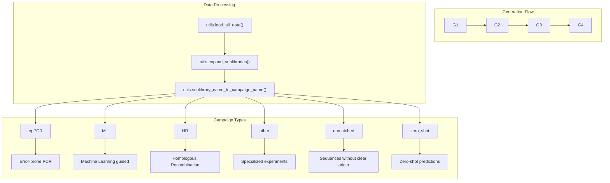
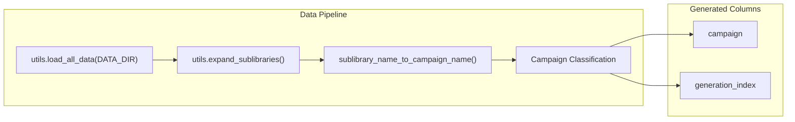
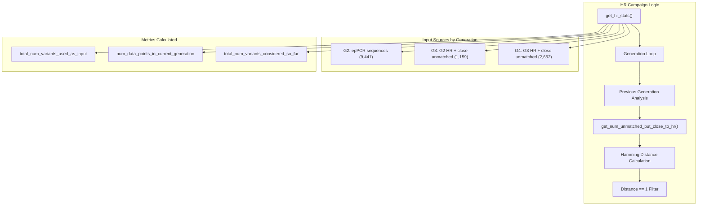
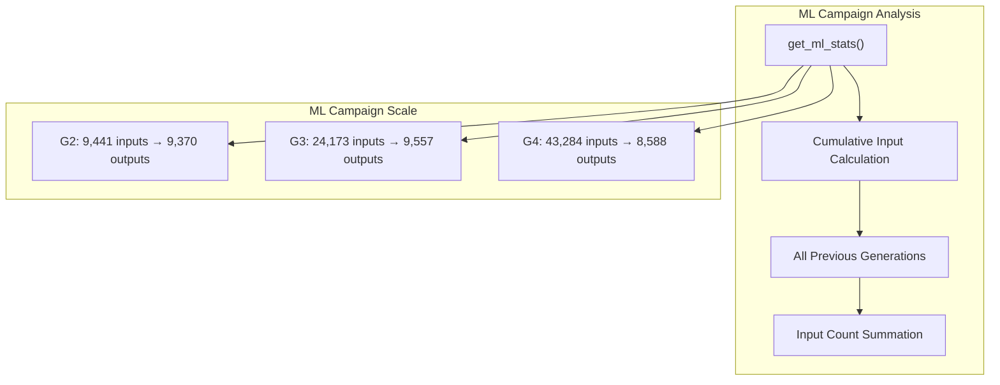

<!-- source: DeepWiki mcp.deepwiki.com · repo google-deepmind/nuclease_design · page 4.6 Campaign Analysis · fetched 2026-10-26 -->

# Campaign Analysis

<details>
<summary>Relevant source files</summary>

The following files were used as context for generating this wiki page:

- [notebooks/campaign_sizes.ipynb](notebooks/campaign_sizes.ipynb)

</details>


This document covers the analysis of experimental campaign sizes and performance tracking across generations. Campaign analysis focuses on understanding how many nuclease variants were tested in each experimental campaign, how campaigns build upon previous results, and the overall scale of variant exploration over time.

For analysis of campaign effectiveness and hit rates, see [Hit Rate Analysis](#4.1). For diversity analysis within campaigns, see [Diversity & Clustering Analysis](#4.3).

## Purpose and Scope

Campaign analysis provides quantitative tracking of experimental scale and progression through the multi-generation nuclease engineering pipeline. This analysis examines:

- **Campaign Classification**: How variants are grouped into different experimental strategies
- **Scale Tracking**: Number of variants tested in each campaign and generation  
- **Progression Analysis**: How campaigns build upon previous experimental data
- **Resource Utilization**: Understanding the cumulative experimental effort invested

## Campaign Types and Structure

The nuclease design system organizes experimental efforts into distinct campaign types, each representing different variant generation strategies:



**Sources**: [notebooks/campaign_sizes.ipynb:90-93]()

## Campaign Size Analysis

### Data Loading and Processing

Campaign analysis begins by loading and processing the full experimental dataset:



The system creates a `campaign` column by mapping sublibrary names to standardized campaign identifiers, enabling consistent analysis across the experimental timeline.

**Sources**: [notebooks/campaign_sizes.ipynb:90-93](), [notebooks/campaign_sizes.ipynb:229]()

### Campaign Size Summary

The notebook generates comprehensive campaign size statistics showing the distribution of variants across campaigns and generations:

| Campaign | Generation | Unique Sequences |
|----------|------------|------------------|
| HR | G2 | 951 |
| HR | G3 | 1,712 |
| HR | G4 | 1,540 |
| ML | G2 | 9,363 |
| ML | G3 | 9,108 |
| ML | G4 | 8,577 |
| epPCR | G1 | 9,441 |
| other | G2-G4 | 44-1,735 |
| unmatched | G2-G4 | 2,360-7,796 |
| zero_shot | G4 | 1,235 |

**Sources**: [notebooks/campaign_sizes.ipynb:129]()

## Homologous Recombination (HR) Campaign Analysis

### HR Campaign Progression Tracking

The HR campaign analysis implements specialized logic to track how variants from previous generations contribute to subsequent rounds:



**Sources**: [notebooks/campaign_sizes.ipynb:246-279]()

### HR Distance Analysis

The HR campaign tracking includes sophisticated sequence similarity analysis using Hamming distance:

```python
def _get_min_distance_to_set(query_sequence, reference_sequences):
    return reference_sequences.apply(_hamming_distance, b=query_sequence).min()
```

This function identifies unmatched sequences that are one mutation away from HR campaign sequences, treating them as potential HR-derived variants.

**Sources**: [notebooks/campaign_sizes.ipynb:225-243]()

## Machine Learning Campaign Analysis

### ML Campaign Scale Tracking

The ML campaign analysis takes a different approach, considering all previous experimental data as potential training input:



The ML campaigns show dramatically larger input datasets compared to HR campaigns, reflecting the machine learning approach of leveraging all available experimental data.

**Sources**: [notebooks/campaign_sizes.ipynb:356-373]()

## Specialized Campaign Categories

### Other Campaign Sublibraries

The "other" campaign category encompasses various specialized experimental approaches:

| Sublibrary Name | Count | Purpose |
|----------------|-------|---------|
| prosar+screen_g2_redux | 1,464 | PROSAR screening redux |
| g4_g3_hit_constituents | 241 | G3 hit analysis |
| g2_stratified_sample | 40 | Stratified sampling |
| g3_g1_stratified_sample | 38 | Cross-generation sampling |
| g4_mbo_seeds | 27 | MBO optimization seeds |
| Various synonyms | 1-14 each | Control sequences |

**Sources**: [notebooks/campaign_sizes.ipynb:412]()

## Implementation Details

### Caching and Performance

The campaign analysis implements function caching for expensive distance calculations:

```python
@functools.cache
def _hamming_distance(a, b):
    return sum(a != b for a, b in zip(a, b))
```

This caching mechanism prevents redundant sequence distance calculations during the analysis.

**Sources**: [notebooks/campaign_sizes.ipynb:142-144]()

### Data Structure and Dependencies

The campaign analysis relies on key system components:

- `constants.DATA_DIR` for data location configuration
- `utils.load_all_data()` for comprehensive data loading
- `utils.expand_sublibraries()` for sublibrary expansion
- `utils.sublibrary_name_to_campaign_name()` for campaign classification

**Sources**: [notebooks/campaign_sizes.ipynb:79](), [notebooks/campaign_sizes.ipynb:60-61]()

## Analysis Output and Interpretation

The campaign analysis produces structured DataFrames with key metrics:

- **total_num_variants_used_as_input**: Cumulative variants available for campaign design
- **num_data_points_in_current_generation**: Variants actually tested in the current generation
- **total_num_variants_considered_so_far**: Running total of experimental effort

These metrics enable tracking of experimental efficiency and resource allocation across the multi-generation pipeline.

**Sources**: [notebooks/campaign_sizes.ipynb:246-279](), [notebooks/campaign_sizes.ipynb:356-373]()

---

