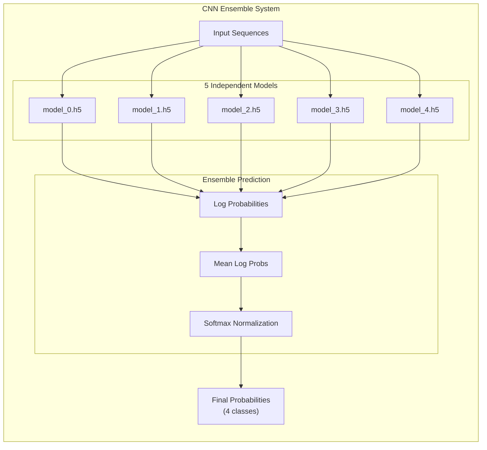
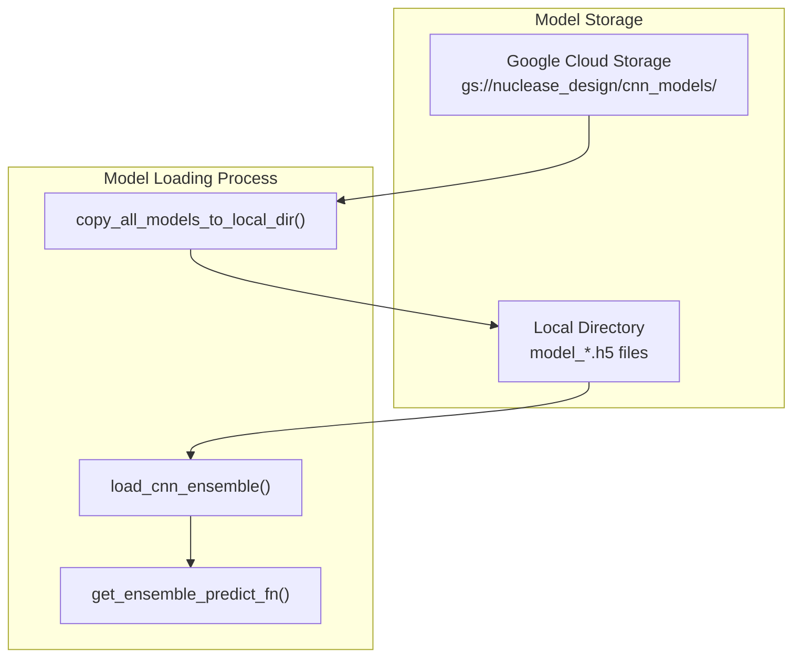
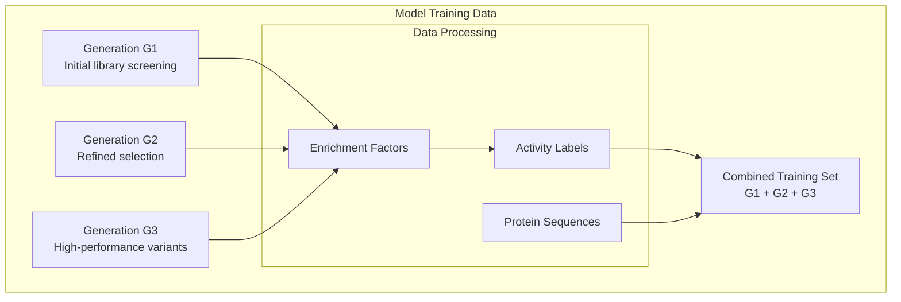
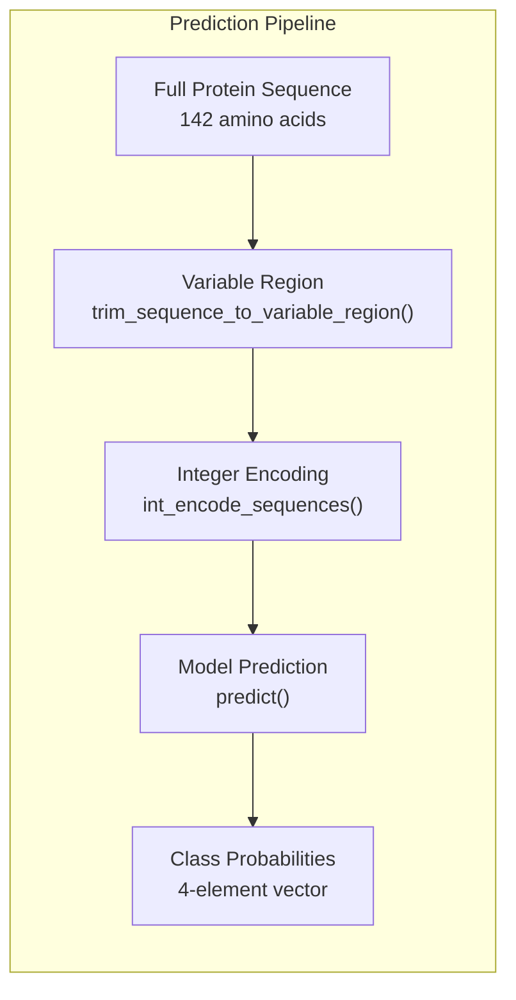
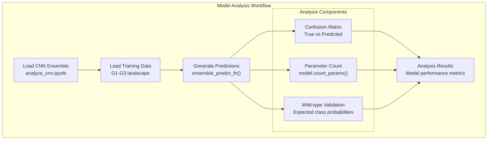

<!-- source: DeepWiki mcp.deepwiki.com · repo google-deepmind/nuclease_design · page 5 Machine Learning Models · fetched 2026-10-26 -->

# Machine Learning Models

<details>
<summary>Relevant source files</summary>

The following files were used as context for generating this wiki page:

- [notebooks/analyze_cnn.ipynb](notebooks/analyze_cnn.ipynb)
- [notebooks/plot_purified_protein_results.ipynb](notebooks/plot_purified_protein_results.ipynb)
- [nuclease_design/cnn_model.py](nuclease_design/cnn_model.py)
- [nuclease_design/constants.py](nuclease_design/constants.py)
- [nuclease_design/utils.py](nuclease_design/utils.py)

</details>


This document covers the machine learning components of the nuclease design system, specifically the CNN ensemble used for predicting nuclease activity levels from protein sequences. For broader system analysis capabilities, see [Analysis & Visualization](#4).

## Overview

The system employs a convolutional neural network (CNN) ensemble to predict nuclease activity levels from amino acid sequences. The ensemble consists of 5 independently trained models that classify sequences into 4 activity categories relative to wild-type performance.

**Key Components:**
- **CNN Ensemble**: 5 models providing robust activity predictions
- **4-Class Classification**: Predicts activity relative to wild-type and A73R reference
- **Sequence Processing**: Handles full-length protein sequences with variable region focus
- **Model Analysis Tools**: Notebooks for evaluating model performance

Sources: [nuclease_design/cnn_model.py:1-292](), [notebooks/analyze_cnn.ipynb:1-591]()

## Model Architecture

### CNN Model Structure

```mermaid
flowchart TD
    subgraph ModelArchitecture["CNN Model Architecture"]
        Input["Input Sequences<br/>(Amino Acid Strings)"]
        IntEncoding["Integer Encoding<br/>int_encode_sequences()"]
        OneHot["One-Hot Encoding<br/>tf.one_hot()"]
        
        subgraph ConvStack["Convolutional Stack"]
            Conv1["Conv1D(32, 5, 1)"]
            Conv2["Conv1D(32, 5, 1)"]
            Conv3["Conv1D(32, 5, 1)"]
        end
        
        Flatten["Flatten Layer"]
        
        subgraph DenseStack["Dense Stack"]
            Dense1["Dense(64, relu)"]
            Dropout["Dropout(0.05)"]
        end
        
        Output["Dense(4, softmax)<br/>Activity Classes"]
    end
    
    Input --> IntEncoding
    IntEncoding --> OneHot
    OneHot --> Conv1
    Conv1 --> Conv2
    Conv2 --> Conv3
    Conv3 --> Flatten
    Flatten --> Dense1
    Dense1 --> Dropout
    Dropout --> Output
```



The model architecture consists of an `EncodingLayer` containing convolutional and dense components, followed by a classification head that outputs probabilities for 4 activity classes.

Sources: [nuclease_design/cnn_model.py:116-221](), [nuclease_design/cnn_model.py:178-221]()

### Output Classes

The models predict 4 activity levels defined relative to wild-type (WT) and A73R reference sequences:

| Class | Description | Interpretation |
|-------|-------------|----------------|
| `<WT` | Below wild-type | EF < WT(α) |
| `WT` | Wild-type level | WT(α) ≤ EF < WT(1-α) |
| `>WT` | Above wild-type | WT(1-α) ≤ EF < A73R(α) |
| `>=A73R` | A73R level or higher | EF ≥ A73R(α) |

**Note**: These classes differ from `constants.LANDSCAPE_ACTIVITY_LEVELS` used in the final landscape data, as they represent the original modeling approach without FDR correction.

Sources: [nuclease_design/cnn_model.py:33-46](), [notebooks/analyze_cnn.ipynb:169-172]()

## CNN Ensemble System

### Ensemble Architecture



The ensemble combines predictions from 5 independently trained models using log-probability averaging for robust predictions.

**Key Functions:**
- `load_cnn_ensemble()`: Loads all 5 models
- `get_ensemble_predict_fn()`: Creates ensemble prediction function
- `copy_all_models_to_local_dir()`: Downloads models from GCS

Sources: [nuclease_design/cnn_model.py:258-291](), [nuclease_design/cnn_model.py:30]()

### Model Storage and Loading

Models are stored in Google Cloud Storage and must be copied locally before use:



**Model File Pattern**: `cnn_models/model_{index}.h5` where index ranges from 0 to 4.

Sources: [nuclease_design/cnn_model.py:234-241](), [nuclease_design/cnn_model.py:243-256]()

## Model Training and Data

### Training Data Sources

The models were trained on experimental data from generations G1, G2, and G3:



**Training Dataset Characteristics:**
- **Sequences**: ~40,000 protein variants from G1-G3
- **Labels**: 4-class activity levels based on enrichment factors
- **Validation**: Train-test split for model selection, then retrained on full dataset

Sources: [notebooks/analyze_cnn.ipynb:322-405](), [notebooks/analyze_cnn.ipynb:413-420]()

### Model Performance Analysis

The training notebook `analyze_cnn.ipynb` provides model validation through confusion matrix analysis:

| True Label | `<WT` | `WT` | `>WT` | `>=A73R` |
|------------|-------|------|-------|----------|
| non-functional | 24770 | 523 | 167 | 20 |
| activity_greater_than_0 | 912 | 6705 | 1256 | 166 |
| activity_greater_than_WT | 9 | 266 | 4294 | 1507 |
| activity_greater_than_A73R | 2 | 1 | 63 | 91 |

**Model Specifications:**
- **Parameters**: 255,524 parameters per model
- **Architecture**: 3 Conv1D layers + 1 Dense layer + Dropout
- **Training Strategy**: Ensemble of 5 independently trained models

Sources: [notebooks/analyze_cnn.ipynb:423-528](), [notebooks/analyze_cnn.ipynb:534-555]()

## Model Usage and Prediction

### Sequence Processing Pipeline



**Key Processing Steps:**
1. **Sequence Trimming**: Extract variable region starting at position 24
2. **Integer Encoding**: Convert amino acids to integers using `amino_acids.AA` mapping
3. **Model Prediction**: Apply ensemble prediction function
4. **Output**: Probability distribution over 4 activity classes

Sources: [nuclease_design/cnn_model.py:265-291](), [nuclease_design/cnn_model.py:223-232]()

### Prediction Function Usage

The system provides both single-model and ensemble prediction capabilities:

**Single Model Prediction:**
```python
model = load_cnn_model(model_index=0, data_dir=local_dir)
predict_fn = get_predict_fn(model)
probabilities = predict_fn([sequence])
```

**Ensemble Prediction:**
```python
ensemble_models = load_cnn_ensemble(data_dir=local_dir)
ensemble_predict_fn = get_ensemble_predict_fn(ensemble_models)
probabilities = ensemble_predict_fn([sequence])
```

**Wild-type Prediction Example:**
For the wild-type sequence, the ensemble typically predicts high probability for the `WT` class:
`[2.5e-03, 9.97e-01, 1.8e-06, 4.7e-04]`

Sources: [notebooks/analyze_cnn.ipynb:213-315](), [nuclease_design/cnn_model.py:269-291]()

## Model Analysis Tools

### Analysis Notebook Workflow



**Analysis Capabilities:**
- **Model Loading**: Download and load ensemble from GCS
- **Performance Evaluation**: Confusion matrix on training data
- **Parameter Analysis**: Model complexity assessment
- **Validation Testing**: Wild-type sequence prediction verification

Sources: [notebooks/analyze_cnn.ipynb:105-159](), [notebooks/analyze_cnn.ipynb:322-555]()

### Experimental Validation

The system includes experimental validation through purified protein assays documented in `plot_purified_protein_results.ipynb`. This provides:

- **Low-throughput Validation**: Purified protein activity measurements
- **CNN Prediction Correlation**: Compare model predictions with experimental results
- **Activity Quantification**: Fluorescence-based enzyme kinetics analysis

**Validation Workflow:**
1. Select variants based on CNN predictions
2. Express and purify proteins
3. Measure enzymatic activity in controlled conditions
4. Compare experimental results with model predictions

Sources: [notebooks/plot_purified_protein_results.ipynb:1-70](), [notebooks/plot_purified_protein_results.ipynb:235-328]()

---

