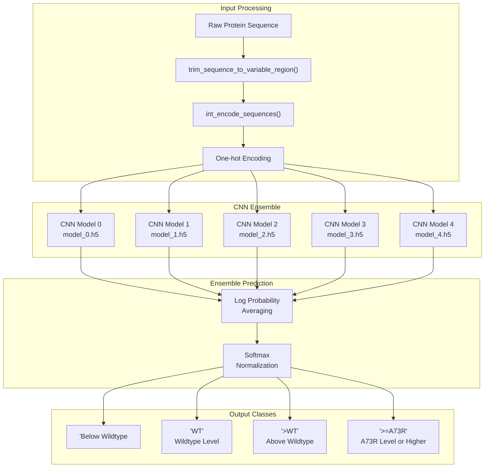
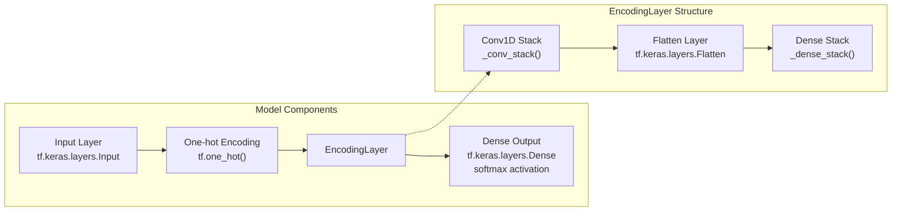
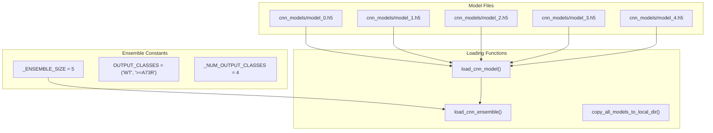
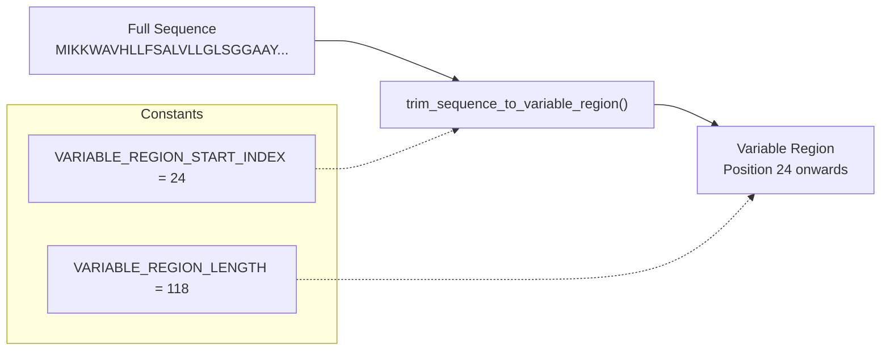
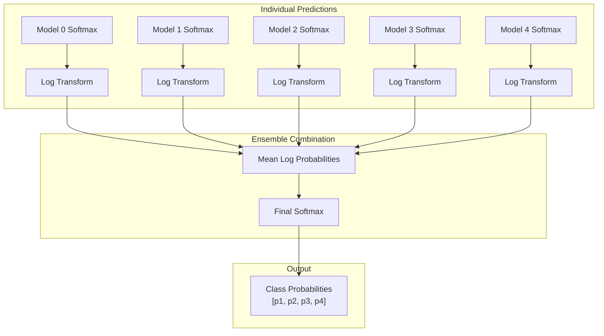
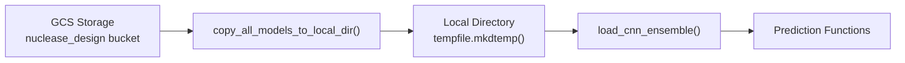

<!-- source: DeepWiki mcp.deepwiki.com · repo google-deepmind/nuclease_design · page 5.1 CNN Ensemble Architecture · fetched 2026-10-26 -->

# CNN Ensemble Architecture

<details>
<summary>Relevant source files</summary>

The following files were used as context for generating this wiki page:

- [notebooks/analyze_cnn.ipynb](notebooks/analyze_cnn.ipynb)
- [notebooks/plot_purified_protein_results.ipynb](notebooks/plot_purified_protein_results.ipynb)
- [nuclease_design/cnn_model.py](nuclease_design/cnn_model.py)
- [nuclease_design/constants.py](nuclease_design/constants.py)
- [nuclease_design/utils.py](nuclease_design/utils.py)

</details>


This document describes the CNN ensemble architecture used for nuclease activity prediction in the ML-guided nuclease engineering system. The ensemble consists of 5 convolutional neural networks that classify protein sequences into activity levels relative to wildtype and reference variants.

For information about model analysis and evaluation, see [5.2](#5.2). For general machine learning model overview, see [5](#5).

## Architecture Overview

The CNN ensemble implements a multi-class classification system that predicts nuclease activity levels based on amino acid sequences. The system processes variable regions of protein sequences and outputs probability distributions across four activity classes.



**Sources:** [nuclease_design/cnn_model.py:30-46](), [nuclease_design/cnn_model.py:280-291](), [nuclease_design/cnn_model.py:223-231]()

## Model Architecture Components

Each individual CNN model in the ensemble follows a consistent architecture pattern implemented through several key components:



**Sources:** [nuclease_design/cnn_model.py:178-220](), [nuclease_design/cnn_model.py:116-176]()

### EncodingLayer Implementation

The `EncodingLayer` class combines convolutional and fully-connected layers:

| Component | Default Configuration | Purpose |
|-----------|----------------------|---------|
| Conv1D Layers | 3 layers: (32, 5, 1) each | Feature extraction from sequence |
| Activation | ReLU | Non-linear activation |
| Flatten | Single layer | Convert to 1D features |
| Dense Layers | 64 units | Final feature processing |
| Dropout | 0.05 rate | Regularization |

**Sources:** [nuclease_design/cnn_model.py:182-188](), [nuclease_design/cnn_model.py:126-164]()

## Ensemble Configuration

The ensemble consists of exactly 5 models with identical architectures but different trained weights:



**Sources:** [nuclease_design/cnn_model.py:30](), [nuclease_design/cnn_model.py:45-46](), [nuclease_design/cnn_model.py:234-262]()

## Input Processing Pipeline

The models process protein sequences through a standardized pipeline:

### Sequence Trimming

Input sequences are trimmed to the variable region starting at position 24:



**Sources:** [nuclease_design/cnn_model.py:265-266](), [nuclease_design/constants.py:359-360]()

### Sequence Encoding

Amino acid sequences are converted to integer arrays for model input:

| Step | Function | Purpose |
|------|----------|---------|
| 1 | `int_encode_sequences()` | Convert AA to integers |
| 2 | `tf.one_hot()` | Create one-hot vectors |
| 3 | Model input | Feed to CNN layers |

**Sources:** [nuclease_design/cnn_model.py:223-231](), [nuclease_design/cnn_model.py:210-211]()

## Ensemble Prediction Process

The ensemble combines predictions from all 5 models using log-probability averaging:



**Sources:** [nuclease_design/cnn_model.py:280-291]()

The ensemble prediction function implements this as:
```python
log_probs = np.log(predictions + 1e-6)
return special.softmax(np.mean(log_probs, axis=-1))
```

## Model Loading and Usage

### Local File Requirement

CNN models must be copied to local storage before loading due to TensorFlow requirements:



**Sources:** [nuclease_design/cnn_model.py:238-241](), [nuclease_design/cnn_model.py:252-255](), [notebooks/analyze_cnn.ipynb:126-159]()

### Prediction Functions

Two main prediction interfaces are available:

| Function | Purpose | Usage |
|----------|---------|-------|
| `get_predict_fn()` | Single model prediction | Individual model analysis |
| `get_ensemble_predict_fn()` | Ensemble prediction | Production inference |

**Sources:** [nuclease_design/cnn_model.py:269-291]()

## Output Classes and Training Data

### Classification Scheme

The models predict four activity classes relative to reference sequences:

| Class | Interpretation | Training Criterion |
|-------|---------------|-------------------|
| `<WT` | Below wildtype | EF < WT(α) |
| `WT` | Wildtype level | WT(α) ≤ EF < WT(1-α) |
| `>WT` | Above wildtype | WT(1-α) ≤ EF < A73R(α) |
| `>=A73R` | A73R level or higher | EF ≥ A73R(α) |

**Sources:** [nuclease_design/cnn_model.py:33-45]()

### Training Data Scope

Models are trained on data from generations G1, G2, and G3, totaling approximately 40,000 sequences. The training excludes G4 data to enable validation on held-out generation data.

**Sources:** [notebooks/analyze_cnn.ipynb:365-404]()

### Model Size

Each CNN model contains 255,524 trainable parameters, making the ensemble computationally efficient while maintaining predictive accuracy.

**Sources:** [notebooks/analyze_cnn.ipynb:554]()

---

