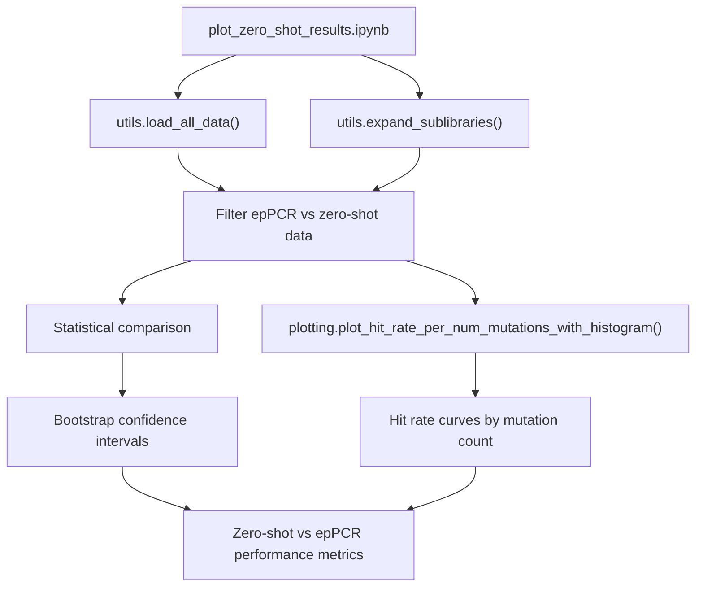
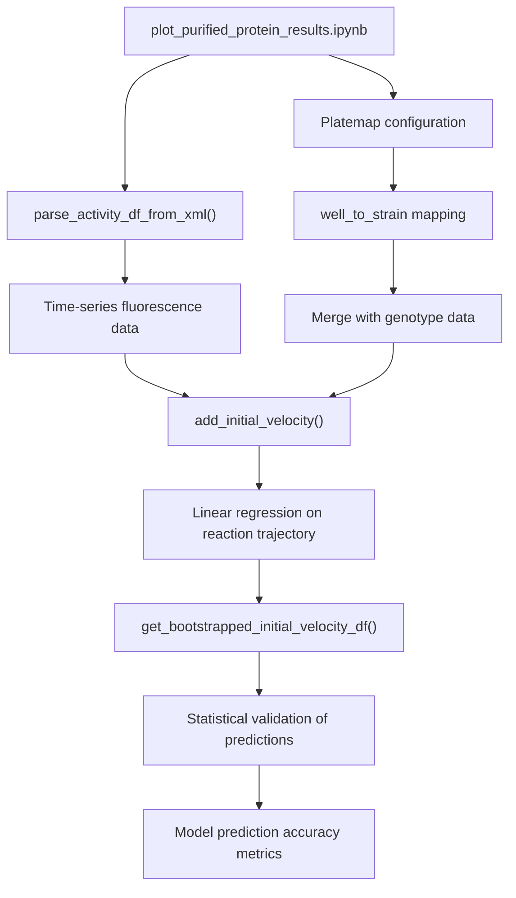
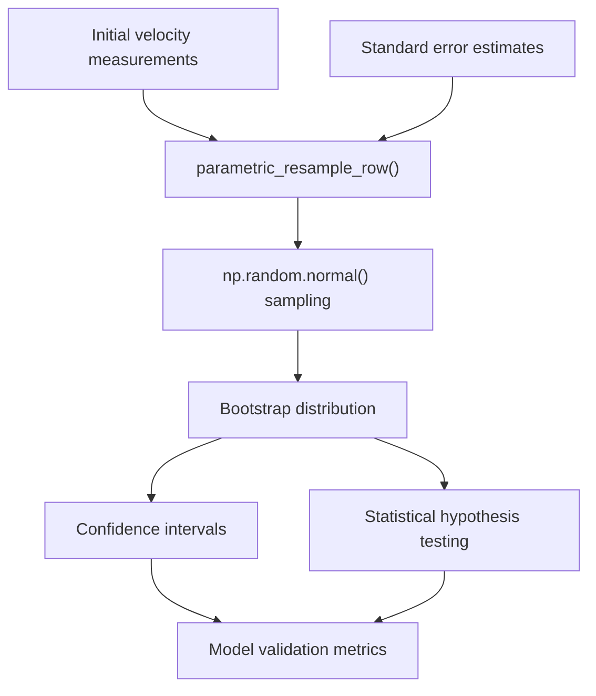
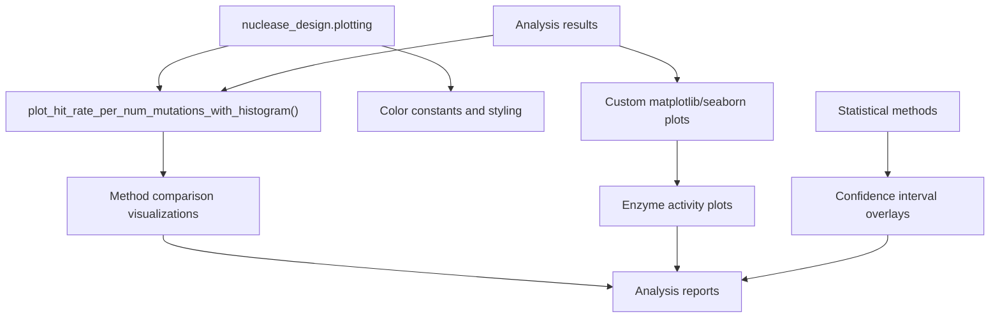

<!-- source: DeepWiki mcp.deepwiki.com · repo google-deepmind/nuclease_design · page 5.2 Model Analysis & Evaluation · fetched 2026-10-26 -->

# Model Analysis & Evaluation

Relevant source files

The following files were used as context for generating this wiki page:

- [notebooks/analyze_cnn.ipynb](notebooks/analyze_cnn.ipynb)
- [notebooks/plot_purified_protein_results.ipynb](notebooks/plot_purified_protein_results.ipynb)
- [notebooks/plot_zero_shot_results.ipynb](notebooks/plot_zero_shot_results.ipynb)

This section covers the tools and methodologies for analyzing and evaluating the performance of the CNN ensemble models used in nuclease design. The focus is on validation techniques, statistical analysis methods, and visualization tools for assessing model predictions against experimental data.

For information about the CNN model architecture itself, see [CNN Ensemble Architecture](#5.1). For broader analysis capabilities including landscape and diversity analysis, see [Analysis & Visualization](#4).

## Zero-Shot Performance Analysis

The system provides comprehensive tools for analyzing zero-shot model performance, where the CNN ensemble makes predictions on sequences not seen during training.

The zero-shot analysis workflow compares model-guided sequence generation against traditional methods like error-prone PCR (epPCR). Key analysis functions include:

- `make_plot()` function for generating comparative visualizations [plot_zero_shot_results.ipynb:180-206]()
- Hit rate analysis across different mutation counts using `plot_hit_rate_per_num_mutations_with_histogram()` [plot_zero_shot_results.ipynb:192-203]()
- Statistical comparison between zero-shot sampling and epPCR methods [plot_zero_shot_results.ipynb:236-267]()

**Sources:** [notebooks/plot_zero_shot_results.ipynb:1-303]()

## Experimental Validation Analysis

A critical component of model evaluation involves validating high-throughput screening predictions against low-throughput purified protein assays.

### Enzyme Activity Measurement

The validation system measures enzyme activity through fluorescence time-series data, computing initial reaction velocities:

- XML parsing for plate reader data using `parse_activity_df_from_xml()` [plot_purified_protein_results.ipynb:167-181]()
- Initial velocity calculation via linear regression on the first 10 data points [plot_purified_protein_results.ipynb:206-215]()
- Special handling for wild-type reactions using 100 points due to slower kinetics [plot_purified_protein_results.ipynb:219-223]()

### Platemap Configuration

The system uses a structured platemap to associate wells with specific protein variants:

- Strain-to-well mapping through `platemap` dictionary [plot_purified_protein_results.ipynb:283-297]()
- Concentration gradient mapping via `well_to_concentration` [plot_purified_protein_results.ipynb:299-302]()
- Integration with genotype data from `constants.PLATE_GENOTYPES_PATH` [plot_purified_protein_results.ipynb:261-262]()

**Sources:** [notebooks/plot_purified_protein_results.ipynb:1-500](), [nuclease_design/constants.py]()

## Statistical Analysis Methods

### Bootstrap Sampling

The system employs parametric bootstrap sampling for robust statistical analysis of experimental measurements:

Key statistical functions include:

- `parametric_resample_row()` for generating bootstrap samples from measurement uncertainty [plot_purified_protein_results.ipynb:225-228]()
- `get_bootstrapped_initial_velocity_df()` for creating bootstrap distributions [plot_purified_protein_results.ipynb:230-231]()
- Default bootstrap sample size of 1000 iterations [plot_purified_protein_results.ipynb:115]()

### Linear Regression Analysis

Enzyme kinetics are analyzed using scipy linear regression:

- `stats.linregress()` for fitting reaction trajectories [plot_purified_protein_results.ipynb:211]()
- Extraction of slope, standard error, and intercept parameters [plot_purified_protein_results.ipynb:213-215]()
- Special handling for different enzyme variants based on reaction kinetics [plot_purified_protein_results.ipynb:219-223]()

**Sources:** [notebooks/plot_purified_protein_results.ipynb:114-231]()

## Visualization and Reporting

### Model Performance Visualization

The analysis system provides comprehensive visualization capabilities for model evaluation:

### Key Visualization Components

- Hit rate analysis with histogram overlays for mutation count distributions [plot_zero_shot_results.ipynb:192-203]()
- Enzyme activity trajectory fitting with linear regression visualization [plot_purified_protein_results.ipynb:355-379]()
- Bootstrap confidence interval visualization for experimental validation
- Method comparison plots using consistent color schemes and styling

### Reporting Capabilities

The notebooks generate comprehensive analysis reports including:

- Zero-shot vs traditional method performance comparisons
- Model prediction accuracy against experimental validation
- Statistical significance testing results
- Bootstrap confidence intervals for all measurements

**Sources:** [notebooks/plot_zero_shot_results.ipynb:180-267](), [notebooks/plot_purified_protein_results.ipynb:355-500](), [nuclease_design/plotting.py]()

---

