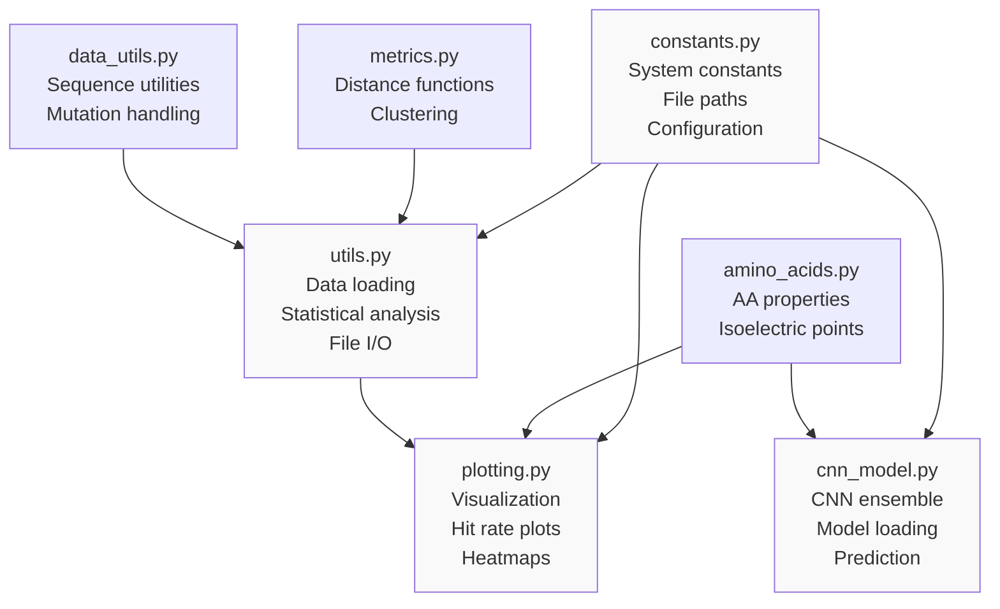
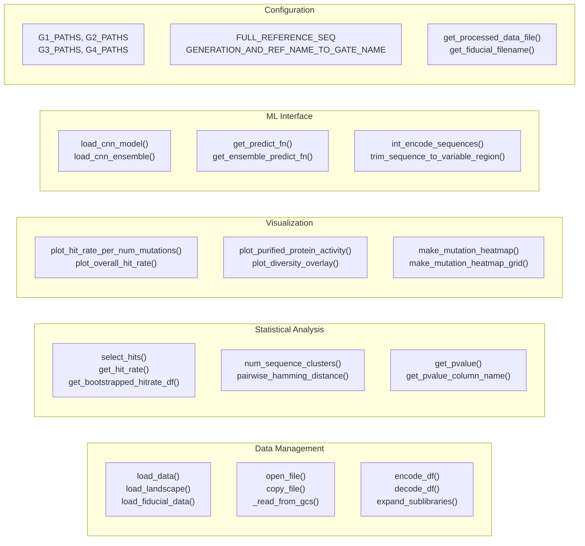
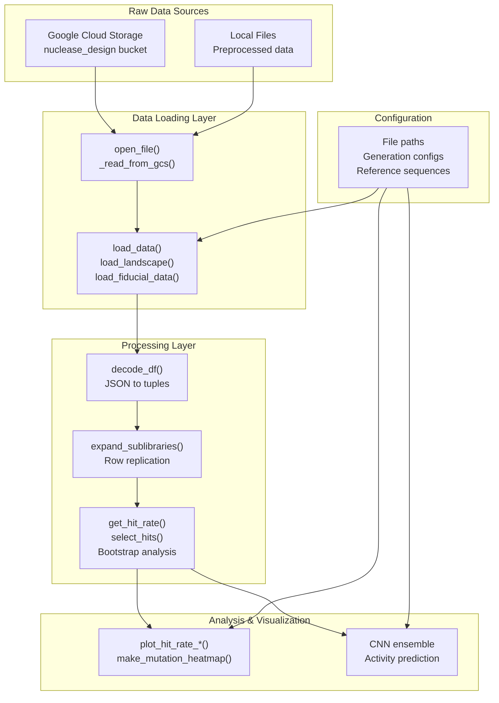

<!-- source: DeepWiki mcp.deepwiki.com · repo google-deepmind/nuclease_design · page 6 Core Libraries · fetched 2026-10-26 -->

# Core Libraries

Relevant source files

The following files were used as context for generating this wiki page:

- [nuclease_design/__init__.py](nuclease_design/__init__.py)
- [nuclease_design/cnn_model.py](nuclease_design/cnn_model.py)
- [nuclease_design/constants.py](nuclease_design/constants.py)
- [nuclease_design/plotting.py](nuclease_design/plotting.py)
- [nuclease_design/utils.py](nuclease_design/utils.py)

This document covers the `nuclease_design` Python package and its core modules that provide foundational functionality for the ML-guided nuclease engineering system. The core libraries include data processing utilities, plotting functions, system constants, and machine learning model interfaces.

For information about specific analysis workflows using these libraries, see [Analysis & Visualization](#4). For details about the machine learning models themselves, see [Machine Learning Models](#5).

## Package Overview

The `nuclease_design` package provides a comprehensive set of utilities organized into specialized modules. Each module serves a distinct purpose in the data processing and analysis pipeline.

### Module Dependencies

**Sources:** [nuclease_design/plotting.py:27-29](), [nuclease_design/utils.py:30-33](), [nuclease_design/cnn_model.py:25-27](), [nuclease_design/constants.py:1-16]()

### Core Functionality Map

**Sources:** [nuclease_design/utils.py:132-162](), [nuclease_design/plotting.py:61-164](), [nuclease_design/cnn_model.py:243-263](), [nuclease_design/constants.py:26-298]()

## Key Module Responsibilities

### Data Processing (`utils.py`)
The utilities module serves as the primary interface for data loading and statistical analysis operations. It handles the complexities of working with both local files and Google Cloud Storage, provides robust statistical functions with bootstrap sampling, and manages the encoding/decoding of complex data structures.

| Function Category | Key Functions | Purpose |
|------------------|---------------|---------|
| Data Loading | `load_data()`, `load_landscape()`, `load_all_data()` | Load processed experimental data |
| File I/O | `open_file()`, `copy_file()`, `_read_from_gcs()` | Handle local and cloud storage |
| Statistical Analysis | `select_hits()`, `get_hit_rate()`, `get_bootstrapped_hitrate_df()` | Perform FDR-corrected hit analysis |
| Data Transformation | `encode_df()`, `decode_df()`, `expand_sublibraries()` | Handle nested data structures |

### Visualization (`plotting.py`)
The plotting module provides standardized visualization functions with consistent styling and color schemes. All plotting functions are designed to work with the experimental data structures and statistical outputs from the utilities module.

| Plot Type | Functions | Data Sources |
|-----------|-----------|--------------|
| Hit Rate Analysis | `plot_hit_rate_per_num_mutations()`, `plot_overall_hit_rate()` | P-value data with FDR correction |
| Activity Validation | `plot_purified_protein_activity()` | Plate assay results |
| Sequence Analysis | `make_mutation_heatmap()`, `plot_diversity_overlay()` | Mutation patterns and clustering |
| Model Analysis | `plot_subsampling_hit_rate()`, `plot_zero_shot_histograms()` | CNN predictions and rankings |

### Configuration (`constants.py`)
The constants module centralizes all system configuration including file paths, experimental parameters, and reference data. It provides a single source of truth for generation-specific settings and data organization.

| Constant Type | Examples | Purpose |
|---------------|----------|---------|
| File Paths | `G1_PATHS`, `G2_PATHS`, `G3_PATHS`, `G4_PATHS` | Raw data file organization |
| Generation Config | `G1_INFO`, `G2_INFO`, `G3_INFO`, `G4_INFO` | Count thresholds, fiducials |
| Reference Data | `FULL_REFERENCE_SEQ`, `FIDUCIAL_NAME_TO_MUTATION_TUPLE` | Sequence and mutation definitions |
| Analysis Parameters | `EXPECTED_FDR`, `DEFAULT_NUM_BOOTSTRAPS` | Statistical analysis settings |

### Machine Learning Interface (`cnn_model.py`)
The CNN model module provides a clean interface to the pre-trained ensemble models used for activity prediction. It handles model loading, sequence encoding, and ensemble prediction averaging.

| Component | Classes/Functions | Purpose |
|-----------|------------------|---------|
| Architecture | `EncodingLayer`, `get_model()` | Define CNN architecture |
| Model Management | `load_cnn_model()`, `load_cnn_ensemble()` | Load pre-trained weights |
| Prediction | `get_predict_fn()`, `get_ensemble_predict_fn()` | Generate activity predictions |
| Preprocessing | `int_encode_sequences()`, `trim_sequence_to_variable_region()` | Prepare input data |

## Data Flow Through Core Libraries

**Sources:** [nuclease_design/utils.py:48-56](), [nuclease_design/utils.py:132-177](), [nuclease_design/plotting.py:61-164](), [nuclease_design/constants.py:22-24]()

## Error Handling and Validation

The core libraries implement several layers of error handling and data validation:

- **File Access**: The `open_file()` function [nuclease_design/utils.py:48-56]() abstracts local vs. cloud storage access with appropriate error handling for different access modes
- **Data Validation**: Functions like `decode_df()` [nuclease_design/utils.py:105-120]() safely handle JSON parsing with proper type conversion
- **Model Loading**: CNN model loading [nuclease_design/cnn_model.py:249-255]() provides clear error messages when models are not available locally
- **Statistical Validation**: Hit rate functions validate input data structures and apply appropriate statistical corrections

## Module Integration Patterns

The core libraries follow consistent patterns for integration:

1. **Dependency Injection**: Configuration constants are passed explicitly rather than imported directly in most functions
2. **DataFrame Conventions**: All modules expect and return pandas DataFrames with standardized column names (e.g., `mutations`, `sublibrary_names`, `generation`)
3. **Random State Management**: Statistical functions accept `random_state` parameters for reproducible results
4. **Flexible Data Sources**: Functions accept `data_dir` parameters to work with different data storage backends

For detailed information about specific functionality within each module, see:
- [Plotting Utilities](#6.1) for visualization functions and styling
- [Data Processing Utilities](#6.2) for statistical analysis and data manipulation  
- [Constants & Configuration](#6.3) for system configuration and file path management
- [Metrics & Analysis Functions](#6.4) for distance metrics and clustering algorithms

**Sources:** [nuclease_design/plotting.py:1-707](), [nuclease_design/utils.py:1-393](), [nuclease_design/constants.py:1-389](), [nuclease_design/cnn_model.py:1-292]()

---

