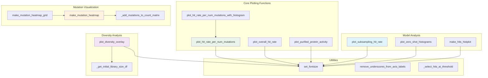
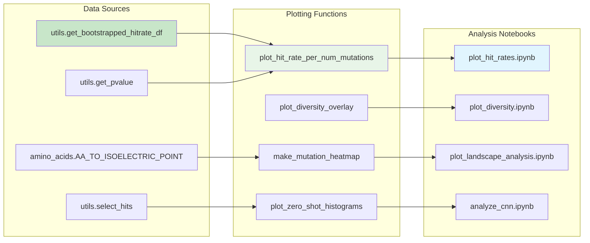

<!-- source: DeepWiki mcp.deepwiki.com · repo google-deepmind/nuclease_design · page 6.1 Plotting Utilities · fetched 2026-10-26 -->

# Plotting Utilities

<details>
<summary>Relevant source files</summary>

The following files were used as context for generating this wiki page:

- [nuclease_design/amino_acids.py](nuclease_design/amino_acids.py)
- [nuclease_design/plotting.py](nuclease_design/plotting.py)

</details>


This document covers the plotting and visualization capabilities provided by the `nuclease_design.plotting` module. The plotting utilities provide standardized visualization functions for nuclease design analysis, including hit rate analysis, diversity measurements, mutation heatmaps, and model evaluation plots.

For information about the underlying statistical analysis functions that generate the data used by these plotting utilities, see [Data Processing Utilities](#6.2). For details about the analysis notebooks that use these plotting functions, see [Analysis & Visualization](#4).

## Overview

The plotting utilities in [nuclease_design/plotting.py]() provide a comprehensive visualization framework for nuclease engineering analysis. The module contains specialized plotting functions for different types of analysis, standardized color schemes for library types, and utility functions for consistent formatting across all visualizations.

### Plotting Function Architecture



Sources: [nuclease_design/plotting.py:1-707]()

### Data Flow and Integration



Sources: [nuclease_design/plotting.py:27-29](), [nuclease_design/plotting.py:102-106]()

## Color Scheme and Styling

The module defines a standardized color palette for different library design methods and nuclease variants. This ensures consistent visualization across all analysis notebooks.

### Library Color Constants

| Library Type | Color Variable | Usage |
|--------------|----------------|-------|
| Wild Type | `WT_COLOR` | Baseline reference sequences |
| Machine Learning | `ML_COLOR` | ML2, ML3, and zero-shot predictions |
| Directed Evolution | `DE_COLOR` | epPCR and DE3 libraries |
| Homologous Recombination | `HR_COLOR` | HR-based libraries |

The color assignments are defined in [nuclease_design/plotting.py:32-40]() and use seaborn's default color palette for consistency.

### Font and Style Utilities

The `set_fontsize()` function provides consistent font sizing across all plot elements:

```python
def set_fontsize(ax, fontsize) -> None:
  """Sets fontsize for `ax`."""
```

This function handles titles, axis labels, tick labels, and legend text uniformly. It's used by most plotting functions with a default font size of 20 points.

Sources: [nuclease_design/plotting.py:32-40](), [nuclease_design/plotting.py:45-58]()

## Hit Rate Analysis Plots

Hit rate analysis is central to evaluating the effectiveness of different library design methods. The plotting utilities provide multiple visualization approaches for hit rate data.

### Primary Hit Rate Function

The `plot_hit_rate_per_num_mutations()` function creates line plots showing hit rates as a function of mutation count:

- Takes DataFrames with p-value columns for statistical significance testing
- Supports bootstrap confidence intervals via `num_bootstraps` parameter
- Allows FDR correction at specified rates (default: `utils.EXPECTED_FDR`)
- Filters data to minimum observation thresholds (`DEFAULT_MIN_NUM_OBSERVATIONS_PER_BIN = 20`)

Key parameters include `reference_name` for comparison baseline ('wt', 'a73r', 'neg_control'), `hue_feature` for grouping (typically 'sublibrary_name'), and `palette` for color specification.

### Enhanced Hit Rate with Histograms

The `plot_hit_rate_per_num_mutations_with_histogram()` function extends the basic hit rate plot by adding histogram subplots showing the distribution of mutation counts for each library:

- Creates multi-panel plots using `gridspec.GridSpec`
- Adds count labels to histogram bars for mutation counts between `min_num_mutations` and `max_num_mutations`
- Shares x-axis between hit rate plot and histograms for easy comparison

Sources: [nuclease_design/plotting.py:61-164](), [nuclease_design/plotting.py:167-284](), [nuclease_design/plotting.py:42]()

## Diversity and Clustering Visualization

### Diversity Overlay Plots

The `plot_diversity_overlay()` function creates sophisticated visualizations showing sequence diversity across different populations and library types:

- Plots number of clusters vs. cluster diameter on log scale
- Compares pre-sort and post-sort populations with different line styles
- Uses opacity mapping to distinguish population types
- Includes initial library size markers as triangles at x=0

The function handles multiple library types simultaneously, showing how diversity changes through the selection process.

### Supporting Functions

The `_get_initial_library_size_df()` helper function extracts initial library sizes from cluster data by filtering to Hamming distance 0 (where clusters equal unique sequences).

Sources: [nuclease_design/plotting.py:389-471](), [nuclease_design/plotting.py:375-386]()

## Mutation Heatmap Visualization

### Single Heatmap Generation

The `make_mutation_heatmap()` function creates detailed heatmaps showing mutation patterns:

- Organizes amino acids by isoelectric point using `amino_acids.AA_TO_ISOELECTRIC_POINT`
- Creates position vs. amino acid matrices with mutation counts
- Overlays parent sequence positions as colored dots
- Uses custom color maps based on seaborn light palettes

### Grid-Based Comparisons

The `make_mutation_heatmap_grid()` function creates 2x2 grids comparing different libraries and activity thresholds:

- Compares full libraries vs. hit subsets
- Shows mutation patterns for different activity levels
- Includes variant and mutation counts in titles
- Uses high DPI (1000) for detailed visualization

Key features include filtering to G4 variable regions using `constants.G4_VARIABLE_REGION_START` and `constants.G4_VARIABLE_REGION_END`, and support for custom fiducial comparisons.

Sources: [nuclease_design/plotting.py:480-530](), [nuclease_design/plotting.py:538-587](), [nuclease_design/plotting.py:474-477]()

## Model Analysis and Zero-Shot Evaluation

### Subsampling Analysis

The `plot_subsampling_hit_rate()` function evaluates model performance by showing hit recovery rates when subsampling libraries by predicted scores:

- Sorts sequences by model scores and plots hit recovery vs. library size reduction
- Compares multiple models simultaneously through `score_specs` parameter
- Includes random baseline for comparison
- Calculates enrichment factors relative to base hit rates

### Zero-Shot Score Distributions

The `plot_zero_shot_histograms()` function visualizes score distributions for functional vs. non-functional variants:

- Creates side-by-side histograms for different activity classes
- Uses cubehelix color palette for clear distinction
- Normalizes histograms to show probability densities
- Centers scores relative to wild-type (WT score = 0)

### Training vs. Design Comparison

The `make_hits_histplot()` function compares mutation distributions between training set hits and designed variants, supporting activity levels 'neg_control', 'wt', and 'a73r'.

Sources: [nuclease_design/plotting.py:589-647](), [nuclease_design/plotting.py:649-682](), [nuclease_design/plotting.py:684-707]()

## Utility Functions

### Text and Label Processing

The `remove_underscores_from_axis_labels()` function provides consistent label formatting by converting underscores to spaces in axis labels, improving readability across all plots.

### Hit Selection

The `_select_hits_at_threshold()` helper function standardizes hit selection logic, supporting both pre-sort populations and activity-based thresholds with FDR correction.

### Integration Points

The plotting utilities integrate with several key modules:
- `nuclease_design.utils` for statistical functions like `get_bootstrapped_hitrate_df` and `select_hits`
- `nuclease_design.constants` for system parameters like variable region boundaries
- `nuclease_design.amino_acids` for amino acid properties and ordering

Sources: [nuclease_design/plotting.py:333-336](), [nuclease_design/plotting.py:532-535](), [nuclease_design/plotting.py:27-29]()

---

