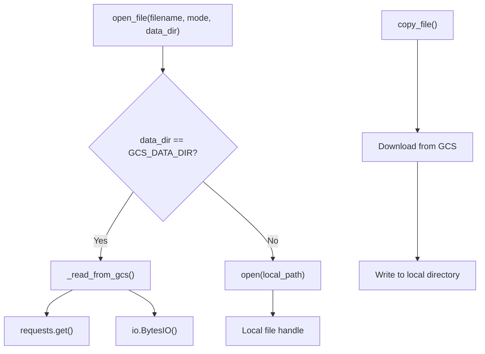
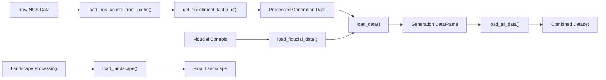
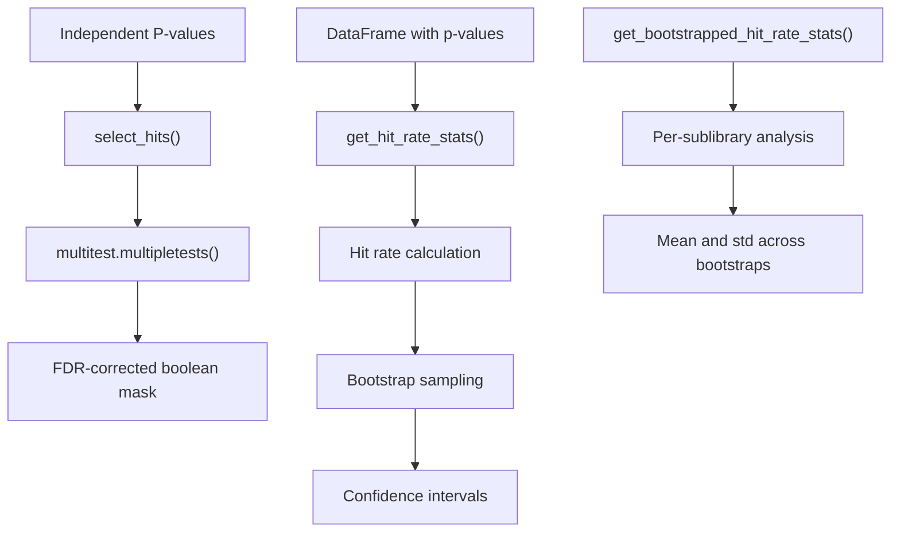
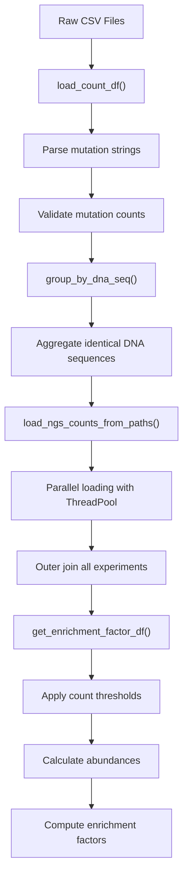
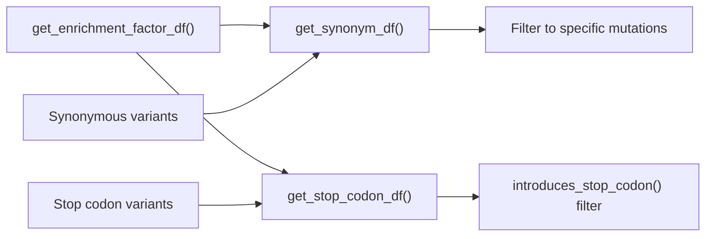
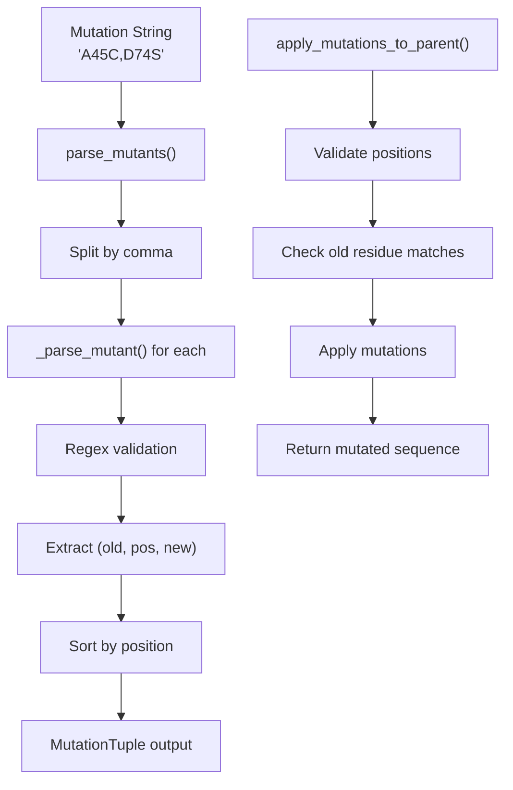
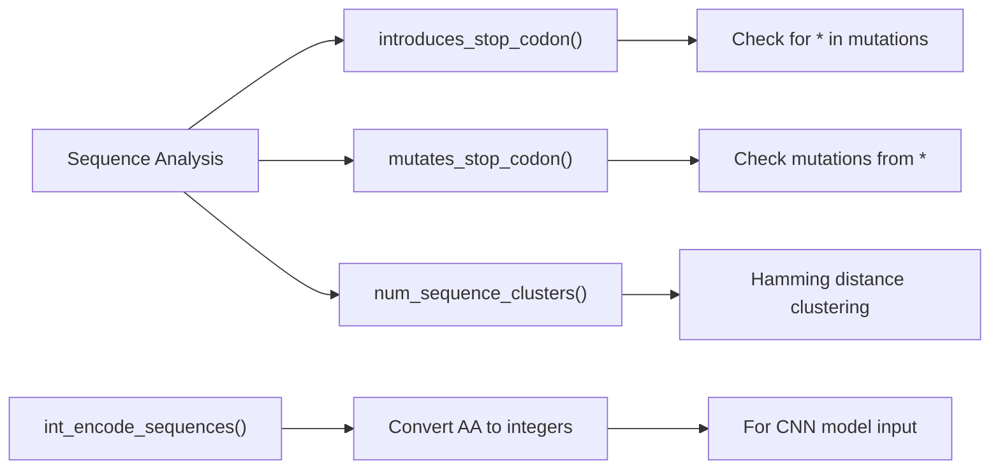
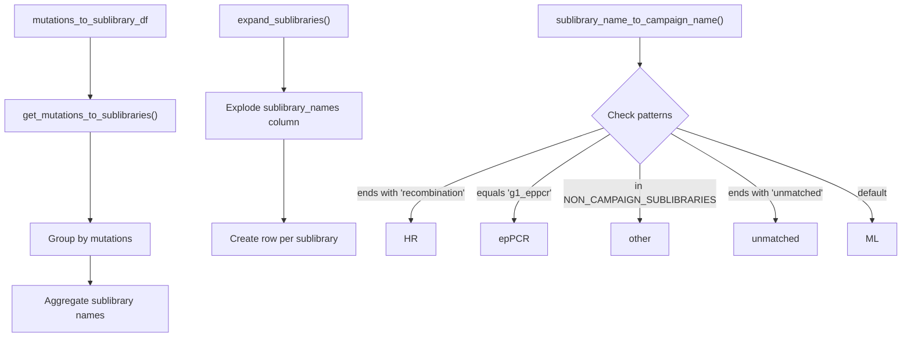

<!-- source: DeepWiki mcp.deepwiki.com · repo google-deepmind/nuclease_design · page 6.2 Data Processing Utilities · fetched 2026-10-26 -->

# Data Processing Utilities

Relevant source files

The following files were used as context for generating this wiki page:

- [nuclease_design/cnn_model.py](nuclease_design/cnn_model.py)
- [nuclease_design/constants.py](nuclease_design/constants.py)
- [nuclease_design/data_utils.py](nuclease_design/data_utils.py)
- [nuclease_design/preprocessing_utils.py](nuclease_design/preprocessing_utils.py)
- [nuclease_design/utils.py](nuclease_design/utils.py)

This document covers the core data processing utilities in the `nuclease_design` package that handle data loading, statistical analysis, NGS preprocessing, and sequence manipulation. These utilities form the foundation for all analysis workflows in the system.

For information about visualization functions, see [Plotting Utilities](#6.1). For configuration parameters and file paths, see [Constants & Configuration](#6.3). For distance metrics and clustering algorithms, see [Metrics & Analysis Functions](#6.4).

## Data Loading Infrastructure

The system provides a flexible data loading infrastructure that supports both Google Cloud Storage (GCS) and local file access through a unified interface.

### Core Loading Functions

The primary data loading functions are centralized in [nuclease_design/utils.py:132-177]():

| Function | Purpose | Returns |
|----------|---------|---------|
| `load_data()` | Load processed enrichment factor data for a specific generation | DataFrame with mutations, enrichment factors, and p-values |
| `load_all_data()` | Load and concatenate data from all four generations (G1-G4) | Combined DataFrame with generation labels |
| `load_landscape()` | Load the final aggregated landscape dataset | DataFrame with activity classifications |
| `load_fiducial_data()` | Load control sequence data for a specific fiducial and generation | DataFrame with fiducial control measurements |

### File System Abstraction

The `open_file()` function at [nuclease_design/utils.py:48-56]() provides transparent access to both GCS and local storage:

**Data Loading Flow Diagram**

Sources: [nuclease_design/utils.py:43-70](), [nuclease_design/utils.py:132-177]()

## Statistical Analysis Functions

The utilities provide comprehensive statistical analysis capabilities with proper multiple testing correction and bootstrap confidence intervals.

### Hit Rate Analysis

Hit rate calculation uses False Discovery Rate (FDR) correction via the Benjamini-Hochberg method:

Key functions for statistical analysis:

| Function | Purpose | Key Parameters |
|----------|---------|----------------|
| `select_hits()` | Apply FDR correction to p-values | `expected_false_discovery_rate=0.1` |
| `get_hit_rate_stats()` | Calculate hit rate, number of hits, library size | Returns dict with statistics |
| `get_bootstrapped_hit_rate_stats()` | Bootstrap analysis across sublibraries | `num_bootstraps=15`, `random_seed` |

### P-value and Enrichment Factor Column Naming

The system uses standardized column naming conventions implemented in [nuclease_design/utils.py:254-262]():

- P-value columns: `pvalue_gen_{generation}_ref_{reference}_{gate_name}_right`
- Enrichment factor columns: `ef_{gate_name}_{generation}`

Sources: [nuclease_design/utils.py:221-329](), [nuclease_design/constants.py:231-252]()

## NGS Data Processing Pipeline

The NGS preprocessing pipeline transforms raw count data into enrichment factors suitable for statistical analysis.

### Count Data Processing Flow

### Enrichment Factor Calculation

The core enrichment factor calculation at [nuclease_design/preprocessing_utils.py:145-149]() follows this formula:

**Enrichment Factor = (Post-sort Abundance) / (Input Abundance)**

Where abundance is calculated as [nuclease_design/preprocessing_utils.py:138-142]():
**Abundance = Variant Counts / Total Counts**

Key parameters for enrichment factor calculation:

| Parameter | Purpose | Typical Values |
|-----------|---------|----------------|
| `count_threshold` | Minimum counts in input to retain variant | G1: 20, G2: 100, G3: 50, G4: 50 |
| `group_aa_seqs` | Whether to group by amino acid vs DNA sequence | Usually `True` |
| `input_count_cols` | Columns to aggregate for input abundance | Pre-sort experiment columns |
| `post_sort_count_cols` | Columns for post-sort enrichment | High-activity gate columns |

### Specialized Data Extraction

The system provides specialized functions for extracting specific variant types:

Sources: [nuclease_design/preprocessing_utils.py:30-256](), [nuclease_design/preprocessing_utils.py:145-221]()

## Sequence and Mutation Utilities

The system provides comprehensive utilities for handling protein sequences and mutations.

### Mutation Parsing and Validation

### Data Structure Encoding

The system handles complex nested data structures in DataFrames through encoding/decoding functions:

| Function | Purpose | Handles |
|----------|---------|---------|
| `encode_df()` | Convert nested structures to JSON strings for CSV storage | mutations, sublibrary_names, generations |
| `decode_df()` | Convert JSON strings back to Python objects | Tuples of tuples for mutations |

### Sequence Analysis Functions

Key constants and patterns used:

- Mutation regex: `^[A-Z*]\d+[A-Z*]$` at [nuclease_design/data_utils.py:23]()
- Stop codon symbol: `*` at [nuclease_design/data_utils.py:25]()
- One-indexed positions: Positions in mutations are 1-indexed to match biological conventions

Sources: [nuclease_design/data_utils.py:22-133](), [nuclease_design/utils.py:92-121](), [nuclease_design/utils.py:186-218]()

## Configuration and Data Structure Management

### Sublibrary and Campaign Management

The system provides utilities for managing experimental sublibraries and campaign classifications:

### Data Filtering and Selection

Key filtering functions for experimental analysis:

| Function | Purpose | Filter Criteria |
|----------|---------|-----------------|
| `filter_to_g4_positions()` | Select variants in G4 design region | Positions 32-142 (zero-indexed) |
| `select_hit_rows()` | Filter to statistically significant hits | FDR-corrected p-values |

### Column Name Generation

Standardized column naming ensures consistency across the analysis pipeline:

- `get_pvalue_column_name()`: Generates names like `pvalue_gen_g4_ref_wt_2_90_right`
- `get_enrichment_factor_column_name()`: Generates names like `ef_2_90_g4`
- `_get_ef_column_name()`: Converts count column names to enrichment factor names

Sources: [nuclease_design/utils.py:76-393](), [nuclease_design/constants.py:231-389]()

---

