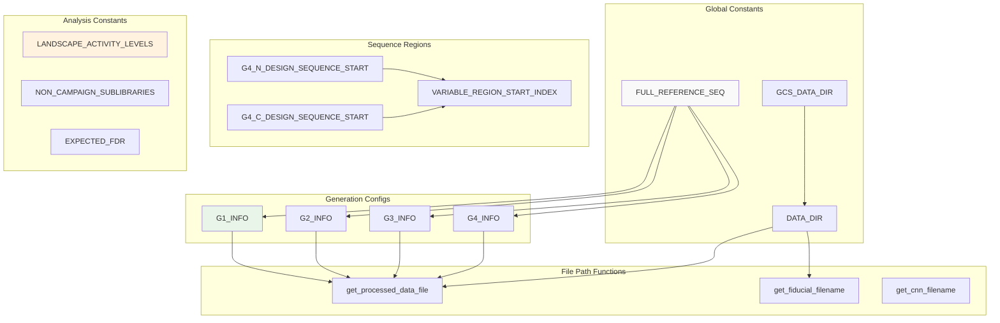
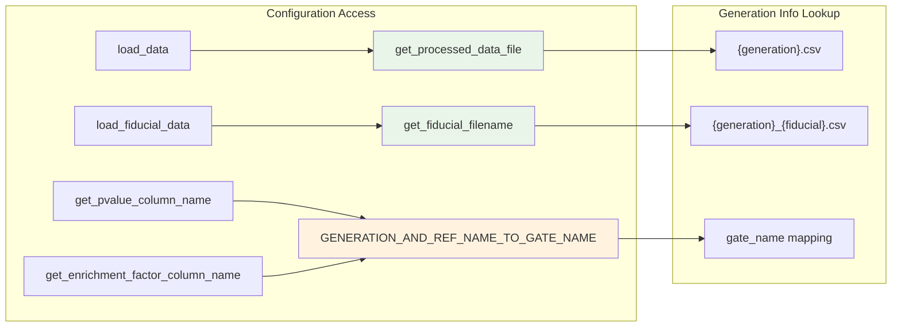
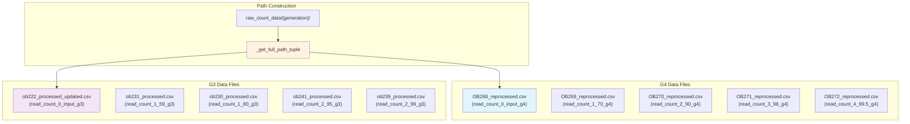
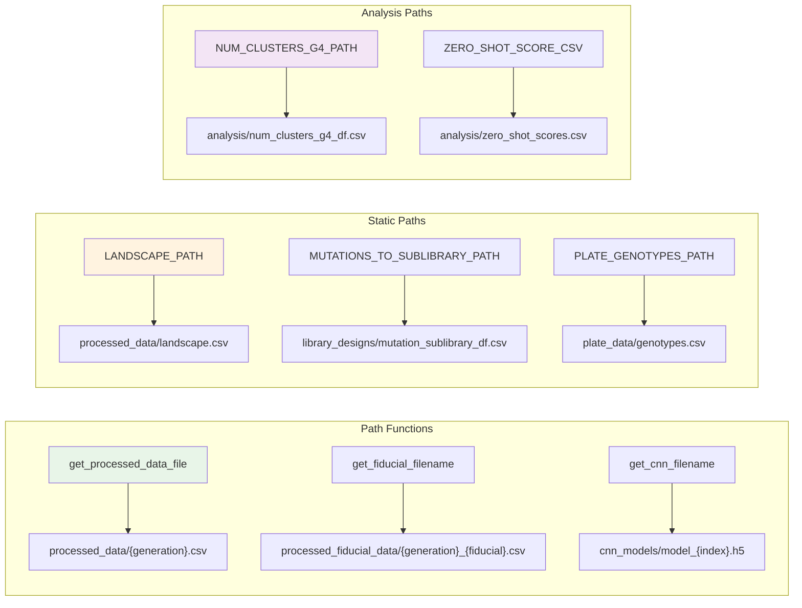
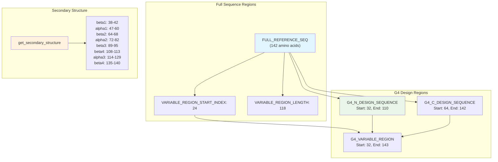
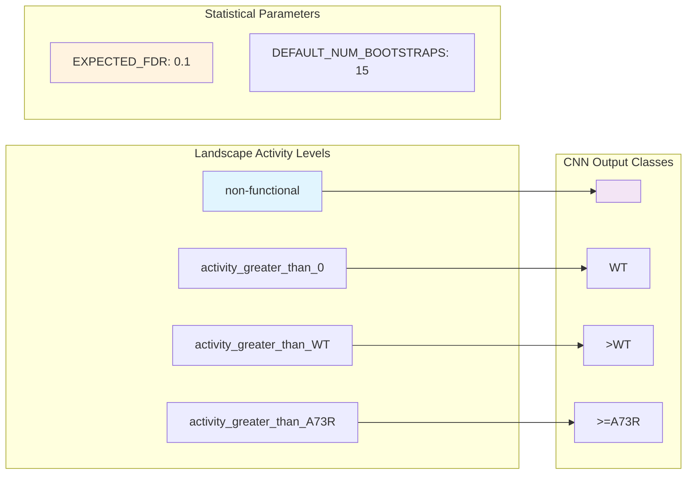
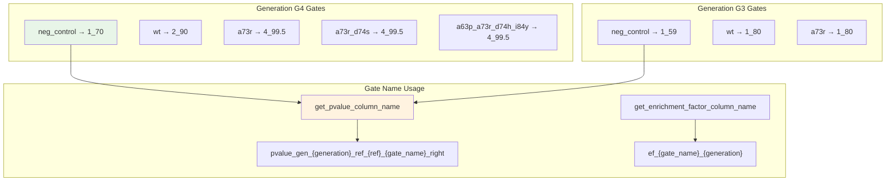

<!-- source: DeepWiki mcp.deepwiki.com · repo google-deepmind/nuclease_design · page 6.3 Constants & Configuration · fetched 2026-10-26 -->

# Constants & Configuration

Relevant source files

The following files were used as context for generating this wiki page:

- [nuclease_design/amino_acids.py](nuclease_design/amino_acids.py)
- [nuclease_design/cnn_model.py](nuclease_design/cnn_model.py)
- [nuclease_design/constants.py](nuclease_design/constants.py)
- [nuclease_design/utils.py](nuclease_design/utils.py)

This document covers the constants, configuration parameters, and static data definitions used throughout the nuclease design system. These configurations control data paths, experimental parameters, sequence regions, and analysis settings that remain consistent across different analysis workflows.

For information about data processing utilities that use these constants, see [Data Processing Utilities](#6.2). For plotting configuration and color constants, see [Plotting Utilities](#6.1).

## Configuration Hierarchy

The system's configuration is organized around a hierarchical structure centered on experimental generations, with each generation having its own data paths, thresholds, and processing parameters.

### Overall Configuration Structure

Sources: [nuclease_design/constants.py:16-389](), [nuclease_design/utils.py:30-41]()

### Configuration Access Pattern

The system uses a consistent pattern for accessing configuration data through generation-specific dictionaries and utility functions:

Sources: [nuclease_design/utils.py:132-162](), [nuclease_design/utils.py:254-261](), [nuclease_design/constants.py:288-297]()

## Generation-Specific Configuration

Each experimental generation (G1-G4) has its own configuration dictionary containing data paths, processing thresholds, and experimental parameters.

### Generation Info Structure

| Configuration Key | Description | Example Values |
|-------------------|-------------|----------------|
| `names_and_paths` | Tuples of (name, file_path) for NGS data | `('read_count_0_input_g4', 'raw_count_data/G4/OB268_reprocessed.csv')` |
| `count_threshold` | Minimum read count for inclusion | G1: 20, G2: 100, G3: 50, G4: 50 |
| `input_names` | Names of pre-sort samples | `['read_count_0_input_g4']` |
| `post_sort_names` | Names of post-sort samples | `['read_count_1_70_g4', 'read_count_2_90_g4', ...]` |
| `fiducials` | Reference sequences for normalization | `['neg_control', 'wt', 'a73r']` |
| `generation` | Generation identifier | `'g4'` |

Sources: [nuclease_design/constants.py:160-229]()

### Data File Organization

Sources: [nuclease_design/constants.py:26-157]()

## File Path Management

The system provides centralized file path management through utility functions and predefined path constants.

### Path Construction Functions

Sources: [nuclease_design/constants.py:288-322]()

### Data Directory Configuration

The system supports both Google Cloud Storage and local file access through the `DATA_DIR` and `GCS_DATA_DIR` constants:

- `GCS_DATA_DIR`: `'https://storage.googleapis.com/nuclease_design'`
- `DATA_DIR`: Defaults to `GCS_DATA_DIR` but can be overridden
- File access handled by `open_file()` function in utils module

Sources: [nuclease_design/constants.py:22-23](), [nuclease_design/utils.py:48-56]()

## Sequence and Design Region Constants

The system defines specific regions within the nuclease sequence for targeted analysis and design.

### Reference Sequence and Regions

Sources: [nuclease_design/constants.py:20](), [nuclease_design/constants.py:269-285](), [nuclease_design/constants.py:326-345](), [nuclease_design/constants.py:359-361]()

### Fiducial Sequence Definitions

The system defines reference sequences used for normalization and comparison:

| Fiducial Name | Mutations | Description |
|---------------|-----------|-------------|
| `wt` | `()` | Wild-type sequence |
| `a73r` | `(('A', 73, 'R'),)` | Single A73R mutation |
| `a73r_d74s` | `(('A', 73, 'R'), ('D', 74, 'S'))` | Double mutation |
| `a63p_a73r_d74h_i84y` | `(('A', 63, 'P'), ('A', 73, 'R'), ('D', 74, 'H'), ('I', 84, 'Y'))` | Quadruple mutation |

Sources: [nuclease_design/constants.py:254-264]()

## Analysis Parameters

The system defines constants used for statistical analysis, activity classification, and experimental organization.

### Activity Level Classification

Sources: [nuclease_design/constants.py:362-367](), [nuclease_design/cnn_model.py:45](), [nuclease_design/utils.py:37-40]()

### Generation and Gate Mapping

The system maintains mappings between experimental generations, reference sequences, and gate names for consistent data access:

Sources: [nuclease_design/constants.py:231-252](), [nuclease_design/utils.py:254-261]()

## Reference Data

### Amino Acid Properties

The system includes amino acid property data for sequence analysis:

- Standard 20 amino acids defined in `amino_acids.AA`
- Isoelectric point values in `AA_TO_ISOELECTRIC_POINT`
- Extended amino acid support (B, Z, X, J)

Sources: [nuclease_design/amino_acids.py:19-81]()

### Sublibrary Organization

The system categorizes experimental sublibraries for analysis:

- `NON_CAMPAIGN_SUBLIBRARIES`: Tuples of sublibrary names excluded from campaign analysis
- Campaign name mapping through `sublibrary_name_to_campaign_name()` function
- Supports categorization into: 'HR', 'epPCR', 'zero_shot', 'other', 'unmatched', 'ML'

Sources: [nuclease_design/constants.py:370-388](), [nuclease_design/utils.py:379-392]()

### Alignment and Model Data

- `ALIGNMENT_PATH`: Path to multiple sequence alignment file for VAE training
- CNN model ensemble configuration with 5 models
- Variable region trimming for model input preparation

Sources: [nuclease_design/constants.py:267](), [nuclease_design/cnn_model.py:30](), [nuclease_design/cnn_model.py:265-266]()

---

