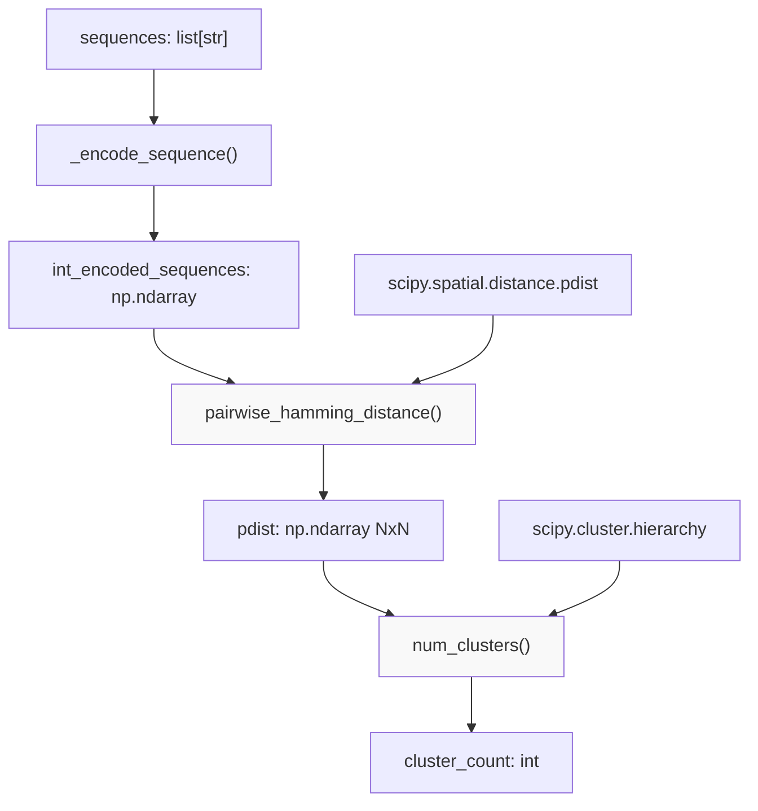
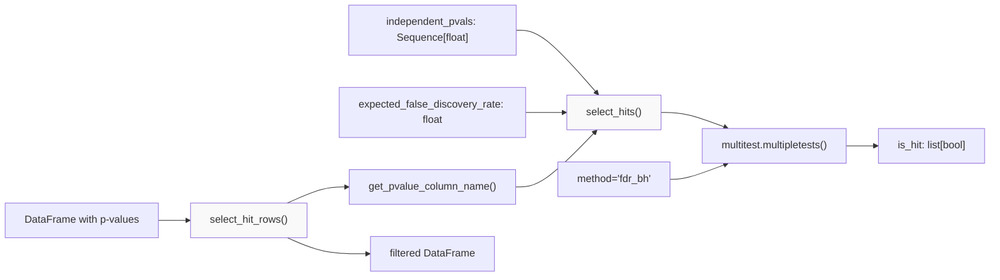
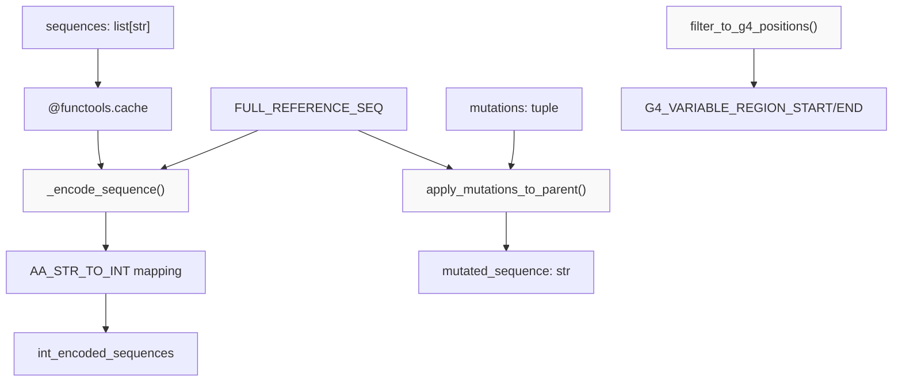
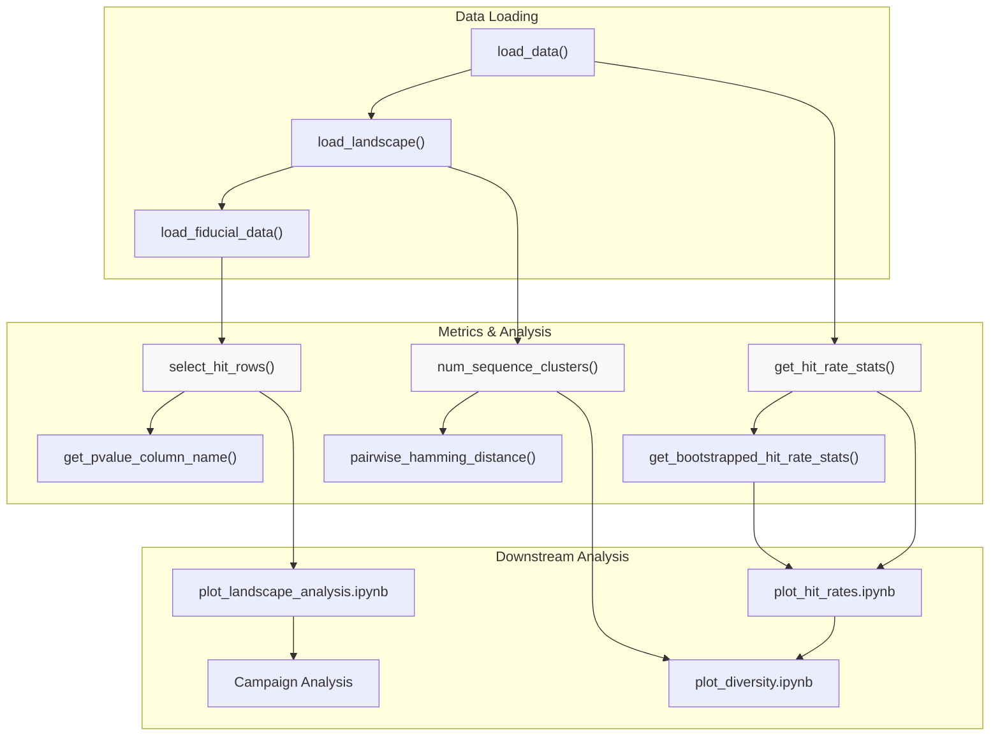
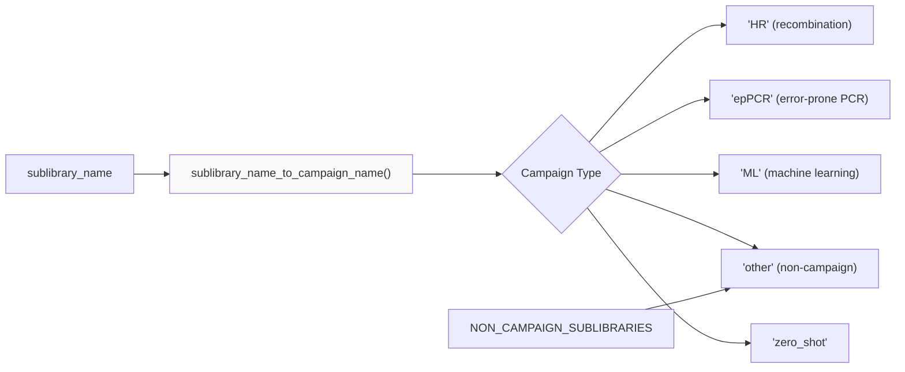

<!-- source: DeepWiki mcp.deepwiki.com · repo google-deepmind/nuclease_design · page 6.4 Metrics & Analysis Functions · fetched 2026-10-26 -->

# Metrics & Analysis Functions

Relevant source files

The following files were used as context for generating this wiki page:

- [nuclease_design/cnn_model.py](nuclease_design/cnn_model.py)
- [nuclease_design/constants.py](nuclease_design/constants.py)
- [nuclease_design/metrics.py](nuclease_design/metrics.py)
- [nuclease_design/utils.py](nuclease_design/utils.py)

This page documents the core metrics and analysis functions provided by the `nuclease_design` package. These functions enable distance calculations, clustering analysis, statistical evaluation of experimental results, and bootstrapped confidence interval estimation. For information about visualization of these metrics, see [Plotting Utilities](#6.1). For details about the data processing pipeline that generates input for these functions, see [Data Processing Pipeline](#3).

## Distance Metrics and Clustering

The system provides specialized distance metrics and clustering algorithms optimized for protein sequence analysis, particularly for evaluating sequence diversity in experimental libraries.

### Hamming Distance Calculation

The foundation of sequence similarity analysis is the `pairwise_hamming_distance` function, which efficiently computes distances between integer-encoded amino acid sequences.

**Hamming Distance and Clustering Pipeline**

The `pairwise_hamming_distance` function in [nuclease_design/metrics.py:57-67]() calculates the NxN matrix of pairwise Hamming distances for integer-encoded sequences. This feeds into hierarchical clustering via `num_clusters`, which uses complete linkage clustering to group sequences within a specified distance threshold.

### Hierarchical Clustering Implementation

The clustering algorithm follows a complete linkage approach consistent with UniRef90 clustering standards:

| Function | Purpose | Method |
|----------|---------|---------|
| `pairwise_hamming_distance` | Calculate sequence distances | Scipy's Hamming distance on integer arrays |
| `num_clusters` | Hierarchical clustering | Complete linkage with distance threshold |
| `num_sequence_clusters` | High-level wrapper | Combines encoding, distance calculation, and clustering |

The `num_clusters` function in [nuclease_design/metrics.py:23-54]() implements complete linkage hierarchical clustering, where cluster distance is defined as the maximum distance between any two sequences in different clusters. This approach ensures that all sequences within a cluster have pairwise distances ≤ the specified threshold.

Sources: [nuclease_design/metrics.py:1-68](), [nuclease_design/utils.py:194-218]()

## Statistical Analysis Functions

The system provides comprehensive statistical analysis capabilities for evaluating experimental hit rates with proper multiple testing correction and confidence interval estimation.

### False Discovery Rate Correction

**FDR Correction and Hit Selection Pipeline**

The statistical framework centers on the `select_hits` function in [nuclease_design/utils.py:221-228](), which applies Benjamini-Hochberg FDR correction to control the expected false discovery rate at 10% (`EXPECTED_FDR = 0.1`). This integrates with `select_hit_rows` to filter DataFrame rows based on statistical significance.

### Hit Rate Analysis

The hit rate calculation system provides both point estimates and bootstrapped confidence intervals:

| Function | Input | Output | Purpose |
|----------|-------|--------|---------|
| `get_hit_rate` | DataFrame, p-value column, FDR | Hit rate (float) | Point estimate |
| `get_hit_rate_stats` | DataFrame, p-value column, FDR | Dict with hit_rate, num_hits, library_size | Summary statistics |
| `get_bootstrapped_hitrate_df` | DataFrame, bootstrap parameters | Bootstrap samples DataFrame | Variance estimation |
| `get_bootstrapped_hit_rate_stats` | DataFrame, reference_name, random_seed | Aggregated bootstrap statistics | Mean/std across bootstraps |

The bootstrap analysis in [nuclease_design/utils.py:276-328]() uses `DEFAULT_NUM_BOOTSTRAPS = 15` samples to estimate confidence intervals for hit rate statistics across different sublibrary designs.

Sources: [nuclease_design/utils.py:221-328](), [nuclease_design/utils.py:37-40]()

## Sequence Analysis Utilities

The system provides specialized utilities for processing and analyzing protein sequences in the context of the nuclease engineering pipeline.

### Sequence Encoding and Processing

**Sequence Processing and Mutation Application**

The sequence analysis utilities handle the conversion between string and integer representations of amino acid sequences. The `_encode_sequence` function in [nuclease_design/utils.py:186-191]() uses the `AA_STR_TO_INT` mapping derived from [nuclease_design/amino_acids.py]() and includes `@functools.cache` decoration for performance optimization.

### Data Structure Handling

The system provides utilities for handling complex nested data structures commonly found in experimental datasets:

| Function | Purpose | Column Handling |
|----------|---------|-----------------|
| `encode_df` | Serialize nested structures | JSON encoding of mutations, sublibrary_names, generations |
| `decode_df` | Deserialize nested structures | JSON decoding back to tuples |
| `expand_sublibraries` | Normalize sublibrary assignments | Explode sublibrary_names into separate rows |

The encoding/decoding functions in [nuclease_design/utils.py:92-120]() handle the serialization of complex data structures like mutation tuples and sublibrary name lists for CSV storage and retrieval.

Sources: [nuclease_design/utils.py:36-120](), [nuclease_design/utils.py:186-192](), [nuclease_design/utils.py:331-376]()

## Integration with Analysis Pipeline

The metrics and analysis functions integrate tightly with the broader nuclease design system, providing the computational foundation for experimental evaluation.

### Pipeline Integration Points

**Integration of Metrics Functions with Analysis Notebooks**

### Column Name Generation

The system uses standardized column naming conventions for p-values and enrichment factors:

- `get_pvalue_column_name(generation, ref)` generates names like `"pvalue_gen_g4_ref_wt_2_90_right"`
- `get_enrichment_factor_column_name(generation, ref)` generates names like `"ef_2_90_g4"`

These functions in [nuclease_design/utils.py:254-261]() ensure consistent naming across the analysis pipeline by incorporating the generation, reference sequence, and gate information from `constants.GENERATION_AND_REF_NAME_TO_GATE_NAME`.

### Campaign Analysis Support

The metrics functions support campaign-level analysis through sublibrary categorization:

**Campaign Classification Logic**

The `sublibrary_name_to_campaign_name` function in [nuclease_design/utils.py:379-392]() categorizes experimental sublibraries into campaign types, enabling comparative analysis across different library design methods.

Sources: [nuclease_design/utils.py:254-292](), [nuclease_design/utils.py:379-392](), [nuclease_design/constants.py:231-252](), [nuclease_design/constants.py:370-388]()

---

