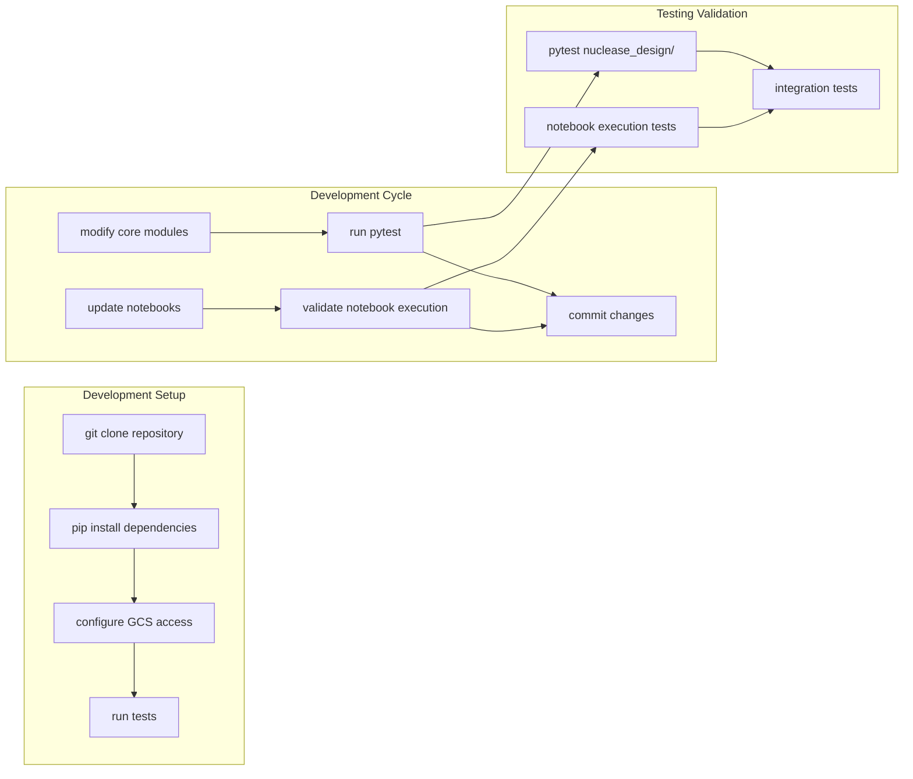
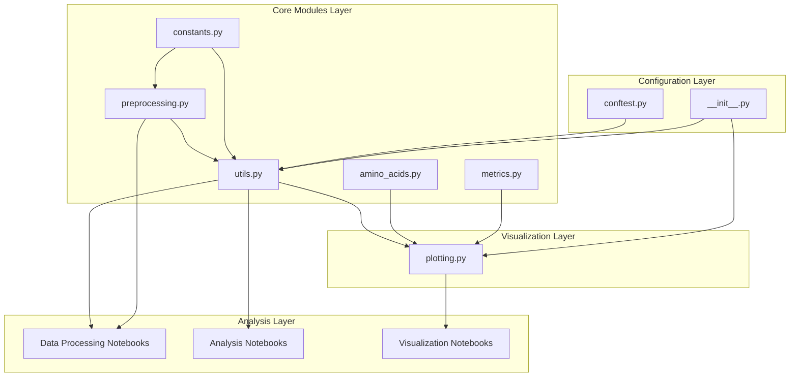
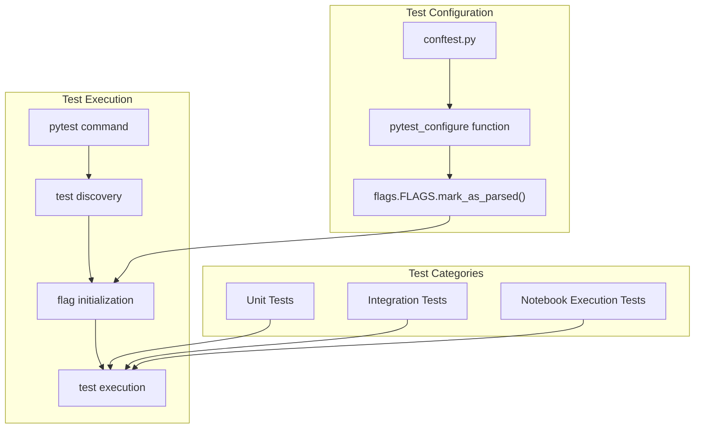
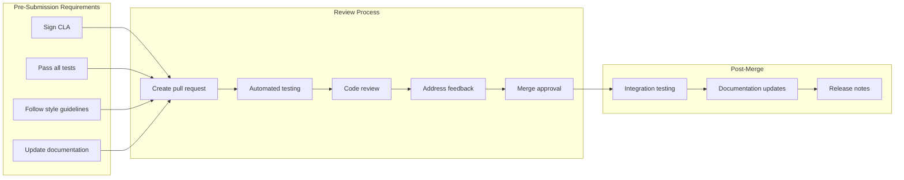

<!-- source: DeepWiki mcp.deepwiki.com · repo google-deepmind/nuclease_design · page 7 Development · fetched 2026-10-26 -->

# Development

<details>
<summary>Relevant source files</summary>

The following files were used as context for generating this wiki page:

- [.gitignore](.gitignore)
- [CONTRIBUTING.md](CONTRIBUTING.md)
- [nuclease_design/conftest.py](nuclease_design/conftest.py)

</details>


This page provides information for developers contributing to or extending the nuclease design system. It covers the development environment setup, code organization, testing framework, and contribution guidelines.

For information about the core libraries and their APIs, see [Core Libraries](#6). For details about the testing framework specifically, see [Testing Framework](#7.1). For contribution guidelines and licensing information, see [Contributing Guidelines](#7.2).

## Development Environment Overview

The nuclease design system is organized as a Python package with Jupyter notebook-based analysis workflows. The development environment supports both local development and Google Colab integration for accessibility.

### Code Organization Structure

```mermaid
flowchart TD
    subgraph "Repository Root"
        A["nuclease_design/"]
        B[".gitignore"]
        C["CONTRIBUTING.md"]
        D["README.md"]
        E["LICENSE"]
    end
    
    subgraph "Core Package"
        F["nuclease_design/__init__.py"]
        G["nuclease_design/utils.py"]
        H["nuclease_design/plotting.py"]
        I["nuclease_design/preprocessing.py"]
        J["nuclease_design/constants.py"]
        K["nuclease_design/amino_acids.py"]
        L["nuclease_design/metrics.py"]
    end
    
    subgraph "Analysis Notebooks"
        M["get_enrichment_factor_data.ipynb"]
        N["get_landscape.ipynb"]
        O["plot_landscape_analysis.ipynb"]
        P["plot_hit_rates.ipynb"]
        Q["plot_diversity.ipynb"]
        R["analyze_cnn.ipynb"]
    end
    
    subgraph "Testing Infrastructure"
        S["nuclease_design/conftest.py"]
        T["pytest configuration"]
    end
    
    A --> F
    A --> G
    A --> H
    A --> I
    A --> J
    A --> K
    A --> L
    A --> S
    
    F -.-> G
    F -.-> H
    F -.-> I
    
    M --> G
    N --> G
    O --> H
    P --> H
    Q --> H
    R --> G
    
    S --> T
```



**Sources:** [.gitignore:1-25](), [CONTRIBUTING.md:1-26](), [nuclease_design/conftest.py:1-24]()

### Development Dependencies

The system requires several key dependency categories for development:

| Category | Key Dependencies | Purpose |
|----------|-----------------|---------|
| Core Scientific | `numpy`, `pandas`, `scipy` | Data processing and statistical analysis |
| Machine Learning | `tensorflow`, `scikit-learn` | CNN models and clustering |
| Visualization | `matplotlib`, `seaborn` | Plotting and visualization |
| Cloud Integration | `google-cloud-storage` | GCS data access |
| Development Tools | `pytest`, `jupyter` | Testing and notebook development |
| Bioinformatics | `biopython` | Sequence analysis utilities |

## Development Workflow

### Local Development Setup

The development workflow follows standard Python package development practices with additional considerations for the notebook-based analysis components.



**Sources:** [nuclease_design/conftest.py:21-23]()

### Code Organization Principles

The codebase follows a modular architecture separating concerns between data processing, analysis, and visualization:



**Sources:** [nuclease_design/conftest.py:16-24]()

## Testing Infrastructure

### pytest Configuration

The testing framework is built on `pytest` with custom configuration for the absl flags system used throughout the codebase.

The `conftest.py` module provides essential pytest configuration:

```python
def pytest_configure(config):
  del config  # Unused.
  flags.FLAGS.mark_as_parsed()
```

This configuration in [nuclease_design/conftest.py:21-23]() ensures that absl flags are properly initialized before test execution, preventing flag parsing conflicts.

### Test Organization



**Sources:** [nuclease_design/conftest.py:1-24]()

## Contributing Process

### Contributor License Agreement

All contributions require a signed Contributor License Agreement (CLA) as specified in [CONTRIBUTING.md:5-9](). The CLA process:

1. Contributors retain copyright to their contributions
2. CLA grants permission for use and redistribution
3. Submit CLA at https://cla.developers.google.com/
4. Generally only need to submit once per developer

### Code Review Process

The project follows Google's standard code review practices outlined in [CONTRIBUTING.md:15-20]():

- All submissions require review via GitHub pull requests
- This includes submissions by project members
- Reviews follow GitHub's pull request workflow
- Community guidelines follow Google's Open Source Community Guidelines

### Development Standards



**Sources:** [CONTRIBUTING.md:1-26]()

### Repository Structure Standards

The `.gitignore` configuration in [.gitignore:1-25]() follows Python best practices, excluding:

- Compiled Python files (`__pycache__/`, `*.pyc`)
- Distribution artifacts (`build/`, `dist/`, `*.egg-info/`)
- Virtual environment directories
- IDE-specific files

This ensures clean repository state and prevents accidental inclusion of generated files in version control.

**Sources:** [.gitignore:1-25](), [CONTRIBUTING.md:1-26](), [nuclease_design/conftest.py:1-24]()

---

