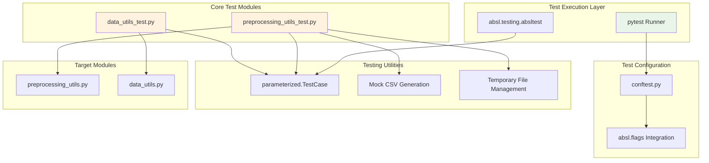
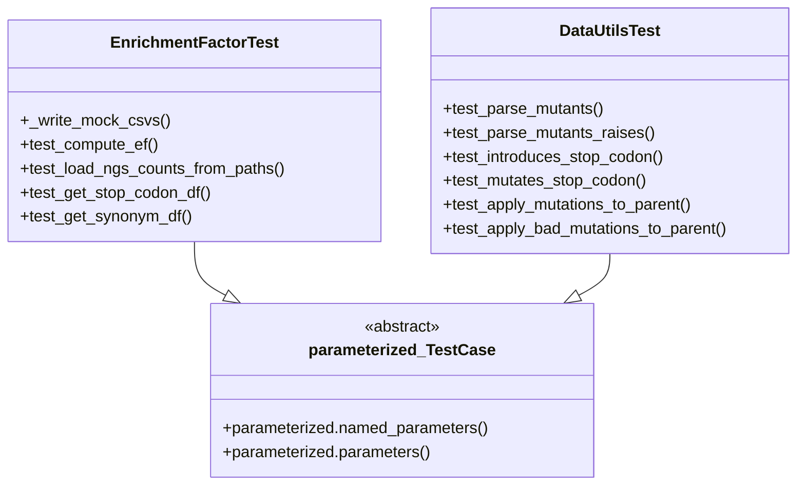
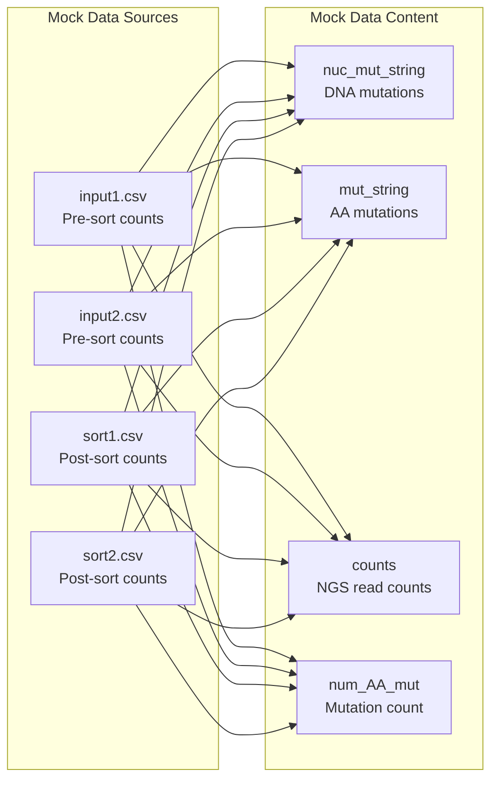
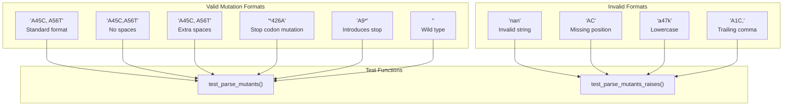
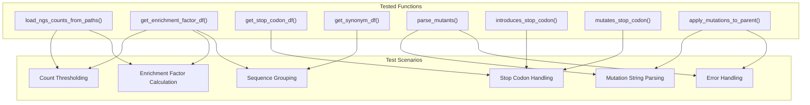

<!-- source: DeepWiki mcp.deepwiki.com · repo google-deepmind/nuclease_design · page 7.1 Testing Framework · fetched 2026-10-26 -->

# Testing Framework

<details>
<summary>Relevant source files</summary>

The following files were used as context for generating this wiki page:

- [nuclease_design/conftest.py](nuclease_design/conftest.py)
- [nuclease_design/data_utils_test.py](nuclease_design/data_utils_test.py)
- [nuclease_design/preprocessing_utils_test.py](nuclease_design/preprocessing_utils_test.py)

</details>


This page documents the testing infrastructure for the nuclease design system, including test organization, execution methods, and coverage of core functionality. The testing framework validates data processing pipelines, statistical calculations, and utility functions essential for the ML-guided nuclease engineering workflow.

For information about development guidelines and contributing practices, see [Contributing Guidelines](#7.2).

## Testing Architecture

The nuclease design system employs a hybrid testing approach combining Google's `absl.testing` framework with `pytest` integration for maximum compatibility and flexibility.

### Testing Framework Stack



**Testing Framework Integration**

Sources: [nuclease_design/conftest.py:1-24]()

The system integrates `pytest` with `absl.testing` through configuration in `conftest.py`, which handles flag parsing compatibility between the two frameworks.

## Test Organization

The testing infrastructure is organized around core functionality modules with comprehensive coverage of data processing and utility functions.

### Test Module Structure

| Test Module | Target Module | Primary Focus |
|-------------|---------------|---------------|
| `preprocessing_utils_test.py` | `preprocessing_utils.py` | NGS data processing, enrichment factors |
| `data_utils_test.py` | `data_utils.py` | Mutation parsing, sequence operations |

### Test Class Hierarchy



Sources: [nuclease_design/preprocessing_utils_test.py:62-63](), [nuclease_design/data_utils_test.py:24-25]()

## Core Test Modules

### Preprocessing Utils Tests

The `EnrichmentFactorTest` class provides comprehensive testing of NGS data processing functionality including enrichment factor calculations, data loading, and sequence filtering.

#### Mock Data Generation

The test suite includes sophisticated mock CSV data generation to simulate real NGS count data:



Sources: [nuclease_design/preprocessing_utils_test.py:28-59]()

#### Parameterized Test Coverage

The enrichment factor tests use extensive parameterization to validate different processing scenarios:

| Test Parameter | Values | Purpose |
|----------------|--------|---------|
| `count_threshold` | 6, 8, 10 | Minimum count filtering |
| `group_aa_seqs` | True, False | Amino acid vs nucleotide grouping |
| `mutations` | Various mutation tuples | Specific sequence variants |

Sources: [nuclease_design/preprocessing_utils_test.py:74-149]()

### Data Utils Tests

The `DataUtilsTest` class validates core sequence processing and mutation handling functionality.

#### Mutation Parsing Tests

Tests cover various mutation string formats and edge cases:



Sources: [nuclease_design/data_utils_test.py:26-47]()

## Running Tests

### Test Execution Methods

The testing framework supports multiple execution approaches:

#### Using pytest
```bash
pytest nuclease_design/
```

#### Using absltest directly
```bash
python nuclease_design/preprocessing_utils_test.py
python nuclease_design/data_utils_test.py
```

#### Running specific test methods
```bash
pytest nuclease_design/preprocessing_utils_test.py::EnrichmentFactorTest::test_compute_ef
```

### Test Dependencies

The testing framework requires the following dependencies:
- `absl-py`: Google's testing and flags framework
- `pytest`: Test runner and discovery
- `pandas`: Data structure testing utilities
- `parameterized`: Parameterized test support

Sources: [nuclease_design/preprocessing_utils_test.py:18-22](), [nuclease_design/data_utils_test.py:18-21]()

## Test Coverage Areas

### Data Processing Pipeline Coverage

The test suite covers critical components of the data processing pipeline:



Sources: [nuclease_design/preprocessing_utils_test.py:150-164](), [nuclease_design/data_utils_test.py:34-82]()

### Statistical Validation

The tests include validation of statistical calculations with expected outputs for enrichment factors, abundance calculations, and confidence intervals.

#### Enrichment Factor Test Cases

The test suite validates enrichment factor calculations against known expected values with different count thresholds and grouping strategies, ensuring mathematical correctness of the core statistical pipeline.

Sources: [nuclease_design/preprocessing_utils_test.py:79-117]()

## Mock Data and Test Utilities

### Temporary File Management

The testing framework includes utilities for creating temporary CSV files that simulate real NGS data structure:

- Automatic cleanup of temporary files
- Consistent data format matching production data
- Parameterizable count values and mutation patterns

### Test Data Validation

Tests include comprehensive assertion strategies:
- DataFrame equality testing with `pd.testing.assert_frame_equal()`
- Set-based comparison for unordered collections
- Exception testing for invalid inputs
- Parameterized validation across multiple scenarios

Sources: [nuclease_design/preprocessing_utils_test.py:64-72](), [nuclease_design/preprocessing_utils_test.py:163-164]()

---

