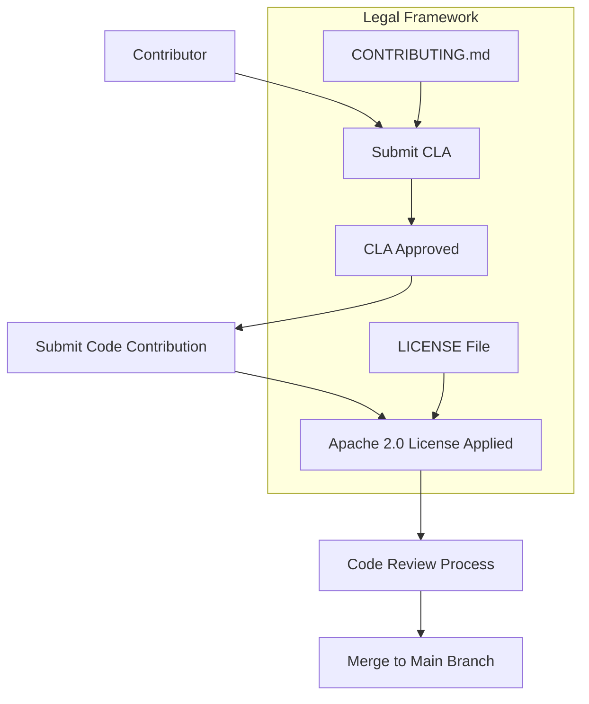
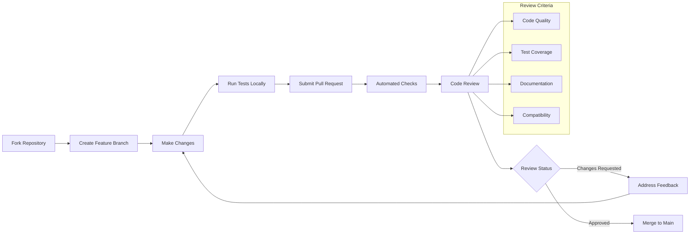
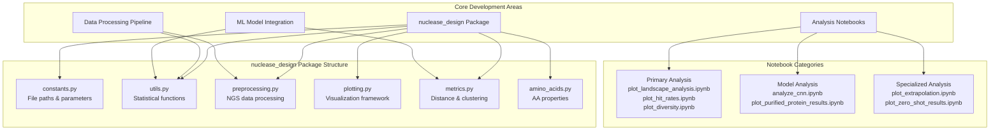
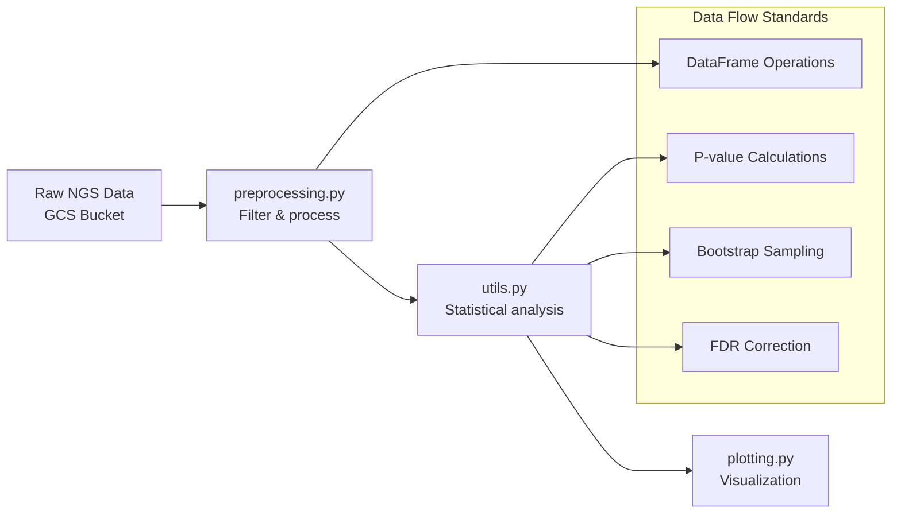

<!-- source: DeepWiki mcp.deepwiki.com · repo google-deepmind/nuclease_design · page 7.2 Contributing Guidelines · fetched 2026-10-26 -->

# Contributing Guidelines

Relevant source files

The following files were used as context for generating this wiki page:

- [.gitignore](.gitignore)
- [CONTRIBUTING.md](CONTRIBUTING.md)
- [LICENSE](LICENSE)

This document provides comprehensive guidelines for contributing to the ML-Guided Nuclease Engineering system. It covers licensing requirements, code review processes, development workflows, and coding standards specific to this project.

For information about the testing framework and running tests, see [Testing Framework](#7.1). For general system architecture and component organization, see [Core Libraries](#6).

## Licensing and Legal Requirements

### Contributor License Agreement

All contributions to this project must be accompanied by a Contributor License Agreement (CLA). The CLA process ensures proper intellectual property handling while allowing you or your employer to retain copyright to your contributions.

| Requirement | Details |
|-------------|---------|
| **CLA Submission** | Required for all contributors |
| **CLA Portal** | <https://cla.developers.google.com/> |
| **Frequency** | Generally required only once per contributor |
| **Scope** | Covers all Google open source projects |

The CLA gives the project permission to use and redistribute your contributions as part of the project. If you have previously submitted a CLA for any Google project, you typically do not need to submit another one.

### Project License

This project is licensed under the Apache License, Version 2.0. All contributions are submitted under the same license terms. Key aspects include:

- **Copyright Retention**: Contributors retain copyright to their contributions
- **License Grant**: Perpetual, worldwide, non-exclusive, royalty-free license to the project
- **Patent Grant**: Contributors grant patent licenses for their contributions
- **Attribution Requirements**: Proper attribution must be maintained in derivative works

**Sources:** [CONTRIBUTING.md:3-13](), [LICENSE:1-203]()

## Code Review Process

All submissions, including those by project members, require code review through GitHub pull requests. This ensures code quality and maintains system integrity across the complex ML pipeline.

### Pull Request Workflow

### Review Criteria

Contributions are evaluated based on:

| Criterion | Requirements |
|-----------|-------------|
| **Code Quality** | Clear, maintainable code following project conventions |
| **Functionality** | Correct implementation of intended features |
| **Testing** | Adequate test coverage for new functionality |
| **Documentation** | Clear docstrings and updated documentation |
| **Compatibility** | Works with existing pipeline components |
| **Data Handling** | Proper handling of GCS bucket data and file paths |

**Sources:** [CONTRIBUTING.md:15-20]()

## Development Workflow

### System Architecture for Development

Understanding the codebase structure is essential for effective contributions. The system follows a modular architecture with clear separation between data processing, analysis, and visualization components.

### File Organization Standards

The codebase follows a structured organization that contributors should maintain:

| Component | Location | Purpose |
|-----------|----------|---------|
| **Core Library** | `nuclease_design/` | Reusable functions and utilities |
| **Data Processing** | `get_enrichment_factor_data.ipynb`, `get_landscape.ipynb` | Raw data to processed datasets |
| **Primary Analysis** | `plot_*.ipynb` | Main analysis notebooks |
| **Configuration** | `nuclease_design/constants.py` | System-wide constants and paths |
| **Utilities** | `nuclease_design/utils.py` | Statistical and helper functions |

**Sources:** Based on system architecture analysis from codebase structure

## Code Standards and Practices

### Python Code Conventions

Contributions should follow established patterns found in the codebase:

#### Function Naming and Structure

Functions should follow the existing naming conventions seen in the core modules:

- Use descriptive names like `get_enrichment_factor_data()` for data processing
- Statistical functions follow patterns like `bootstrap_hit_rates()` 
- Plotting functions use prefixes like `plot_hit_rate_comparison()`

#### Data Handling Patterns

When working with the nuclease design data pipeline:

#### Constants and Configuration

All file paths, reference sequences, and analysis parameters should be defined in `nuclease_design/constants.py`. This centralized approach ensures:

- Consistent data access across notebooks
- Easy modification of experimental parameters
- Clear separation between code and configuration

### Documentation Requirements

Contributions must include appropriate documentation:

| Documentation Type | Requirement |
|-------------------|-------------|
| **Function Docstrings** | All public functions must have docstrings describing parameters, returns, and purpose |
| **Notebook Markdown** | Analysis notebooks should include markdown cells explaining methodology |
| **Inline Comments** | Complex statistical calculations should include explanatory comments |
| **Type Hints** | New functions should include appropriate type hints |

**Sources:** [nuclease_design/constants.py](), [nuclease_design/utils.py](), [nuclease_design/preprocessing.py]()

## Testing and Quality Assurance

### Testing Framework Integration

Contributions should integrate with the existing testing framework documented in [Testing Framework](#7.1). Key testing requirements:

- **Unit Tests**: For new utility functions in `nuclease_design` package
- **Integration Tests**: For data processing pipeline components
- **Notebook Validation**: Ensure notebooks execute without errors
- **Statistical Validation**: Verify statistical calculations produce expected results

### Quality Checklist

Before submitting contributions, verify:

- [ ] Code follows existing patterns in the codebase
- [ ] All constants are defined in `nuclease_design/constants.py`
- [ ] Functions include appropriate docstrings
- [ ] New analysis includes statistical validation
- [ ] Notebooks include explanatory markdown cells
- [ ] Changes maintain compatibility with GCS data sources
- [ ] Tests pass for modified components

**Sources:** [.gitignore:1-25]()

## Community Guidelines

This project follows [Google's Open Source Community Guidelines](https://opensource.google/conduct/). All contributors are expected to maintain a welcoming and inclusive environment.

### Communication Standards

- **Respectful Interaction**: Maintain professional and respectful communication
- **Constructive Feedback**: Provide specific, actionable feedback in code reviews
- **Knowledge Sharing**: Help other contributors understand complex ML and statistical concepts
- **Scientific Rigor**: Maintain high standards for statistical analysis and experimental validation

### Issue Reporting and Feature Requests

When reporting issues or requesting features:

1. **Search Existing Issues**: Check if the issue has already been reported
2. **Provide Context**: Include relevant notebook names, data generation information
3. **Include Reproducible Examples**: Provide minimal examples that demonstrate the issue
4. **Specify System Components**: Identify which parts of the pipeline are affected

**Sources:** [CONTRIBUTING.md:22-25]()