# Page: Overview

# Overview

<details>
<summary>Relevant source files</summary>

The following files were used as context for generating this wiki page:

- [README.md](README.md)
- [images/landscape.svg](images/landscape.svg)
- [images/overview.png](images/overview.png)
- [images/overview_wide.png](images/overview_wide.png)

</details>


## Purpose and Scope

This system implements **ML-Guided Directed Evolution for Engineering Nuclease Enzymes**, providing a comprehensive platform that combines high-throughput experimental screening with machine learning to engineer improved nuclease variants. The system processes NGS data from 55,760 NucB variants across 4 experimental generations, applies statistical analysis with multiple testing correction, and uses CNN ensembles for activity prediction.

The system encompasses the complete workflow from raw NGS count data to final analysis and visualization, supporting both pre-computed results and full data regeneration from source. For information about specific analysis notebooks, see [Analysis & Visualization](#4). For details about the machine learning models, see [Machine Learning Models](#5).

## System Architecture

The system follows a layered architecture with distinct data processing, analysis, and infrastructure components:

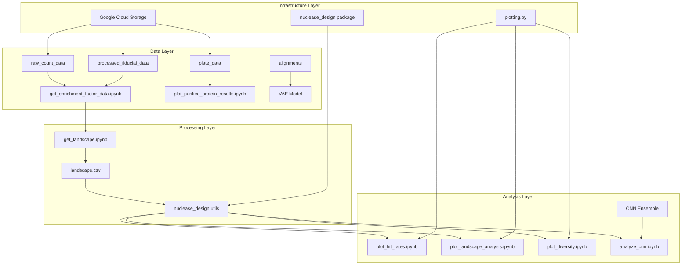

**Data Processing Pipeline**
Sources: [README.md:20-30](), [nuclease_design/constants.py](), [notebooks/get_enrichment_factor_data.ipynb]()

## Core Data Flow

The system processes experimental data through a well-defined pipeline that transforms raw NGS counts into statistical landscapes:

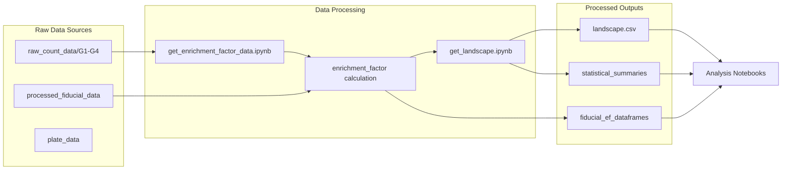

**Key Processing Steps:**
1. **Enrichment Factor Calculation**: Computes log2 ratios between post-sort and pre-sort populations with p-value estimation
2. **Statistical Correction**: Applies FDR correction using Benjamini-Hochberg method
3. **Multi-Generation Aggregation**: Combines data across G1-G4 generations into unified landscape
4. **Activity Classification**: Assigns multi-class labels (< WT, WT, > WT, >= A73R) based on statistical thresholds

Sources: [nuclease_design/preprocessing.py](), [nuclease_design/utils.py](), [notebooks/get_landscape.ipynb]()

## Library Design Methods Analysis

The system evaluates multiple nuclease library design approaches through comparative hit rate analysis:

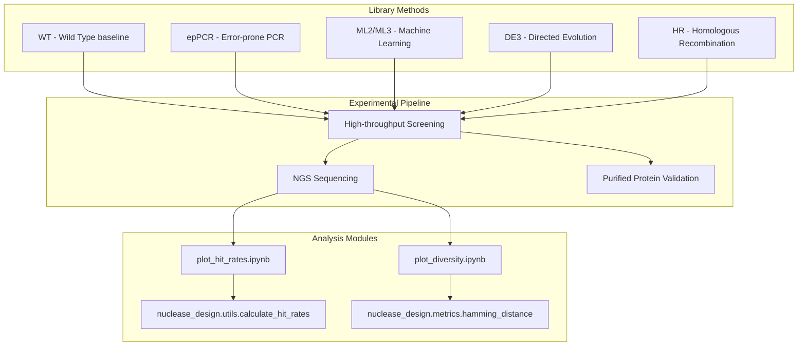

**Hit Rate Calculation**: Uses bootstrap sampling with confidence intervals to compare method effectiveness across activity thresholds.

Sources: [nuclease_design/utils.py:200-250](), [notebooks/plot_hit_rates.ipynb](), [nuclease_design/constants.py]()

## Machine Learning Components

The system integrates pre-trained models for sequence analysis and activity prediction:

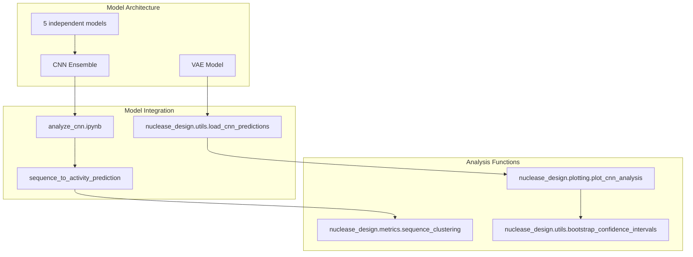

**CNN Ensemble**: Provides activity predictions with output classes (< WT, WT, > WT, >= A73R) for sequence variants.
**VAE Model**: Generates new sequences based on alignment training data for library design.

Sources: [notebooks/analyze_cnn.ipynb](), [nuclease_design/utils.py:300-350](), [README.md:37-40]()

## Core Python Package Structure

The `nuclease_design` package provides the foundational utilities and analysis functions:

| Module | Primary Functions | Purpose |
|--------|------------------|---------|
| `utils.py` | `calculate_hit_rates`, `bootstrap_sample`, `load_enrichment_data` | Statistical analysis and data loading |
| `plotting.py` | `plot_hit_rates`, `plot_landscape_heatmap`, `plot_diversity_analysis` | Visualization and figure generation |
| `preprocessing.py` | `calculate_enrichment_factors`, `apply_fdr_correction` | NGS data processing |
| `constants.py` | `FILE_PATHS`, `REFERENCE_SEQUENCES`, `ANALYSIS_PARAMETERS` | System configuration |
| `metrics.py` | `hamming_distance`, `sequence_clustering` | Distance and similarity calculations |
| `amino_acids.py` | `AA_PROPERTIES`, `ISOELECTRIC_POINTS` | Biochemical properties |

Sources: [nuclease_design/](), [nuclease_design/utils.py](), [nuclease_design/plotting.py](), [nuclease_design/constants.py]()

## Analysis Notebook Ecosystem

The system provides specialized Jupyter notebooks for different analysis tasks:

**Primary Analysis Notebooks:**
- `plot_landscape_analysis.ipynb`: Dataset exploration and landscape visualization
- `plot_hit_rates.ipynb`: Library method evaluation and comparison  
- `plot_diversity.ipynb`: Hit diversity and clustering analysis
- `analyze_cnn.ipynb`: CNN model interaction and validation

**Specialized Analysis:**
- `plot_purified_protein_results.ipynb`: Low-throughput experimental validation
- `plot_extrapolation.ipynb`: Trend prediction and forecasting
- `plot_zero_shot_results.ipynb`: Zero-shot performance evaluation

**Data Generation:**
- `get_enrichment_factor_data.ipynb`: Raw NGS data processing
- `get_landscape.ipynb`: Multi-generation landscape aggregation

All primary analysis notebooks support Google Colab integration for accessible execution without local setup.

Sources: [notebooks/](), [README.md:32-40](), [notebooks/plot_landscape_analysis.ipynb]()

## Infrastructure and Deployment

The system leverages cloud infrastructure for scalable data access and analysis:

**Google Cloud Storage**: All processed data stored in `nuclease_design` bucket with organized subdirectories for different data types and processing stages.

**Key GCS Paths:**
- `raw_count_data/`: NGS pre/post-sort populations
- `processed_data/`: Enrichment factors and statistical summaries  
- `processed_data/landscape.csv`: Primary dataset with 56K sequences
- `library_designs/`: Method-to-sequence mappings
- `analysis/`: Pre-computed clustering and diversity results

**Reproducibility**: System supports both pre-computed result loading and full regeneration from raw data by setting `LOCAL_OUTPUT_DATA_DIR` parameter.

Sources: [README.md:41-75](), [nuclease_design/constants.py](), [notebooks/get_enrichment_factor_data.ipynb:25-30]()

---

# Page: Getting Started

# Getting Started

<details>
<summary>Relevant source files</summary>

The following files were used as context for generating this wiki page:

- [README.md](README.md)
- [requirements.txt](requirements.txt)

</details>


This page provides the essential information needed to begin using the ML-Guided Nuclease Engineering system. It covers system prerequisites, setup options, and the main entry points for analysis. 

For detailed installation instructions and dependency management, see [Installation & Dependencies](#2.1). For step-by-step tutorials using the analysis notebooks, see [Quick Start Guide](#2.2). For information about the data processing pipeline, see [Data Processing Pipeline](#3).

## System Overview

The nuclease design system provides two primary usage modes: **interactive analysis** through Google Colab notebooks and **local development** for advanced users. The system is built around pre-computed datasets stored in Google Cloud Storage, eliminating the need for complex local data processing for most use cases.

### Main Entry Points and Data Flow

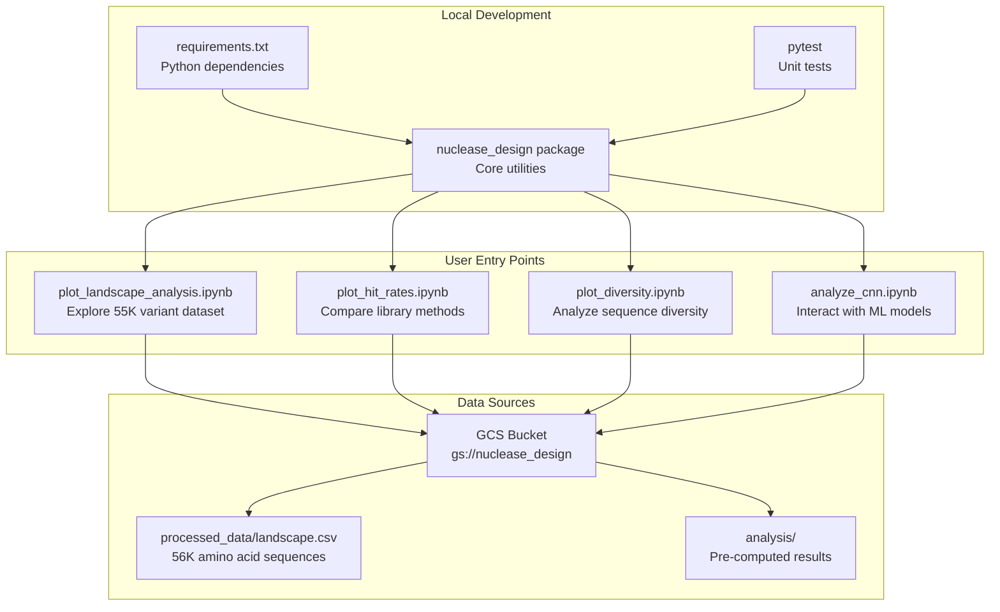

Sources: [README.md:10-40](), [README.md:76-89]()

## Prerequisites and Setup Options

### Option 1: Google Colab (Recommended for Most Users)

No local installation required. The system automatically installs dependencies and loads data from Google Cloud Storage.

**Requirements:**
- Web browser
- Google account (for Colab access)

**Capabilities:**
- Full access to pre-computed analysis
- Interactive visualization and exploration
- CNN model interaction
- Statistical analysis tools

### Option 2: Local Development Environment

Required for contributing to the codebase, running unit tests, or regenerating data from raw NGS sources.

**Requirements:**
- Python >= 3.10
- Local installation of the `nuclease_design` package
- Dependencies from `requirements.txt`

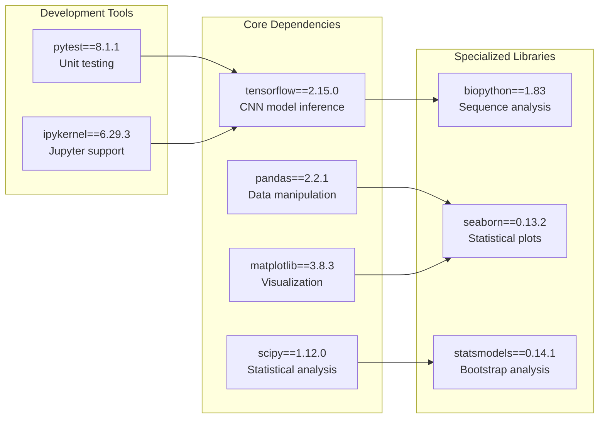

Sources: [requirements.txt:1-13](), [README.md:81-89]()

## Main Analysis Workflows

The system provides four primary analysis workflows, each accessible through dedicated notebooks:

| Workflow | Notebook | Purpose | Colab Link |
|----------|----------|---------|------------|
| Dataset Exploration | `plot_landscape_analysis.ipynb` | Analyze 55,760 NucB variant activity data | Available |
| Library Comparison | `plot_hit_rates.ipynb` | Compare performance of different design methods | Available |
| Sequence Diversity | `plot_diversity.ipynb` | Analyze diversity of active variants | Available |
| Model Interaction | `analyze_cnn.ipynb` | Explore CNN ensemble predictions | Available |

### Workflow Architecture

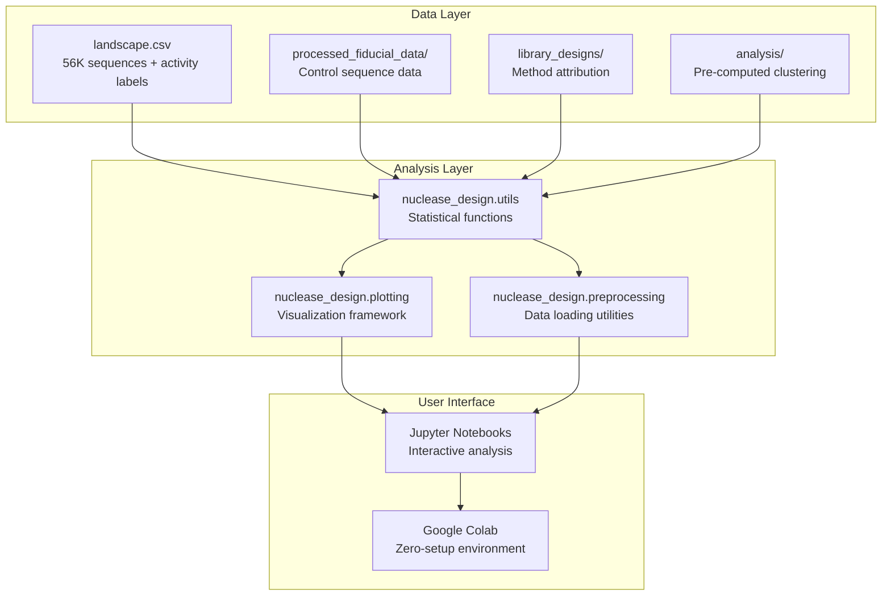

Sources: [README.md:32-39](), [README.md:42-74]()

## Data Access Patterns

The system uses a consistent data access pattern across all notebooks:

1. **Automatic Dependency Installation**: Notebooks install the `nuclease_design` package directly from GitHub
2. **GCS Data Loading**: Helper functions load pre-computed data from `gs://nuclease_design`
3. **Local Caching**: Data is cached locally during notebook execution
4. **Analysis Execution**: Notebooks run analysis using the loaded data

### Available Data Categories

| Data Type | GCS Location | Description |
|-----------|--------------|-------------|
| Raw NGS Counts | `raw_count_data/` | Pre/post-sort population counts |
| Processed Results | `processed_data/` | Enrichment factors and p-values |
| Master Dataset | `processed_data/landscape.csv` | 56K sequences with activity labels |
| Validation Data | `plate_data/` | Purified protein experimental results |
| Design Attribution | `library_designs/` | Method-to-sequence mappings |
| Analysis Results | `analysis/` | Pre-computed clustering and diversity metrics |

Sources: [README.md:44-74]()

## Basic Usage Patterns

### For Data Analysis Users
1. Open any of the Colab-enabled notebooks
2. Run all cells to automatically install dependencies and load data
3. Modify analysis parameters or add custom analysis code
4. Export results or visualizations as needed

### For Developers
1. Clone the repository locally
2. Set up Python virtual environment (>=3.10)
3. Install package in development mode: `pip install -e .`
4. Run unit tests: `python -m pytest nuclease_design/*test.py`
5. Use notebooks with local data regeneration capabilities

### For Model Development
1. Access the CNN ensemble through `analyze_cnn.ipynb`
2. Load the master dataset for training new models
3. Use the `nuclease_design.utils` module for statistical analysis
4. Leverage pre-computed clustering data for diversity analysis

Sources: [README.md:25-29](), [README.md:78-89]()

---

# Page: Installation & Dependencies

# Installation & Dependencies

<details>
<summary>Relevant source files</summary>

The following files were used as context for generating this wiki page:

- [requirements.txt](requirements.txt)

</details>


This document provides comprehensive installation instructions and dependency requirements for the ML-Guided Nuclease Engineering system. It covers the Python package dependencies, their specific roles in the data processing pipeline, and verification steps to ensure proper installation.

For information about basic usage patterns after installation, see [Quick Start Guide](#2.2). For details about the core libraries and utilities provided by the system, see [Core Libraries](#6).

## System Requirements

The nuclease design system requires Python 3.8+ and depends on scientific computing libraries for data processing, machine learning frameworks for CNN models, and visualization tools for analysis notebooks.

### Dependency Architecture Overview

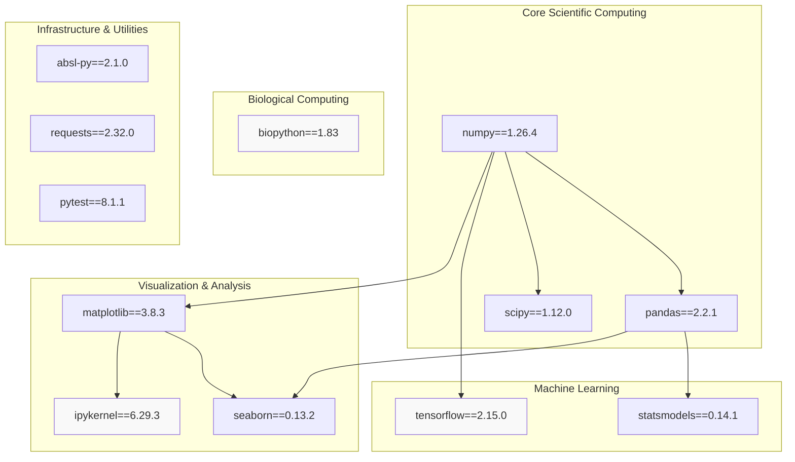

**Dependencies mapped to system components**

Sources: [requirements.txt:1-12]()

### Core Dependencies by Function

| Dependency | Version | Primary Use Cases |
|------------|---------|-------------------|
| `numpy` | 1.26.4 | Array operations in enrichment factor calculations, statistical analysis |
| `pandas` | 2.2.1 | DataFrame operations for NGS data, landscape generation |
| `tensorflow` | 2.15.0 | CNN ensemble models for activity prediction |
| `matplotlib` | 3.8.3 | Base plotting functionality in `plotting.py` |
| `seaborn` | 0.13.2 | Statistical visualizations and heatmaps |
| `scipy` | 1.12.0 | Statistical functions, bootstrap sampling |
| `statsmodels` | 0.14.1 | Advanced statistical modeling and FDR corrections |
| `biopython` | 1.83 | Sequence analysis and biological data parsing |

Sources: [requirements.txt:1-12]()

## Installation Instructions

### Standard Installation

Install all dependencies using pip:

```bash
pip install -r requirements.txt
```

### Development Installation

For contributing to the system or running tests:

```bash
pip install -r requirements.txt
git clone https://github.com/google-deepmind/nuclease_design
cd nuclease_design
```

Sources: [requirements.txt:1-12]()

## Dependency Roles in System Components

### Data Processing Pipeline Dependencies

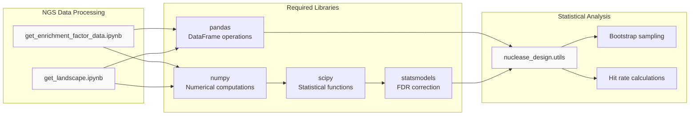

**Data processing pipeline dependency mapping**

Sources: [requirements.txt:2-11]()

### Machine Learning Model Dependencies

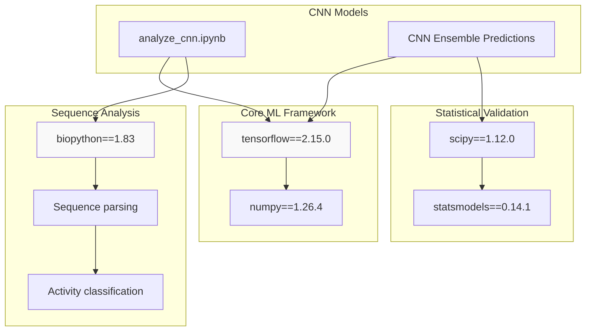

**Machine learning component dependency requirements**

Sources: [requirements.txt:1-12]()

### Visualization and Analysis Dependencies

| Component | Required Dependencies | Function |
|-----------|----------------------|----------|
| `plotting.py` | `matplotlib`, `seaborn`, `numpy` | Hit rate plots, heatmaps, diversity analysis |
| Analysis notebooks | `ipykernel`, `matplotlib`, `seaborn` | Jupyter notebook execution and visualization |
| Statistical plots | `scipy`, `statsmodels`, `pandas` | Confidence intervals, bootstrap analysis |

Sources: [requirements.txt:3-11]()

## Infrastructure Dependencies

### Google Cloud Storage Access

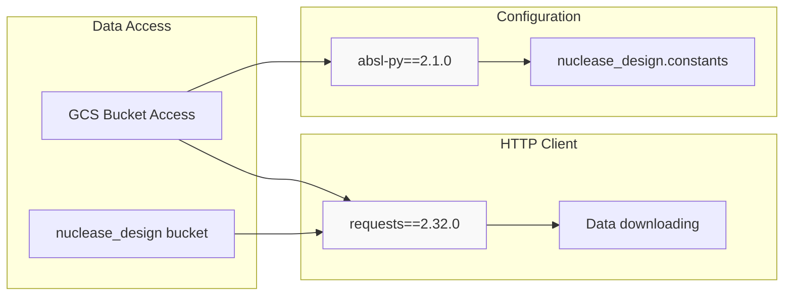

**Infrastructure and data access dependencies**

The `requests` library enables downloading pre-computed data from Google Cloud Storage, while `absl-py` provides configuration utilities used throughout the system.

Sources: [requirements.txt:1-8]()

## Development and Testing Dependencies

### Testing Framework

The system includes comprehensive testing capabilities:

- `pytest==8.1.1` - Primary testing framework
- Integration with CI/CD pipelines
- Unit tests for core utilities

For detailed testing information, see [Testing Framework](#7.1).

Sources: [requirements.txt:7]()

## Installation Verification

### Basic System Check

Verify core dependencies are properly installed:

```python
import numpy as np
import pandas as pd
import tensorflow as tf
import matplotlib.pyplot as plt
print(f"NumPy: {np.__version__}")
print(f"Pandas: {pd.__version__}")
print(f"TensorFlow: {tf.__version__}")
```

### Nuclease Design Package Check

Verify the nuclease design utilities are accessible:

```python
try:
    from nuclease_design import utils, plotting, constants
    print("Nuclease design package loaded successfully")
except ImportError as e:
    print(f"Import error: {e}")
```

Sources: [requirements.txt:1-12]()

## Common Installation Issues

### TensorFlow Compatibility

Ensure TensorFlow 2.15.0 is compatible with your system:
- GPU support requires CUDA 11.8+
- macOS users may need additional configuration for M1/M2 chips

### Jupyter Notebook Integration

The `ipykernel` dependency ensures proper Jupyter notebook execution. For Google Colab compatibility, no additional installation is required as dependencies are handled automatically.

Sources: [requirements.txt:3-12]()

---

# Page: Quick Start Guide

# Quick Start Guide

<details>
<summary>Relevant source files</summary>

The following files were used as context for generating this wiki page:

- [README.md](README.md)
- [notebooks/plot_landscape_analysis.ipynb](notebooks/plot_landscape_analysis.ipynb)

</details>


This guide provides a step-by-step introduction to using the ML-Guided Nuclease Engineering system for analyzing enzyme activity datasets and reproducing research results. It covers the essential workflows and entry points for both exploratory analysis and paper reproduction.

For detailed information about data processing pipelines, see [Data Processing Pipeline](#3). For comprehensive analysis capabilities, see [Analysis & Visualization](#4). For machine learning model details, see [Machine Learning Models](#5).

## Purpose and Usage Patterns

The system supports three primary usage patterns:

1. **Dataset Analysis**: Explore the 55,760 NucB variant activity dataset for ML model development
2. **Paper Reproduction**: Recreate all figures and analyses from the research paper  
3. **Method Extension**: Use the codebase as a foundation for custom genotype-phenotype analysis

## Quick Start Workflow

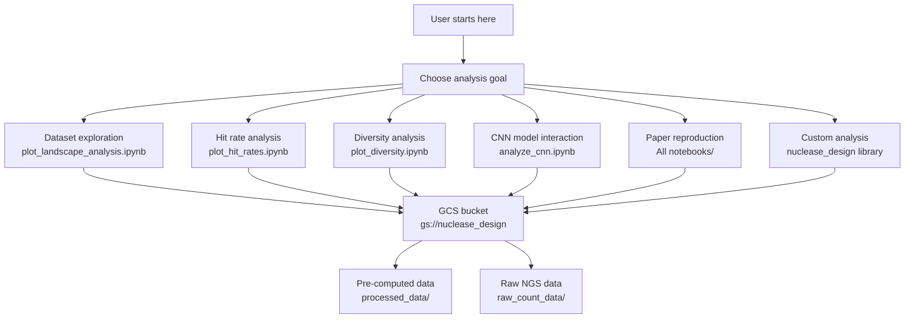

**Basic Workflow Diagram**

Sources: [README.md:10-40]()

## Primary Entry Points

### Dataset Exploration

The primary entry point for dataset analysis is `plot_landscape_analysis.ipynb`, which provides comprehensive exploration of the nuclease activity landscape.

| Notebook | Purpose | Colab Ready | Key Features |
|----------|---------|-------------|--------------|
| `plot_landscape_analysis.ipynb` | Dataset exploration | ✅ | Activity distribution, variant analysis, landscape visualization |
| `plot_hit_rates.ipynb` | Library method evaluation | ✅ | Hit rate comparison, bootstrap statistics |
| `plot_diversity.ipynb` | Sequence diversity analysis | ✅ | Clustering, diversity metrics, overlap analysis |
| `analyze_cnn.ipynb` | CNN model interaction | ✅ | Model predictions, feature analysis |

### Notebook Execution Pattern

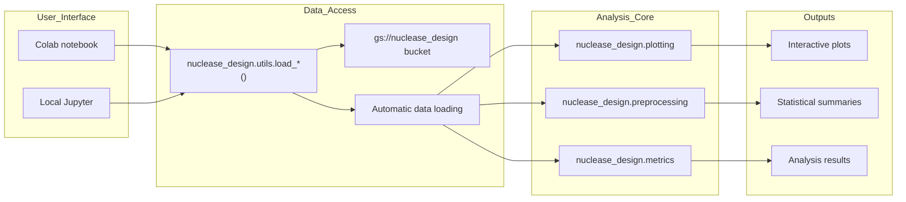

**Notebook Execution Architecture**

Sources: [README.md:25-40]()

## Basic Usage Examples

### Dataset Analysis

To analyze the nuclease activity dataset:

1. **Open the landscape analysis notebook**: Access `plot_landscape_analysis.ipynb` via Colab or locally
2. **Execute cells sequentially**: The notebook automatically loads data from GCS bucket `gs://nuclease_design`
3. **Explore key datasets**: 
   - `processed_data/landscape.csv` - 56K amino acid sequences with activity labels
   - `processed_fiducial_data/` - Control sequence enrichment factors
   - `library_designs/` - Sequence design method mappings

### Library Method Comparison

To compare different library design methods:

1. **Run hit rate analysis**: Execute `plot_hit_rates.ipynb` 
2. **Key analysis functions**:
   - `nuclease_design.utils.compute_hit_rates()` - Calculate hit rates with confidence intervals
   - `nuclease_design.plotting.plot_hit_rates()` - Visualize method performance
3. **Examine methods**: `WT`, `epPCR`, `ML2`, `ML3`, `DE3`, `HR`

### CNN Model Analysis

To interact with the pre-trained CNN ensemble:

1. **Load CNN models**: Use `analyze_cnn.ipynb` to access the 5-model ensemble
2. **Prediction workflow**:
   - Input: Amino acid sequences  
   - Output: Activity classes (`<WT`, `WT`, `>WT`, `>=A73R`)
3. **Analysis capabilities**: Model predictions, feature importance, sequence scoring

## Data Access Patterns

### Automatic Data Loading

The system uses helper functions for seamless data access:

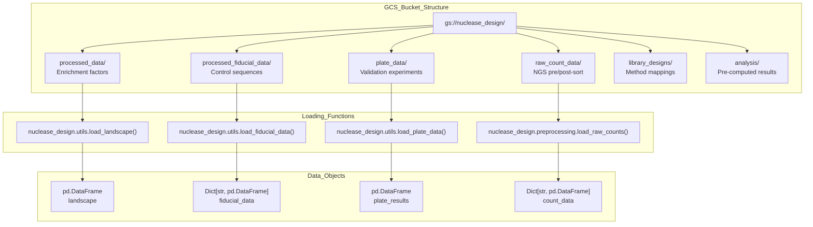

**Data Access Architecture**

Sources: [README.md:41-75]()

### Pre-computed vs Raw Data

| Data Type | Location | Usage | Regeneration Required |
|-----------|----------|-------|----------------------|
| Pre-computed | `processed_data/` | Default notebook execution | No |
| Raw NGS counts | `raw_count_data/` | Custom analysis, verification | Yes - run `get_enrichment_factor_data.ipynb` |
| Validation data | `plate_data/` | Low-throughput confirmation | No |
| Analysis results | `analysis/` | Paper figure reproduction | No |

## Development Setup

For local development and testing:

### Installation

The notebooks install the package automatically from GitHub. For local development:

```bash
# Requirements: Python >= 3.10
venv=/tmp/nuclease_design_venv
python3 -m venv $venv
source $venv/bin/activate
pip install -e .
```

### Testing

Execute unit tests to verify installation:

```bash
python -m pytest nuclease_design/*test.py
```

### Local Data Generation

To regenerate analysis from raw data, set `LOCAL_OUTPUT_DATA_DIR` in `get_enrichment_factor_data.ipynb` and execute the notebook locally.

Sources: [README.md:76-89]()

## Next Steps

- **For dataset analysis**: Start with `plot_landscape_analysis.ipynb` in Colab
- **For method comparison**: Run `plot_hit_rates.ipynb` and `plot_diversity.ipynb` 
- **For ML model exploration**: Use `analyze_cnn.ipynb`
- **For paper reproduction**: Execute all notebooks in `notebooks/` directory
- **For custom analysis**: Import `nuclease_design` library functions

For comprehensive analysis capabilities, see [Analysis & Visualization](#4). For understanding the data processing pipeline, see [Data Processing Pipeline](#3).

---

# Page: Data Processing Pipeline

# Data Processing Pipeline

<details>
<summary>Relevant source files</summary>

The following files were used as context for generating this wiki page:

- [README.md](README.md)
- [notebooks/get_enrichment_factor_data.ipynb](notebooks/get_enrichment_factor_data.ipynb)
- [notebooks/get_landscape.ipynb](notebooks/get_landscape.ipynb)

</details>


This document describes the core data processing pipeline that transforms raw NGS (Next Generation Sequencing) count data from four experimental generations into processed enrichment factor datasets and the final consolidated landscape dataset. The pipeline handles statistical analysis, p-value calculations, and multi-generation data aggregation.

For information about the analysis workflows that consume this processed data, see [Analysis & Visualization](#4). For details on the machine learning models that use the landscape data, see [Machine Learning Models](#5).

## Pipeline Overview

The data processing pipeline consists of two main stages executed by dedicated Jupyter notebooks that can run independently or regenerate data from raw sources:

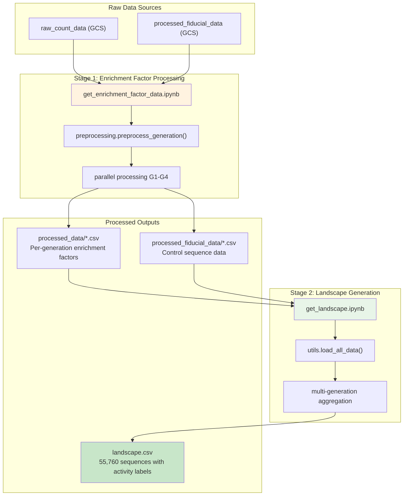

**Sources:** [README.md:25-29](), [notebooks/get_enrichment_factor_data.ipynb:1-250](), [notebooks/get_landscape.ipynb:1-250]()

## Data Flow Architecture

The pipeline processes data through well-defined interfaces using the `nuclease_design` library components:

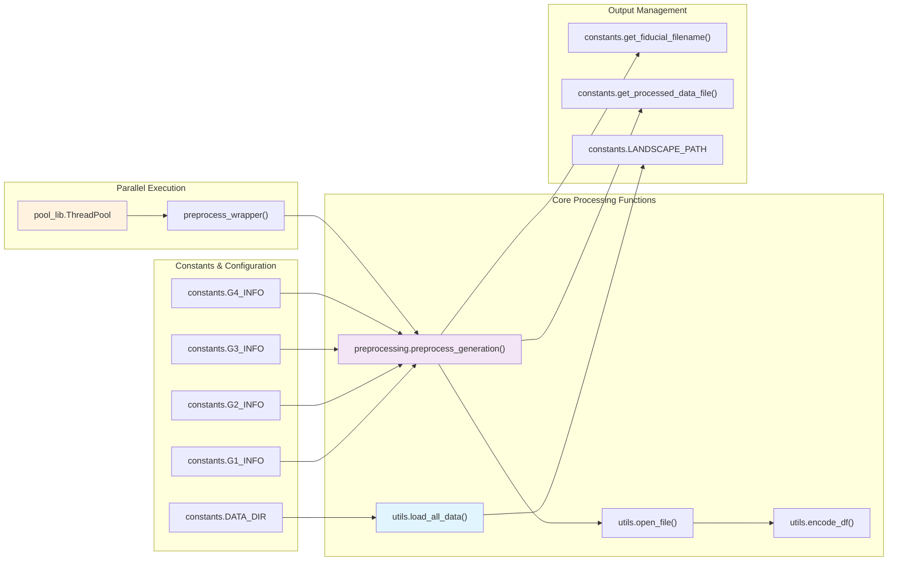

**Sources:** [notebooks/get_enrichment_factor_data.ipynb:111-117](), [notebooks/get_enrichment_factor_data.ipynb:196-221](), [notebooks/get_landscape.ipynb:80-83]()

## Stage 1: Enrichment Factor Processing

The first stage processes raw NGS count data through the `get_enrichment_factor_data.ipynb` notebook, which implements parallel processing across all four experimental generations.

### Core Processing Function

The `preprocess_wrapper()` function [notebooks/get_enrichment_factor_data.ipynb:196-221]() coordinates the processing for each generation:

| Function | Input | Output | Purpose |
|----------|--------|---------|---------|
| `preprocessing.preprocess_generation()` | Raw count data, generation config | `pvalue_df`, `fiducials_to_efdf` | Calculate enrichment factors and p-values |
| `constants.get_fiducial_filename()` | Fiducial name, generation | File path string | Generate output file paths |
| `utils.encode_df()` | DataFrame | Encoded DataFrame | Prepare data for CSV serialization |

### Parallel Execution Strategy

The pipeline uses `pool_lib.ThreadPool` to process all generations concurrently:

```python
all_generations = ['g4', 'g3', 'g2', 'g1']
with pool_lib.ThreadPool(len(all_generations)) as pool:
    dfs = pool.map(preprocess_wrapper, all_generations)
```

**Sources:** [notebooks/get_enrichment_factor_data.ipynb:242-248]()

### Generation Configuration

Each generation is configured through constants that specify fiducials, thresholds, and data paths:

| Generation | Configuration Constant | Key Parameters |
|------------|----------------------|----------------|
| G1 | `constants.G1_INFO` | Early generation fiducials |
| G2 | `constants.G2_INFO` | Expanded fiducial set |
| G3 | `constants.G3_INFO` | Advanced controls |
| G4 | `constants.G4_INFO` | Final generation setup |

**Sources:** [notebooks/get_enrichment_factor_data.ipynb:111-117]()

## Stage 2: Landscape Generation

The second stage aggregates processed data across generations using `get_landscape.ipynb` to create the final consolidated dataset.

### Data Loading and Aggregation

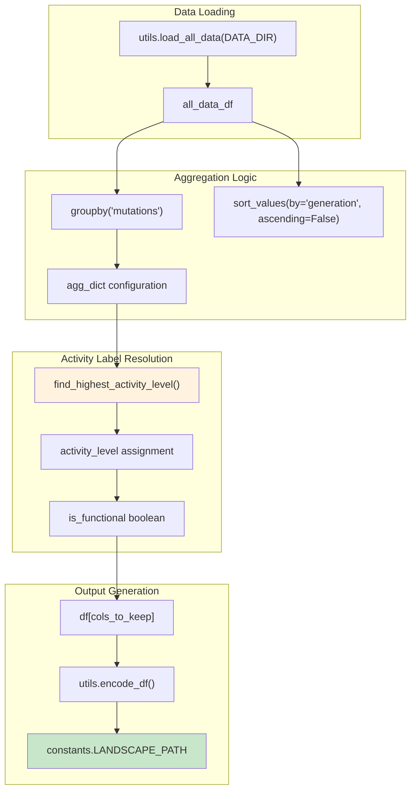

**Sources:** [notebooks/get_landscape.ipynb:122-124](), [notebooks/get_landscape.ipynb:142-157](), [notebooks/get_landscape.ipynb:168-190]()

### Activity Level Classification

The `find_highest_activity_level()` function [notebooks/get_landscape.ipynb:168-179]() implements hierarchical activity classification:

| Activity Level | Criteria | Description |
|----------------|----------|-------------|
| `non-functional` | Fails basic tests | Default for inactive variants |
| `activity_greater_than_0` | Passes negative control | Above background activity |
| `activity_greater_than_WT` | Exceeds wild-type | Improved over natural enzyme |
| `activity_greater_than_A73R` | Exceeds A73R control | Highest activity class |

### Aggregation Strategy

The pipeline resolves multi-generation data using the `agg_dict` configuration [notebooks/get_landscape.ipynb:147-155]():

```python
agg_dict = {
    'sublibrary_names': lambda x: tuple(itertools.chain.from_iterable(x)),
    'generations': lambda x: tuple(sorted(x)),
    'activity_greater_than_neg_control': 'first',
    'activity_greater_than_wt': 'first', 
    'activity_greater_than_a73r': 'first',
    'num_mutations': 'first',
    'sequence': 'first',
}
```

**Sources:** [notebooks/get_landscape.ipynb:143-156]()

## Output Data Structure

The pipeline generates three primary output categories stored in the GCS bucket structure:

### Processed Data Files

| Path Pattern | Content | Generation Scope |
|--------------|---------|------------------|
| `processed_data/g{n}.csv` | P-values and enrichment factors | Per generation |
| `processed_fiducial_data/g{n}_{fiducial}.csv` | Control sequence analysis | Per generation, per fiducial |
| `processed_data/landscape.csv` | Consolidated activity labels | All generations |

### Final Landscape Schema

The `landscape.csv` output contains 55,760 unique amino acid sequences with the following columns:

| Column | Type | Description |
|--------|------|-------------|
| `mutations` | Tuple | Amino acid changes from wild-type |
| `num_mutations` | Integer | Count of mutations |
| `sublibrary_names` | Tuple | Design methods that proposed sequence |
| `generations` | Tuple | Experimental generations where observed |
| `activity_level` | String | Hierarchical activity classification |
| `is_functional` | Boolean | Basic functionality flag |
| `sequence` | String | Full amino acid sequence |

**Sources:** [notebooks/get_landscape.ipynb:200-209](), [README.md:58-61]()

### Data Access Patterns

The processed data supports two primary access patterns:

1. **Pre-computed Access**: Load processed results directly from GCS using `utils.load_all_data()`
2. **Regenerated Access**: Execute notebooks with `LOCAL_OUTPUT_DATA_DIR` to recreate from raw data

**Sources:** [README.md:25-29](), [notebooks/get_enrichment_factor_data.ipynb:137-142]()

---

# Page: Raw Data Sources & Structure

# Raw Data Sources & Structure

<details>
<summary>Relevant source files</summary>

The following files were used as context for generating this wiki page:

- [README.md](README.md)
- [nuclease_design/cnn_model.py](nuclease_design/cnn_model.py)
- [nuclease_design/constants.py](nuclease_design/constants.py)
- [nuclease_design/utils.py](nuclease_design/utils.py)

</details>


This page documents the organization and structure of raw experimental data sources in the nuclease design system. It covers the Google Cloud Storage bucket organization, generation-specific data layouts, file formats, and experimental design structure across the four generations of directed evolution experiments.

For information about how this raw data is processed into enrichment factors, see [Enrichment Factor Calculation](#3.2). For details on the final aggregated landscape dataset, see [Landscape Generation & Aggregation](#3.3).

## Data Storage Architecture

The nuclease design system stores all experimental data in a Google Cloud Storage bucket with a well-defined hierarchical structure. The primary data repository is accessible at `https://storage.googleapis.com/nuclease_design`.

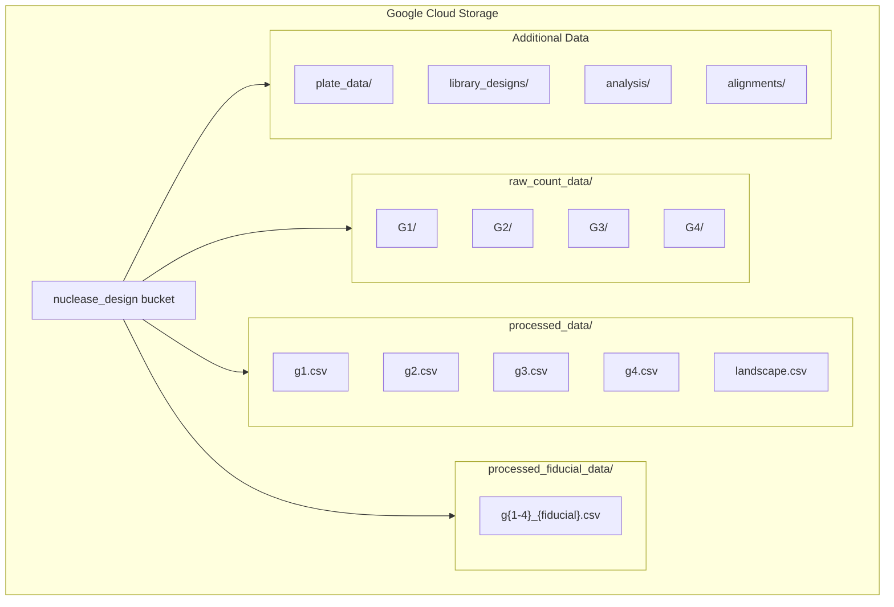

**Data Storage Hierarchy**
Sources: [README.md:44-75](), [nuclease_design/constants.py:22-23]()

## Generation-Specific Data Organization

The experimental data is organized across four generations (G1-G4) of directed evolution, each with distinct experimental parameters and file structures.

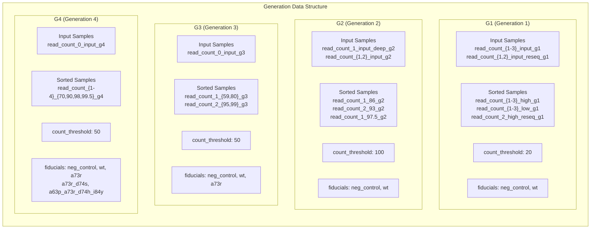

**Generation Configuration Details**
Sources: [nuclease_design/constants.py:160-229](), [nuclease_design/constants.py:231-252]()

## File Naming Conventions and Paths

Each generation follows a systematic file naming convention that encodes the experimental conditions and sorting parameters.

| Generation | Sample Files | Pattern | Example |
|------------|--------------|---------|---------|
| G1 | Input samples | `Sort_{1-3}_input_ob133_3_{1-3}.csv` | `Sort_1_input_ob133_3_1.csv` |
| G1 | Sorted samples | `Sort_{1-3}_{high,low}_gate_{output_,ob}{id}.csv` | `Sort_1_high_gate_output_ob142.csv` |
| G2 | Input samples | `ob188_{processed,ns{1,2}_processed}.csv` | `ob188_processed.csv` |
| G2 | Sorted samples | `ob{193,194,196}_processed.csv` | `ob193_processed.csv` |
| G3 | Input samples | `ob222_processed_updated.csv` | `ob222_processed_updated.csv` |
| G3 | Sorted samples | `ob{230,231,239,241}_processed.csv` | `ob230_processed.csv` |
| G4 | All samples | `OB{268-272}_reprocessed.csv` | `OB268_reprocessed.csv` |

**File Path Constants**
Sources: [nuclease_design/constants.py:26-150]()

## Experimental Design Structure

The experimental design follows a systematic approach with specific gating strategies for each generation and fiducial sequence.

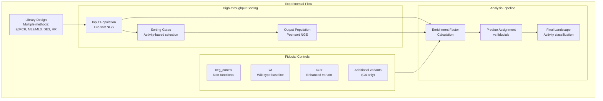

**Fiducial Sequence Configuration**
Sources: [nuclease_design/constants.py:254-264](), [nuclease_design/constants.py:170-191]()

## Data Access and Loading Patterns

The system provides multiple access patterns for different use cases, supporting both cloud-based and local data access.

```mermaid
flowchart LR
    subgraph "Data Access Layer"
        subgraph functions["Core Loading Functions"]
            open_file["open_file()<br/>nuclease_design.utils"]
            load_data["load_data()<br/>nuclease_design.utils"] 
            load_fiducial["load_fiducial_data()<br/>nuclease_design.utils"]
            load_landscape["load_landscape()<br/>nuclease_design.utils"]
        end
        
        subgraph sources["Data Sources"]
            gcs["GCS Bucket<br/>constants.GCS_DATA_DIR"]
            local["Local Directory<br/>user-specified"]
        end
        
        subgraph outputs["Data Outputs"]
            df_gen["Generation DataFrame<br/>enrichment factors"]
            df_fid["Fiducial DataFrame<br/>control sequences"]
            df_land["Landscape DataFrame<br/>56K sequences"]
        end
    end
    
    gcs --> open_file
    local --> open_file
    open_file --> load_data
    open_file --> load_fiducial
    open_file --> load_landscape
    load_data --> df_gen
    load_fiducial --> df_fid
    load_landscape --> df_land
```

**Data Loading Implementation**
Sources: [nuclease_design/utils.py:43-56](), [nuclease_design/utils.py:132-177]()

## Count Thresholds and Quality Control

Each generation employs specific count thresholds to ensure data quality, with thresholds varying based on experimental conditions and sequencing depth.

| Generation | Count Threshold | Rationale |
|------------|----------------|-----------|
| G1 | 20 | Initial screening, lower stringency |
| G2 | 100 | Increased stringency for better hits |
| G3 | 50 | Balanced threshold for diverse library |
| G4 | 50 | Consistent with G3 for final selection |

These thresholds are applied during preprocessing to filter sequences with insufficient NGS read coverage, ensuring statistical reliability of enrichment factor calculations.

**Threshold Configuration**
Sources: [nuclease_design/constants.py:162-177](), [nuclease_design/constants.py:194-209]()

## Reference Sequence and Design Regions

The system is built around the full-length NucB reference sequence, with specific design regions targeted for mutagenesis in generation 4.

```python
FULL_REFERENCE_SEQ = 'MIKKWAVHLLFSALVLLGLSGGAAYSPQHAEGAARYDDVLYFPASRYPETGAHISDAIKAGHADVCTIERSGADKRRQESLKGIPTKPGFDRDEWPMAMCEEGGKGASVRYVSSSDNRGAGSWVGNRLNGYADGTRILFIVQ'
```

**Design Region Boundaries (G4)**:
- N-terminal region: positions 33-110 (1-indexed)
- C-terminal region: positions 65-142 (1-indexed)
- Variable region for CNN: position 24 to end

**Sequence Constants**
Sources: [nuclease_design/constants.py:20](), [nuclease_design/constants.py:270-285](), [nuclease_design/constants.py:359-361]()

---

# Page: Enrichment Factor Calculation

# Enrichment Factor Calculation

<details>
<summary>Relevant source files</summary>

The following files were used as context for generating this wiki page:

- [notebooks/get_enrichment_factor_data.ipynb](notebooks/get_enrichment_factor_data.ipynb)
- [notebooks/get_landscape.ipynb](notebooks/get_landscape.ipynb)
- [nuclease_design/preprocessing.py](nuclease_design/preprocessing.py)
- [nuclease_design/preprocessing_utils.py](nuclease_design/preprocessing_utils.py)

</details>


This document covers the calculation of enrichment factors from NGS count data, which forms the core statistical framework for determining nuclease activity levels. Enrichment factors quantify how much a variant is enriched or depleted in post-sort populations compared to input populations.

For information about the landscape generation that aggregates enrichment factor data across generations, see [Landscape Generation & Aggregation](#3.3). For details about the raw data structure and experimental design, see [Raw Data Sources & Structure](#3.1).

## Overview

Enrichment factor calculation transforms raw NGS count data into quantitative measures of nuclease activity. The process involves computing abundance ratios between pre-sort and post-sort populations, followed by statistical testing against fiducial controls to determine activity classifications.

The calculation pipeline processes data for each generation (G1-G4) independently, computing enrichment factors for multiple sorting thresholds and comparing results against negative controls and positive reference variants.

## Data Processing Pipeline

```mermaid
flowchart TD
    A["Raw NGS Count Files"] --> B["load_ngs_counts_from_paths()"]
    B --> C["Count DataFrame<br/>nuc_mutations, mutations, counts"]
    C --> D["get_enrichment_factor_df()"]
    D --> E["Filter Stop Codons<br/>_drop_introduces_stop_codons()"]
    E --> F["Calculate P-values<br/>get_pvalue()"]
    F --> G["Statistical Significance<br/>select_hits()"]
    G --> H["Activity Classification<br/>activity_greater_than_X"]
    H --> I["pvalue_df Output"]
    
    J["Fiducial Controls"] --> K["get_synonym_df()<br/>get_stop_codon_df()"]
    K --> L["fiducial_ef_dfs Output"]
    
    style B fill:#f9f9f9
    style D fill:#f9f9f9
    style F fill:#f9f9f9
```

**Sources:** [nuclease_design/preprocessing.py:77-151](), [nuclease_design/preprocessing_utils.py:98-136]()

## Enrichment Factor Calculation

The core enrichment factor calculation transforms raw counts into activity measurements through abundance normalization and ratio computation.

```mermaid
flowchart LR
    A["Input Counts<br/>read_count_0_input"] --> B["Input Abundance<br/>counts / total_counts"]
    C["Post-Sort Counts<br/>read_count_X_threshold"] --> D["Post-Sort Abundance<br/>counts / total_counts"]
    B --> E["Enrichment Factor<br/>post_abundance / input_abundance"]
    D --> E
    E --> F["ef_X_threshold_gN<br/>Column Output"]
    
    style E fill:#f9f9f9
```

**Sources:** [nuclease_design/preprocessing_utils.py:145-150](), [nuclease_design/preprocessing_utils.py:156-220]()

### Key Functions

| Function | Purpose | Location |
|----------|---------|----------|
| `get_enrichment_factor_df()` | Computes enrichment factors from count data | [preprocessing_utils.py:156-220]() |
| `get_abundance()` | Converts counts to abundance proportions | [preprocessing_utils.py:138-142]() |
| `get_enrichment_factor()` | Calculates ratio of post-sort to input abundance | [preprocessing_utils.py:145-150]() |

## Statistical Analysis Framework

The statistical framework uses pooled t-tests to compare variant enrichment factors against fiducial control distributions, enabling quantitative activity classification.

```mermaid
flowchart TD
    A["Variant Enrichment Factor<br/>Single Value"] --> B["get_pvalue()"]
    C["Fiducial EF Distribution<br/>neg_control, wt, a73r"] --> B
    B --> D["Pooled T-Test<br/>weightstats.ttest_ind()"]
    D --> E["P-value"]
    E --> F["FDR Correction<br/>select_hits()"]
    F --> G["Activity Classification<br/>activity_greater_than_X"]
    
    H["Stop Codon Variants"] --> I["Negative Control<br/>get_stop_codon_df()"]
    J["Synonymous Variants"] --> K["Positive Controls<br/>get_synonym_df()"]
    I --> C
    K --> C
    
    style D fill:#f9f9f9
    style F fill:#f9f9f9
```

**Sources:** [nuclease_design/preprocessing.py:30-44](), [nuclease_design/preprocessing.py:134-142]()

### Fiducial Controls

| Fiducial Type | Purpose | Implementation |
|---------------|---------|----------------|
| `neg_control` | Variants introducing stop codons | `get_stop_codon_df()` |
| `wt` | Wild-type synonymous variants | `get_synonym_df()` with WT mutations |
| `a73r` | A73R positive control variants | `get_synonym_df()` with A73R mutations |
| `double` | Double mutant controls | `get_synonym_df()` with double mutations |
| `quad` | Quadruple mutant controls | `get_synonym_df()` with quad mutations |

**Sources:** [nuclease_design/preprocessing.py:65-74](), [nuclease_design/preprocessing_utils.py:223-235](), [nuclease_design/preprocessing_utils.py:238-255]()

## Data Processing Implementation

The main processing workflow is implemented in the `get_enrichment_factor_data.ipynb` notebook, which orchestrates parallel processing across all generations.

```mermaid
flowchart LR
    A["preprocess_wrapper()"] --> B["preprocessing.preprocess_generation()"]
    B --> C["pvalue_df"]
    B --> D["fiducials_to_efdf"]
    C --> E["Write Processed Data<br/>constants.get_processed_data_file()"]
    D --> F["Write Fiducial Data<br/>constants.get_fiducial_filename()"]
    
    G["ThreadPool"] --> H["Parallel Processing<br/>G1, G2, G3, G4"]
    H --> A
    
    style B fill:#f9f9f9
    style G fill:#f9f9f9
```

**Sources:** [notebooks/get_enrichment_factor_data.ipynb:196-221](), [notebooks/get_enrichment_factor_data.ipynb:242-248]()

### Processing Parameters

The enrichment factor calculation uses generation-specific parameters defined in the constants module:

- **Count Threshold**: Minimum read count required in input samples (typically 10)
- **Input Columns**: Pre-sort population counts (`read_count_0_input_gN`)
- **Post-Sort Columns**: Activity-sorted population counts (`read_count_X_threshold_gN`)
- **Fiducials**: Control variants for statistical comparison

**Sources:** [nuclease_design/preprocessing.py:77-111]()

## Output Data Structure

The enrichment factor calculation produces two main outputs:

### P-value DataFrame
Contains enrichment factors, p-values, and activity classifications for all variants:

| Column Pattern | Description |
|----------------|-------------|
| `ef_X_threshold_gN` | Enrichment factor for threshold X in generation N |
| `pvalue_X_threshold_gN` | P-value from comparison to fiducial |
| `activity_greater_than_X` | Boolean activity classification |
| `mutations` | Amino acid mutation tuple |
| `num_mutations` | Number of mutations |
| `sublibrary_names` | Source library identification |

### Fiducial DataFrames
Separate DataFrames for each fiducial containing DNA-level enrichment factors for control variants, used as null distributions in statistical testing.

**Sources:** [notebooks/get_enrichment_factor_data.ipynb:606-609](), [nuclease_design/preprocessing.py:143-150]()

---

# Page: Landscape Generation & Aggregation

# Landscape Generation & Aggregation

<details>
<summary>Relevant source files</summary>

The following files were used as context for generating this wiki page:

- [notebooks/get_enrichment_factor_data.ipynb](notebooks/get_enrichment_factor_data.ipynb)
- [notebooks/get_landscape.ipynb](notebooks/get_landscape.ipynb)
- [nuclease_design/cnn_model.py](nuclease_design/cnn_model.py)
- [nuclease_design/constants.py](nuclease_design/constants.py)
- [nuclease_design/utils.py](nuclease_design/utils.py)

</details>


This document covers the core data processing pipeline that transforms raw NGS count data from multiple experimental generations into a unified landscape dataset. The landscape represents the complete set of observed nuclease variants and their activity classifications across all generations.

For information about the initial raw data sources and structure, see [Raw Data Sources & Structure](#3.1). For details on the statistical methods used in enrichment factor calculation, see [Enrichment Factor Calculation](#3.2).

## Overview

The landscape generation process consists of two main phases:

1. **Enrichment Factor Processing**: Convert raw NGS count data into enrichment factors with statistical significance testing for each generation independently
2. **Multi-Generation Aggregation**: Combine data across generations to create a unified landscape with consistent activity labels

## Processing Workflow

```mermaid
flowchart TD
    subgraph "Raw Data"
        A["raw_count_data/G1/"]
        B["raw_count_data/G2/"]
        C["raw_count_data/G3/"]
        D["raw_count_data/G4/"]
    end
    
    subgraph "Enrichment Factor Processing"
        E["get_enrichment_factor_data.ipynb"]
        F["preprocessing.preprocess_generation()"]
        G["ThreadPool parallel processing"]
    end
    
    subgraph "Generation Outputs"
        H["processed_data/g1.csv"]
        I["processed_data/g2.csv"] 
        J["processed_data/g3.csv"]
        K["processed_data/g4.csv"]
        L["processed_fiducial_data/"]
    end
    
    subgraph "Landscape Aggregation"
        M["get_landscape.ipynb"]
        N["utils.load_all_data()"]
        O["Multi-generation groupby aggregation"]
        P["Activity level determination"]
    end
    
    subgraph "Final Output"
        Q["processed_data/landscape.csv"]
    end
    
    A --> E
    B --> E
    C --> E
    D --> E
    E --> F
    F --> G
    G --> H
    G --> I
    G --> J
    G --> K
    G --> L
    
    H --> M
    I --> M
    J --> M
    K --> M
    M --> N
    N --> O
    O --> P
    P --> Q
    
    style E fill:#e1f5fe
    style M fill:#c8e6c9
    style Q fill:#fff3e0
```

Sources: [notebooks/get_enrichment_factor_data.ipynb:243-248](), [notebooks/get_landscape.ipynb:122-124](), [nuclease_design/constants.py:288-297]()

## Enrichment Factor Processing

The enrichment factor processing step is implemented in `get_enrichment_factor_data.ipynb` and processes each generation independently using parallel execution.

### Key Components

| Component | Purpose | Implementation |
|-----------|---------|----------------|
| `preprocess_wrapper()` | Main processing function for each generation | [notebooks/get_enrichment_factor_data.ipynb:196-221]() |
| `preprocessing.preprocess_generation()` | Core enrichment factor calculation | [notebooks/get_enrichment_factor_data.ipynb:197-199]() |
| `ThreadPool` | Parallel processing of generations | [notebooks/get_enrichment_factor_data.ipynb:245-248]() |

### Processing Steps

```mermaid
flowchart LR
    subgraph "Per Generation Processing"
        A["Raw NGS count data"]
        B["preprocessing.preprocess_generation()"]
        C["P-value calculation"]
        D["Enrichment factor calculation"]
        E["Fiducial sequence processing"]
    end
    
    subgraph "Outputs"
        F["generation_pvalue_df"]
        G["fiducials_to_efdf"]
        H["CSV file output"]
    end
    
    A --> B
    B --> C
    B --> D
    B --> E
    C --> F
    D --> F
    E --> G
    F --> H
    G --> H
    
    style B fill:#e1f5fe
```

Sources: [notebooks/get_enrichment_factor_data.ipynb:196-221](), [nuclease_design/constants.py:160-229]()

### Generation Configuration

Each generation has specific configuration parameters defined in `constants.py`:

```mermaid
flowchart TD
    subgraph "Generation Constants"
        A["G4_INFO"]
        B["G3_INFO"] 
        C["G2_INFO"]
        D["G1_INFO"]
    end
    
    subgraph "Configuration Parameters"
        E["names_and_paths"]
        F["count_threshold"]
        G["input_names"]
        H["post_sort_names"]
        I["fiducials"]
    end
    
    A --> E
    A --> F
    A --> G
    A --> H
    A --> I
    
    style A fill:#fff3e0
    style B fill:#fff3e0
    style C fill:#fff3e0
    style D fill:#fff3e0
```

Sources: [nuclease_design/constants.py:160-229](), [notebooks/get_enrichment_factor_data.ipynb:111-116]()

## Landscape Aggregation

The landscape aggregation step combines processed data from all generations into a unified dataset with consistent activity labels.

### Data Loading and Aggregation

```mermaid
flowchart TD
    subgraph "Data Loading"
        A["utils.load_all_data()"]
        B["load_data() for each generation"]
        C["pd.concat() all generations"]
    end
    
    subgraph "Aggregation Logic"
        D["Group by mutations"]
        E["Sort by generation descending"]
        F["Apply aggregation dictionary"]
        G["Take first for activity labels"]
    end
    
    subgraph "Activity Level Determination"
        H["find_highest_activity_level()"]
        I["Check activity thresholds"]
        J["Handle conflicting labels"]
    end
    
    A --> B
    B --> C
    C --> D
    D --> E
    E --> F
    F --> G
    G --> H
    H --> I
    I --> J
    
    style H fill:#c8e6c9
```

Sources: [notebooks/get_landscape.ipynb:122-124](), [notebooks/get_landscape.ipynb:143-156](), [notebooks/get_landscape.ipynb:168-189]()

### Activity Level Classification

The system determines activity levels using a hierarchical approach:

| Priority | Activity Level | Logic |
|----------|----------------|-------|
| 1 | `activity_greater_than_A73R` | Highest activity threshold |
| 2 | `activity_greater_than_WT` | Wild-type threshold |
| 3 | `activity_greater_than_0` | Above negative control |
| 4 | `non-functional` | Default/failed thresholds |

Sources: [notebooks/get_landscape.ipynb:168-189](), [nuclease_design/constants.py:362-367]()

### Aggregation Dictionary

The aggregation strategy preserves the most recent generation's activity labels while combining metadata:

```python
agg_dict = {
    'sublibrary_names': lambda x: tuple(itertools.chain.from_iterable(x)),
    'generations': lambda x: tuple(sorted(x)),
    'activity_greater_than_neg_control': 'first',
    'activity_greater_than_wt': 'first', 
    'activity_greater_than_a73r': 'first',
    'num_mutations': 'first',
    'sequence': 'first',
}
```

Sources: [notebooks/get_landscape.ipynb:147-155]()

## Data Structures and Outputs

### Landscape Dataset Schema

The final landscape dataset contains the following columns:

| Column | Type | Description |
|--------|------|-------------|
| `mutations` | `tuple` | Amino acid mutations as tuples |
| `num_mutations` | `int` | Count of mutations |
| `sublibrary_names` | `tuple` | Library sources for variant |
| `generations` | `tuple` | Generations where variant observed |
| `activity_level` | `str` | Final activity classification |
| `is_functional` | `bool` | Whether variant is functional |
| `sequence` | `str` | Full amino acid sequence |

Sources: [notebooks/get_landscape.ipynb:200-208](), [nuclease_design/utils.py:92-120]()

### File Output Structure

```mermaid
flowchart LR
    subgraph "Processed Data Directory"
        A["processed_data/landscape.csv"]
        B["processed_data/g1.csv"]
        C["processed_data/g2.csv"]
        D["processed_data/g3.csv"]
        E["processed_data/g4.csv"]
    end
    
    subgraph "Fiducial Data Directory"
        F["processed_fiducial_data/g1_wt.csv"]
        G["processed_fiducial_data/g1_neg_control.csv"]
        H["processed_fiducial_data/g4_a73r.csv"]
        I["..."]
    end
    
    style A fill:#fff3e0
```

Sources: [nuclease_design/constants.py:288-297](), [notebooks/get_landscape.ipynb:219-223]()

## Conflicting Labels Handling

The system handles cases where variants have conflicting activity labels across generations by prioritizing the most recent generation's assessment.

### Common Conflict Patterns

| Conflict Type | Count | Resolution |
|---------------|-------|------------|
| WT vs neg_control mismatch | 973 variants | Use most recent generation |
| A73R vs neg_control mismatch | 5 variants | Label as A73R level |
| Missing A73R assessment | ~20K variants | Only G1/G2 data available |

Sources: [notebooks/get_landscape.ipynb:575-577](), [notebooks/get_landscape.ipynb:650-652](), [notebooks/get_landscape.ipynb:612-614]()

## Integration with Analysis Pipeline

The landscape dataset serves as the primary input for downstream analysis components:

```mermaid
flowchart TD
    A["landscape.csv"]
    B["Hit Rate Analysis"]
    C["Diversity Analysis"] 
    D["CNN Model Training"]
    E["Protein Validation"]
    
    A --> B
    A --> C
    A --> D
    A --> E
    
    style A fill:#fff3e0
    style B fill:#e8f5e8
    style C fill:#e8f5e8
    style D fill:#f3e5f5
    style E fill:#e8f5e8
```

Sources: [nuclease_design/utils.py:174-176](), [nuclease_design/constants.py:321]()

---

# Page: Analysis & Visualization

# Analysis & Visualization

<details>
<summary>Relevant source files</summary>

The following files were used as context for generating this wiki page:

- [notebooks/plot_hit_rates.ipynb](notebooks/plot_hit_rates.ipynb)
- [notebooks/plot_landscape_analysis.ipynb](notebooks/plot_landscape_analysis.ipynb)
- [nuclease_design/plotting.py](nuclease_design/plotting.py)

</details>


This document provides an overview of the analysis notebook ecosystem and visualization capabilities within the nuclease design system. The analysis framework transforms processed experimental data into scientific insights through statistical analysis, data visualization, and model evaluation.

For detailed information about data processing that feeds into these analyses, see [Data Processing Pipeline](#3). For information about the underlying utility functions and plotting infrastructure, see [Core Libraries](#6).

## Overview

The analysis and visualization system consists of an integrated ecosystem of Jupyter notebooks that provide different analytical perspectives on the nuclease engineering experimental data. These notebooks leverage a shared plotting and analysis infrastructure to ensure consistent methodology and visualization standards across all analyses.

## Analysis Notebook Ecosystem

The system is organized into several categories of analysis notebooks, each serving specific analytical purposes:

```mermaid
flowchart TD
    subgraph "Primary Data Analysis"
        A["plot_landscape_analysis.ipynb<br/>Dataset exploration"]
        B["plot_hit_rates.ipynb<br/>Library method evaluation"] 
        C["plot_diversity.ipynb<br/>Sequence diversity analysis"]
    end
    
    subgraph "Model Analysis"
        D["analyze_cnn.ipynb<br/>CNN model evaluation"]
        E["plot_purified_protein_results.ipynb<br/>Experimental validation"]
    end
    
    subgraph "Specialized Analysis"
        F["plot_extrapolation.ipynb<br/>Trend prediction"]
        G["plot_zero_shot_results.ipynb<br/>Zero-shot performance"]
        H["plot_supplementary.ipynb<br/>Additional visualizations"]
        I["plot_structural_diversity.ipynb<br/>Structure analysis"]
    end
    
    subgraph "Data Sources"
        J["landscape.csv<br/>Processed experimental data"]
        K["GCS Bucket<br/>Pre-computed results"]
        L["Purified protein data<br/>Low-throughput validation"]
    end
    
    J --> A
    J --> B
    J --> C
    K --> A
    K --> B
    K --> C
    K --> D
    L --> E
    
    A -.-> F
    D -.-> G
    B -.-> H
    C -.-> I
```

**Primary Data Analysis Notebooks**
- `plot_landscape_analysis.ipynb`: Comprehensive exploration of the nuclease activity landscape
- `plot_hit_rates.ipynb`: Evaluation of different library design methods through hit rate analysis
- `plot_diversity.ipynb`: Analysis of sequence diversity and clustering patterns

**Model Analysis Notebooks**  
- `analyze_cnn.ipynb`: CNN ensemble model performance evaluation and prediction analysis
- `plot_purified_protein_results.ipynb`: Validation of high-throughput results with purified protein experiments

**Specialized Analysis Notebooks**
- Additional notebooks providing focused analysis on specific aspects like extrapolation, zero-shot performance, and structural diversity

Sources: [High-level system architecture diagrams](), [Table of contents structure]()

## Core Plotting Infrastructure

The visualization system is built around a centralized plotting infrastructure that ensures consistency and provides statistical rigor across all analyses:

```mermaid
flowchart LR
    subgraph "Data Loading"
        A["utils.load_landscape()"]
        B["utils.load_all_data()"]
        C["GCS data sources"]
    end
    
    subgraph "Statistical Analysis"
        D["utils.get_bootstrapped_hitrate_df()"]
        E["utils.get_pvalue()"] 
        F["utils.expand_sublibraries()"]
    end
    
    subgraph "Visualization Engine"
        G["plotting.py"]
        H["plot_hit_rate_per_num_mutations()"]
        I["set_fontsize()"]
        J["Color constants<br/>WT_COLOR, ML_COLOR, etc."]
    end
    
    subgraph "Output"
        K["Statistical plots with<br/>confidence intervals"]
        L["Consistent styling<br/>and formatting"]
    end
    
    A --> D
    B --> F
    C --> A
    D --> H
    E --> H
    F --> D
    G --> H
    G --> I
    G --> J
    H --> K
    I --> L
    J --> L
```

**Key Components:**
- **Data Loading**: `utils.load_landscape()` and `utils.load_all_data()` provide standardized data access
- **Statistical Analysis**: Bootstrap sampling and p-value calculations for robust statistical inference
- **Visualization**: Centralized plotting functions with consistent styling and color schemes
- **Quality Control**: Built-in confidence intervals and statistical validation

Sources: [nuclease_design/plotting.py:1-200](), [notebooks/plot_hit_rates.ipynb:114-120](), [notebooks/plot_landscape_analysis.ipynb:120-122]()

## Data Flow and Analysis Pipeline

The analysis system follows a structured data flow from raw experimental results to publication-ready visualizations:

```mermaid
flowchart TB
    subgraph "Processed Data"
        A["landscape.csv<br/>55,760 variants<br/>Activity classifications"]
        B["Enrichment factor data<br/>Per generation statistics"]
        C["Purified protein results<br/>Low-throughput validation"]
    end
    
    subgraph "Statistical Processing"
        D["Bootstrap sampling<br/>DEFAULT_NUM_BOOTSTRAPS"]
        E["FDR correction<br/>EXPECTED_FDR = 0.05"]
        F["P-value calculation<br/>get_pvalue()"]
    end
    
    subgraph "Visualization Generation"
        G["Hit rate plots<br/>plot_hit_rate_per_num_mutations()"]
        H["Landscape heatmaps<br/>Activity distribution plots"]
        I["Diversity analysis<br/>Sequence clustering"]
        J["Model performance<br/>CNN evaluation metrics"]
    end
    
    subgraph "Analysis Outputs"
        K["Publication figures<br/>Statistical validation"]
        L["Method comparisons<br/>Library effectiveness"]
        M["Prediction validation<br/>Model accuracy assessment"]
    end
    
    A --> D
    A --> F
    B --> E
    C --> F
    D --> G
    E --> G
    F --> G
    D --> H
    E --> H
    F --> I
    G --> K
    H --> L
    I --> L
    J --> M
```

**Statistical Rigor:**
- Bootstrap resampling for confidence interval estimation
- False Discovery Rate (FDR) correction for multiple hypothesis testing
- Minimum observation thresholds to ensure statistical power

**Visualization Standards:**
- Consistent color schemes across all plots (`WT_COLOR`, `ML_COLOR`, `DE_COLOR`, etc.)
- Standardized font sizes and styling through `set_fontsize()`
- Error bars and confidence bands for all statistical estimates

Sources: [nuclease_design/plotting.py:32-43](), [nuclease_design/plotting.py:61-164](), [nuclease_design/utils.py]()

## Integration with Google Colab

All primary analysis notebooks are designed for seamless integration with Google Colab, enabling collaborative analysis and easy sharing:

**Colab Integration Features:**
- Automatic package installation via `pip install git+https://github.com/google-deepmind/nuclease_design.git`
- Pre-computed data access from Google Cloud Storage
- Interactive plotting with matplotlib and seaborn
- Kernel restart instructions for package updates

**Notebook Structure:**
1. License headers and copyright notices
2. Package installation cell (skippable for local environments)  
3. Import statements for required libraries
4. Data loading from standardized sources
5. Analysis and visualization generation

Sources: [notebooks/plot_hit_rates.ipynb:33-36](), [notebooks/plot_landscape_analysis.ipynb:53-56]()

## Analysis Categories

The visualization system provides several distinct categories of analysis, each addressing specific research questions:

- **Hit Rate Analysis** ([#4.1](#4.1)): Quantitative evaluation of library design method effectiveness
- **Landscape Analysis** ([#4.2](#4.2)): Comprehensive exploration of the nuclease activity landscape  
- **Diversity Analysis** ([#4.3](#4.3)): Sequence diversity and clustering pattern investigation
- **Protein Activity Analysis** ([#4.4](#4.4)): Experimental validation through purified protein assays
- **Specialized Analysis** ([#4.5](#4.5)): Additional analytical capabilities for specific research questions
- **Campaign Analysis** ([#4.6](#4.6)): Performance analysis across experimental generations

Each category leverages the shared infrastructure while providing specialized analytical tools and visualizations tailored to specific research objectives.

Sources: [Table of contents structure](), [High-level system diagrams]()

---

# Page: Hit Rate Analysis

# Hit Rate Analysis

<details>
<summary>Relevant source files</summary>

The following files were used as context for generating this wiki page:

- [notebooks/plot_hit_rates.ipynb](notebooks/plot_hit_rates.ipynb)
- [nuclease_design/plotting.py](nuclease_design/plotting.py)

</details>


This page documents the hit rate analysis system used to evaluate the effectiveness of different library design methods for nuclease engineering. Hit rate analysis measures the proportion of variants that achieve activity above specified thresholds, providing a quantitative comparison between experimental approaches.

For landscape-wide analysis and visualization, see [Landscape Analysis](#4.2). For diversity analysis of sequence space exploration, see [Diversity & Clustering Analysis](#4.3).

## Purpose and Core Concepts

Hit rate analysis evaluates library design method performance by calculating the fraction of variants that exceed activity thresholds relative to reference sequences. The system compares multiple library generation approaches:

- **WT**: Wild type baseline sequences
- **epPCR**: Error-prone PCR mutagenesis 
- **ML2/ML3**: Machine learning-guided design
- **DE3**: Directed evolution approaches
- **HR**: Homologous recombination methods

Activity thresholds are defined relative to control sequences:
- `neg_control`: Baseline functional activity
- `wt`: Wild type activity level
- `a73r`: Specific high-activity variant

Sources: [nuclease_design/plotting.py:32-41](), [nuclease_design/plotting.py:149-156]()

## Statistical Framework

### Hit Rate Calculation Workflow

```mermaid
flowchart TD
    A["Raw NGS Data"] --> B["P-value Calculation"]
    B --> C["FDR Correction"]
    C --> D["Hit Classification"] 
    D --> E["Bootstrap Sampling"]
    E --> F["Confidence Intervals"]
    F --> G["Hit Rate Metrics"]
    
    H["Reference Sequence\n(wt/neg_control/a73r)"] --> B
    I["Enrichment Factors"] --> B
    J["Random Seed"] --> E
    K["Expected FDR Rate"] --> C
    
    style D fill:#f9f9f9
    style G fill:#e8f5e8
```

The system implements statistical rigor through multiple correction and validation steps:

1. **P-value Computation**: Uses `utils.get_pvalue()` to calculate significance against reference sequences
2. **FDR Correction**: Applies False Discovery Rate correction with default rate of `utils.EXPECTED_FDR`
3. **Bootstrap Validation**: Generates confidence intervals through resampling with `utils.DEFAULT_NUM_BOOTSTRAPS` iterations
4. **Minimum Sample Size**: Filters groups with fewer than `DEFAULT_MIN_NUM_OBSERVATIONS_PER_BIN` (20) observations

Sources: [nuclease_design/plotting.py:61-124](), [nuclease_design/plotting.py:287-331]()

### Core Analysis Functions

```mermaid
flowchart LR
    A["plot_hit_rate_per_num_mutations"] --> B["Statistical Processing"]
    C["plot_overall_hit_rate"] --> B
    D["plot_subsampling_hit_rate"] --> B
    
    B --> E["get_bootstrapped_hitrate_df"]
    B --> F["FDR Correction"]
    B --> G["Confidence Bands"]
    
    H["DataFrame with p-values"] --> A
    I["sublibrary_name grouping"] --> C
    J["Zero-shot scores"] --> D
    
    style E fill:#f3e5f5
    style A fill:#e8f5e8
```

The analysis pipeline centers on three primary visualization functions that each address different aspects of hit rate evaluation:

| Function | Purpose | Key Parameters |
|----------|---------|---------------|
| `plot_hit_rate_per_num_mutations` | Hit rates by mutation count | `reference_name`, `hue_feature`, `group_cols` |
| `plot_overall_hit_rate` | Library-wide hit rate comparison | `sublibrary_name`, `expected_false_discovery_rate` |
| `plot_subsampling_hit_rate` | Enrichment through score-based ranking | `score_specs`, `library_subsampling_fraction` |

Sources: [nuclease_design/plotting.py:61-165](), [nuclease_design/plotting.py:287-331](), [nuclease_design/plotting.py:589-647]()

## Visualization Components

### Hit Rate by Mutation Count

The `plot_hit_rate_per_num_mutations` function generates the primary hit rate analysis visualization:

```mermaid
flowchart TD
    A["Input DataFrame"] --> B["P-value Calculation"]
    B --> C["Group by (sublibrary_name, num_mutations)"]
    C --> D["Filter Minimum Observations"]
    D --> E["Bootstrap Sampling"]
    E --> F["Hit Rate Calculation"]
    F --> G["SNS Lineplot with Error Bands"]
    G --> H["Scatter Plot Overlay"]
    
    I["reference_name"] --> B
    J["min_num_observations_per_bin"] --> D
    K["num_bootstraps"] --> E
    L["hue_feature & palette"] --> G
    
    style G fill:#e8f5e8
    style F fill:#f3e5f5
```

Key features:
- **Error bands**: Confidence intervals from bootstrap resampling
- **Mutation filtering**: X-axis limits from 1 to maximum observed mutations
- **Color coding**: Library-specific palettes defined in module constants
- **Statistical validation**: Minimum observation thresholds per mutation count

Sources: [nuclease_design/plotting.py:61-165]()

### Histogram Integration

The `plot_hit_rate_per_num_mutations_with_histogram` function extends the basic hit rate plot with mutation count distributions:

```mermaid
flowchart TD
    A["GridSpec Layout"] --> B["Main Hit Rate Plot"]
    A --> C["Per-Library Histograms"]
    
    B --> D["plot_hit_rate_per_num_mutations"]
    C --> E["SNS Histplot"]
    E --> F["Count Labels"]
    F --> G["Shared X-axis"]
    
    H["height_ratios=[15] + [2]*num_libraries"] --> A
    I["hue_order"] --> C
    J["min_num_mutations, max_num_mutations"] --> F
    
    style D fill:#e8f5e8
    style E fill:#f9f9f9
```

This visualization provides context for hit rate patterns by showing the underlying distribution of variants across mutation counts for each library.

Sources: [nuclease_design/plotting.py:167-285]()

## Integration with Analysis Pipeline

### Data Flow from Processing to Visualization

```mermaid
flowchart LR
    A["get_enrichment_factor_data.ipynb"] --> B["Enrichment Factors"]
    C["get_landscape.ipynb"] --> D["landscape.csv"]
    
    B --> E["Statistical Analysis"]
    D --> E
    E --> F["plot_hit_rates.ipynb"]
    
    F --> G["plot_hit_rate_per_num_mutations"]
    F --> H["plot_overall_hit_rate"]
    F --> I["plot_subsampling_hit_rate"]
    
    J["nuclease_design.utils"] --> E
    K["nuclease_design.constants"] --> F
    
    style F fill:#c8e6c9
    style E fill:#fff3e0
```

The hit rate analysis integrates with the broader system through:

1. **Data Sources**: Processed enrichment factor data from the main pipeline
2. **Statistical Utilities**: Shared functions from `nuclease_design.utils`
3. **Configuration**: Constants for file paths and reference sequences
4. **Visualization Framework**: Shared plotting utilities and color schemes

Sources: [nuclease_design/plotting.py:27-30]()

### Zero-Shot Model Integration

```mermaid
flowchart TD
    A["CNN Ensemble Predictions"] --> B["Score-based Ranking"]
    B --> C["Library Subsampling"]
    C --> D["Hit Recovery Analysis"]
    
    E["epPCR Validation Set"] --> F["Functional Classification"]
    F --> G["Score Distribution Analysis"]
    
    D --> H["plot_subsampling_hit_rate"]
    G --> I["plot_zero_shot_histograms"]
    
    J["score_specs"] --> H
    K["activity classification"] --> I
    
    style H fill:#e8f5e8
    style I fill:#f3e5f5
```

The system evaluates machine learning model performance through:
- **Score-based ranking**: Sorting variants by predicted activity scores
- **Hit recovery metrics**: Measuring fraction of functional variants recovered
- **Enrichment calculation**: Comparing to random baseline performance

Sources: [nuclease_design/plotting.py:589-647](), [nuclease_design/plotting.py:649-682]()

## Configuration and Customization

### Color Palette System

The module defines standardized colors for consistent visualization across analyses:

| Library Type | Color Variable | Purpose |
|--------------|---------------|---------|
| Wild Type | `WT_COLOR` | Baseline reference |
| Machine Learning | `ML_COLOR`, `ML2_COLOR`, `ML3_COLOR` | ML-guided approaches |
| Directed Evolution | `DE_COLOR`, `DE3_COLOR`, `EPPCR_COLOR` | Traditional methods |
| Homologous Recombination | `HR_COLOR` | Recombination-based |

Sources: [nuclease_design/plotting.py:32-41]()

### Statistical Parameters

Key configuration parameters control analysis rigor:

- `DEFAULT_MIN_NUM_OBSERVATIONS_PER_BIN = 20`: Minimum sample size per mutation count
- `utils.DEFAULT_NUM_BOOTSTRAPS`: Bootstrap iteration count for confidence intervals  
- `utils.EXPECTED_FDR`: False discovery rate for hit classification
- `fontsize` parameters: Consistent text sizing across plots

Sources: [nuclease_design/plotting.py:42](), [nuclease_design/plotting.py:70-74]()

---

# Page: Landscape Analysis

# Landscape Analysis

<details>
<summary>Relevant source files</summary>

The following files were used as context for generating this wiki page:

- [notebooks/plot_landscape_analysis.ipynb](notebooks/plot_landscape_analysis.ipynb)
- [nuclease_design/plotting.py](nuclease_design/plotting.py)

</details>


This document covers the landscape analysis capabilities for exploring and visualizing nuclease activity patterns across the variant space. The landscape analysis framework provides tools for examining hit rates, mutation patterns, sequence diversity, and model predictions across the generated nuclease variant libraries.

For hit rate calculation methodologies, see [Hit Rate Analysis](#4.1). For diversity clustering algorithms, see [Diversity & Clustering Analysis](#4.3). For CNN model analysis capabilities, see [Model Analysis & Evaluation](#5.2).

## Overview

The landscape analysis system provides comprehensive visualization and analysis tools for understanding nuclease variant performance across different experimental conditions and library design methods. The core functionality is implemented in the `nuclease_design.plotting` module and accessed primarily through the `plot_landscape_analysis.ipynb` notebook.

```mermaid
flowchart TD
    subgraph "Landscape Analysis Components"
        A[plot_hit_rate_per_num_mutations]
        B[plot_diversity_overlay]
        C[make_mutation_heatmap_grid]
        D[plot_subsampling_hit_rate]
        E[plot_zero_shot_histograms]
    end
    
    subgraph "Data Sources"
        F["landscape.csv"]
        G["processed_fiducial_data"]
        H["CNN ensemble predictions"]
    end
    
    subgraph "Analysis Outputs"
        I["Hit rate by mutation count"]
        J["Sequence diversity plots"]
        K["Mutation frequency heatmaps"]
        L["Model performance curves"]
    end
    
    F --> A
    F --> B
    F --> C
    G --> A
    H --> D
    H --> E
    
    A --> I
    B --> J
    C --> K
    D --> L
    E --> L
```

**Sources:** [nuclease_design/plotting.py:1-707]()

## Core Visualization Functions

The landscape analysis system provides several key visualization functions that operate on processed landscape data:

| Function | Purpose | Key Parameters |
|----------|---------|----------------|
| `plot_hit_rate_per_num_mutations` | Hit rates vs mutation count | `reference_name`, `hue_feature` |
| `plot_diversity_overlay` | Library diversity analysis | `post_sort_population`, `hue_feature` |
| `make_mutation_heatmap_grid` | Mutation frequency visualization | `parent_sequence`, `fiducial` |
| `plot_subsampling_hit_rate` | Zero-shot model evaluation | `score_specs`, `reference_name` |

### Hit Rate Analysis Framework

The hit rate plotting system analyzes variant performance across mutation count bins:

```mermaid
flowchart LR
    subgraph "Hit Rate Calculation Pipeline"
        A["DataFrame with pvalue columns"]
        B[utils.get_pvalue]
        C[utils.get_bootstrapped_hitrate_df]
        D[sns.lineplot]
    end
    
    subgraph "Configuration Parameters"
        E["reference_name: 'wt', 'a73r', 'neg_control'"]
        F["expected_false_discovery_rate: 0.01"]
        G["num_bootstraps: 1000"]
        H["min_num_observations_per_bin: 20"]
    end
    
    A --> B
    B --> C
    C --> D
    E --> B
    F --> C
    G --> C
    H --> C
```

The `plot_hit_rate_per_num_mutations` function implements statistical rigor through bootstrap resampling and FDR correction:

```python
# Key processing steps from plotting.py:100-123
df['pvalue'] = df.apply(utils.get_pvalue, reference_name=reference_name, axis=1)
df = df.groupby(group_cols).filter(lambda df: len(df) > min_num_observations_per_bin)
hit_rate_df = df.groupby(group_cols).apply(
    utils.get_bootstrapped_hitrate_df,
    pval_col='pvalue',
    expected_false_discovery_rate=expected_false_discovery_rate,
    random_state=random_state,
    num_bootstraps=num_bootstraps,
).reset_index()
```

**Sources:** [nuclease_design/plotting.py:61-164](), [nuclease_design/plotting.py:167-284]()

## Diversity Visualization

The diversity overlay system visualizes sequence clustering patterns across pre-sort and post-sort populations:

```mermaid
flowchart TD
    subgraph "Diversity Analysis Components"
        A["cluster_df with Hamming distances"]
        B[_get_initial_library_size_df]
        C[sns.lineplot]
        D["Log-scale cluster counts"]
    end
    
    subgraph "Visual Elements"
        E["Line plots: post-sort vs pre-sort"]
        F["Triangle markers: initial library size"]
        G["Opacity mapping: population emphasis"]
        H["Confidence intervals: bootstrap variance"]
    end
    
    A --> B
    A --> C
    B --> F
    C --> D
    C --> E
    C --> G
    C --> H
```

The `plot_diversity_overlay` function creates multi-element plots showing library diversity patterns:

- **Pre-sort populations**: Low opacity (0.1) with dashed lines
- **Post-sort populations**: Full opacity (1.0) with solid lines  
- **Initial library markers**: Triangle markers at cluster diameter 0
- **Log-scale y-axis**: Accommodates wide range of cluster counts

**Sources:** [nuclease_design/plotting.py:389-471](), [nuclease_design/plotting.py:375-386]()

## Mutation Heatmap Generation

The mutation heatmap system visualizes amino acid substitution patterns across protein positions:

```mermaid
flowchart LR
    subgraph "Heatmap Generation Pipeline"
        A["mutations list"]
        B[_add_mutations_to_count_matrix]
        C["Count matrix by position/AA"]
        D[sns.heatmap]
    end
    
    subgraph "AA Organization"
        E["amino_acids.AA_TO_ISOELECTRIC_POINT"]
        F["Sorted by isoelectric point"]
        G["aa_to_index mapping"]
    end
    
    subgraph "Visual Configuration"
        H["Color palette: light to dark"]
        I["Parent sequence overlay"]
        J["Position-specific AA counts"]
    end
    
    A --> B
    B --> C
    C --> D
    E --> F
    F --> G
    G --> B
    D --> H
    D --> I
    D --> J
```

The `make_mutation_heatmap_grid` function creates comprehensive mutation visualization:

```python
# Grid layout from plotting.py:548-549
_, axs = plt.subplots(nrows=2, ncols=2, figsize=(60, 15), sharex=True, dpi=1000)
```

Grid structure:
- **Row 1**: Library A (full library vs hits)
- **Row 2**: Library B (full library vs hits)  
- **Column 1**: Complete library populations
- **Column 2**: Activity-filtered hits only

**Sources:** [nuclease_design/plotting.py:538-587](), [nuclease_design/plotting.py:480-530](), [nuclease_design/plotting.py:474-477]()

## Zero-Shot Model Integration

The landscape analysis integrates CNN ensemble predictions for model evaluation:

```mermaid
flowchart TD
    subgraph "Zero-Shot Analysis"
        A["CNN ensemble predictions"]
        B[plot_subsampling_hit_rate]
        C[plot_zero_shot_histograms]
    end
    
    subgraph "Evaluation Metrics"
        D["Hit recovery percentage"]
        E["Library subsampling fraction"]
        F["Enrichment over baseline"]
        G["Functional vs non-functional"]
    end
    
    subgraph "Visualization Outputs"
        H["Subsampling curves"]
        I["Score distribution histograms"]
        J["Model ranking comparison"]
    end
    
    A --> B
    A --> C
    B --> D
    B --> E
    B --> F
    C --> G
    D --> H
    E --> H
    F --> H
    G --> I
    B --> J
    C --> J
```

The `plot_subsampling_hit_rate` function evaluates model-guided library reduction:

```python
# Subsampling analysis from plotting.py:601-619
for model_name, score_column_for_sorting in score_specs:
    sorted_df = df.sort_values(score_column_for_sorting, ascending=False)
    total_num_hits = sorted_df['is_functional'].sum()
    base_rate = sorted_df['is_functional'].mean()
    for n in np.linspace(50, len(sorted_df), 100):
        hits = sorted_df.head(int(n))['is_functional']
        hit_rate = hits.mean()
        fraction_of_total_hits_recovered = hits.sum() / total_num_hits
        enrichment = hit_rate / base_rate
```

**Sources:** [nuclease_design/plotting.py:589-647](), [nuclease_design/plotting.py:649-682]()

## Color Palette System

The landscape analysis uses consistent color schemes across all visualizations:

| Library Type | Color Constant | Purpose |
|-------------|----------------|---------|
| Wild Type | `WT_COLOR` | Baseline reference |
| Machine Learning | `ML_COLOR` | ML2/ML3 libraries |
| Directed Evolution | `DE_COLOR` | epPCR/DE3 libraries |
| Homologous Recombination | `HR_COLOR` | HR libraries |

```python
# Color definitions from plotting.py:32-40
WT_COLOR = sns.color_palette()[-3]  # grey
ML_COLOR = sns.color_palette()[1]   # orange  
DE_COLOR = sns.color_palette()[0]   # blue
HR_COLOR = sns.color_palette()[2]   # green
```

**Sources:** [nuclease_design/plotting.py:32-41]()

## Usage Patterns

The landscape analysis functions integrate with the broader analysis workflow through consistent parameter interfaces:

### Standard Analysis Pattern
```python
# Typical usage pattern
plot_hit_rate_per_num_mutations(
    df=landscape_df,
    reference_name='wt',
    random_seed=random_state,
    hue_feature='sublibrary_name',
    palette=custom_palette,
    expected_false_discovery_rate=0.01
)
```

### Bootstrap Configuration
- **Default bootstraps**: 1000 iterations via `utils.DEFAULT_NUM_BOOTSTRAPS`
- **FDR control**: 0.01 via `utils.EXPECTED_FDR`
- **Minimum bin size**: 20 observations via `DEFAULT_MIN_NUM_OBSERVATIONS_PER_BIN`

**Sources:** [nuclease_design/plotting.py:42-43](), [nuclease_design/plotting.py:61-99]()

---

# Page: Diversity & Clustering Analysis

# Diversity & Clustering Analysis

<details>
<summary>Relevant source files</summary>

The following files were used as context for generating this wiki page:

- [notebooks/compute_sequence_clusters.ipynb](notebooks/compute_sequence_clusters.ipynb)
- [notebooks/plot_diversity.ipynb](notebooks/plot_diversity.ipynb)
- [notebooks/plot_structural_diversity.ipynb](notebooks/plot_structural_diversity.ipynb)

</details>


This document covers the sequence diversity and clustering analysis capabilities of the nuclease design system. The analysis focuses on quantifying sequence diversity within experimental libraries by clustering sequences based on Hamming distance similarity and comparing diversity metrics across different selection criteria and library design methods.

For information about landscape visualization and exploration, see [Landscape Analysis](#4.2). For hit rate calculations and method comparisons, see [Hit Rate Analysis](#4.1).

## Purpose and Scope

The diversity and clustering analysis provides tools to:

- **Cluster sequences** based on Hamming distance similarity with configurable distance thresholds
- **Quantify diversity** by counting unique sequence clusters in different populations  
- **Compare library methods** by analyzing diversity differences between ML and HR approaches
- **Validate results** through bootstrap sampling and statistical confidence intervals
- **Track diversity changes** across different activity selection criteria (pre-sort, >WT, >A73R)

## Core Clustering Methodology

The system uses Hamming distance-based clustering to group similar sequences and quantify diversity.

### Clustering Algorithm Workflow

```mermaid
flowchart TD
    A["Input Sequences"] --> B["Calculate Pairwise<br/>Hamming Distances"]
    B --> C["Apply Distance Threshold<br/>(max_intra_cluster_hamming_distance)"]
    C --> D["Group Sequences<br/>into Clusters"]
    D --> E["Count Unique Clusters"]
    E --> F["Bootstrap Sampling<br/>(10 iterations)"]
    F --> G["Statistical Summary<br/>(confidence intervals)"]
    
    H["utils.num_sequence_clusters()"] -.-> B
    I["_get_bootstrapped_num_clusters()"] -.-> F
    J["get_num_clusters_df()"] -.-> G
```

**Sources:** [notebooks/plot_diversity.ipynb:189-207](), [notebooks/compute_sequence_clusters.ipynb:151-168]()

### Key Parameters

The clustering analysis uses several configurable parameters:

| Parameter | G1 Range | G4 Range | Purpose |
|-----------|----------|----------|---------|
| `max_intra_cluster_hamming_distance` | 0-21 | 0-26 | Maximum distance within clusters |
| `num_bootstraps` | 10 | 10 | Statistical sampling iterations |
| `random_seed` | 0 | 0 | Reproducible sampling |

**Sources:** [notebooks/compute_sequence_clusters.ipynb:113-119]()

## Diversity Analysis Implementation

### Core Functions and Data Flow

```mermaid
flowchart LR
    subgraph "Data Loading"
        A["utils.load_all_data()"]
        B["utils.expand_sublibraries()"]
    end
    
    subgraph "Filtering & Selection"  
        C["utils.select_hit_rows()"]
        D["Activity Filtering<br/>(wt, a73r thresholds)"]
    end
    
    subgraph "Clustering Analysis"
        E["utils.num_sequence_clusters()"]
        F["_get_bootstrapped_num_clusters()"]
        G["get_num_clusters_df()"]
    end
    
    subgraph "Statistical Output"
        H["Bootstrap Confidence<br/>Intervals"]
        I["Cluster Count<br/>Summaries"]
    end
    
    A --> B
    B --> C
    C --> D
    D --> E
    E --> F
    F --> G
    G --> H
    G --> I
```

**Sources:** [notebooks/plot_diversity.ipynb:233-241](), [notebooks/compute_sequence_clusters.ipynb:177-206]()

### Hit Selection and Activity Labels

The system analyzes diversity across different activity selection criteria:

```mermaid
flowchart TD
    A["All Sequences<br/>(pre-sort)"] --> B["_get_activity_label()"]
    C["Hits > WT threshold"] --> B
    D["Hits > A73R threshold"] --> B
    
    B --> E["Activity Labels:<br/>• 'all'<br/>• '> wt'<br/>• '> a73r'"]
    
    F["utils.select_hit_rows()"] --> C
    F --> D
    
    G["hit_calling_kwargs<br/>(reference_name, expected_false_discovery_rate)"] --> F
```

**Sources:** [notebooks/compute_sequence_clusters.ipynb:171-175](), [notebooks/plot_diversity.ipynb:350-353]()

## Library Comparison Analysis

### G4 Method Comparison

The analysis specifically compares ML and HR library design approaches:

```mermaid
flowchart TD
    A["G4 Libraries"] --> B["g4_mbo_dnn<br/>(ML4 Method)"]
    A --> C["g4_hit_recombination<br/>(HR4 Method)"]
    
    B --> D["Sequence Clustering<br/>Analysis"]
    C --> D
    
    D --> E["Input Library Stats:<br/>• Total sequences<br/>• Unique clusters"]
    D --> F["Hit Population Stats:<br/>• Hit sequences<br/>• Hit clusters"]
    
    G["print_library_sizes()"] --> E
    G --> F
    
    H["DEFAULT_MAX_INTRA_CLUSTER_HAMMING_DISTANCE = 3"] -.-> D
```

**Sources:** [notebooks/plot_diversity.ipynb:189-203](), [notebooks/plot_diversity.ipynb:247-248]()

### Statistical Validation Framework  

The diversity analysis includes robust statistical validation:

```mermaid
flowchart LR
    subgraph "Bootstrap Process"
        A["Original Dataset"] --> B["Random Sampling<br/>(with replacement)"]
        B --> C["Cluster Analysis<br/>(10 iterations)"]
        C --> D["Sample Statistics"]
    end
    
    subgraph "Statistical Output"
        D --> E["Confidence Intervals"]
        D --> F["Mean Cluster Counts"]
        D --> G["Variance Estimates"]
    end
    
    H["np.random.RandomState(0)"] -.-> B
    I["pd.DataFrame(dict(num_clusters=samples))"] -.-> D
```

**Sources:** [notebooks/compute_sequence_clusters.ipynb:151-168]()

## Implementation Components

### Key Utility Functions

The analysis relies on several core utility functions from the `nuclease_design.utils` module:

- **`num_sequence_clusters()`** - Computes cluster count given sequences and distance threshold
- **`select_hit_rows()`** - Filters sequences based on activity criteria and FDR correction  
- **`load_all_data()`** - Loads experimental data from the data directory
- **`expand_sublibraries()`** - Expands sublibrary data for analysis

**Sources:** [notebooks/plot_diversity.ipynb:95-97](), [notebooks/compute_sequence_clusters.ipynb:73-75]()

### Notebook Organization

The diversity analysis is implemented across two main notebooks:

1. **`plot_diversity.ipynb`** - Interactive analysis and visualization of diversity metrics
2. **`compute_sequence_clusters.ipynb`** - Batch computation of clustering data (can take ~2 hours for G1)

Both notebooks support Google Colab integration and can regenerate results from raw data.

**Sources:** [notebooks/plot_diversity.ipynb:1-47](), [notebooks/compute_sequence_clusters.ipynb:44-48]()

### Configuration and Constants

The system uses configurable parameters stored in the `constants` module and local configuration:

- **`DATA_DIR`** - Source data directory path
- **`LOCAL_OUTPUT_DATA_DIR`** - Output directory for computed results  
- **Cluster radius ranges** - Different ranges for G1 vs G4 analysis
- **`OVERWRITE`** and **`SUBSAMPLE_FRACTION`** - Control computation behavior

**Sources:** [notebooks/compute_sequence_clusters.ipynb:88-119]()

---

# Page: Protein Activity Analysis

# Protein Activity Analysis

<details>
<summary>Relevant source files</summary>

The following files were used as context for generating this wiki page:

- [data/liquid_culture.csv](data/liquid_culture.csv)
- [notebooks/analyze_cnn.ipynb](notebooks/analyze_cnn.ipynb)
- [notebooks/plot_liquid_culture_vs_ef_correlation.ipynb](notebooks/plot_liquid_culture_vs_ef_correlation.ipynb)
- [notebooks/plot_purified_protein_results.ipynb](notebooks/plot_purified_protein_results.ipynb)

</details>


This document covers the validation of high-throughput screening results through low-throughput purified protein experiments. The system processes time-series fluorescence data from purified protein assays to measure enzyme activity and provides statistical validation of variants identified in the broader nuclease design pipeline.

For information about the broader landscape analysis of high-throughput data, see [Landscape Analysis](#4.2). For details about machine learning model evaluation, see [Model Analysis & Evaluation](#5.2).

## Experimental Validation Framework

The protein activity analysis system validates high-throughput screening results by conducting controlled experiments with purified proteins. This approach provides precise activity measurements for selected variants to confirm their functional properties.

```mermaid
flowchart TD
    subgraph "High-Throughput Screening"
        A["NGS Count Data"] --> B["Enrichment Factors"]
        B --> C["Variant Selection"]
    end
    
    subgraph "Low-Throughput Validation"
        D["Selected Variants"] --> E["Protein Purification"]
        E --> F["Plate Reader Assays"]
        F --> G["Time-Series Fluorescence"]
    end
    
    subgraph "Activity Analysis"
        G --> H["parse_activity_df_from_xml()"]
        H --> I["Initial Velocity Calculation"]
        I --> J["Statistical Analysis"]
        J --> K["Validation Results"]
    end
    
    C --> D
    K --> L["HTS Validation"]
```

**Sources:** [notebooks/plot_purified_protein_results.ipynb:1-700]()

## Data Processing Pipeline

The system processes raw fluorescence measurements from plate reader experiments to extract quantitative enzyme activity data. The pipeline handles XML-formatted time-series data and applies kinetic analysis methods.

### Raw Data Input

Time-series fluorescence data is stored in XML format from plate reader experiments. The `parse_activity_df_from_xml()` function extracts fluorescence measurements and time points for each well.

```mermaid
flowchart LR
    subgraph "Raw Data"
        A["TIME_SERIES_ACTIVITY_XML_PATH"] --> B["XML Parser"]
        B --> C["Well Data Extraction"]
    end
    
    subgraph "Data Mapping"
        D["platemap"] --> E["well_to_strain mapping"]
        E --> F["well_to_concentration mapping"]
        F --> G["Genotype Association"]
    end
    
    subgraph "Processed Data"
        C --> H["Fluorescence Time Series"]
        G --> H
        H --> I["DataFrame with metadata"]
    end
```

**Sources:** [notebooks/plot_purified_protein_results.ipynb:167-182](), [notebooks/plot_purified_protein_results.ipynb:283-328]()

### Enzyme Kinetics Analysis

The system calculates initial reaction velocities by fitting linear regression to early time points in the linear regime of enzyme reactions. This approach follows established enzymology principles for measuring enzyme activity.

```mermaid
flowchart TD
    subgraph "Kinetic Analysis"
        A["Time-Series Data"] --> B["add_initial_velocity()"]
        B --> C["Linear Regression (first 10 points)"]
        C --> D["Slope = Initial Velocity"]
        D --> E["Standard Error Calculation"]
    end
    
    subgraph "Special Cases"
        F["Wild Type Sequences"] --> G["add_initial_velocity_wrapper()"]
        G --> H["Extended Linear Fit (100 points)"]
    end
    
    subgraph "Statistical Bootstrap"
        E --> I["parametric_resample_row()"]
        I --> J["get_bootstrapped_initial_velocity_df()"]
        J --> K["Confidence Intervals"]
    end
```

The `add_initial_velocity()` function uses `scipy.stats.linregress()` to fit the initial linear portion of the reaction curve, ensuring measurements are taken in the linear enzyme kinetics regime.

**Sources:** [notebooks/plot_purified_protein_results.ipynb:206-231](), [notebooks/plot_purified_protein_results.ipynb:436-439]()

## Statistical Analysis Methods

The system employs parametric bootstrapping to generate robust statistical estimates of enzyme activities and their uncertainties. This approach accounts for measurement uncertainty in the kinetic analysis.

### Bootstrap Resampling

For each protein variant, the system generates multiple resampled activity measurements using the standard error from the linear regression fit. This provides confidence intervals for comparative analysis.

| Component | Function | Purpose |
|-----------|----------|---------|
| `parametric_resample_row()` | Resampling | Generates bootstrap samples from normal distribution |
| `get_bootstrapped_initial_velocity_df()` | Statistical analysis | Creates ensemble of activity measurements |
| `DEFAULT_NUM_BOOTSTRAPS` | Configuration | Sets number of bootstrap iterations (1000) |

**Sources:** [notebooks/plot_purified_protein_results.ipynb:225-231](), [notebooks/plot_purified_protein_results.ipynb:114-116]()

## Validation Workflow

The protein activity analysis validates high-throughput screening results by comparing purified protein activities across different library design methods and protein concentrations.

### Genotype Mapping

The system maps experimental genotypes to library design categories, enabling systematic comparison of different approaches:

```mermaid
flowchart LR
    subgraph "Genotype Categories"
        A["'wild type'"] --> B["'WT'"]
        C["'A73R'"] --> D["'epPCR'"]
        E["'A73R,D74S'"] --> F["'ML2'"]
        G["'A63P,A73R,D74H,I84Y'"] --> H["'ML3'"]
        I["'A63S,D64S,A73R'"] --> J["'DE3'"]
    end
    
    subgraph "Analysis Framework"
        K["genotype_to_library mapping"] --> L["Activity Comparison"]
        L --> M["Library Method Validation"]
    end
```

**Sources:** [notebooks/plot_purified_protein_results.ipynb:600-616](), [notebooks/plot_purified_protein_results.ipynb:637-642]()

### Correlation Analysis

The system includes correlation analysis between liquid culture experiments and enrichment factors from high-throughput screening, providing additional validation of the screening methodology.

**Sources:** [notebooks/plot_liquid_culture_vs_ef_correlation.ipynb:1-200]()

## Key Components and Implementation

### Core Analysis Functions

| Function | File Location | Purpose |
|----------|--------------|---------|
| `parse_activity_df_from_xml()` | [plot_purified_protein_results.ipynb:167-182]() | XML data parsing |
| `add_initial_velocity()` | [plot_purified_protein_results.ipynb:206-215]() | Kinetic analysis |
| `add_initial_velocity_wrapper()` | [plot_purified_protein_results.ipynb:219-223]() | Handles variant-specific analysis |
| `parametric_resample_row()` | [plot_purified_protein_results.ipynb:225-228]() | Bootstrap resampling |

### Data Structures

The system uses several key data structures for organizing experimental data:

- **Platemap**: Dictionary mapping strain IDs to well positions
- **Well mappings**: Functions converting well positions to strain names and concentrations  
- **Genotype mapping**: Dictionary linking genotypes to library design methods
- **Bootstrap DataFrame**: Expanded dataset with resampled activity measurements

### Constants and Configuration

Key configuration parameters include:
- `DEFAULT_NUM_BOOTSTRAPS`: Number of bootstrap iterations (1000)
- `RANDOM_SEED`: Random state for reproducible analysis (0)
- Plate layout mappings for strain and concentration assignments

**Sources:** [notebooks/plot_purified_protein_results.ipynb:114-138](), [notebooks/plot_purified_protein_results.ipynb:283-302]()

---

# Page: Specialized Analysis Notebooks

# Specialized Analysis Notebooks

<details>
<summary>Relevant source files</summary>

The following files were used as context for generating this wiki page:

- [notebooks/plot_extrapolation.ipynb](notebooks/plot_extrapolation.ipynb)
- [notebooks/plot_ngs_read_thresholding.ipynb](notebooks/plot_ngs_read_thresholding.ipynb)
- [notebooks/plot_supplementary.ipynb](notebooks/plot_supplementary.ipynb)
- [notebooks/plot_zero_shot_results.ipynb](notebooks/plot_zero_shot_results.ipynb)

</details>


This page documents additional analysis notebooks that provide specialized capabilities beyond the core analysis workflows. These notebooks focus on specific research questions such as extrapolation performance, supplementary visualizations, and zero-shot evaluation.

For general analysis workflows, see [Analysis & Visualization](#4). For model-specific analysis, see [Model Analysis & Evaluation](#5.2).

## Overview

The specialized analysis notebooks complement the main analysis suite by providing targeted investigations into specific aspects of the nuclease design pipeline. These notebooks typically generate publication-quality figures and perform detailed statistical comparisons.

```mermaid
flowchart TD
    subgraph "Core Data"
        A["landscape.csv<br/>55K variants"]
        B["experimental_data<br/>G1-G4 generations"]
        C["zero_shot_data<br/>Computational predictions"]
    end
    
    subgraph "Specialized Notebooks"
        D["plot_extrapolation.ipynb<br/>Training vs Design Performance"]
        E["plot_supplementary.ipynb<br/>Additional Hit Rate Analysis"]
        F["plot_zero_shot_results.ipynb<br/>Computational vs Experimental"]
    end
    
    subgraph "Common Utilities"
        G["utils.load_all_data()"]
        H["utils.expand_sublibraries()"]
        I["plotting.plot_hit_rate_per_num_mutations_with_histogram()"]
    end
    
    A --> D
    A --> E
    B --> D
    B --> E
    B --> F
    C --> F
    
    D --> G
    D --> H
    D --> I
    E --> G
    E --> H
    E --> I
    F --> G
    F --> H
    F --> I
```

Sources: [notebooks/plot_extrapolation.ipynb:1-400](), [notebooks/plot_supplementary.ipynb:1-300](), [notebooks/plot_zero_shot_results.ipynb:1-280]()

## Extrapolation Analysis

The `plot_extrapolation.ipynb` notebook analyzes how well machine learning-guided library design methods perform when extrapolating beyond their training data. This addresses a key question in protein engineering: can computational methods discover variants that perform better than anything seen during training?

### Data Processing Pipeline

```mermaid
flowchart LR
    subgraph "Training Data Preparation"
        A["get_landscape_up_to_generation()"]
        B["Generation G1 Data"]
        C["Generation G2 Data"] 
        D["Generation G3 Data"]
    end
    
    subgraph "Design Data Filtering"
        E["remove_controls()"]
        F["non_controls_g2"]
        G["non_controls_g3"]
        H["non_controls_g4"]
    end
    
    subgraph "Activity Classification"
        I["add_activity_level_columns()"]
        J["activity_greater_than_wt"]
        K["activity_greater_than_A73R"]
    end
    
    A --> B
    A --> C
    A --> D
    E --> F
    E --> G
    E --> H
    I --> J
    I --> K
    
    B --> I
    C --> I
    D --> I
```

The notebook implements several key functions:

- `get_landscape_up_to_generation()` - Filters landscape data to specific experimental generations [notebooks/plot_extrapolation.ipynb:116-123]()
- `remove_controls()` - Excludes control sequences from analysis [notebooks/plot_extrapolation.ipynb:125-136]()
- `add_activity_level_columns()` - Creates binary activity classification features [notebooks/plot_extrapolation.ipynb:178-183]()

### Hit Rate Visualization

The core visualization function `make_hits_histplot()` creates overlaid histograms comparing training set hits versus designed hits across different numbers of mutations [notebooks/plot_extrapolation.ipynb:296-319]().

Sources: [notebooks/plot_extrapolation.ipynb:93-350]()

## Supplementary Analysis

The `plot_supplementary.ipynb` notebook generates additional hit rate plots for different experimental generations and sublibrary comparisons. This provides comprehensive coverage of all library design methods evaluated in the study.

### Sublibrary Classification

```mermaid
flowchart TD
    subgraph "Generation 2 Methods"
        A["g2_eppcr"]
        B["g2_mbo_dnn_explore"] 
        C["g2_mbo_dnn_exploit"]
        D["g2_hit_recombination"]
    end
    
    subgraph "Generation 3 Methods" 
        E["g3_prosar_high_screen_low"]
        F["g3_prosar_low_screen_high"]
        G["g3_mbo_dnn_exploit"]
        H["g3_mbo_dnn_explore"]
    end
    
    subgraph "Generation 4 Methods"
        I["g4_mbo_dnn"]
        J["g4_mbo_linear"] 
        K["g4_sample_and_screen_dnn"]
        L["g4_sample_unscreened"]
    end
    
    subgraph "Analysis Function"
        M["make_plot()"]
    end
    
    A --> M
    B --> M
    C --> M
    E --> M
    F --> M
    I --> M
    J --> M
```

The `make_plot()` function provides a standardized interface for generating hit rate comparisons across different sublibrary sets [notebooks/plot_supplementary.ipynb:207-227]().

Sources: [notebooks/plot_supplementary.ipynb:135-300]()

## Zero-Shot Analysis  

The `plot_zero_shot_results.ipynb` notebook compares computational zero-shot predictions against experimental error-prone PCR (epPCR) results. This evaluates whether machine learning models can predict high-activity variants without any experimental training data.

### Comparative Analysis Framework

```mermaid
flowchart LR
    subgraph "Experimental Baseline"
        A["eppcr_df<br/>sublibrary_name == 'g1_eppcr'"]
        B["9441 variants"]
    end
    
    subgraph "Computational Predictions" 
        C["zero_shot_df<br/>sublibrary_name == 'zero_shot'"]
        D["1235 variants"]
    end
    
    subgraph "Comparison Metrics"
        E["Hit Rate Analysis"]
        F["Mutation Count Distribution"]
        G["Activity Level Classification"]
    end
    
    A --> E
    A --> F  
    A --> G
    C --> E
    C --> F
    C --> G
```

The analysis uses the standardized `make_plot()` function with specific configuration for zero-shot comparisons:

```python
sublibrary_rename_dict = {'g1_eppcr': 'epPCR', 'zero_shot': 'zero-shot sampling'}
```

Key parameters include:
- `min_num_mutations=1, max_num_mutations=9` - Focus on variants with 1-9 mutations
- `fontsize=40` - Large fonts for publication figures  
- Statistical analysis via bootstrap sampling (`random_seed=RANDOM_SEED`)

Sources: [notebooks/plot_zero_shot_results.ipynb:147-270]()

## Common Analysis Patterns

All specialized notebooks follow consistent patterns for data loading and visualization:

### Data Loading Pipeline

```mermaid
flowchart TD
    A["constants.DATA_DIR"] --> B["utils.load_all_data()"]
    B --> C["utils.expand_sublibraries()"]
    C --> D["Filtered DataFrames"]
    
    subgraph "Standard Workflow"
        E["Load experimental data"]
        F["Expand sublibrary information"] 
        G["Filter by generation/method"]
        H["Apply statistical analysis"]
        I["Generate visualizations"]
    end
    
    D --> E
    E --> F
    F --> G
    G --> H
    H --> I
```

### Visualization Framework

The notebooks rely heavily on the `plotting.plot_hit_rate_per_num_mutations_with_histogram()` function, which provides:

- Statistical bootstrap analysis with confidence intervals
- Histogram overlays showing variant distributions
- Standardized color schemes and formatting
- Publication-ready figure output

Configuration parameters commonly used:
- `reference_name` - Activity reference level ('wt' or 'a73r')
- `hue_feature='library'` - Color coding by library method
- `group_cols=['library', 'num_mutations']` - Grouping for statistical analysis
- `random_seed` - Reproducible bootstrap sampling

Sources: [notebooks/plot_extrapolation.ipynb:75-85](), [notebooks/plot_supplementary.ipynb:93-106](), [notebooks/plot_zero_shot_results.ipynb:125-127]()

---

# Page: Campaign Analysis

# Campaign Analysis

<details>
<summary>Relevant source files</summary>

The following files were used as context for generating this wiki page:

- [notebooks/campaign_sizes.ipynb](notebooks/campaign_sizes.ipynb)

</details>


This document covers the analysis of experimental campaign sizes and performance tracking across generations. Campaign analysis focuses on understanding how many nuclease variants were tested in each experimental campaign, how campaigns build upon previous results, and the overall scale of variant exploration over time.

For analysis of campaign effectiveness and hit rates, see [Hit Rate Analysis](#4.1). For diversity analysis within campaigns, see [Diversity & Clustering Analysis](#4.3).

## Purpose and Scope

Campaign analysis provides quantitative tracking of experimental scale and progression through the multi-generation nuclease engineering pipeline. This analysis examines:

- **Campaign Classification**: How variants are grouped into different experimental strategies
- **Scale Tracking**: Number of variants tested in each campaign and generation  
- **Progression Analysis**: How campaigns build upon previous experimental data
- **Resource Utilization**: Understanding the cumulative experimental effort invested

## Campaign Types and Structure

The nuclease design system organizes experimental efforts into distinct campaign types, each representing different variant generation strategies:

```mermaid
flowchart TD
    subgraph "Campaign Types"
        A[epPCR] --> B["Error-prone PCR"]
        C[ML] --> D["Machine Learning guided"]
        E[HR] --> F["Homologous Recombination"]
        G[other] --> H["Specialized experiments"]
        I[unmatched] --> J["Sequences without clear origin"]
        K[zero_shot] --> L["Zero-shot predictions"]
    end
    
    subgraph "Generation Flow"
        M[G1] --> N[G2]
        N --> O[G3]
        O --> P[G4]
    end
    
    subgraph "Data Processing"
        Q["utils.load_all_data()"]
        R["utils.expand_sublibraries()"]
        S["utils.sublibrary_name_to_campaign_name()"]
    end
    
    Q --> R
    R --> S
    S --> A
    S --> C
    S --> E
    S --> G
    S --> I
    S --> K
```

**Sources**: [notebooks/campaign_sizes.ipynb:90-93]()

## Campaign Size Analysis

### Data Loading and Processing

Campaign analysis begins by loading and processing the full experimental dataset:

```mermaid
flowchart LR
    subgraph "Data Pipeline"
        A["utils.load_all_data(DATA_DIR)"] --> B["utils.expand_sublibraries()"]
        B --> C["sublibrary_name_to_campaign_name()"]
        C --> D["Campaign Classification"]
    end
    
    subgraph "Generated Columns"
        E["campaign"]
        F["generation_index"]
    end
    
    D --> E
    D --> F
```

The system creates a `campaign` column by mapping sublibrary names to standardized campaign identifiers, enabling consistent analysis across the experimental timeline.

**Sources**: [notebooks/campaign_sizes.ipynb:90-93](), [notebooks/campaign_sizes.ipynb:229]()

### Campaign Size Summary

The notebook generates comprehensive campaign size statistics showing the distribution of variants across campaigns and generations:

| Campaign | Generation | Unique Sequences |
|----------|------------|------------------|
| HR | G2 | 951 |
| HR | G3 | 1,712 |
| HR | G4 | 1,540 |
| ML | G2 | 9,363 |
| ML | G3 | 9,108 |
| ML | G4 | 8,577 |
| epPCR | G1 | 9,441 |
| other | G2-G4 | 44-1,735 |
| unmatched | G2-G4 | 2,360-7,796 |
| zero_shot | G4 | 1,235 |

**Sources**: [notebooks/campaign_sizes.ipynb:129]()

## Homologous Recombination (HR) Campaign Analysis

### HR Campaign Progression Tracking

The HR campaign analysis implements specialized logic to track how variants from previous generations contribute to subsequent rounds:

```mermaid
flowchart TD
    subgraph "HR Campaign Logic"
        A["get_hr_stats()"] --> B["Generation Loop"]
        B --> C["Previous Generation Analysis"]
        C --> D["get_num_unmatched_but_close_to_hr()"]
        D --> E["Hamming Distance Calculation"]
        E --> F["Distance == 1 Filter"]
    end
    
    subgraph "Input Sources by Generation"
        G["G2: epPCR sequences (9,441)"]
        H["G3: G2 HR + close unmatched (1,159)"]
        I["G4: G3 HR + close unmatched (2,652)"]
    end
    
    subgraph "Metrics Calculated"
        J["total_num_variants_used_as_input"]
        K["num_data_points_in_current_generation"]
        L["total_num_variants_considered_so_far"]
    end
    
    A --> G
    A --> H
    A --> I
    A --> J
    A --> K
    A --> L
```

**Sources**: [notebooks/campaign_sizes.ipynb:246-279]()

### HR Distance Analysis

The HR campaign tracking includes sophisticated sequence similarity analysis using Hamming distance:

```python
def _get_min_distance_to_set(query_sequence, reference_sequences):
    return reference_sequences.apply(_hamming_distance, b=query_sequence).min()
```

This function identifies unmatched sequences that are one mutation away from HR campaign sequences, treating them as potential HR-derived variants.

**Sources**: [notebooks/campaign_sizes.ipynb:225-243]()

## Machine Learning Campaign Analysis

### ML Campaign Scale Tracking

The ML campaign analysis takes a different approach, considering all previous experimental data as potential training input:

```mermaid
flowchart TD
    subgraph "ML Campaign Analysis"
        A["get_ml_stats()"] --> B["Cumulative Input Calculation"]
        B --> C["All Previous Generations"]
        C --> D["Input Count Summation"]
    end
    
    subgraph "ML Campaign Scale"
        E["G2: 9,441 inputs → 9,370 outputs"]
        F["G3: 24,173 inputs → 9,557 outputs"]
        G["G4: 43,284 inputs → 8,588 outputs"]
    end
    
    A --> E
    A --> F
    A --> G
```

The ML campaigns show dramatically larger input datasets compared to HR campaigns, reflecting the machine learning approach of leveraging all available experimental data.

**Sources**: [notebooks/campaign_sizes.ipynb:356-373]()

## Specialized Campaign Categories

### Other Campaign Sublibraries

The "other" campaign category encompasses various specialized experimental approaches:

| Sublibrary Name | Count | Purpose |
|----------------|-------|---------|
| prosar+screen_g2_redux | 1,464 | PROSAR screening redux |
| g4_g3_hit_constituents | 241 | G3 hit analysis |
| g2_stratified_sample | 40 | Stratified sampling |
| g3_g1_stratified_sample | 38 | Cross-generation sampling |
| g4_mbo_seeds | 27 | MBO optimization seeds |
| Various synonyms | 1-14 each | Control sequences |

**Sources**: [notebooks/campaign_sizes.ipynb:412]()

## Implementation Details

### Caching and Performance

The campaign analysis implements function caching for expensive distance calculations:

```python
@functools.cache
def _hamming_distance(a, b):
    return sum(a != b for a, b in zip(a, b))
```

This caching mechanism prevents redundant sequence distance calculations during the analysis.

**Sources**: [notebooks/campaign_sizes.ipynb:142-144]()

### Data Structure and Dependencies

The campaign analysis relies on key system components:

- `constants.DATA_DIR` for data location configuration
- `utils.load_all_data()` for comprehensive data loading
- `utils.expand_sublibraries()` for sublibrary expansion
- `utils.sublibrary_name_to_campaign_name()` for campaign classification

**Sources**: [notebooks/campaign_sizes.ipynb:79](), [notebooks/campaign_sizes.ipynb:60-61]()

## Analysis Output and Interpretation

The campaign analysis produces structured DataFrames with key metrics:

- **total_num_variants_used_as_input**: Cumulative variants available for campaign design
- **num_data_points_in_current_generation**: Variants actually tested in the current generation
- **total_num_variants_considered_so_far**: Running total of experimental effort

These metrics enable tracking of experimental efficiency and resource allocation across the multi-generation pipeline.

**Sources**: [notebooks/campaign_sizes.ipynb:246-279](), [notebooks/campaign_sizes.ipynb:356-373]()

---

# Page: Machine Learning Models

# Machine Learning Models

<details>
<summary>Relevant source files</summary>

The following files were used as context for generating this wiki page:

- [notebooks/analyze_cnn.ipynb](notebooks/analyze_cnn.ipynb)
- [notebooks/plot_purified_protein_results.ipynb](notebooks/plot_purified_protein_results.ipynb)
- [nuclease_design/cnn_model.py](nuclease_design/cnn_model.py)
- [nuclease_design/constants.py](nuclease_design/constants.py)
- [nuclease_design/utils.py](nuclease_design/utils.py)

</details>


This document covers the machine learning components of the nuclease design system, specifically the CNN ensemble used for predicting nuclease activity levels from protein sequences. For broader system analysis capabilities, see [Analysis & Visualization](#4).

## Overview

The system employs a convolutional neural network (CNN) ensemble to predict nuclease activity levels from amino acid sequences. The ensemble consists of 5 independently trained models that classify sequences into 4 activity categories relative to wild-type performance.

**Key Components:**
- **CNN Ensemble**: 5 models providing robust activity predictions
- **4-Class Classification**: Predicts activity relative to wild-type and A73R reference
- **Sequence Processing**: Handles full-length protein sequences with variable region focus
- **Model Analysis Tools**: Notebooks for evaluating model performance

Sources: [nuclease_design/cnn_model.py:1-292](), [notebooks/analyze_cnn.ipynb:1-591]()

## Model Architecture

### CNN Model Structure

```mermaid
flowchart TD
    subgraph ModelArchitecture["CNN Model Architecture"]
        Input["Input Sequences<br/>(Amino Acid Strings)"]
        IntEncoding["Integer Encoding<br/>int_encode_sequences()"]
        OneHot["One-Hot Encoding<br/>tf.one_hot()"]
        
        subgraph ConvStack["Convolutional Stack"]
            Conv1["Conv1D(32, 5, 1)"]
            Conv2["Conv1D(32, 5, 1)"]
            Conv3["Conv1D(32, 5, 1)"]
        end
        
        Flatten["Flatten Layer"]
        
        subgraph DenseStack["Dense Stack"]
            Dense1["Dense(64, relu)"]
            Dropout["Dropout(0.05)"]
        end
        
        Output["Dense(4, softmax)<br/>Activity Classes"]
    end
    
    Input --> IntEncoding
    IntEncoding --> OneHot
    OneHot --> Conv1
    Conv1 --> Conv2
    Conv2 --> Conv3
    Conv3 --> Flatten
    Flatten --> Dense1
    Dense1 --> Dropout
    Dropout --> Output
```

The model architecture consists of an `EncodingLayer` containing convolutional and dense components, followed by a classification head that outputs probabilities for 4 activity classes.

Sources: [nuclease_design/cnn_model.py:116-221](), [nuclease_design/cnn_model.py:178-221]()

### Output Classes

The models predict 4 activity levels defined relative to wild-type (WT) and A73R reference sequences:

| Class | Description | Interpretation |
|-------|-------------|----------------|
| `<WT` | Below wild-type | EF < WT(α) |
| `WT` | Wild-type level | WT(α) ≤ EF < WT(1-α) |
| `>WT` | Above wild-type | WT(1-α) ≤ EF < A73R(α) |
| `>=A73R` | A73R level or higher | EF ≥ A73R(α) |

**Note**: These classes differ from `constants.LANDSCAPE_ACTIVITY_LEVELS` used in the final landscape data, as they represent the original modeling approach without FDR correction.

Sources: [nuclease_design/cnn_model.py:33-46](), [notebooks/analyze_cnn.ipynb:169-172]()

## CNN Ensemble System

### Ensemble Architecture

```mermaid
flowchart LR
    subgraph EnsembleSystem["CNN Ensemble System"]
        Sequences["Input Sequences"]
        
        subgraph Models["5 Independent Models"]
            Model0["model_0.h5"]
            Model1["model_1.h5"]
            Model2["model_2.h5"]
            Model3["model_3.h5"]
            Model4["model_4.h5"]
        end
        
        subgraph Prediction["Ensemble Prediction"]
            LogProbs["Log Probabilities"]
            MeanLogProbs["Mean Log Probs"]
            Softmax["Softmax Normalization"]
        end
        
        FinalProbs["Final Probabilities<br/>(4 classes)"]
    end
    
    Sequences --> Model0
    Sequences --> Model1
    Sequences --> Model2
    Sequences --> Model3
    Sequences --> Model4
    
    Model0 --> LogProbs
    Model1 --> LogProbs
    Model2 --> LogProbs
    Model3 --> LogProbs
    Model4 --> LogProbs
    
    LogProbs --> MeanLogProbs
    MeanLogProbs --> Softmax
    Softmax --> FinalProbs
```

The ensemble combines predictions from 5 independently trained models using log-probability averaging for robust predictions.

**Key Functions:**
- `load_cnn_ensemble()`: Loads all 5 models
- `get_ensemble_predict_fn()`: Creates ensemble prediction function
- `copy_all_models_to_local_dir()`: Downloads models from GCS

Sources: [nuclease_design/cnn_model.py:258-291](), [nuclease_design/cnn_model.py:30]()

### Model Storage and Loading

Models are stored in Google Cloud Storage and must be copied locally before use:

```mermaid
flowchart TD
    subgraph Storage["Model Storage"]
        GCS["Google Cloud Storage<br/>gs://nuclease_design/cnn_models/"]
        Local["Local Directory<br/>model_*.h5 files"]
    end
    
    subgraph Loading["Model Loading Process"]
        CopyModels["copy_all_models_to_local_dir()"]
        LoadEnsemble["load_cnn_ensemble()"]
        GetPredictFn["get_ensemble_predict_fn()"]
    end
    
    GCS --> CopyModels
    CopyModels --> Local
    Local --> LoadEnsemble
    LoadEnsemble --> GetPredictFn
```

**Model File Pattern**: `cnn_models/model_{index}.h5` where index ranges from 0 to 4.

Sources: [nuclease_design/cnn_model.py:234-241](), [nuclease_design/cnn_model.py:243-256]()

## Model Training and Data

### Training Data Sources

The models were trained on experimental data from generations G1, G2, and G3:

```mermaid
flowchart TD
    subgraph TrainingData["Model Training Data"]
        G1Data["Generation G1<br/>Initial library screening"]
        G2Data["Generation G2<br/>Refined selection"]
        G3Data["Generation G3<br/>High-performance variants"]
        
        subgraph Processing["Data Processing"]
            EF["Enrichment Factors"]
            Labels["Activity Labels"]
            Sequences["Protein Sequences"]
        end
        
        TrainingSet["Combined Training Set<br/>G1 + G2 + G3"]
    end
    
    G1Data --> EF
    G2Data --> EF
    G3Data --> EF
    
    EF --> Labels
    Labels --> TrainingSet
    Sequences --> TrainingSet
```

**Training Dataset Characteristics:**
- **Sequences**: ~40,000 protein variants from G1-G3
- **Labels**: 4-class activity levels based on enrichment factors
- **Validation**: Train-test split for model selection, then retrained on full dataset

Sources: [notebooks/analyze_cnn.ipynb:322-405](), [notebooks/analyze_cnn.ipynb:413-420]()

### Model Performance Analysis

The training notebook `analyze_cnn.ipynb` provides model validation through confusion matrix analysis:

| True Label | `<WT` | `WT` | `>WT` | `>=A73R` |
|------------|-------|------|-------|----------|
| non-functional | 24770 | 523 | 167 | 20 |
| activity_greater_than_0 | 912 | 6705 | 1256 | 166 |
| activity_greater_than_WT | 9 | 266 | 4294 | 1507 |
| activity_greater_than_A73R | 2 | 1 | 63 | 91 |

**Model Specifications:**
- **Parameters**: 255,524 parameters per model
- **Architecture**: 3 Conv1D layers + 1 Dense layer + Dropout
- **Training Strategy**: Ensemble of 5 independently trained models

Sources: [notebooks/analyze_cnn.ipynb:423-528](), [notebooks/analyze_cnn.ipynb:534-555]()

## Model Usage and Prediction

### Sequence Processing Pipeline

```mermaid
flowchart LR
    subgraph PredictionPipeline["Prediction Pipeline"]
        FullSeq["Full Protein Sequence<br/>142 amino acids"]
        TrimSeq["Variable Region<br/>trim_sequence_to_variable_region()"]
        IntEncode["Integer Encoding<br/>int_encode_sequences()"]
        ModelPredict["Model Prediction<br/>predict()"]
        Probabilities["Class Probabilities<br/>4-element vector"]
    end
    
    FullSeq --> TrimSeq
    TrimSeq --> IntEncode
    IntEncode --> ModelPredict
    ModelPredict --> Probabilities
```

**Key Processing Steps:**
1. **Sequence Trimming**: Extract variable region starting at position 24
2. **Integer Encoding**: Convert amino acids to integers using `amino_acids.AA` mapping
3. **Model Prediction**: Apply ensemble prediction function
4. **Output**: Probability distribution over 4 activity classes

Sources: [nuclease_design/cnn_model.py:265-291](), [nuclease_design/cnn_model.py:223-232]()

### Prediction Function Usage

The system provides both single-model and ensemble prediction capabilities:

**Single Model Prediction:**
```python
model = load_cnn_model(model_index=0, data_dir=local_dir)
predict_fn = get_predict_fn(model)
probabilities = predict_fn([sequence])
```

**Ensemble Prediction:**
```python
ensemble_models = load_cnn_ensemble(data_dir=local_dir)
ensemble_predict_fn = get_ensemble_predict_fn(ensemble_models)
probabilities = ensemble_predict_fn([sequence])
```

**Wild-type Prediction Example:**
For the wild-type sequence, the ensemble typically predicts high probability for the `WT` class:
`[2.5e-03, 9.97e-01, 1.8e-06, 4.7e-04]`

Sources: [notebooks/analyze_cnn.ipynb:213-315](), [nuclease_design/cnn_model.py:269-291]()

## Model Analysis Tools

### Analysis Notebook Workflow

```mermaid
flowchart TD
    subgraph AnalysisWorkflow["Model Analysis Workflow"]
        LoadModels["Load CNN Ensemble<br/>analyze_cnn.ipynb"]
        LoadData["Load Training Data<br/>G1-G3 landscape"]
        Predict["Generate Predictions<br/>ensemble_predict_fn()"]
        
        subgraph Analysis["Analysis Components"]
            ConfusionMatrix["Confusion Matrix<br/>True vs Predicted"]
            ParamCount["Parameter Count<br/>model.count_params()"]
            WTValidation["Wild-type Validation<br/>Expected class probabilities"]
        end
        
        Results["Analysis Results<br/>Model performance metrics"]
    end
    
    LoadModels --> LoadData
    LoadData --> Predict
    Predict --> ConfusionMatrix
    Predict --> ParamCount
    Predict --> WTValidation
    
    ConfusionMatrix --> Results
    ParamCount --> Results
    WTValidation --> Results
```

**Analysis Capabilities:**
- **Model Loading**: Download and load ensemble from GCS
- **Performance Evaluation**: Confusion matrix on training data
- **Parameter Analysis**: Model complexity assessment
- **Validation Testing**: Wild-type sequence prediction verification

Sources: [notebooks/analyze_cnn.ipynb:105-159](), [notebooks/analyze_cnn.ipynb:322-555]()

### Experimental Validation

The system includes experimental validation through purified protein assays documented in `plot_purified_protein_results.ipynb`. This provides:

- **Low-throughput Validation**: Purified protein activity measurements
- **CNN Prediction Correlation**: Compare model predictions with experimental results
- **Activity Quantification**: Fluorescence-based enzyme kinetics analysis

**Validation Workflow:**
1. Select variants based on CNN predictions
2. Express and purify proteins
3. Measure enzymatic activity in controlled conditions
4. Compare experimental results with model predictions

Sources: [notebooks/plot_purified_protein_results.ipynb:1-70](), [notebooks/plot_purified_protein_results.ipynb:235-328]()

---

# Page: CNN Ensemble Architecture

# CNN Ensemble Architecture

<details>
<summary>Relevant source files</summary>

The following files were used as context for generating this wiki page:

- [notebooks/analyze_cnn.ipynb](notebooks/analyze_cnn.ipynb)
- [notebooks/plot_purified_protein_results.ipynb](notebooks/plot_purified_protein_results.ipynb)
- [nuclease_design/cnn_model.py](nuclease_design/cnn_model.py)
- [nuclease_design/constants.py](nuclease_design/constants.py)
- [nuclease_design/utils.py](nuclease_design/utils.py)

</details>


This document describes the CNN ensemble architecture used for nuclease activity prediction in the ML-guided nuclease engineering system. The ensemble consists of 5 convolutional neural networks that classify protein sequences into activity levels relative to wildtype and reference variants.

For information about model analysis and evaluation, see [5.2](#5.2). For general machine learning model overview, see [5](#5).

## Architecture Overview

The CNN ensemble implements a multi-class classification system that predicts nuclease activity levels based on amino acid sequences. The system processes variable regions of protein sequences and outputs probability distributions across four activity classes.

```mermaid
flowchart TD
    subgraph "Input Processing"
        A["Raw Protein Sequence"] --> B["trim_sequence_to_variable_region()"]
        B --> C["int_encode_sequences()"]
        C --> D["One-hot Encoding"]
    end
    
    subgraph "CNN Ensemble"
        D --> E1["CNN Model 0<br/>model_0.h5"]
        D --> E2["CNN Model 1<br/>model_1.h5"]
        D --> E3["CNN Model 2<br/>model_2.h5"]
        D --> E4["CNN Model 3<br/>model_3.h5"]
        D --> E5["CNN Model 4<br/>model_4.h5"]
    end
    
    subgraph "Ensemble Prediction"
        E1 --> F["Log Probability<br/>Averaging"]
        E2 --> F
        E3 --> F
        E4 --> F
        E5 --> F
        F --> G["Softmax<br/>Normalization"]
    end
    
    subgraph "Output Classes"
        G --> H1["'<WT'<br/>Below Wildtype"]
        G --> H2["'WT'<br/>Wildtype Level"]
        G --> H3["'>WT'<br/>Above Wildtype"]
        G --> H4["'>=A73R'<br/>A73R Level or Higher"]
    end
```

**Sources:** [nuclease_design/cnn_model.py:30-46](), [nuclease_design/cnn_model.py:280-291](), [nuclease_design/cnn_model.py:223-231]()

## Model Architecture Components

Each individual CNN model in the ensemble follows a consistent architecture pattern implemented through several key components:

```mermaid
flowchart LR
    subgraph "Model Components"
        A["Input Layer<br/>tf.keras.layers.Input"] --> B["One-hot Encoding<br/>tf.one_hot()"]
        B --> C["EncodingLayer"]
        C --> D["Dense Output<br/>tf.keras.layers.Dense<br/>softmax activation"]
    end
    
    subgraph "EncodingLayer Structure"
        E["Conv1D Stack<br/>_conv_stack()"] --> F["Flatten Layer<br/>tf.keras.layers.Flatten"]
        F --> G["Dense Stack<br/>_dense_stack()"]
    end
    
    C -.-> E
```

**Sources:** [nuclease_design/cnn_model.py:178-220](), [nuclease_design/cnn_model.py:116-176]()

### EncodingLayer Implementation

The `EncodingLayer` class combines convolutional and fully-connected layers:

| Component | Default Configuration | Purpose |
|-----------|----------------------|---------|
| Conv1D Layers | 3 layers: (32, 5, 1) each | Feature extraction from sequence |
| Activation | ReLU | Non-linear activation |
| Flatten | Single layer | Convert to 1D features |
| Dense Layers | 64 units | Final feature processing |
| Dropout | 0.05 rate | Regularization |

**Sources:** [nuclease_design/cnn_model.py:182-188](), [nuclease_design/cnn_model.py:126-164]()

## Ensemble Configuration

The ensemble consists of exactly 5 models with identical architectures but different trained weights:

```mermaid
flowchart TD
    subgraph "Ensemble Constants"
        A["_ENSEMBLE_SIZE = 5"]
        B["OUTPUT_CLASSES = ('<WT', 'WT', '>WT', '>=A73R')"]
        C["_NUM_OUTPUT_CLASSES = 4"]
    end
    
    subgraph "Model Files"
        D["cnn_models/model_0.h5"]
        E["cnn_models/model_1.h5"]
        F["cnn_models/model_2.h5"]
        G["cnn_models/model_3.h5"]
        H["cnn_models/model_4.h5"]
    end
    
    subgraph "Loading Functions"
        I["load_cnn_model()"]
        J["load_cnn_ensemble()"]
        K["copy_all_models_to_local_dir()"]
    end
    
    A --> J
    D --> I
    E --> I
    F --> I
    G --> I
    H --> I
    I --> J
```

**Sources:** [nuclease_design/cnn_model.py:30](), [nuclease_design/cnn_model.py:45-46](), [nuclease_design/cnn_model.py:234-262]()

## Input Processing Pipeline

The models process protein sequences through a standardized pipeline:

### Sequence Trimming

Input sequences are trimmed to the variable region starting at position 24:

```mermaid
flowchart LR
    A["Full Sequence<br/>MIKKWAVHLLFSALVLLGLSGGAAY..."] --> B["trim_sequence_to_variable_region()"]
    B --> C["Variable Region<br/>Position 24 onwards"]
    
    subgraph "Constants"
        D["VARIABLE_REGION_START_INDEX = 24"]
        E["VARIABLE_REGION_LENGTH = 118"]
    end
    
    D -.-> B
    E -.-> C
```

**Sources:** [nuclease_design/cnn_model.py:265-266](), [nuclease_design/constants.py:359-360]()

### Sequence Encoding

Amino acid sequences are converted to integer arrays for model input:

| Step | Function | Purpose |
|------|----------|---------|
| 1 | `int_encode_sequences()` | Convert AA to integers |
| 2 | `tf.one_hot()` | Create one-hot vectors |
| 3 | Model input | Feed to CNN layers |

**Sources:** [nuclease_design/cnn_model.py:223-231](), [nuclease_design/cnn_model.py:210-211]()

## Ensemble Prediction Process

The ensemble combines predictions from all 5 models using log-probability averaging:

```mermaid
flowchart TD
    subgraph "Individual Predictions"
        A["Model 0 Softmax"] --> E["Log Transform"]
        B["Model 1 Softmax"] --> F["Log Transform"]
        C["Model 2 Softmax"] --> G["Log Transform"]
        D["Model 3 Softmax"] --> H["Log Transform"]
        I["Model 4 Softmax"] --> J["Log Transform"]
    end
    
    subgraph "Ensemble Combination"
        E --> K["Mean Log Probabilities"]
        F --> K
        G --> K
        H --> K
        J --> K
        K --> L["Final Softmax"]
    end
    
    subgraph "Output"
        L --> M["Class Probabilities<br/>[p1, p2, p3, p4]"]
    end
```

**Sources:** [nuclease_design/cnn_model.py:280-291]()

The ensemble prediction function implements this as:
```python
log_probs = np.log(predictions + 1e-6)
return special.softmax(np.mean(log_probs, axis=-1))
```

## Model Loading and Usage

### Local File Requirement

CNN models must be copied to local storage before loading due to TensorFlow requirements:

```mermaid
flowchart LR
    A["GCS Storage<br/>nuclease_design bucket"] --> B["copy_all_models_to_local_dir()"]
    B --> C["Local Directory<br/>tempfile.mkdtemp()"]
    C --> D["load_cnn_ensemble()"]
    D --> E["Prediction Functions"]
```

**Sources:** [nuclease_design/cnn_model.py:238-241](), [nuclease_design/cnn_model.py:252-255](), [notebooks/analyze_cnn.ipynb:126-159]()

### Prediction Functions

Two main prediction interfaces are available:

| Function | Purpose | Usage |
|----------|---------|-------|
| `get_predict_fn()` | Single model prediction | Individual model analysis |
| `get_ensemble_predict_fn()` | Ensemble prediction | Production inference |

**Sources:** [nuclease_design/cnn_model.py:269-291]()

## Output Classes and Training Data

### Classification Scheme

The models predict four activity classes relative to reference sequences:

| Class | Interpretation | Training Criterion |
|-------|---------------|-------------------|
| `<WT` | Below wildtype | EF < WT(α) |
| `WT` | Wildtype level | WT(α) ≤ EF < WT(1-α) |
| `>WT` | Above wildtype | WT(1-α) ≤ EF < A73R(α) |
| `>=A73R` | A73R level or higher | EF ≥ A73R(α) |

**Sources:** [nuclease_design/cnn_model.py:33-45]()

### Training Data Scope

Models are trained on data from generations G1, G2, and G3, totaling approximately 40,000 sequences. The training excludes G4 data to enable validation on held-out generation data.

**Sources:** [notebooks/analyze_cnn.ipynb:365-404]()

### Model Size

Each CNN model contains 255,524 trainable parameters, making the ensemble computationally efficient while maintaining predictive accuracy.

**Sources:** [notebooks/analyze_cnn.ipynb:554]()

---

# Page: Model Analysis & Evaluation

# Model Analysis & Evaluation

<details>
<summary>Relevant source files</summary>

The following files were used as context for generating this wiki page:

- [notebooks/analyze_cnn.ipynb](notebooks/analyze_cnn.ipynb)
- [notebooks/plot_purified_protein_results.ipynb](notebooks/plot_purified_protein_results.ipynb)
- [notebooks/plot_zero_shot_results.ipynb](notebooks/plot_zero_shot_results.ipynb)

</details>


This section covers the tools and methodologies for analyzing and evaluating the performance of the CNN ensemble models used in nuclease design. The focus is on validation techniques, statistical analysis methods, and visualization tools for assessing model predictions against experimental data.

For information about the CNN model architecture itself, see [CNN Ensemble Architecture](#5.1). For broader analysis capabilities including landscape and diversity analysis, see [Analysis & Visualization](#4).

## Zero-Shot Performance Analysis

The system provides comprehensive tools for analyzing zero-shot model performance, where the CNN ensemble makes predictions on sequences not seen during training.

```mermaid
flowchart TD
    ZeroShotNotebook["plot_zero_shot_results.ipynb"] --> LoadData["utils.load_all_data()"]
    ZeroShotNotebook --> ExpandSub["utils.expand_sublibraries()"]
    
    LoadData --> FilterData["Filter epPCR vs zero-shot data"]
    ExpandSub --> FilterData
    
    FilterData --> HitRatePlot["plotting.plot_hit_rate_per_num_mutations_with_histogram()"]
    FilterData --> StatAnalysis["Statistical comparison"]
    
    HitRatePlot --> Visualization["Hit rate curves by mutation count"]
    StatAnalysis --> Bootstrap["Bootstrap confidence intervals"]
    
    Bootstrap --> Results["Zero-shot vs epPCR performance metrics"]
    Visualization --> Results
```

The zero-shot analysis workflow compares model-guided sequence generation against traditional methods like error-prone PCR (epPCR). Key analysis functions include:

- `make_plot()` function for generating comparative visualizations [plot_zero_shot_results.ipynb:180-206]()
- Hit rate analysis across different mutation counts using `plot_hit_rate_per_num_mutations_with_histogram()` [plot_zero_shot_results.ipynb:192-203]()
- Statistical comparison between zero-shot sampling and epPCR methods [plot_zero_shot_results.ipynb:236-267]()

**Sources:** [notebooks/plot_zero_shot_results.ipynb:1-303]()

## Experimental Validation Analysis

A critical component of model evaluation involves validating high-throughput screening predictions against low-throughput purified protein assays.

```mermaid
flowchart TD
    PurifiedNotebook["plot_purified_protein_results.ipynb"] --> ParseXML["parse_activity_df_from_xml()"]
    PurifiedNotebook --> PlateMap["Platemap configuration"]
    
    ParseXML --> ActivityData["Time-series fluorescence data"]
    PlateMap --> StrainMapping["well_to_strain mapping"]
    
    ActivityData --> InitialVel["add_initial_velocity()"]
    StrainMapping --> MergeData["Merge with genotype data"]
    
    InitialVel --> LinearFit["Linear regression on reaction trajectory"]
    MergeData --> InitialVel
    
    LinearFit --> BootstrapSample["get_bootstrapped_initial_velocity_df()"]
    BootstrapSample --> StatValidation["Statistical validation of predictions"]
    
    StatValidation --> ValidationResults["Model prediction accuracy metrics"]
```

### Enzyme Activity Measurement

The validation system measures enzyme activity through fluorescence time-series data, computing initial reaction velocities:

- XML parsing for plate reader data using `parse_activity_df_from_xml()` [plot_purified_protein_results.ipynb:167-181]()
- Initial velocity calculation via linear regression on the first 10 data points [plot_purified_protein_results.ipynb:206-215]()
- Special handling for wild-type reactions using 100 points due to slower kinetics [plot_purified_protein_results.ipynb:219-223]()

### Platemap Configuration

The system uses a structured platemap to associate wells with specific protein variants:

- Strain-to-well mapping through `platemap` dictionary [plot_purified_protein_results.ipynb:283-297]()
- Concentration gradient mapping via `well_to_concentration` [plot_purified_protein_results.ipynb:299-302]()
- Integration with genotype data from `constants.PLATE_GENOTYPES_PATH` [plot_purified_protein_results.ipynb:261-262]()

**Sources:** [notebooks/plot_purified_protein_results.ipynb:1-500](), [nuclease_design/constants.py]()

## Statistical Analysis Methods

### Bootstrap Sampling

The system employs parametric bootstrap sampling for robust statistical analysis of experimental measurements:

```mermaid
flowchart TD
    InitialVel["Initial velocity measurements"] --> ParamResample["parametric_resample_row()"]
    StdError["Standard error estimates"] --> ParamResample
    
    ParamResample --> NormalDist["np.random.normal() sampling"]
    NormalDist --> BootstrapDist["Bootstrap distribution"]
    
    BootstrapDist --> ConfidenceInt["Confidence intervals"]
    BootstrapDist --> StatTests["Statistical hypothesis testing"]
    
    ConfidenceInt --> ValidationMetrics["Model validation metrics"]
    StatTests --> ValidationMetrics
```

Key statistical functions include:

- `parametric_resample_row()` for generating bootstrap samples from measurement uncertainty [plot_purified_protein_results.ipynb:225-228]()
- `get_bootstrapped_initial_velocity_df()` for creating bootstrap distributions [plot_purified_protein_results.ipynb:230-231]()
- Default bootstrap sample size of 1000 iterations [plot_purified_protein_results.ipynb:115]()

### Linear Regression Analysis

Enzyme kinetics are analyzed using scipy linear regression:

- `stats.linregress()` for fitting reaction trajectories [plot_purified_protein_results.ipynb:211]()
- Extraction of slope, standard error, and intercept parameters [plot_purified_protein_results.ipynb:213-215]()
- Special handling for different enzyme variants based on reaction kinetics [plot_purified_protein_results.ipynb:219-223]()

**Sources:** [notebooks/plot_purified_protein_results.ipynb:114-231]()

## Visualization and Reporting

### Model Performance Visualization

The analysis system provides comprehensive visualization capabilities for model evaluation:

```mermaid
flowchart TD
    PlottingModule["nuclease_design.plotting"] --> HitRateViz["plot_hit_rate_per_num_mutations_with_histogram()"]
    PlottingModule --> ColorConstants["Color constants and styling"]
    
    AnalysisData["Analysis results"] --> HitRateViz
    AnalysisData --> CustomPlots["Custom matplotlib/seaborn plots"]
    
    HitRateViz --> ComparisonPlots["Method comparison visualizations"]
    CustomPlots --> ActivityPlots["Enzyme activity plots"]
    
    ComparisonPlots --> Reports["Analysis reports"]
    ActivityPlots --> Reports
    
    StatMethods["Statistical methods"] --> ConfidenceBands["Confidence interval overlays"]
    ConfidenceBands --> Reports
```

### Key Visualization Components

- Hit rate analysis with histogram overlays for mutation count distributions [plot_zero_shot_results.ipynb:192-203]()
- Enzyme activity trajectory fitting with linear regression visualization [plot_purified_protein_results.ipynb:355-379]()
- Bootstrap confidence interval visualization for experimental validation
- Method comparison plots using consistent color schemes and styling

### Reporting Capabilities

The notebooks generate comprehensive analysis reports including:

- Zero-shot vs traditional method performance comparisons
- Model prediction accuracy against experimental validation
- Statistical significance testing results
- Bootstrap confidence intervals for all measurements

**Sources:** [notebooks/plot_zero_shot_results.ipynb:180-267](), [notebooks/plot_purified_protein_results.ipynb:355-500](), [nuclease_design/plotting.py]()

---

# Page: Core Libraries

# Core Libraries

<details>
<summary>Relevant source files</summary>

The following files were used as context for generating this wiki page:

- [nuclease_design/__init__.py](nuclease_design/__init__.py)
- [nuclease_design/cnn_model.py](nuclease_design/cnn_model.py)
- [nuclease_design/constants.py](nuclease_design/constants.py)
- [nuclease_design/plotting.py](nuclease_design/plotting.py)
- [nuclease_design/utils.py](nuclease_design/utils.py)

</details>


This document covers the `nuclease_design` Python package and its core modules that provide foundational functionality for the ML-guided nuclease engineering system. The core libraries include data processing utilities, plotting functions, system constants, and machine learning model interfaces.

For information about specific analysis workflows using these libraries, see [Analysis & Visualization](#4). For details about the machine learning models themselves, see [Machine Learning Models](#5).

## Package Overview

The `nuclease_design` package provides a comprehensive set of utilities organized into specialized modules. Each module serves a distinct purpose in the data processing and analysis pipeline.

### Module Dependencies

```mermaid
flowchart TD
    constants["constants.py<br/>System constants<br/>File paths<br/>Configuration"]
    utils["utils.py<br/>Data loading<br/>Statistical analysis<br/>File I/O"]
    plotting["plotting.py<br/>Visualization<br/>Hit rate plots<br/>Heatmaps"]
    cnn_model["cnn_model.py<br/>CNN ensemble<br/>Model loading<br/>Prediction"]
    amino_acids["amino_acids.py<br/>AA properties<br/>Isoelectric points"]
    metrics["metrics.py<br/>Distance functions<br/>Clustering"]
    data_utils["data_utils.py<br/>Sequence utilities<br/>Mutation handling"]
    
    constants --> utils
    constants --> plotting
    constants --> cnn_model
    amino_acids --> plotting
    amino_acids --> cnn_model
    utils --> plotting
    metrics --> utils
    data_utils --> utils
    
    style constants fill:#f9f9f9
    style utils fill:#f9f9f9
    style plotting fill:#f9f9f9
    style cnn_model fill:#f9f9f9
```

**Sources:** [nuclease_design/plotting.py:27-29](), [nuclease_design/utils.py:30-33](), [nuclease_design/cnn_model.py:25-27](), [nuclease_design/constants.py:1-16]()

### Core Functionality Map

```mermaid
flowchart LR
    subgraph "Data Management"
        load_data["load_data()<br/>load_landscape()<br/>load_fiducial_data()"]
        file_io["open_file()<br/>copy_file()<br/>_read_from_gcs()"]
        encoding["encode_df()<br/>decode_df()<br/>expand_sublibraries()"]
    end
    
    subgraph "Statistical Analysis"
        hit_analysis["select_hits()<br/>get_hit_rate()<br/>get_bootstrapped_hitrate_df()"]
        clustering["num_sequence_clusters()<br/>pairwise_hamming_distance()"]
        pvalue_funcs["get_pvalue()<br/>get_pvalue_column_name()"]
    end
    
    subgraph "Visualization"
        hit_plots["plot_hit_rate_per_num_mutations()<br/>plot_overall_hit_rate()"]
        activity_plots["plot_purified_protein_activity()<br/>plot_diversity_overlay()"]
        heatmaps["make_mutation_heatmap()<br/>make_mutation_heatmap_grid()"]
    end
    
    subgraph "ML Interface"
        model_loading["load_cnn_model()<br/>load_cnn_ensemble()"]
        prediction["get_predict_fn()<br/>get_ensemble_predict_fn()"]
        encoding_ml["int_encode_sequences()<br/>trim_sequence_to_variable_region()"]
    end
    
    subgraph "Configuration"
        paths["G1_PATHS, G2_PATHS<br/>G3_PATHS, G4_PATHS"]
        constants_data["FULL_REFERENCE_SEQ<br/>GENERATION_AND_REF_NAME_TO_GATE_NAME"]
        file_helpers["get_processed_data_file()<br/>get_fiducial_filename()"]
    end
```

**Sources:** [nuclease_design/utils.py:132-162](), [nuclease_design/plotting.py:61-164](), [nuclease_design/cnn_model.py:243-263](), [nuclease_design/constants.py:26-298]()

## Key Module Responsibilities

### Data Processing (`utils.py`)
The utilities module serves as the primary interface for data loading and statistical analysis operations. It handles the complexities of working with both local files and Google Cloud Storage, provides robust statistical functions with bootstrap sampling, and manages the encoding/decoding of complex data structures.

| Function Category | Key Functions | Purpose |
|------------------|---------------|---------|
| Data Loading | `load_data()`, `load_landscape()`, `load_all_data()` | Load processed experimental data |
| File I/O | `open_file()`, `copy_file()`, `_read_from_gcs()` | Handle local and cloud storage |
| Statistical Analysis | `select_hits()`, `get_hit_rate()`, `get_bootstrapped_hitrate_df()` | Perform FDR-corrected hit analysis |
| Data Transformation | `encode_df()`, `decode_df()`, `expand_sublibraries()` | Handle nested data structures |

### Visualization (`plotting.py`)
The plotting module provides standardized visualization functions with consistent styling and color schemes. All plotting functions are designed to work with the experimental data structures and statistical outputs from the utilities module.

| Plot Type | Functions | Data Sources |
|-----------|-----------|--------------|
| Hit Rate Analysis | `plot_hit_rate_per_num_mutations()`, `plot_overall_hit_rate()` | P-value data with FDR correction |
| Activity Validation | `plot_purified_protein_activity()` | Plate assay results |
| Sequence Analysis | `make_mutation_heatmap()`, `plot_diversity_overlay()` | Mutation patterns and clustering |
| Model Analysis | `plot_subsampling_hit_rate()`, `plot_zero_shot_histograms()` | CNN predictions and rankings |

### Configuration (`constants.py`)
The constants module centralizes all system configuration including file paths, experimental parameters, and reference data. It provides a single source of truth for generation-specific settings and data organization.

| Constant Type | Examples | Purpose |
|---------------|----------|---------|
| File Paths | `G1_PATHS`, `G2_PATHS`, `G3_PATHS`, `G4_PATHS` | Raw data file organization |
| Generation Config | `G1_INFO`, `G2_INFO`, `G3_INFO`, `G4_INFO` | Count thresholds, fiducials |
| Reference Data | `FULL_REFERENCE_SEQ`, `FIDUCIAL_NAME_TO_MUTATION_TUPLE` | Sequence and mutation definitions |
| Analysis Parameters | `EXPECTED_FDR`, `DEFAULT_NUM_BOOTSTRAPS` | Statistical analysis settings |

### Machine Learning Interface (`cnn_model.py`)
The CNN model module provides a clean interface to the pre-trained ensemble models used for activity prediction. It handles model loading, sequence encoding, and ensemble prediction averaging.

| Component | Classes/Functions | Purpose |
|-----------|------------------|---------|
| Architecture | `EncodingLayer`, `get_model()` | Define CNN architecture |
| Model Management | `load_cnn_model()`, `load_cnn_ensemble()` | Load pre-trained weights |
| Prediction | `get_predict_fn()`, `get_ensemble_predict_fn()` | Generate activity predictions |
| Preprocessing | `int_encode_sequences()`, `trim_sequence_to_variable_region()` | Prepare input data |

## Data Flow Through Core Libraries

```mermaid
flowchart TD
    subgraph "Raw Data Sources"
        gcs["Google Cloud Storage<br/>nuclease_design bucket"]
        local["Local Files<br/>Preprocessed data"]
    end
    
    subgraph "Data Loading Layer"
        open_file["open_file()<br/>_read_from_gcs()"]
        load_funcs["load_data()<br/>load_landscape()<br/>load_fiducial_data()"]
    end
    
    subgraph "Processing Layer"
        decode["decode_df()<br/>JSON to tuples"]
        expand["expand_sublibraries()<br/>Row replication"]
        stats["get_hit_rate()<br/>select_hits()<br/>Bootstrap analysis"]
    end
    
    subgraph "Analysis & Visualization"
        plotting_funcs["plot_hit_rate_*()<br/>make_mutation_heatmap()"]
        ml_prediction["CNN ensemble<br/>Activity prediction"]
    end
    
    subgraph "Configuration"
        constants_lookup["File paths<br/>Generation configs<br/>Reference sequences"]
    end
    
    gcs --> open_file
    local --> open_file
    open_file --> load_funcs
    constants_lookup --> load_funcs
    load_funcs --> decode
    decode --> expand
    expand --> stats
    stats --> plotting_funcs
    stats --> ml_prediction
    constants_lookup --> plotting_funcs
    constants_lookup --> ml_prediction
```

**Sources:** [nuclease_design/utils.py:48-56](), [nuclease_design/utils.py:132-177](), [nuclease_design/plotting.py:61-164](), [nuclease_design/constants.py:22-24]()

## Error Handling and Validation

The core libraries implement several layers of error handling and data validation:

- **File Access**: The `open_file()` function [nuclease_design/utils.py:48-56]() abstracts local vs. cloud storage access with appropriate error handling for different access modes
- **Data Validation**: Functions like `decode_df()` [nuclease_design/utils.py:105-120]() safely handle JSON parsing with proper type conversion
- **Model Loading**: CNN model loading [nuclease_design/cnn_model.py:249-255]() provides clear error messages when models are not available locally
- **Statistical Validation**: Hit rate functions validate input data structures and apply appropriate statistical corrections

## Module Integration Patterns

The core libraries follow consistent patterns for integration:

1. **Dependency Injection**: Configuration constants are passed explicitly rather than imported directly in most functions
2. **DataFrame Conventions**: All modules expect and return pandas DataFrames with standardized column names (e.g., `mutations`, `sublibrary_names`, `generation`)
3. **Random State Management**: Statistical functions accept `random_state` parameters for reproducible results
4. **Flexible Data Sources**: Functions accept `data_dir` parameters to work with different data storage backends

For detailed information about specific functionality within each module, see:
- [Plotting Utilities](#6.1) for visualization functions and styling
- [Data Processing Utilities](#6.2) for statistical analysis and data manipulation  
- [Constants & Configuration](#6.3) for system configuration and file path management
- [Metrics & Analysis Functions](#6.4) for distance metrics and clustering algorithms

**Sources:** [nuclease_design/plotting.py:1-707](), [nuclease_design/utils.py:1-393](), [nuclease_design/constants.py:1-389](), [nuclease_design/cnn_model.py:1-292]()

---

# Page: Plotting Utilities

# Plotting Utilities

<details>
<summary>Relevant source files</summary>

The following files were used as context for generating this wiki page:

- [nuclease_design/amino_acids.py](nuclease_design/amino_acids.py)
- [nuclease_design/plotting.py](nuclease_design/plotting.py)

</details>


This document covers the plotting and visualization capabilities provided by the `nuclease_design.plotting` module. The plotting utilities provide standardized visualization functions for nuclease design analysis, including hit rate analysis, diversity measurements, mutation heatmaps, and model evaluation plots.

For information about the underlying statistical analysis functions that generate the data used by these plotting utilities, see [Data Processing Utilities](#6.2). For details about the analysis notebooks that use these plotting functions, see [Analysis & Visualization](#4).

## Overview

The plotting utilities in [nuclease_design/plotting.py]() provide a comprehensive visualization framework for nuclease engineering analysis. The module contains specialized plotting functions for different types of analysis, standardized color schemes for library types, and utility functions for consistent formatting across all visualizations.

### Plotting Function Architecture

```mermaid
flowchart TD
    subgraph "Core Plotting Functions"
        A[plot_hit_rate_per_num_mutations]
        B[plot_hit_rate_per_num_mutations_with_histogram]
        C[plot_overall_hit_rate]
        D[plot_purified_protein_activity]
    end
    
    subgraph "Diversity Analysis"
        E[plot_diversity_overlay]
        F[_get_initial_library_size_df]
    end
    
    subgraph "Mutation Visualization"
        G[make_mutation_heatmap]
        H[make_mutation_heatmap_grid]
        I[_add_mutations_to_count_matrix]
    end
    
    subgraph "Model Analysis"
        J[plot_subsampling_hit_rate]
        K[plot_zero_shot_histograms]
        L[make_hits_histplot]
    end
    
    subgraph "Utilities"
        M[set_fontsize]
        N[remove_underscores_from_axis_labels]
        O[_select_hits_at_threshold]
    end
    
    A --> M
    B --> A
    C --> M
    D --> M
    E --> F
    E --> M
    G --> I
    H --> G
    J --> M
    K --> M
    L --> M
    
    style A fill:#e8f5e8
    style E fill:#f3e5f5
    style G fill:#fff3e0
    style J fill:#e1f5fe
```

Sources: [nuclease_design/plotting.py:1-707]()

### Data Flow and Integration

```mermaid
flowchart LR
    subgraph "Data Sources"
        A["utils.get_bootstrapped_hitrate_df"]
        B["utils.select_hits"]
        C["utils.get_pvalue"]
        D["amino_acids.AA_TO_ISOELECTRIC_POINT"]
    end
    
    subgraph "Plotting Functions"
        E["plot_hit_rate_per_num_mutations"]
        F["plot_diversity_overlay"]
        G["make_mutation_heatmap"]
        H["plot_zero_shot_histograms"]
    end
    
    subgraph "Analysis Notebooks"
        I["plot_hit_rates.ipynb"]
        J["plot_diversity.ipynb"]
        K["plot_landscape_analysis.ipynb"]
        L["analyze_cnn.ipynb"]
    end
    
    A --> E
    B --> H
    C --> E
    D --> G
    
    E --> I
    F --> J
    G --> K
    H --> L
    
    style A fill:#c8e6c9
    style E fill:#e8f5e8
    style I fill:#e1f5fe
```

Sources: [nuclease_design/plotting.py:27-29](), [nuclease_design/plotting.py:102-106]()

## Color Scheme and Styling

The module defines a standardized color palette for different library design methods and nuclease variants. This ensures consistent visualization across all analysis notebooks.

### Library Color Constants

| Library Type | Color Variable | Usage |
|--------------|----------------|-------|
| Wild Type | `WT_COLOR` | Baseline reference sequences |
| Machine Learning | `ML_COLOR` | ML2, ML3, and zero-shot predictions |
| Directed Evolution | `DE_COLOR` | epPCR and DE3 libraries |
| Homologous Recombination | `HR_COLOR` | HR-based libraries |

The color assignments are defined in [nuclease_design/plotting.py:32-40]() and use seaborn's default color palette for consistency.

### Font and Style Utilities

The `set_fontsize()` function provides consistent font sizing across all plot elements:

```python
def set_fontsize(ax, fontsize) -> None:
  """Sets fontsize for `ax`."""
```

This function handles titles, axis labels, tick labels, and legend text uniformly. It's used by most plotting functions with a default font size of 20 points.

Sources: [nuclease_design/plotting.py:32-40](), [nuclease_design/plotting.py:45-58]()

## Hit Rate Analysis Plots

Hit rate analysis is central to evaluating the effectiveness of different library design methods. The plotting utilities provide multiple visualization approaches for hit rate data.

### Primary Hit Rate Function

The `plot_hit_rate_per_num_mutations()` function creates line plots showing hit rates as a function of mutation count:

- Takes DataFrames with p-value columns for statistical significance testing
- Supports bootstrap confidence intervals via `num_bootstraps` parameter
- Allows FDR correction at specified rates (default: `utils.EXPECTED_FDR`)
- Filters data to minimum observation thresholds (`DEFAULT_MIN_NUM_OBSERVATIONS_PER_BIN = 20`)

Key parameters include `reference_name` for comparison baseline ('wt', 'a73r', 'neg_control'), `hue_feature` for grouping (typically 'sublibrary_name'), and `palette` for color specification.

### Enhanced Hit Rate with Histograms

The `plot_hit_rate_per_num_mutations_with_histogram()` function extends the basic hit rate plot by adding histogram subplots showing the distribution of mutation counts for each library:

- Creates multi-panel plots using `gridspec.GridSpec`
- Adds count labels to histogram bars for mutation counts between `min_num_mutations` and `max_num_mutations`
- Shares x-axis between hit rate plot and histograms for easy comparison

Sources: [nuclease_design/plotting.py:61-164](), [nuclease_design/plotting.py:167-284](), [nuclease_design/plotting.py:42]()

## Diversity and Clustering Visualization

### Diversity Overlay Plots

The `plot_diversity_overlay()` function creates sophisticated visualizations showing sequence diversity across different populations and library types:

- Plots number of clusters vs. cluster diameter on log scale
- Compares pre-sort and post-sort populations with different line styles
- Uses opacity mapping to distinguish population types
- Includes initial library size markers as triangles at x=0

The function handles multiple library types simultaneously, showing how diversity changes through the selection process.

### Supporting Functions

The `_get_initial_library_size_df()` helper function extracts initial library sizes from cluster data by filtering to Hamming distance 0 (where clusters equal unique sequences).

Sources: [nuclease_design/plotting.py:389-471](), [nuclease_design/plotting.py:375-386]()

## Mutation Heatmap Visualization

### Single Heatmap Generation

The `make_mutation_heatmap()` function creates detailed heatmaps showing mutation patterns:

- Organizes amino acids by isoelectric point using `amino_acids.AA_TO_ISOELECTRIC_POINT`
- Creates position vs. amino acid matrices with mutation counts
- Overlays parent sequence positions as colored dots
- Uses custom color maps based on seaborn light palettes

### Grid-Based Comparisons

The `make_mutation_heatmap_grid()` function creates 2x2 grids comparing different libraries and activity thresholds:

- Compares full libraries vs. hit subsets
- Shows mutation patterns for different activity levels
- Includes variant and mutation counts in titles
- Uses high DPI (1000) for detailed visualization

Key features include filtering to G4 variable regions using `constants.G4_VARIABLE_REGION_START` and `constants.G4_VARIABLE_REGION_END`, and support for custom fiducial comparisons.

Sources: [nuclease_design/plotting.py:480-530](), [nuclease_design/plotting.py:538-587](), [nuclease_design/plotting.py:474-477]()

## Model Analysis and Zero-Shot Evaluation

### Subsampling Analysis

The `plot_subsampling_hit_rate()` function evaluates model performance by showing hit recovery rates when subsampling libraries by predicted scores:

- Sorts sequences by model scores and plots hit recovery vs. library size reduction
- Compares multiple models simultaneously through `score_specs` parameter
- Includes random baseline for comparison
- Calculates enrichment factors relative to base hit rates

### Zero-Shot Score Distributions

The `plot_zero_shot_histograms()` function visualizes score distributions for functional vs. non-functional variants:

- Creates side-by-side histograms for different activity classes
- Uses cubehelix color palette for clear distinction
- Normalizes histograms to show probability densities
- Centers scores relative to wild-type (WT score = 0)

### Training vs. Design Comparison

The `make_hits_histplot()` function compares mutation distributions between training set hits and designed variants, supporting activity levels 'neg_control', 'wt', and 'a73r'.

Sources: [nuclease_design/plotting.py:589-647](), [nuclease_design/plotting.py:649-682](), [nuclease_design/plotting.py:684-707]()

## Utility Functions

### Text and Label Processing

The `remove_underscores_from_axis_labels()` function provides consistent label formatting by converting underscores to spaces in axis labels, improving readability across all plots.

### Hit Selection

The `_select_hits_at_threshold()` helper function standardizes hit selection logic, supporting both pre-sort populations and activity-based thresholds with FDR correction.

### Integration Points

The plotting utilities integrate with several key modules:
- `nuclease_design.utils` for statistical functions like `get_bootstrapped_hitrate_df` and `select_hits`
- `nuclease_design.constants` for system parameters like variable region boundaries
- `nuclease_design.amino_acids` for amino acid properties and ordering

Sources: [nuclease_design/plotting.py:333-336](), [nuclease_design/plotting.py:532-535](), [nuclease_design/plotting.py:27-29]()

---

# Page: Data Processing Utilities

# Data Processing Utilities

<details>
<summary>Relevant source files</summary>

The following files were used as context for generating this wiki page:

- [nuclease_design/cnn_model.py](nuclease_design/cnn_model.py)
- [nuclease_design/constants.py](nuclease_design/constants.py)
- [nuclease_design/data_utils.py](nuclease_design/data_utils.py)
- [nuclease_design/preprocessing_utils.py](nuclease_design/preprocessing_utils.py)
- [nuclease_design/utils.py](nuclease_design/utils.py)

</details>


This document covers the core data processing utilities in the `nuclease_design` package that handle data loading, statistical analysis, NGS preprocessing, and sequence manipulation. These utilities form the foundation for all analysis workflows in the system.

For information about visualization functions, see [Plotting Utilities](#6.1). For configuration parameters and file paths, see [Constants & Configuration](#6.3). For distance metrics and clustering algorithms, see [Metrics & Analysis Functions](#6.4).

## Data Loading Infrastructure

The system provides a flexible data loading infrastructure that supports both Google Cloud Storage (GCS) and local file access through a unified interface.

### Core Loading Functions

The primary data loading functions are centralized in [nuclease_design/utils.py:132-177]():

| Function | Purpose | Returns |
|----------|---------|---------|
| `load_data()` | Load processed enrichment factor data for a specific generation | DataFrame with mutations, enrichment factors, and p-values |
| `load_all_data()` | Load and concatenate data from all four generations (G1-G4) | Combined DataFrame with generation labels |
| `load_landscape()` | Load the final aggregated landscape dataset | DataFrame with activity classifications |
| `load_fiducial_data()` | Load control sequence data for a specific fiducial and generation | DataFrame with fiducial control measurements |

### File System Abstraction

The `open_file()` function at [nuclease_design/utils.py:48-56]() provides transparent access to both GCS and local storage:

```mermaid
flowchart TD
    A["open_file(filename, mode, data_dir)"] --> B{"data_dir == GCS_DATA_DIR?"}
    B -->|Yes| C["_read_from_gcs()"]
    B -->|No| D["open(local_path)"]
    C --> E["requests.get()"]
    C --> F["io.BytesIO()"]
    D --> G["Local file handle"]
    
    H["copy_file()"] --> I["Download from GCS"]
    I --> J["Write to local directory"]
```

**Data Loading Flow Diagram**
```mermaid
flowchart LR
    A["Raw NGS Data"] --> B["load_ngs_counts_from_paths()"]
    B --> C["get_enrichment_factor_df()"]
    C --> D["Processed Generation Data"]
    
    E["Fiducial Controls"] --> F["load_fiducial_data()"]
    
    D --> G["load_data()"]
    F --> G
    G --> H["Generation DataFrame"]
    
    H --> I["load_all_data()"]
    I --> J["Combined Dataset"]
    
    K["Landscape Processing"] --> L["load_landscape()"]
    L --> M["Final Landscape"]
```

Sources: [nuclease_design/utils.py:43-70](), [nuclease_design/utils.py:132-177]()

## Statistical Analysis Functions

The utilities provide comprehensive statistical analysis capabilities with proper multiple testing correction and bootstrap confidence intervals.

### Hit Rate Analysis

Hit rate calculation uses False Discovery Rate (FDR) correction via the Benjamini-Hochberg method:

```mermaid
flowchart TD
    A["Independent P-values"] --> B["select_hits()"]
    B --> C["multitest.multipletests()"]
    C --> D["FDR-corrected boolean mask"]
    
    E["DataFrame with p-values"] --> F["get_hit_rate_stats()"]
    F --> G["Hit rate calculation"]
    G --> H["Bootstrap sampling"]
    H --> I["Confidence intervals"]
    
    J["get_bootstrapped_hit_rate_stats()"] --> K["Per-sublibrary analysis"]
    K --> L["Mean and std across bootstraps"]
```

Key functions for statistical analysis:

| Function | Purpose | Key Parameters |
|----------|---------|----------------|
| `select_hits()` | Apply FDR correction to p-values | `expected_false_discovery_rate=0.1` |
| `get_hit_rate_stats()` | Calculate hit rate, number of hits, library size | Returns dict with statistics |
| `get_bootstrapped_hit_rate_stats()` | Bootstrap analysis across sublibraries | `num_bootstraps=15`, `random_seed` |

### P-value and Enrichment Factor Column Naming

The system uses standardized column naming conventions implemented in [nuclease_design/utils.py:254-262]():

- P-value columns: `pvalue_gen_{generation}_ref_{reference}_{gate_name}_right`
- Enrichment factor columns: `ef_{gate_name}_{generation}`

Sources: [nuclease_design/utils.py:221-329](), [nuclease_design/constants.py:231-252]()

## NGS Data Processing Pipeline

The NGS preprocessing pipeline transforms raw count data into enrichment factors suitable for statistical analysis.

### Count Data Processing Flow

```mermaid
flowchart TD
    A["Raw CSV Files"] --> B["load_count_df()"]
    B --> C["Parse mutation strings"]
    C --> D["Validate mutation counts"]
    
    D --> E["group_by_dna_seq()"]
    E --> F["Aggregate identical DNA sequences"]
    
    F --> G["load_ngs_counts_from_paths()"]
    G --> H["Parallel loading with ThreadPool"]
    H --> I["Outer join all experiments"]
    
    I --> J["get_enrichment_factor_df()"]
    J --> K["Apply count thresholds"]
    K --> L["Calculate abundances"]
    L --> M["Compute enrichment factors"]
```

### Enrichment Factor Calculation

The core enrichment factor calculation at [nuclease_design/preprocessing_utils.py:145-149]() follows this formula:

**Enrichment Factor = (Post-sort Abundance) / (Input Abundance)**

Where abundance is calculated as [nuclease_design/preprocessing_utils.py:138-142]():
**Abundance = Variant Counts / Total Counts**

Key parameters for enrichment factor calculation:

| Parameter | Purpose | Typical Values |
|-----------|---------|----------------|
| `count_threshold` | Minimum counts in input to retain variant | G1: 20, G2: 100, G3: 50, G4: 50 |
| `group_aa_seqs` | Whether to group by amino acid vs DNA sequence | Usually `True` |
| `input_count_cols` | Columns to aggregate for input abundance | Pre-sort experiment columns |
| `post_sort_count_cols` | Columns for post-sort enrichment | High-activity gate columns |

### Specialized Data Extraction

The system provides specialized functions for extracting specific variant types:

```mermaid
flowchart LR
    A["get_enrichment_factor_df()"] --> B["get_synonym_df()"]
    A --> C["get_stop_codon_df()"]
    
    B --> D["Filter to specific mutations"]
    C --> E["introduces_stop_codon() filter"]
    
    F["Synonymous variants"] --> B
    G["Stop codon variants"] --> C
```

Sources: [nuclease_design/preprocessing_utils.py:30-256](), [nuclease_design/preprocessing_utils.py:145-221]()

## Sequence and Mutation Utilities

The system provides comprehensive utilities for handling protein sequences and mutations.

### Mutation Parsing and Validation

```mermaid
flowchart TD
    A["Mutation String<br/>'A45C,D74S'"] --> B["parse_mutants()"]
    B --> C["Split by comma"]
    C --> D["_parse_mutant() for each"]
    D --> E["Regex validation"]
    E --> F["Extract (old, pos, new)"]
    F --> G["Sort by position"]
    G --> H["MutationTuple output"]
    
    I["apply_mutations_to_parent()"] --> J["Validate positions"]
    J --> K["Check old residue matches"]
    K --> L["Apply mutations"]
    L --> M["Return mutated sequence"]
```

### Data Structure Encoding

The system handles complex nested data structures in DataFrames through encoding/decoding functions:

| Function | Purpose | Handles |
|----------|---------|---------|
| `encode_df()` | Convert nested structures to JSON strings for CSV storage | mutations, sublibrary_names, generations |
| `decode_df()` | Convert JSON strings back to Python objects | Tuples of tuples for mutations |

### Sequence Analysis Functions

```mermaid
flowchart LR
    A["Sequence Analysis"] --> B["introduces_stop_codon()"]
    A --> C["mutates_stop_codon()"]
    A --> D["num_sequence_clusters()"]
    
    B --> E["Check for * in mutations"]
    C --> F["Check mutations from *"]
    D --> G["Hamming distance clustering"]
    
    H["int_encode_sequences()"] --> I["Convert AA to integers"]
    I --> J["For CNN model input"]
```

Key constants and patterns used:

- Mutation regex: `^[A-Z*]\d+[A-Z*]$` at [nuclease_design/data_utils.py:23]()
- Stop codon symbol: `*` at [nuclease_design/data_utils.py:25]()
- One-indexed positions: Positions in mutations are 1-indexed to match biological conventions

Sources: [nuclease_design/data_utils.py:22-133](), [nuclease_design/utils.py:92-121](), [nuclease_design/utils.py:186-218]()

## Configuration and Data Structure Management

### Sublibrary and Campaign Management

The system provides utilities for managing experimental sublibraries and campaign classifications:

```mermaid
flowchart TD
    A["mutations_to_sublibrary_df"] --> B["get_mutations_to_sublibraries()"]
    B --> C["Group by mutations"]
    C --> D["Aggregate sublibrary names"]
    
    E["expand_sublibraries()"] --> F["Explode sublibrary_names column"]
    F --> G["Create row per sublibrary"]
    
    H["sublibrary_name_to_campaign_name()"] --> I{"Check patterns"}
    I -->|ends with 'recombination'| J["HR"]
    I -->|equals 'g1_eppcr'| K["epPCR"]
    I -->|in NON_CAMPAIGN_SUBLIBRARIES| L["other"]
    I -->|ends with 'unmatched'| M["unmatched"]
    I -->|default| N["ML"]
```

### Data Filtering and Selection

Key filtering functions for experimental analysis:

| Function | Purpose | Filter Criteria |
|----------|---------|-----------------|
| `filter_to_g4_positions()` | Select variants in G4 design region | Positions 32-142 (zero-indexed) |
| `select_hit_rows()` | Filter to statistically significant hits | FDR-corrected p-values |

### Column Name Generation

Standardized column naming ensures consistency across the analysis pipeline:

- `get_pvalue_column_name()`: Generates names like `pvalue_gen_g4_ref_wt_2_90_right`
- `get_enrichment_factor_column_name()`: Generates names like `ef_2_90_g4`
- `_get_ef_column_name()`: Converts count column names to enrichment factor names

Sources: [nuclease_design/utils.py:76-393](), [nuclease_design/constants.py:231-389]()

---

# Page: Constants & Configuration

# Constants & Configuration

<details>
<summary>Relevant source files</summary>

The following files were used as context for generating this wiki page:

- [nuclease_design/amino_acids.py](nuclease_design/amino_acids.py)
- [nuclease_design/cnn_model.py](nuclease_design/cnn_model.py)
- [nuclease_design/constants.py](nuclease_design/constants.py)
- [nuclease_design/utils.py](nuclease_design/utils.py)

</details>


This document covers the constants, configuration parameters, and static data definitions used throughout the nuclease design system. These configurations control data paths, experimental parameters, sequence regions, and analysis settings that remain consistent across different analysis workflows.

For information about data processing utilities that use these constants, see [Data Processing Utilities](#6.2). For plotting configuration and color constants, see [Plotting Utilities](#6.1).

## Configuration Hierarchy

The system's configuration is organized around a hierarchical structure centered on experimental generations, with each generation having its own data paths, thresholds, and processing parameters.

### Overall Configuration Structure

```mermaid
flowchart TD
    subgraph "Global Constants"
        A[FULL_REFERENCE_SEQ]
        B[GCS_DATA_DIR]
        C[DATA_DIR]
    end
    
    subgraph "Generation Configs"
        D[G1_INFO]
        E[G2_INFO] 
        F[G3_INFO]
        G[G4_INFO]
    end
    
    subgraph "Sequence Regions"
        H[G4_N_DESIGN_SEQUENCE_START]
        I[G4_C_DESIGN_SEQUENCE_START]
        J[VARIABLE_REGION_START_INDEX]
    end
    
    subgraph "File Path Functions"
        K[get_processed_data_file]
        L[get_fiducial_filename]
        M[get_cnn_filename]
    end
    
    subgraph "Analysis Constants"
        N[LANDSCAPE_ACTIVITY_LEVELS]
        O[NON_CAMPAIGN_SUBLIBRARIES]
        P[EXPECTED_FDR]
    end
    
    A --> D
    A --> E
    A --> F
    A --> G
    
    B --> C
    C --> K
    C --> L
    
    H --> J
    I --> J
    
    D --> K
    E --> K
    F --> K
    G --> K
    
    style A fill:#f9f9f9
    style D fill:#e8f5e8
    style N fill:#fff3e0
```

Sources: [nuclease_design/constants.py:16-389](), [nuclease_design/utils.py:30-41]()

### Configuration Access Pattern

The system uses a consistent pattern for accessing configuration data through generation-specific dictionaries and utility functions:

```mermaid
flowchart LR
    subgraph "Configuration Access"
        A[load_data] --> B[get_processed_data_file]
        C[load_fiducial_data] --> D[get_fiducial_filename]
        E[get_pvalue_column_name] --> F[GENERATION_AND_REF_NAME_TO_GATE_NAME]
        G[get_enrichment_factor_column_name] --> F
    end
    
    subgraph "Generation Info Lookup"
        B --> H["{generation}.csv"]
        D --> I["{generation}_{fiducial}.csv"]
        F --> J["gate_name mapping"]
    end
    
    style B fill:#e8f5e8
    style D fill:#e8f5e8
    style F fill:#fff3e0
```

Sources: [nuclease_design/utils.py:132-162](), [nuclease_design/utils.py:254-261](), [nuclease_design/constants.py:288-297]()

## Generation-Specific Configuration

Each experimental generation (G1-G4) has its own configuration dictionary containing data paths, processing thresholds, and experimental parameters.

### Generation Info Structure

| Configuration Key | Description | Example Values |
|-------------------|-------------|----------------|
| `names_and_paths` | Tuples of (name, file_path) for NGS data | `('read_count_0_input_g4', 'raw_count_data/G4/OB268_reprocessed.csv')` |
| `count_threshold` | Minimum read count for inclusion | G1: 20, G2: 100, G3: 50, G4: 50 |
| `input_names` | Names of pre-sort samples | `['read_count_0_input_g4']` |
| `post_sort_names` | Names of post-sort samples | `['read_count_1_70_g4', 'read_count_2_90_g4', ...]` |
| `fiducials` | Reference sequences for normalization | `['neg_control', 'wt', 'a73r']` |
| `generation` | Generation identifier | `'g4'` |

Sources: [nuclease_design/constants.py:160-229]()

### Data File Organization

```mermaid
flowchart TD
    subgraph "G4 Data Files"
        A["OB268_reprocessed.csv<br/>(read_count_0_input_g4)"]
        B["OB269_reprocessed.csv<br/>(read_count_1_70_g4)"]
        C["OB270_reprocessed.csv<br/>(read_count_2_90_g4)"]
        D["OB271_reprocessed.csv<br/>(read_count_3_98_g4)"]
        E["OB272_reprocessed.csv<br/>(read_count_4_99.5_g4)"]
    end
    
    subgraph "G3 Data Files"
        F["ob222_processed_updated.csv<br/>(read_count_0_input_g3)"]
        G["ob231_processed.csv<br/>(read_count_1_59_g3)"]
        H["ob230_processed.csv<br/>(read_count_1_80_g3)"]
        I["ob241_processed.csv<br/>(read_count_2_95_g3)"]
        J["ob239_processed.csv<br/>(read_count_2_99_g3)"]
    end
    
    subgraph "Path Construction"
        K[_get_full_path_tuple]
        L["raw_count_data/{generation}/"]
    end
    
    K --> A
    K --> F
    L --> K
    
    style A fill:#e1f5fe
    style F fill:#f3e5f5
    style K fill:#fff3e0
```

Sources: [nuclease_design/constants.py:26-157]()

## File Path Management

The system provides centralized file path management through utility functions and predefined path constants.

### Path Construction Functions

```mermaid
flowchart LR
    subgraph "Path Functions"
        A[get_processed_data_file] --> B["processed_data/{generation}.csv"]
        C[get_fiducial_filename] --> D["processed_fiducial_data/{generation}_{fiducial}.csv"]
        E[get_cnn_filename] --> F["cnn_models/model_{index}.h5"]
    end
    
    subgraph "Static Paths"
        G[LANDSCAPE_PATH] --> H["processed_data/landscape.csv"]
        I[MUTATIONS_TO_SUBLIBRARY_PATH] --> J["library_designs/mutation_sublibrary_df.csv"]
        K[PLATE_GENOTYPES_PATH] --> L["plate_data/genotypes.csv"]
    end
    
    subgraph "Analysis Paths"
        M[NUM_CLUSTERS_G4_PATH] --> N["analysis/num_clusters_g4_df.csv"]
        O[ZERO_SHOT_SCORE_CSV] --> P["analysis/zero_shot_scores.csv"]
    end
    
    style A fill:#e8f5e8
    style G fill:#fff3e0
    style M fill:#f3e5f5
```

Sources: [nuclease_design/constants.py:288-322]()

### Data Directory Configuration

The system supports both Google Cloud Storage and local file access through the `DATA_DIR` and `GCS_DATA_DIR` constants:

- `GCS_DATA_DIR`: `'https://storage.googleapis.com/nuclease_design'`
- `DATA_DIR`: Defaults to `GCS_DATA_DIR` but can be overridden
- File access handled by `open_file()` function in utils module

Sources: [nuclease_design/constants.py:22-23](), [nuclease_design/utils.py:48-56]()

## Sequence and Design Region Constants

The system defines specific regions within the nuclease sequence for targeted analysis and design.

### Reference Sequence and Regions

```mermaid
flowchart TD
    subgraph "Full Sequence Regions"
        A["FULL_REFERENCE_SEQ<br/>(142 amino acids)"]
        B["VARIABLE_REGION_START_INDEX: 24"]
        C["VARIABLE_REGION_LENGTH: 118"]
    end
    
    subgraph "G4 Design Regions"
        D["G4_N_DESIGN_SEQUENCE<br/>Start: 32, End: 110"]
        E["G4_C_DESIGN_SEQUENCE<br/>Start: 64, End: 142"]
        F["G4_VARIABLE_REGION<br/>Start: 32, End: 143"]
    end
    
    subgraph "Secondary Structure"
        G[get_secondary_structure]
        H["beta1: 38-42<br/>alpha1: 47-60<br/>beta2: 64-68<br/>alpha2: 72-82<br/>beta3: 89-95<br/>beta4: 108-113<br/>alpha3: 114-129<br/>beta4: 135-140"]
    end
    
    A --> B
    A --> C
    A --> D
    A --> E
    B --> F
    D --> F
    E --> F
    G --> H
    
    style A fill:#e1f5fe
    style D fill:#e8f5e8
    style G fill:#fff3e0
```

Sources: [nuclease_design/constants.py:20](), [nuclease_design/constants.py:269-285](), [nuclease_design/constants.py:326-345](), [nuclease_design/constants.py:359-361]()

### Fiducial Sequence Definitions

The system defines reference sequences used for normalization and comparison:

| Fiducial Name | Mutations | Description |
|---------------|-----------|-------------|
| `wt` | `()` | Wild-type sequence |
| `a73r` | `(('A', 73, 'R'),)` | Single A73R mutation |
| `a73r_d74s` | `(('A', 73, 'R'), ('D', 74, 'S'))` | Double mutation |
| `a63p_a73r_d74h_i84y` | `(('A', 63, 'P'), ('A', 73, 'R'), ('D', 74, 'H'), ('I', 84, 'Y'))` | Quadruple mutation |

Sources: [nuclease_design/constants.py:254-264]()

## Analysis Parameters

The system defines constants used for statistical analysis, activity classification, and experimental organization.

### Activity Level Classification

```mermaid
flowchart LR
    subgraph "Landscape Activity Levels"
        A["non-functional"]
        B["activity_greater_than_0"]
        C["activity_greater_than_WT"]
        D["activity_greater_than_A73R"]
    end
    
    subgraph "CNN Output Classes"
        E["<WT"]
        F["WT"]
        G[">WT"]
        H[">=A73R"]
    end
    
    subgraph "Statistical Parameters"
        I["EXPECTED_FDR: 0.1"]
        J["DEFAULT_NUM_BOOTSTRAPS: 15"]
    end
    
    A --> E
    B --> F
    C --> G
    D --> H
    
    style A fill:#e1f5fe
    style E fill:#f3e5f5
    style I fill:#fff3e0
```

Sources: [nuclease_design/constants.py:362-367](), [nuclease_design/cnn_model.py:45](), [nuclease_design/utils.py:37-40]()

### Generation and Gate Mapping

The system maintains mappings between experimental generations, reference sequences, and gate names for consistent data access:

```mermaid
flowchart TD
    subgraph "Generation G4 Gates"
        A["neg_control → 1_70"]
        B["wt → 2_90"]
        C["a73r → 4_99.5"]
        D["a73r_d74s → 4_99.5"]
        E["a63p_a73r_d74h_i84y → 4_99.5"]
    end
    
    subgraph "Generation G3 Gates"
        F["neg_control → 1_59"]
        G["wt → 1_80"]
        H["a73r → 1_80"]
    end
    
    subgraph "Gate Name Usage"
        I[get_pvalue_column_name]
        J[get_enrichment_factor_column_name]
        K["pvalue_gen_{generation}_ref_{ref}_{gate_name}_right"]
        L["ef_{gate_name}_{generation}"]
    end
    
    A --> I
    F --> I
    I --> K
    J --> L
    
    style A fill:#e8f5e8
    style I fill:#fff3e0
```

Sources: [nuclease_design/constants.py:231-252](), [nuclease_design/utils.py:254-261]()

## Reference Data

### Amino Acid Properties

The system includes amino acid property data for sequence analysis:

- Standard 20 amino acids defined in `amino_acids.AA`
- Isoelectric point values in `AA_TO_ISOELECTRIC_POINT`
- Extended amino acid support (B, Z, X, J)

Sources: [nuclease_design/amino_acids.py:19-81]()

### Sublibrary Organization

The system categorizes experimental sublibraries for analysis:

- `NON_CAMPAIGN_SUBLIBRARIES`: Tuples of sublibrary names excluded from campaign analysis
- Campaign name mapping through `sublibrary_name_to_campaign_name()` function
- Supports categorization into: 'HR', 'epPCR', 'zero_shot', 'other', 'unmatched', 'ML'

Sources: [nuclease_design/constants.py:370-388](), [nuclease_design/utils.py:379-392]()

### Alignment and Model Data

- `ALIGNMENT_PATH`: Path to multiple sequence alignment file for VAE training
- CNN model ensemble configuration with 5 models
- Variable region trimming for model input preparation

Sources: [nuclease_design/constants.py:267](), [nuclease_design/cnn_model.py:30](), [nuclease_design/cnn_model.py:265-266]()

---

# Page: Metrics & Analysis Functions

# Metrics & Analysis Functions

<details>
<summary>Relevant source files</summary>

The following files were used as context for generating this wiki page:

- [nuclease_design/cnn_model.py](nuclease_design/cnn_model.py)
- [nuclease_design/constants.py](nuclease_design/constants.py)
- [nuclease_design/metrics.py](nuclease_design/metrics.py)
- [nuclease_design/utils.py](nuclease_design/utils.py)

</details>


This page documents the core metrics and analysis functions provided by the `nuclease_design` package. These functions enable distance calculations, clustering analysis, statistical evaluation of experimental results, and bootstrapped confidence interval estimation. For information about visualization of these metrics, see [Plotting Utilities](#6.1). For details about the data processing pipeline that generates input for these functions, see [Data Processing Pipeline](#3).

## Distance Metrics and Clustering

The system provides specialized distance metrics and clustering algorithms optimized for protein sequence analysis, particularly for evaluating sequence diversity in experimental libraries.

### Hamming Distance Calculation

The foundation of sequence similarity analysis is the `pairwise_hamming_distance` function, which efficiently computes distances between integer-encoded amino acid sequences.

```mermaid
flowchart TD
    A["sequences: list[str]"] --> B["_encode_sequence()"]
    B --> C["int_encoded_sequences: np.ndarray"]
    C --> D["pairwise_hamming_distance()"]
    D --> E["pdist: np.ndarray NxN"]
    E --> F["num_clusters()"]
    F --> G["cluster_count: int"]
    
    H["scipy.spatial.distance.pdist"] --> D
    I["scipy.cluster.hierarchy"] --> F
    
    style D fill:#f9f9f9
    style F fill:#f9f9f9
```
**Hamming Distance and Clustering Pipeline**

The `pairwise_hamming_distance` function in [nuclease_design/metrics.py:57-67]() calculates the NxN matrix of pairwise Hamming distances for integer-encoded sequences. This feeds into hierarchical clustering via `num_clusters`, which uses complete linkage clustering to group sequences within a specified distance threshold.

### Hierarchical Clustering Implementation

The clustering algorithm follows a complete linkage approach consistent with UniRef90 clustering standards:

| Function | Purpose | Method |
|----------|---------|---------|
| `pairwise_hamming_distance` | Calculate sequence distances | Scipy's Hamming distance on integer arrays |
| `num_clusters` | Hierarchical clustering | Complete linkage with distance threshold |
| `num_sequence_clusters` | High-level wrapper | Combines encoding, distance calculation, and clustering |

The `num_clusters` function in [nuclease_design/metrics.py:23-54]() implements complete linkage hierarchical clustering, where cluster distance is defined as the maximum distance between any two sequences in different clusters. This approach ensures that all sequences within a cluster have pairwise distances ≤ the specified threshold.

Sources: [nuclease_design/metrics.py:1-68](), [nuclease_design/utils.py:194-218]()

## Statistical Analysis Functions

The system provides comprehensive statistical analysis capabilities for evaluating experimental hit rates with proper multiple testing correction and confidence interval estimation.

### False Discovery Rate Correction

```mermaid
flowchart LR
    A["independent_pvals: Sequence[float]"] --> B["select_hits()"]
    B --> C["multitest.multipletests()"]
    C --> D["is_hit: list[bool]"]
    
    E["expected_false_discovery_rate: float"] --> B
    F["method='fdr_bh'"] --> C
    
    G["DataFrame with p-values"] --> H["select_hit_rows()"]
    H --> I["get_pvalue_column_name()"]
    I --> B
    H --> J["filtered DataFrame"]
    
    style B fill:#f9f9f9
    style H fill:#f9f9f9
```
**FDR Correction and Hit Selection Pipeline**

The statistical framework centers on the `select_hits` function in [nuclease_design/utils.py:221-228](), which applies Benjamini-Hochberg FDR correction to control the expected false discovery rate at 10% (`EXPECTED_FDR = 0.1`). This integrates with `select_hit_rows` to filter DataFrame rows based on statistical significance.

### Hit Rate Analysis

The hit rate calculation system provides both point estimates and bootstrapped confidence intervals:

| Function | Input | Output | Purpose |
|----------|-------|--------|---------|
| `get_hit_rate` | DataFrame, p-value column, FDR | Hit rate (float) | Point estimate |
| `get_hit_rate_stats` | DataFrame, p-value column, FDR | Dict with hit_rate, num_hits, library_size | Summary statistics |
| `get_bootstrapped_hitrate_df` | DataFrame, bootstrap parameters | Bootstrap samples DataFrame | Variance estimation |
| `get_bootstrapped_hit_rate_stats` | DataFrame, reference_name, random_seed | Aggregated bootstrap statistics | Mean/std across bootstraps |

The bootstrap analysis in [nuclease_design/utils.py:276-328]() uses `DEFAULT_NUM_BOOTSTRAPS = 15` samples to estimate confidence intervals for hit rate statistics across different sublibrary designs.

Sources: [nuclease_design/utils.py:221-328](), [nuclease_design/utils.py:37-40]()

## Sequence Analysis Utilities

The system provides specialized utilities for processing and analyzing protein sequences in the context of the nuclease engineering pipeline.

### Sequence Encoding and Processing

```mermaid
flowchart TD
    A["FULL_REFERENCE_SEQ"] --> B["_encode_sequence()"]
    B --> C["AA_STR_TO_INT mapping"]
    C --> D["int_encoded_sequences"]
    
    E["sequences: list[str]"] --> F["@functools.cache"]
    F --> B
    
    G["mutations: tuple"] --> H["apply_mutations_to_parent()"]
    A --> H
    H --> I["mutated_sequence: str"]
    
    J["filter_to_g4_positions()"] --> K["G4_VARIABLE_REGION_START/END"]
    
    style B fill:#f9f9f9
    style H fill:#f9f9f9
    style J fill:#f9f9f9
```
**Sequence Processing and Mutation Application**

The sequence analysis utilities handle the conversion between string and integer representations of amino acid sequences. The `_encode_sequence` function in [nuclease_design/utils.py:186-191]() uses the `AA_STR_TO_INT` mapping derived from [nuclease_design/amino_acids.py]() and includes `@functools.cache` decoration for performance optimization.

### Data Structure Handling

The system provides utilities for handling complex nested data structures commonly found in experimental datasets:

| Function | Purpose | Column Handling |
|----------|---------|-----------------|
| `encode_df` | Serialize nested structures | JSON encoding of mutations, sublibrary_names, generations |
| `decode_df` | Deserialize nested structures | JSON decoding back to tuples |
| `expand_sublibraries` | Normalize sublibrary assignments | Explode sublibrary_names into separate rows |

The encoding/decoding functions in [nuclease_design/utils.py:92-120]() handle the serialization of complex data structures like mutation tuples and sublibrary name lists for CSV storage and retrieval.

Sources: [nuclease_design/utils.py:36-120](), [nuclease_design/utils.py:186-192](), [nuclease_design/utils.py:331-376]()

## Integration with Analysis Pipeline

The metrics and analysis functions integrate tightly with the broader nuclease design system, providing the computational foundation for experimental evaluation.

### Pipeline Integration Points

```mermaid
flowchart TD
    subgraph "Data Loading"
        A["load_data()"] --> B["load_landscape()"]
        B --> C["load_fiducial_data()"]
    end
    
    subgraph "Metrics & Analysis"
        D["get_hit_rate_stats()"] --> E["get_bootstrapped_hit_rate_stats()"]
        F["num_sequence_clusters()"] --> G["pairwise_hamming_distance()"]
        H["select_hit_rows()"] --> I["get_pvalue_column_name()"]
    end
    
    subgraph "Downstream Analysis"
        J["plot_hit_rates.ipynb"] --> K["plot_diversity.ipynb"]
        L["plot_landscape_analysis.ipynb"] --> M["Campaign Analysis"]
    end
    
    A --> D
    B --> F
    C --> H
    D --> J
    E --> J
    F --> K
    H --> L
    
    style D fill:#f9f9f9
    style F fill:#f9f9f9
    style H fill:#f9f9f9
```
**Integration of Metrics Functions with Analysis Notebooks**

### Column Name Generation

The system uses standardized column naming conventions for p-values and enrichment factors:

- `get_pvalue_column_name(generation, ref)` generates names like `"pvalue_gen_g4_ref_wt_2_90_right"`
- `get_enrichment_factor_column_name(generation, ref)` generates names like `"ef_2_90_g4"`

These functions in [nuclease_design/utils.py:254-261]() ensure consistent naming across the analysis pipeline by incorporating the generation, reference sequence, and gate information from `constants.GENERATION_AND_REF_NAME_TO_GATE_NAME`.

### Campaign Analysis Support

The metrics functions support campaign-level analysis through sublibrary categorization:

```mermaid
flowchart LR
    A["sublibrary_name"] --> B["sublibrary_name_to_campaign_name()"]
    B --> C{"Campaign Type"}
    C --> D["'HR' (recombination)"]
    C --> E["'epPCR' (error-prone PCR)"]
    C --> F["'ML' (machine learning)"]
    C --> G["'other' (non-campaign)"]
    C --> H["'zero_shot'"]
    
    I["NON_CAMPAIGN_SUBLIBRARIES"] --> G
    
    style B fill:#f9f9f9
```
**Campaign Classification Logic**

The `sublibrary_name_to_campaign_name` function in [nuclease_design/utils.py:379-392]() categorizes experimental sublibraries into campaign types, enabling comparative analysis across different library design methods.

Sources: [nuclease_design/utils.py:254-292](), [nuclease_design/utils.py:379-392](), [nuclease_design/constants.py:231-252](), [nuclease_design/constants.py:370-388]()

---

# Page: Development

# Development

<details>
<summary>Relevant source files</summary>

The following files were used as context for generating this wiki page:

- [.gitignore](.gitignore)
- [CONTRIBUTING.md](CONTRIBUTING.md)
- [nuclease_design/conftest.py](nuclease_design/conftest.py)

</details>


This page provides information for developers contributing to or extending the nuclease design system. It covers the development environment setup, code organization, testing framework, and contribution guidelines.

For information about the core libraries and their APIs, see [Core Libraries](#6). For details about the testing framework specifically, see [Testing Framework](#7.1). For contribution guidelines and licensing information, see [Contributing Guidelines](#7.2).

## Development Environment Overview

The nuclease design system is organized as a Python package with Jupyter notebook-based analysis workflows. The development environment supports both local development and Google Colab integration for accessibility.

### Code Organization Structure

```mermaid
flowchart TD
    subgraph "Repository Root"
        A["nuclease_design/"]
        B[".gitignore"]
        C["CONTRIBUTING.md"]
        D["README.md"]
        E["LICENSE"]
    end
    
    subgraph "Core Package"
        F["nuclease_design/__init__.py"]
        G["nuclease_design/utils.py"]
        H["nuclease_design/plotting.py"]
        I["nuclease_design/preprocessing.py"]
        J["nuclease_design/constants.py"]
        K["nuclease_design/amino_acids.py"]
        L["nuclease_design/metrics.py"]
    end
    
    subgraph "Analysis Notebooks"
        M["get_enrichment_factor_data.ipynb"]
        N["get_landscape.ipynb"]
        O["plot_landscape_analysis.ipynb"]
        P["plot_hit_rates.ipynb"]
        Q["plot_diversity.ipynb"]
        R["analyze_cnn.ipynb"]
    end
    
    subgraph "Testing Infrastructure"
        S["nuclease_design/conftest.py"]
        T["pytest configuration"]
    end
    
    A --> F
    A --> G
    A --> H
    A --> I
    A --> J
    A --> K
    A --> L
    A --> S
    
    F -.-> G
    F -.-> H
    F -.-> I
    
    M --> G
    N --> G
    O --> H
    P --> H
    Q --> H
    R --> G
    
    S --> T
```

**Sources:** [.gitignore:1-25](), [CONTRIBUTING.md:1-26](), [nuclease_design/conftest.py:1-24]()

### Development Dependencies

The system requires several key dependency categories for development:

| Category | Key Dependencies | Purpose |
|----------|-----------------|---------|
| Core Scientific | `numpy`, `pandas`, `scipy` | Data processing and statistical analysis |
| Machine Learning | `tensorflow`, `scikit-learn` | CNN models and clustering |
| Visualization | `matplotlib`, `seaborn` | Plotting and visualization |
| Cloud Integration | `google-cloud-storage` | GCS data access |
| Development Tools | `pytest`, `jupyter` | Testing and notebook development |
| Bioinformatics | `biopython` | Sequence analysis utilities |

## Development Workflow

### Local Development Setup

The development workflow follows standard Python package development practices with additional considerations for the notebook-based analysis components.

```mermaid
flowchart LR
    subgraph "Development Setup"
        A["git clone repository"]
        B["pip install dependencies"]
        C["configure GCS access"]
        D["run tests"]
    end
    
    subgraph "Development Cycle"
        E["modify core modules"]
        F["update notebooks"]
        G["run pytest"]
        H["validate notebook execution"]
        I["commit changes"]
    end
    
    subgraph "Testing Validation"
        J["pytest nuclease_design/"]
        K["notebook execution tests"]
        L["integration tests"]
    end
    
    A --> B
    B --> C
    C --> D
    
    E --> G
    F --> H
    G --> I
    H --> I
    
    G --> J
    H --> K
    J --> L
    K --> L
```

**Sources:** [nuclease_design/conftest.py:21-23]()

### Code Organization Principles

The codebase follows a modular architecture separating concerns between data processing, analysis, and visualization:

```mermaid
flowchart TD
    subgraph "Core Modules Layer"
        A["utils.py"]
        B["preprocessing.py"] 
        C["constants.py"]
        D["amino_acids.py"]
        E["metrics.py"]
    end
    
    subgraph "Visualization Layer"
        F["plotting.py"]
    end
    
    subgraph "Analysis Layer"
        G["Data Processing Notebooks"]
        H["Analysis Notebooks"]
        I["Visualization Notebooks"]
    end
    
    subgraph "Configuration Layer"
        J["conftest.py"]
        K["__init__.py"]
    end
    
    A --> F
    B --> A
    C --> A
    C --> B
    D --> F
    E --> F
    
    F --> I
    A --> G
    A --> H
    B --> G
    
    J --> A
    K --> A
    K --> F
```

**Sources:** [nuclease_design/conftest.py:16-24]()

## Testing Infrastructure

### pytest Configuration

The testing framework is built on `pytest` with custom configuration for the absl flags system used throughout the codebase.

The `conftest.py` module provides essential pytest configuration:

```python
def pytest_configure(config):
  del config  # Unused.
  flags.FLAGS.mark_as_parsed()
```

This configuration in [nuclease_design/conftest.py:21-23]() ensures that absl flags are properly initialized before test execution, preventing flag parsing conflicts.

### Test Organization

```mermaid
flowchart TD
    subgraph "Test Configuration"
        A["conftest.py"]
        B["pytest_configure function"]
        C["flags.FLAGS.mark_as_parsed()"]
    end
    
    subgraph "Test Categories"
        D["Unit Tests"]
        E["Integration Tests"]
        F["Notebook Execution Tests"]
    end
    
    subgraph "Test Execution"
        G["pytest command"]
        H["test discovery"]
        I["flag initialization"]
        J["test execution"]
    end
    
    A --> B
    B --> C
    
    G --> H
    H --> I
    I --> J
    
    C --> I
    
    D --> J
    E --> J
    F --> J
```

**Sources:** [nuclease_design/conftest.py:1-24]()

## Contributing Process

### Contributor License Agreement

All contributions require a signed Contributor License Agreement (CLA) as specified in [CONTRIBUTING.md:5-9](). The CLA process:

1. Contributors retain copyright to their contributions
2. CLA grants permission for use and redistribution
3. Submit CLA at https://cla.developers.google.com/
4. Generally only need to submit once per developer

### Code Review Process

The project follows Google's standard code review practices outlined in [CONTRIBUTING.md:15-20]():

- All submissions require review via GitHub pull requests
- This includes submissions by project members
- Reviews follow GitHub's pull request workflow
- Community guidelines follow Google's Open Source Community Guidelines

### Development Standards

```mermaid
flowchart LR
    subgraph "Pre-Submission Requirements"
        A["Sign CLA"]
        B["Pass all tests"]
        C["Follow style guidelines"]
        D["Update documentation"]
    end
    
    subgraph "Review Process"
        E["Create pull request"]
        F["Automated testing"]
        G["Code review"]
        H["Address feedback"]
        I["Merge approval"]
    end
    
    subgraph "Post-Merge"
        J["Integration testing"]
        K["Documentation updates"]
        L["Release notes"]
    end
    
    A --> E
    B --> E
    C --> E
    D --> E
    
    E --> F
    F --> G
    G --> H
    H --> I
    
    I --> J
    J --> K
    K --> L
```

**Sources:** [CONTRIBUTING.md:1-26]()

### Repository Structure Standards

The `.gitignore` configuration in [.gitignore:1-25]() follows Python best practices, excluding:

- Compiled Python files (`__pycache__/`, `*.pyc`)
- Distribution artifacts (`build/`, `dist/`, `*.egg-info/`)
- Virtual environment directories
- IDE-specific files

This ensures clean repository state and prevents accidental inclusion of generated files in version control.

**Sources:** [.gitignore:1-25](), [CONTRIBUTING.md:1-26](), [nuclease_design/conftest.py:1-24]()

---

# Page: Testing Framework

# Testing Framework

<details>
<summary>Relevant source files</summary>

The following files were used as context for generating this wiki page:

- [nuclease_design/conftest.py](nuclease_design/conftest.py)
- [nuclease_design/data_utils_test.py](nuclease_design/data_utils_test.py)
- [nuclease_design/preprocessing_utils_test.py](nuclease_design/preprocessing_utils_test.py)

</details>


This page documents the testing infrastructure for the nuclease design system, including test organization, execution methods, and coverage of core functionality. The testing framework validates data processing pipelines, statistical calculations, and utility functions essential for the ML-guided nuclease engineering workflow.

For information about development guidelines and contributing practices, see [Contributing Guidelines](#7.2).

## Testing Architecture

The nuclease design system employs a hybrid testing approach combining Google's `absl.testing` framework with `pytest` integration for maximum compatibility and flexibility.

### Testing Framework Stack

```mermaid
flowchart TD
    subgraph "Test Execution Layer"
        A["pytest Runner"]
        B["absl.testing.absltest"]
    end
    
    subgraph "Test Configuration"
        C["conftest.py"]
        D["absl.flags Integration"]
    end
    
    subgraph "Core Test Modules"
        E["preprocessing_utils_test.py"]
        F["data_utils_test.py"]
    end
    
    subgraph "Testing Utilities"
        G["parameterized.TestCase"]
        H["Mock CSV Generation"]
        I["Temporary File Management"]
    end
    
    subgraph "Target Modules"
        J["preprocessing_utils.py"]
        K["data_utils.py"]
    end
    
    A --> C
    C --> D
    B --> G
    E --> G
    F --> G
    E --> H
    E --> I
    E --> J
    F --> K
    
    style A fill:#e8f5e8
    style E fill:#fff3e0
    style F fill:#fff3e0
```

**Testing Framework Integration**

Sources: [nuclease_design/conftest.py:1-24]()

The system integrates `pytest` with `absl.testing` through configuration in `conftest.py`, which handles flag parsing compatibility between the two frameworks.

## Test Organization

The testing infrastructure is organized around core functionality modules with comprehensive coverage of data processing and utility functions.

### Test Module Structure

| Test Module | Target Module | Primary Focus |
|-------------|---------------|---------------|
| `preprocessing_utils_test.py` | `preprocessing_utils.py` | NGS data processing, enrichment factors |
| `data_utils_test.py` | `data_utils.py` | Mutation parsing, sequence operations |

### Test Class Hierarchy

```mermaid
classDiagram
    class EnrichmentFactorTest {
        +_write_mock_csvs()
        +test_compute_ef()
        +test_load_ngs_counts_from_paths()
        +test_get_stop_codon_df()
        +test_get_synonym_df()
    }
    
    class DataUtilsTest {
        +test_parse_mutants()
        +test_parse_mutants_raises()
        +test_introduces_stop_codon()
        +test_mutates_stop_codon()
        +test_apply_mutations_to_parent()
        +test_apply_bad_mutations_to_parent()
    }
    
    class parameterized_TestCase {
        <<abstract>>
        +parameterized.named_parameters()
        +parameterized.parameters()
    }
    
    EnrichmentFactorTest --|> parameterized_TestCase
    DataUtilsTest --|> parameterized_TestCase
```

Sources: [nuclease_design/preprocessing_utils_test.py:62-63](), [nuclease_design/data_utils_test.py:24-25]()

## Core Test Modules

### Preprocessing Utils Tests

The `EnrichmentFactorTest` class provides comprehensive testing of NGS data processing functionality including enrichment factor calculations, data loading, and sequence filtering.

#### Mock Data Generation

The test suite includes sophisticated mock CSV data generation to simulate real NGS count data:

```mermaid
flowchart LR
    subgraph "Mock Data Sources"
        A["input1.csv<br/>Pre-sort counts"]
        B["input2.csv<br/>Pre-sort counts"]
        C["sort1.csv<br/>Post-sort counts"]
        D["sort2.csv<br/>Post-sort counts"]
    end
    
    subgraph "Mock Data Content"
        E["nuc_mut_string<br/>DNA mutations"]
        F["mut_string<br/>AA mutations"]
        G["counts<br/>NGS read counts"]
        H["num_AA_mut<br/>Mutation count"]
    end
    
    A --> E
    A --> F
    A --> G
    A --> H
    B --> E
    B --> F
    B --> G
    B --> H
    C --> E
    C --> F
    C --> G
    C --> H
    D --> E
    D --> F
    D --> G
    D --> H
```

Sources: [nuclease_design/preprocessing_utils_test.py:28-59]()

#### Parameterized Test Coverage

The enrichment factor tests use extensive parameterization to validate different processing scenarios:

| Test Parameter | Values | Purpose |
|----------------|--------|---------|
| `count_threshold` | 6, 8, 10 | Minimum count filtering |
| `group_aa_seqs` | True, False | Amino acid vs nucleotide grouping |
| `mutations` | Various mutation tuples | Specific sequence variants |

Sources: [nuclease_design/preprocessing_utils_test.py:74-149]()

### Data Utils Tests

The `DataUtilsTest` class validates core sequence processing and mutation handling functionality.

#### Mutation Parsing Tests

Tests cover various mutation string formats and edge cases:

```mermaid
flowchart TD
    subgraph "Valid Mutation Formats"
        A["'A45C, A56T'<br/>Standard format"]
        B["'A45C,A56T'<br/>No spaces"]
        C["'A45C,    A56T'<br/>Extra spaces"]
        D["'*426A'<br/>Stop codon mutation"]
        E["'A9*'<br/>Introduces stop"]
        F["''<br/>Wild type"]
    end
    
    subgraph "Invalid Formats"
        G["'nan'<br/>Invalid string"]
        H["'AC'<br/>Missing position"]
        I["'a47k'<br/>Lowercase"]
        J["'A1C,'<br/>Trailing comma"]
    end
    
    subgraph "Test Functions"
        K["test_parse_mutants()"]
        L["test_parse_mutants_raises()"]
    end
    
    A --> K
    B --> K
    C --> K
    D --> K
    E --> K
    F --> K
    
    G --> L
    H --> L
    I --> L
    J --> L
```

Sources: [nuclease_design/data_utils_test.py:26-47]()

## Running Tests

### Test Execution Methods

The testing framework supports multiple execution approaches:

#### Using pytest
```bash
pytest nuclease_design/
```

#### Using absltest directly
```bash
python nuclease_design/preprocessing_utils_test.py
python nuclease_design/data_utils_test.py
```

#### Running specific test methods
```bash
pytest nuclease_design/preprocessing_utils_test.py::EnrichmentFactorTest::test_compute_ef
```

### Test Dependencies

The testing framework requires the following dependencies:
- `absl-py`: Google's testing and flags framework
- `pytest`: Test runner and discovery
- `pandas`: Data structure testing utilities
- `parameterized`: Parameterized test support

Sources: [nuclease_design/preprocessing_utils_test.py:18-22](), [nuclease_design/data_utils_test.py:18-21]()

## Test Coverage Areas

### Data Processing Pipeline Coverage

The test suite covers critical components of the data processing pipeline:

```mermaid
flowchart TD
    subgraph "Tested Functions"
        A["load_ngs_counts_from_paths()"]
        B["get_enrichment_factor_df()"]
        C["get_stop_codon_df()"]
        D["get_synonym_df()"]
        E["parse_mutants()"]
        F["introduces_stop_codon()"]
        G["mutates_stop_codon()"]
        H["apply_mutations_to_parent()"]
    end
    
    subgraph "Test Scenarios"
        I["Count Thresholding"]
        J["Stop Codon Handling"]
        K["Mutation String Parsing"]
        L["Enrichment Factor Calculation"]
        M["Sequence Grouping"]
        N["Error Handling"]
    end
    
    A --> I
    A --> L
    B --> I
    B --> L
    B --> M
    C --> J
    D --> M
    E --> K
    E --> N
    F --> J
    G --> J
    H --> K
    H --> N
```

Sources: [nuclease_design/preprocessing_utils_test.py:150-164](), [nuclease_design/data_utils_test.py:34-82]()

### Statistical Validation

The tests include validation of statistical calculations with expected outputs for enrichment factors, abundance calculations, and confidence intervals.

#### Enrichment Factor Test Cases

The test suite validates enrichment factor calculations against known expected values with different count thresholds and grouping strategies, ensuring mathematical correctness of the core statistical pipeline.

Sources: [nuclease_design/preprocessing_utils_test.py:79-117]()

## Mock Data and Test Utilities

### Temporary File Management

The testing framework includes utilities for creating temporary CSV files that simulate real NGS data structure:

- Automatic cleanup of temporary files
- Consistent data format matching production data
- Parameterizable count values and mutation patterns

### Test Data Validation

Tests include comprehensive assertion strategies:
- DataFrame equality testing with `pd.testing.assert_frame_equal()`
- Set-based comparison for unordered collections
- Exception testing for invalid inputs
- Parameterized validation across multiple scenarios

Sources: [nuclease_design/preprocessing_utils_test.py:64-72](), [nuclease_design/preprocessing_utils_test.py:163-164]()

---

# Page: Contributing Guidelines

# Contributing Guidelines

<details>
<summary>Relevant source files</summary>

The following files were used as context for generating this wiki page:

- [.gitignore](.gitignore)
- [CONTRIBUTING.md](CONTRIBUTING.md)
- [LICENSE](LICENSE)

</details>


This document provides comprehensive guidelines for contributing to the ML-Guided Nuclease Engineering system. It covers licensing requirements, code review processes, development workflows, and coding standards specific to this project.

For information about the testing framework and running tests, see [Testing Framework](#7.1). For general system architecture and component organization, see [Core Libraries](#6).

## Licensing and Legal Requirements

### Contributor License Agreement

All contributions to this project must be accompanied by a Contributor License Agreement (CLA). The CLA process ensures proper intellectual property handling while allowing you or your employer to retain copyright to your contributions.

| Requirement | Details |
|-------------|---------|
| **CLA Submission** | Required for all contributors |
| **CLA Portal** | <https://cla.developers.google.com/> |
| **Frequency** | Generally required only once per contributor |
| **Scope** | Covers all Google open source projects |

The CLA gives the project permission to use and redistribute your contributions as part of the project. If you have previously submitted a CLA for any Google project, you typically do not need to submit another one.

### Project License

This project is licensed under the Apache License, Version 2.0. All contributions are submitted under the same license terms. Key aspects include:

- **Copyright Retention**: Contributors retain copyright to their contributions
- **License Grant**: Perpetual, worldwide, non-exclusive, royalty-free license to the project
- **Patent Grant**: Contributors grant patent licenses for their contributions
- **Attribution Requirements**: Proper attribution must be maintained in derivative works

```mermaid
flowchart TD
    A["Contributor"] --> B["Submit CLA"]
    B --> C["CLA Approved"]
    C --> D["Submit Code Contribution"]
    D --> E["Apache 2.0 License Applied"]
    E --> F["Code Review Process"]
    F --> G["Merge to Main Branch"]
    
    H["LICENSE File"] --> E
    I["CONTRIBUTING.md"] --> B
    
    subgraph "Legal Framework"
        B
        C
        E
        H
        I
    end
```

**Sources:** [CONTRIBUTING.md:3-13](), [LICENSE:1-203]()

## Code Review Process

All submissions, including those by project members, require code review through GitHub pull requests. This ensures code quality and maintains system integrity across the complex ML pipeline.

### Pull Request Workflow

```mermaid
flowchart LR
    A["Fork Repository"] --> B["Create Feature Branch"]
    B --> C["Make Changes"]
    C --> D["Run Tests Locally"]
    D --> E["Submit Pull Request"]
    E --> F["Automated Checks"]
    F --> G["Code Review"]
    G --> H{"Review Status"}
    H -->|"Changes Requested"| I["Address Feedback"]
    H -->|"Approved"| J["Merge to Main"]
    I --> C
    
    subgraph "Review Criteria"
        K["Code Quality"]
        L["Test Coverage"]
        M["Documentation"]
        N["Compatibility"]
    end
    
    G --> K
    G --> L
    G --> M
    G --> N
```

### Review Criteria

Contributions are evaluated based on:

| Criterion | Requirements |
|-----------|-------------|
| **Code Quality** | Clear, maintainable code following project conventions |
| **Functionality** | Correct implementation of intended features |
| **Testing** | Adequate test coverage for new functionality |
| **Documentation** | Clear docstrings and updated documentation |
| **Compatibility** | Works with existing pipeline components |
| **Data Handling** | Proper handling of GCS bucket data and file paths |

**Sources:** [CONTRIBUTING.md:15-20]()

## Development Workflow

### System Architecture for Development

Understanding the codebase structure is essential for effective contributions. The system follows a modular architecture with clear separation between data processing, analysis, and visualization components.

```mermaid
flowchart TD
    subgraph "Core Development Areas"
        A["nuclease_design Package"]
        B["Analysis Notebooks"]
        C["Data Processing Pipeline"]
        D["ML Model Integration"]
    end
    
    subgraph "nuclease_design Package Structure"
        E["constants.py<br/>File paths & parameters"]
        F["utils.py<br/>Statistical functions"]
        G["preprocessing.py<br/>NGS data processing"]
        H["plotting.py<br/>Visualization framework"]
        I["metrics.py<br/>Distance & clustering"]
        J["amino_acids.py<br/>AA properties"]
    end
    
    subgraph "Notebook Categories"
        K["Primary Analysis<br/>plot_landscape_analysis.ipynb<br/>plot_hit_rates.ipynb<br/>plot_diversity.ipynb"]
        L["Model Analysis<br/>analyze_cnn.ipynb<br/>plot_purified_protein_results.ipynb"]
        M["Specialized Analysis<br/>plot_extrapolation.ipynb<br/>plot_zero_shot_results.ipynb"]
    end
    
    A --> E
    A --> F
    A --> G
    A --> H
    A --> I
    A --> J
    
    B --> K
    B --> L
    B --> M
    
    C --> F
    C --> G
    D --> F
    D --> I
```

### File Organization Standards

The codebase follows a structured organization that contributors should maintain:

| Component | Location | Purpose |
|-----------|----------|---------|
| **Core Library** | `nuclease_design/` | Reusable functions and utilities |
| **Data Processing** | `get_enrichment_factor_data.ipynb`, `get_landscape.ipynb` | Raw data to processed datasets |
| **Primary Analysis** | `plot_*.ipynb` | Main analysis notebooks |
| **Configuration** | `nuclease_design/constants.py` | System-wide constants and paths |
| **Utilities** | `nuclease_design/utils.py` | Statistical and helper functions |

**Sources:** Based on system architecture analysis from codebase structure

## Code Standards and Practices

### Python Code Conventions

Contributions should follow established patterns found in the codebase:

#### Function Naming and Structure

Functions should follow the existing naming conventions seen in the core modules:

- Use descriptive names like `get_enrichment_factor_data()` for data processing
- Statistical functions follow patterns like `bootstrap_hit_rates()` 
- Plotting functions use prefixes like `plot_hit_rate_comparison()`

#### Data Handling Patterns

When working with the nuclease design data pipeline:

```mermaid
flowchart LR
    A["Raw NGS Data<br/>GCS Bucket"] --> B["preprocessing.py<br/>Filter & process"]
    B --> C["utils.py<br/>Statistical analysis"]
    C --> D["plotting.py<br/>Visualization"]
    
    subgraph "Data Flow Standards"
        E["DataFrame Operations"]
        F["P-value Calculations"]
        G["Bootstrap Sampling"]
        H["FDR Correction"]
    end
    
    B --> E
    C --> F
    C --> G
    C --> H
```

#### Constants and Configuration

All file paths, reference sequences, and analysis parameters should be defined in `nuclease_design/constants.py`. This centralized approach ensures:

- Consistent data access across notebooks
- Easy modification of experimental parameters
- Clear separation between code and configuration

### Documentation Requirements

Contributions must include appropriate documentation:

| Documentation Type | Requirement |
|-------------------|-------------|
| **Function Docstrings** | All public functions must have docstrings describing parameters, returns, and purpose |
| **Notebook Markdown** | Analysis notebooks should include markdown cells explaining methodology |
| **Inline Comments** | Complex statistical calculations should include explanatory comments |
| **Type Hints** | New functions should include appropriate type hints |

**Sources:** [nuclease_design/constants.py](), [nuclease_design/utils.py](), [nuclease_design/preprocessing.py]()

## Testing and Quality Assurance

### Testing Framework Integration

Contributions should integrate with the existing testing framework documented in [Testing Framework](#7.1). Key testing requirements:

- **Unit Tests**: For new utility functions in `nuclease_design` package
- **Integration Tests**: For data processing pipeline components
- **Notebook Validation**: Ensure notebooks execute without errors
- **Statistical Validation**: Verify statistical calculations produce expected results

### Quality Checklist

Before submitting contributions, verify:

- [ ] Code follows existing patterns in the codebase
- [ ] All constants are defined in `nuclease_design/constants.py`
- [ ] Functions include appropriate docstrings
- [ ] New analysis includes statistical validation
- [ ] Notebooks include explanatory markdown cells
- [ ] Changes maintain compatibility with GCS data sources
- [ ] Tests pass for modified components

**Sources:** [.gitignore:1-25]()

## Community Guidelines

This project follows [Google's Open Source Community Guidelines](https://opensource.google/conduct/). All contributors are expected to maintain a welcoming and inclusive environment.

### Communication Standards

- **Respectful Interaction**: Maintain professional and respectful communication
- **Constructive Feedback**: Provide specific, actionable feedback in code reviews
- **Knowledge Sharing**: Help other contributors understand complex ML and statistical concepts
- **Scientific Rigor**: Maintain high standards for statistical analysis and experimental validation

### Issue Reporting and Feature Requests

When reporting issues or requesting features:

1. **Search Existing Issues**: Check if the issue has already been reported
2. **Provide Context**: Include relevant notebook names, data generation information
3. **Include Reproducible Examples**: Provide minimal examples that demonstrate the issue
4. **Specify System Components**: Identify which parts of the pipeline are affected

**Sources:** [CONTRIBUTING.md:22-25]()