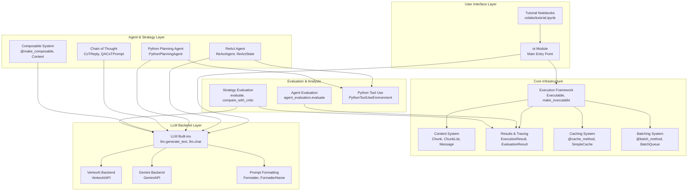
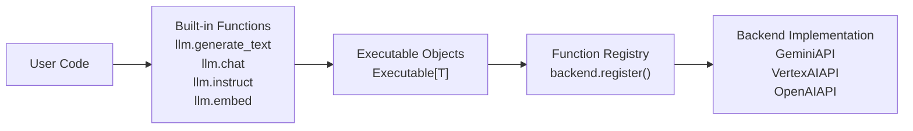
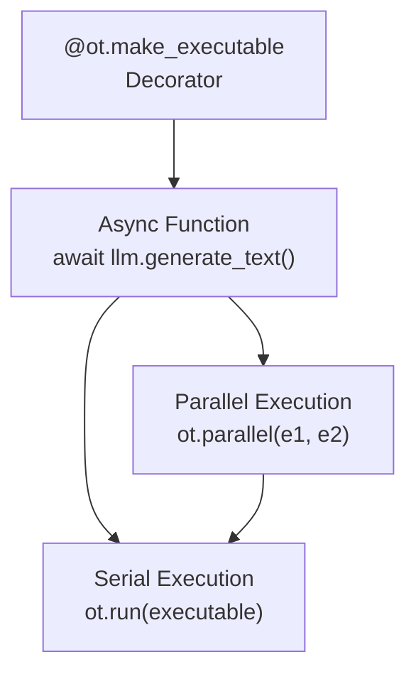
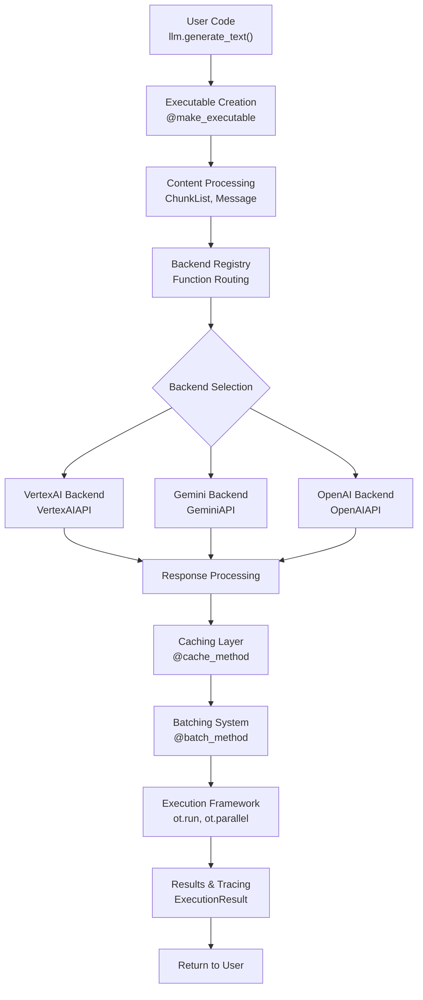
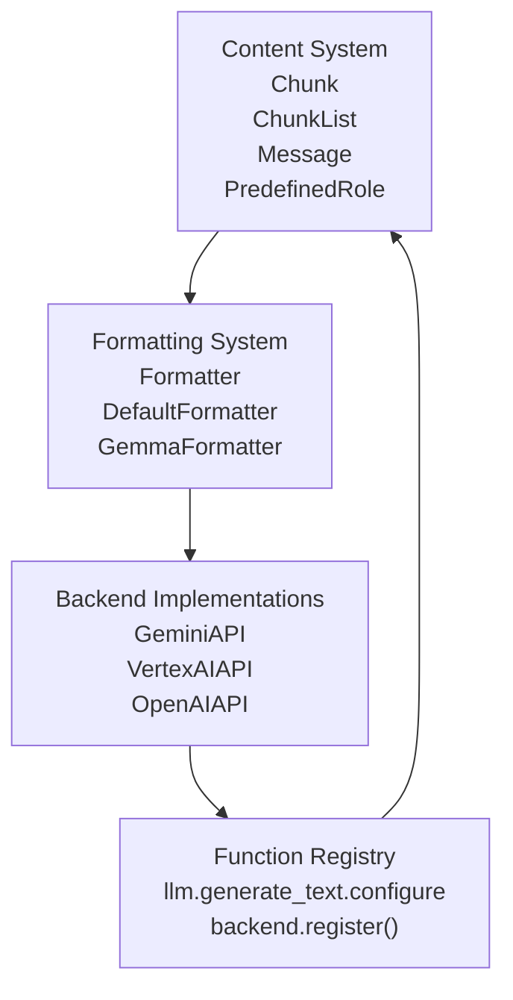
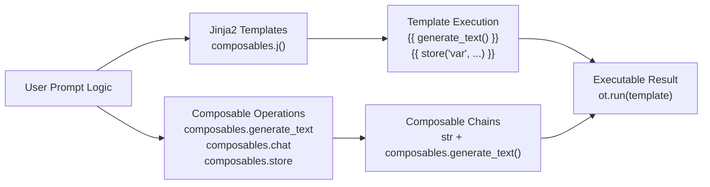

<!-- source: DeepWiki mcp.deepwiki.com · repo google-deepmind/onetwo · page 1 Overview · fetched 2026-10-26 -->

# Overview

Relevant source files

The following files were used as context for generating this wiki page:

- [README.md](README.md)
- [colabs/tutorial.ipynb](colabs/tutorial.ipynb)
- [docs/basics.md](docs/basics.md)

OneTwo is a Python library designed to simplify interactions with large language and multimodal foundation models, primarily aimed at researchers in prompting and prompting strategies. This document provides a high-level architectural overview of the OneTwo system, its core components, and how they work together to enable complex model interactions.

For detailed information about getting started with basic usage, see [Getting Started](#1.1). For in-depth coverage of the foundational systems, see [Core Architecture](#2). For advanced prompting strategies and agents, see [Advanced Features](#4).

## System Purpose and Architecture

OneTwo enables the creation of complex flows involving multiple calls to foundation models and other tools. The library is built around two key strategies for efficient execution: caching of model requests/responses and asynchronous execution for parallel operations.

### High-Level System Architecture

The OneTwo system is organized into several interconnected layers:

**Sources:** [colabs/tutorial.ipynb:47-226](), [README.md:1-70](), [docs/basics.md:1-27]()

## Core Concepts and Code Entities

### Executables and Built-in Functions

The foundation of OneTwo is the `Executable` abstraction, which represents deferred computation that can be executed against different backends. Built-in functions like `llm.generate_text()`, `llm.chat()`, `llm.instruct()`, and `llm.embed()` return `Executable` objects rather than directly calling models.

**Sources:** [colabs/tutorial.ipynb:565-573](), [colabs/tutorial.ipynb:617-618](), [docs/basics.md:44-70]()

### Execution Framework

The execution model supports both sequential and parallel operations through the `@ot.make_executable` decorator and functions like `ot.parallel()`. This enables complex computation graphs while maintaining clean, readable code.

**Sources:** [colabs/tutorial.ipynb:825-840](), [colabs/tutorial.ipynb:859-870](), [docs/basics.md:117-176]()

## Data Flow Architecture

### Request Processing Pipeline

OneTwo processes requests through a sophisticated pipeline that handles content formatting, backend routing, caching, and batching:

**Sources:** [colabs/tutorial.ipynb:604-608](), [colabs/tutorial.ipynb:825-840](), [colabs/tutorial.ipynb:498-523]()

## Backend System and Content Handling

### Backend Registration and Content Types

OneTwo supports multiple LLM backends through a unified registration system. Content is handled through a multimodal system supporting text, images, and structured messages:

| Component | Code Entity | Purpose |
|-----------|-------------|---------|
| Backend Registry | `backend.register()` | Routes function calls to implementations |
| Content Types | `Chunk`, `ChunkList`, `Message` | Handles multimodal content |
| Formatters | `Formatter`, `FormatterName` | Converts content for specific models |
| Built-in Functions | `llm.generate_text`, `llm.chat`, `llm.instruct` | Uniform API across backends |

**Sources:** [colabs/tutorial.ipynb:387-428](), [colabs/tutorial.ipynb:646-664](), [docs/basics.md:72-81]()

## Composables and Template System

OneTwo provides multiple approaches for building complex prompts, including Jinja2 templates and composable functions that can be concatenated with the `+` operator:

**Sources:** [colabs/tutorial.ipynb:907-915](), [colabs/tutorial.ipynb:934-942](), [colabs/tutorial.ipynb:1054-1064]()

## Evaluation and Testing Framework

OneTwo includes comprehensive evaluation capabilities for comparing prompting strategies and measuring agent performance:

| Evaluation Type | Key Classes | Purpose |
|----------------|-------------|---------|
| Strategy Evaluation | `evaluate()`, `compare_with_critic()` | Compare prompting approaches |
| Agent Evaluation | `agent_evaluation.evaluate()` | Measure agent performance |
| Results Analysis | `EvaluationResult`, `EvaluationSummary` | Store and analyze results |
| Testing Infrastructure | `LLMForTest`, Test utilities | Mock backends for testing |

**Sources:** [colabs/tutorial.ipynb:1338-1370](), [README.md:42-47]()

The OneTwo architecture provides a flexible, efficient foundation for prompting research while maintaining clean abstractions between user code, execution infrastructure, and backend implementations. The system's design enables researchers to focus on prompting strategies rather than infrastructure concerns.

---

