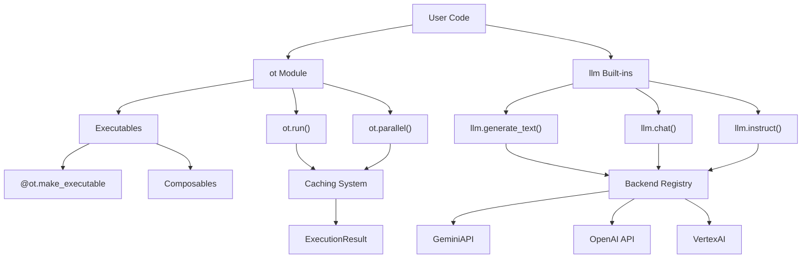
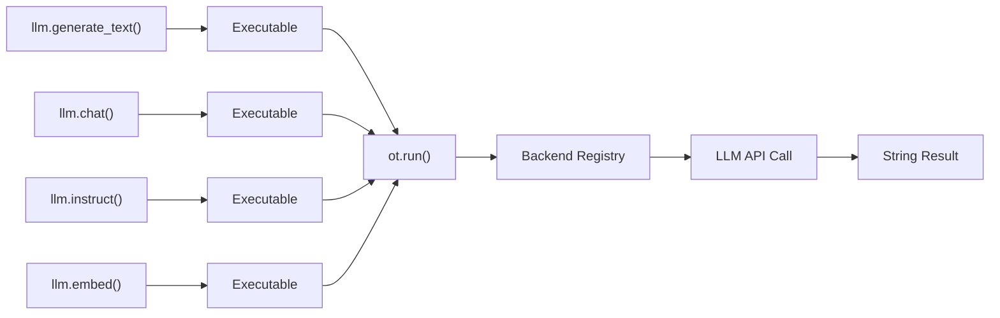
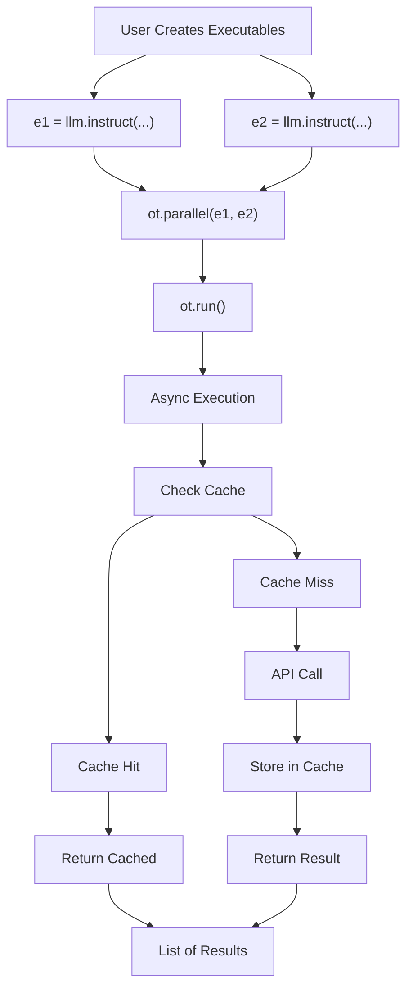

<!-- source: DeepWiki mcp.deepwiki.com · repo google-deepmind/onetwo · page 1.1 Getting Started · fetched 2026-10-26 -->

# Getting Started

<details>
<summary>Relevant source files</summary>

The following files were used as context for generating this wiki page:

- [colabs/tutorial.ipynb](colabs/tutorial.ipynb)

</details>


This document provides a tutorial introduction to the OneTwo library's core concepts and basic usage patterns. It covers installation, backend setup, built-in functions, executables, and fundamental prompting techniques. For advanced features like agents and complex reasoning strategies, see [Agent Strategies](#4.1). For comprehensive evaluation frameworks, see [Strategy Evaluation](#5.1).

## Purpose and Core Architecture

OneTwo is a library for building and executing complex LLM prompting strategies. It provides two main layers: a low-level core for connecting to models and chaining calls, and a standard library of reusable prompting components.

### OneTwo System Overview



Sources: [colabs/tutorial.ipynb:108-112](), [colabs/tutorial.ipynb:203-225]()

## Installation and Setup

### Installation

Install OneTwo from the GitHub repository:

```bash
pip install git+https://github.com/google-deepmind/onetwo
```

### Basic Imports

The minimum required imports for basic OneTwo operations:

```python
from onetwo import ot
from onetwo.builtins import llm
```

Sources: [colabs/tutorial.ipynb:108-112]()

### Backend Configuration

OneTwo supports multiple LLM backends. Choose one and configure it with your API credentials.

#### Gemini API Setup

```python
from onetwo.backends import gemini_api

backend = gemini_api.GeminiAPI(
    api_key=your_api_key,
    temperature=0.0,
    generate_model_name='models/gemini-1.5-flash',
    cache_filename='cache/gemini_cache.json'
)
backend.register()
```

#### OpenAI API Setup

```python
from onetwo.backends import openai_api

backend = openai_api.OpenAIAPI(
    api_key=your_api_key,
    model_name='gpt-4o-mini',
    temperature=0.0,
    cache_filename='cache/openai_cache.json'
)
backend.register()
```

Sources: [colabs/tutorial.ipynb:387-428](), [colabs/tutorial.ipynb:450-489]()

## Core Concepts

### Built-in Functions and Executables

OneTwo's core abstraction is the `Executable` - objects that represent LLM operations but don't execute immediately. Built-in functions return executables that are later executed with `ot.run()`.

### Built-in Function Mapping



Sources: [colabs/tutorial.ipynb:565-573](), [colabs/tutorial.ipynb:617-618]()

### The Three Main Built-ins

1. **`llm.generate_text()`** - Raw text completion, primarily for base models
2. **`llm.chat()`** - Multi-turn conversation with message history  
3. **`llm.instruct()`** - Single instruction following, converts to chat format

Sources: [colabs/tutorial.ipynb:565-573]()

## Basic Usage Examples

### Text Generation

```python
# Create an executable
e = llm.generate_text(
    'Three not so well known cities in France are',
    max_tokens=20
)

# Execute it
result = ot.run(e)
print(result)
```

Sources: [colabs/tutorial.ipynb:604-608]()

### Chat Conversations

```python
from onetwo.core import content as content_lib

messages = [
    content_lib.Message(
        role=content_lib.PredefinedRole.USER,
        content='Hi, my name is Peter. Who are you?'
    ),
    content_lib.Message(
        role=content_lib.PredefinedRole.MODEL,
        content='Nice to meet you, Peter. My name is Albert.'
    ),
    content_lib.Message(
        role=content_lib.PredefinedRole.USER,
        content='Tell me about yourself.'
    )
]

e = llm.chat(messages, max_tokens=50)
result = ot.run(e)
```

Sources: [colabs/tutorial.ipynb:646-664]()

### Instruction Following

```python
e = llm.instruct('What are three well-known cities in France?', max_tokens=50)
result = ot.run(e)
```

Sources: [colabs/tutorial.ipynb:694-695]()

## Composing Operations

### Sequential Execution with Executables

Create complex flows by composing operations with `@ot.make_executable`:

```python
@ot.make_executable
async def f() -> str:
    result1 = await llm.instruct(
        'Question: What is the capital of France? Answer:',
        max_tokens=20, stop=['\n']
    )
    print('Intermediate result:', result1)
    
    result2 = await llm.instruct(
        f'Question: Who is the mayor of {result1}? Answer:',
        max_tokens=20, stop=['\n'] 
    )
    return result2

result = ot.run(f())
```

Sources: [colabs/tutorial.ipynb:825-839]()

### Parallel Execution

Execute multiple operations concurrently:

```python
e1 = llm.instruct('What is the capital of France?', max_tokens=20)
e2 = llm.instruct('What is the capital of Spain?', max_tokens=20)

# Execute in parallel
parallel_exec = ot.parallel(e1, e2)
results = ot.run(parallel_exec)  # Returns list of results
```

Sources: [colabs/tutorial.ipynb:859-869]()

### Execution Flow



Sources: [colabs/tutorial.ipynb:859-869](), [colabs/tutorial.ipynb:216-217]()

## Templates and Composables

### Jinja2 Templates

Use `composables.j()` for template-based prompting:

```python
from onetwo.builtins import composables

template = composables.j("""
Question: What is the capital of {{ country }}?
Answer: {{ generate_text(max_tokens=10, stop=['\\n']) }}
""")

result = ot.run(template(country='France'))
```

Sources: [colabs/tutorial.ipynb:907-914]()

### Composable Strings

Concatenate strings with LLM operations using `+`:

```python
e = (
    'Question: What is the capital of France? Answer:'
    + composables.generate_text(max_tokens=20, stop=['\n'])
    + '\nQuestion: Who is its mayor? Answer:'
    + composables.generate_text(max_tokens=20, stop=['\n'])
)

result = ot.run(e)
```

Sources: [colabs/tutorial.ipynb:934-942]()

## Caching and Performance

### Automatic Caching

OneTwo automatically caches LLM responses. Identical requests return cached results:

```python
# First call hits the API
result1 = ot.run(llm.generate_text('Hello world'))

# Second identical call returns from cache
result2 = ot.run(llm.generate_text('Hello world'))
```

### Sampling Multiple Responses

Use `ot.repeat()` to generate multiple samples:

```python
executable = llm.generate_text(
    prompt='Five cities in Switzerland:',
    max_tokens=20,
    temperature=1.0  # Non-zero for diversity
)

# Create 3 instances
repeated = ot.repeat(executable, 3)
parallel_exec = ot.parallel(*repeated)
results = ot.run(parallel_exec)  # List of 3 different responses
```

Sources: [colabs/tutorial.ipynb:1117-1133]()

## Variable Management

### F-strings

Use Python f-strings for simple variable substitution:

```python
country = 'France'
prompt = f'Question: What is the capital of {country}?'
result = ot.run(llm.instruct(prompt, max_tokens=10))
```

### Jinja2 Variables

Store and retrieve variables in templates:

```python
prompt = composables.j(
    'Question: What is the capital of {{ question }}?\n'
    'Answer: {{ store("city", generate_text(max_tokens=10) | trim) }}\n'
    'Question: Who is the mayor of {{ __vars__.city }}?\n'
    'Answer: {{ store("mayor", generate_text(max_tokens=10) | trim) }}'
)

result = ot.run(prompt(question='France'))
# Access stored variables
city = prompt['city']
mayor = prompt['mayor']
```

Sources: [colabs/tutorial.ipynb:1054-1063]()

## Basic Evaluation

OneTwo provides evaluation utilities for testing prompting strategies:

```python
# Define a simple strategy
@ot.make_executable
async def strategy(question, **_):
    answer = await llm.generate_text(
        prompt=f'Question: {question}\nAnswer:',
        stop=['Question:', '\n']
    )
    return answer.strip()

# Define evaluation dataset
dataset = [
    {'question': 'What is 2+2?', 'answer': '4'},
    {'question': 'What is the capital of France?', 'answer': 'Paris'}
]

# Run evaluation
def metric_fn(answer, example):
    correct = str(example['answer']) in answer
    return float(correct), {}

time_elapsed, avg_metric, info = ot.evaluate(
    strategy=strategy,
    examples=dataset,
    critic=metric_fn
)
```

Sources: [colabs/tutorial.ipynb:1378-1405]()

## Next Steps

This covers the fundamental concepts for getting started with OneTwo. For more advanced topics, see:

- [Core Concepts](#1.2) for deeper understanding of executables and the function registry
- [Agent Strategies](#4.1) for ReAct and Python Planning agents
- [Reasoning Strategies](#4.3) for Chain-of-Thought and self-consistency
- [Strategy Evaluation](#5.1) for comprehensive evaluation frameworks
- [Performance Systems](#2.4) for caching, batching, and optimization features

Sources: [colabs/tutorial.ipynb:203-225]()

---

