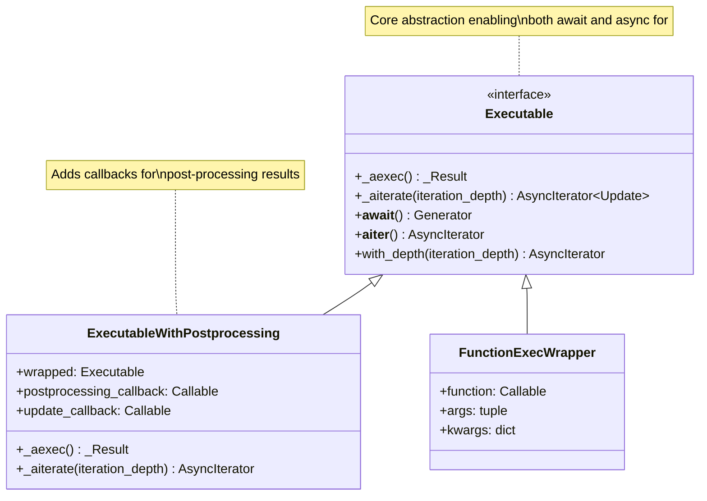
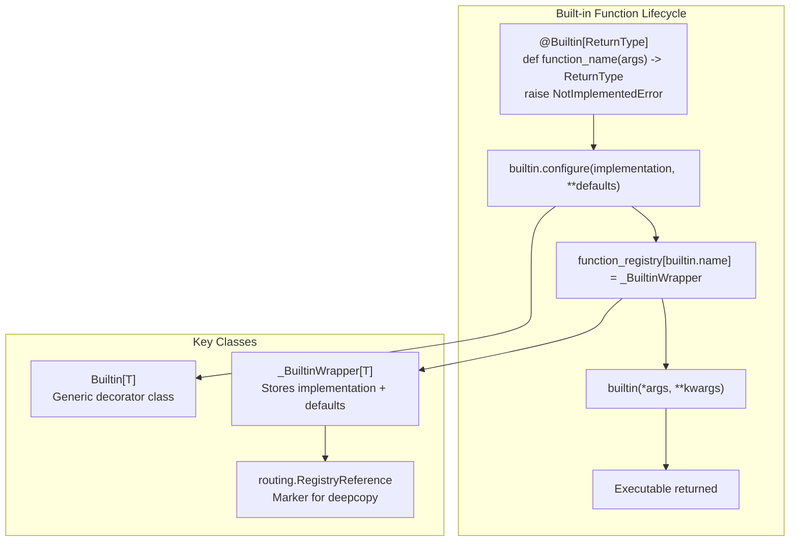
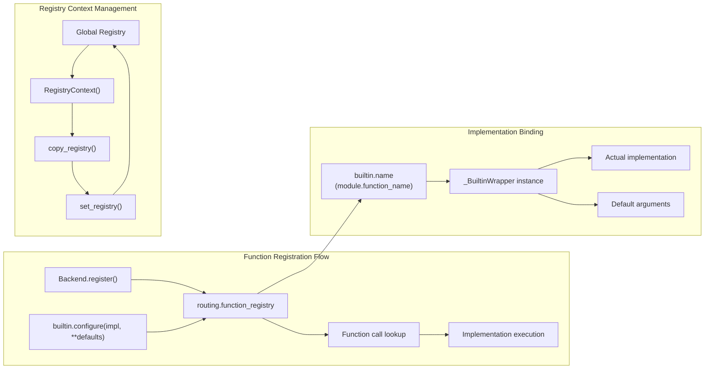
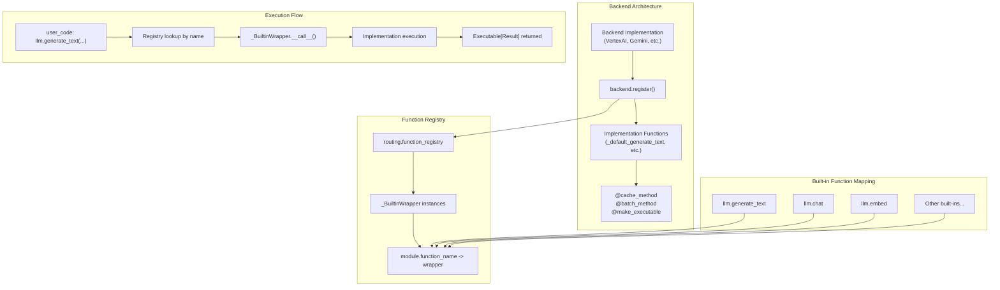
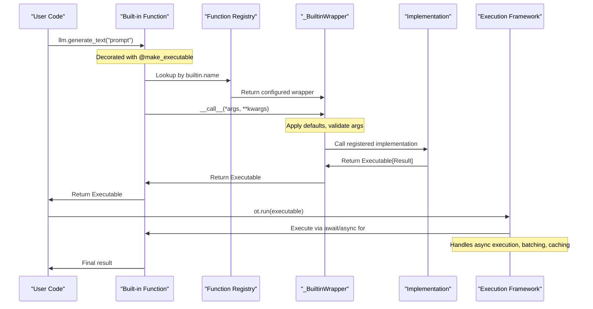

<!-- source: DeepWiki mcp.deepwiki.com · repo google-deepmind/onetwo · page 1.2 Core Concepts · fetched 2026-10-26 -->

# Core Concepts

Relevant source files

The following files were used as context for generating this wiki page:

- [README.md](README.md)
- [docs/basics.md](docs/basics.md)
- [onetwo/builtins/builtins_base.py](onetwo/builtins/builtins_base.py)
- [onetwo/builtins/builtins_base_test.py](onetwo/builtins/builtins_base_test.py)
- [onetwo/core/executing_impl.py](onetwo/core/executing_impl.py)
- [onetwo/core/executing_impl_test.py](onetwo/core/executing_impl_test.py)

This document explains the fundamental abstractions and architecture that power OneTwo's execution model. It covers the core concepts that enable decoupling prompting strategies from model implementations: Executables, built-in functions, the function registry, and backend systems.

For information about specific LLM integrations and backend configurations, see [Backend Systems](#3.2). For details about the execution framework mechanics, see [Execution Framework](#2.2).

## Core Abstractions

OneTwo is built around two primary abstractions that enable flexible, asynchronous execution of language model operations.

### Executables

The `Executable` interface represents any process that can be executed step-by-step, supporting both immediate execution via `await` and streaming execution via `async for`. All operations in OneTwo ultimately return `Executable` objects.

**Sources:** [onetwo/core/executing_impl.py:48-99](), [onetwo/core/executing_impl.py:102-148]()

The `Executable` interface provides two execution modes:
- **Awaitable**: Returns final result when awaited (`await executable`)
- **AsyncIterator**: Streams intermediate updates (`async for update in executable`)

### Built-in Functions

Built-in functions provide a uniform API for common language model operations, decoupled from specific implementations. They are defined as signatures and configured with concrete implementations at runtime.

**Sources:** [onetwo/builtins/builtins_base.py:297-346](), [onetwo/builtins/builtins_base.py:95-107](), [docs/basics.md:28-42]()

Built-ins use the `@Builtin[T]` decorator pattern:

| Component | Purpose | Key Methods |
|-----------|---------|-------------|
| `Builtin[T]` | Decorator for function signatures | `configure()`, `update()`, `is_configured()` |
| `_BuiltinWrapper[T]` | Stores implementation and defaults | `__call__()`, `update()`, signature validation |
| Function Registry | Maps builtin names to wrappers | Global routing via `routing.function_registry` |

## Function Registry System

The function registry enables runtime binding of built-in function calls to specific implementations, allowing the same prompting strategy to work with different backends.

**Sources:** [onetwo/builtins/builtins_base.py:429-431](), [docs/basics.md:72-116](), [onetwo/core/routing.py]()

### Registry Operations

| Operation | Purpose | Example |
|-----------|---------|---------|
| `builtin.configure(impl, **kwargs)` | Bind implementation to builtin | `llm.generate_text.configure(vertex_impl)` |
| `ot.RegistryContext()` | Create temporary registry scope | Context manager for isolated configs |
| `ot.copy_registry()` | Snapshot current registry state | Save configuration for later use |
| `ot.set_registry(registry)` | Activate specific registry | Switch between backend configurations |

## Backend Integration

Backends provide concrete implementations of built-in functions and register themselves in the function registry. The system supports multiple backends simultaneously through registry management.

**Sources:** [onetwo/builtins/builtins_base.py:459-502](), [docs/basics.md:74-81](), [README.md:19-37]()

### Implementation Requirements

Backend implementations must satisfy specific constraints when configured with built-ins:

| Constraint | Description | Example |
|------------|-------------|---------|
| **Signature Compatibility** | All non-optional builtin parameters must exist in implementation | `base_fn(a: int)` requires `impl_fn(a: int, ...)` |
| **Type Annotations** | Parameter types must match between builtin and implementation | Supports generic TypeVar matching |
| **Extra Parameters** | Implementation-only parameters must have defaults or be provided in configure | `impl_fn(a: int, b: str = 'default')` |
| **Return Executables** | Implementations automatically wrapped with `@make_executable` if needed | Ensures consistent Executable return types |

## Execution Integration

The integration between built-ins, registry, and execution creates a flexible system where prompting strategies are decoupled from implementation details.

**Sources:** [onetwo/builtins/builtins_base.py:459-502](), [onetwo/core/executing_impl.py:48-99](), [docs/basics.md:44-71]()

### Key Integration Points

| Component | Role | Key Methods |
|-----------|------|-------------|
| **Built-in Functions** | Define uniform API signatures | `configure()`, `__call__()` |
| **Function Registry** | Route calls to implementations | `routing.function_registry` lookup |
| **Executables** | Provide async execution interface | `_aexec()`, `_aiterate()` |
| **Backends** | Supply concrete implementations | `register()`, implementation functions |

This architecture enables powerful features like swapping backends, caching results, batching requests, and composing complex multi-step prompting strategies while maintaining clean separation between strategy definition and execution details.

---

