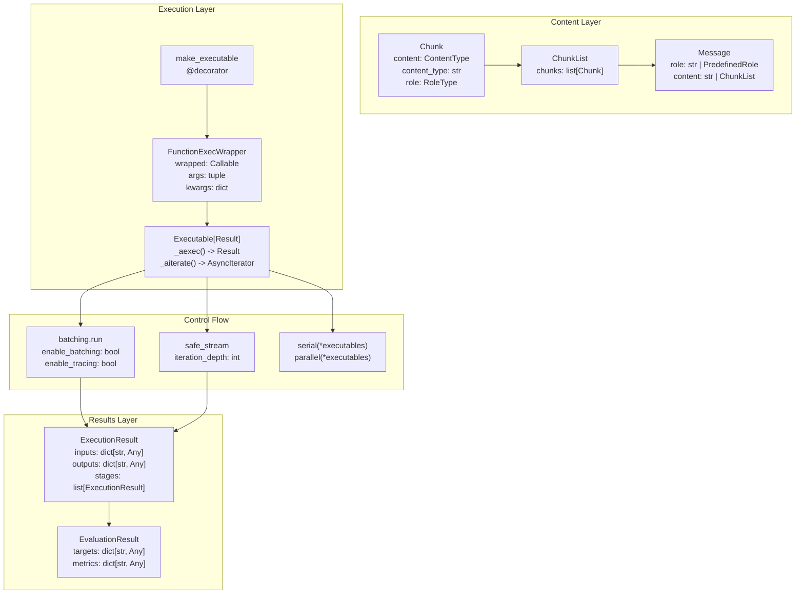
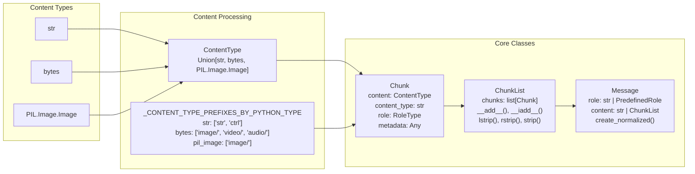
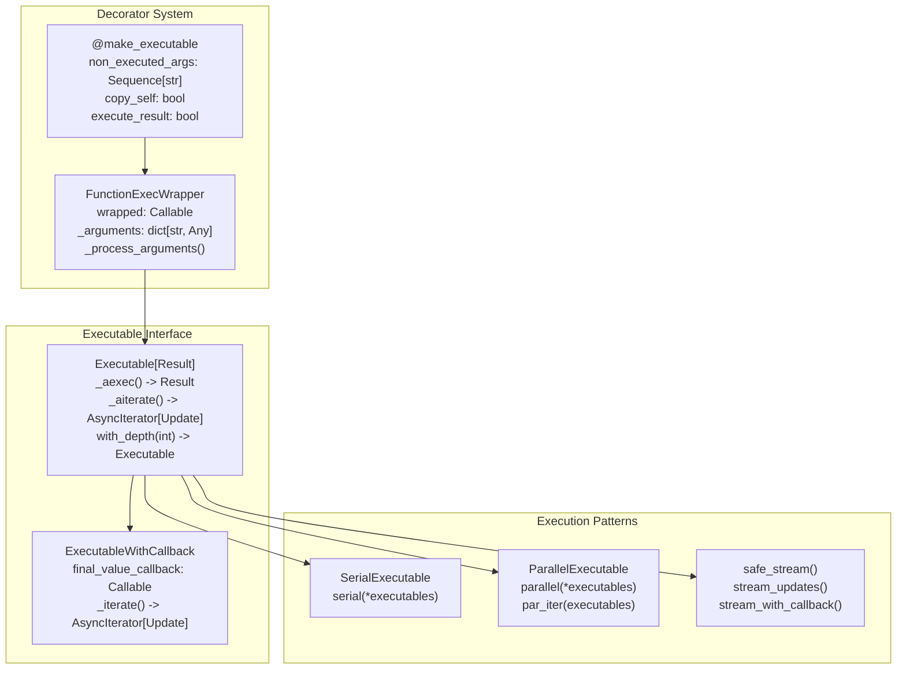
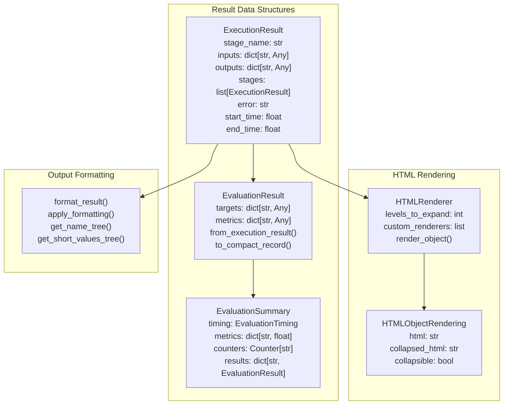
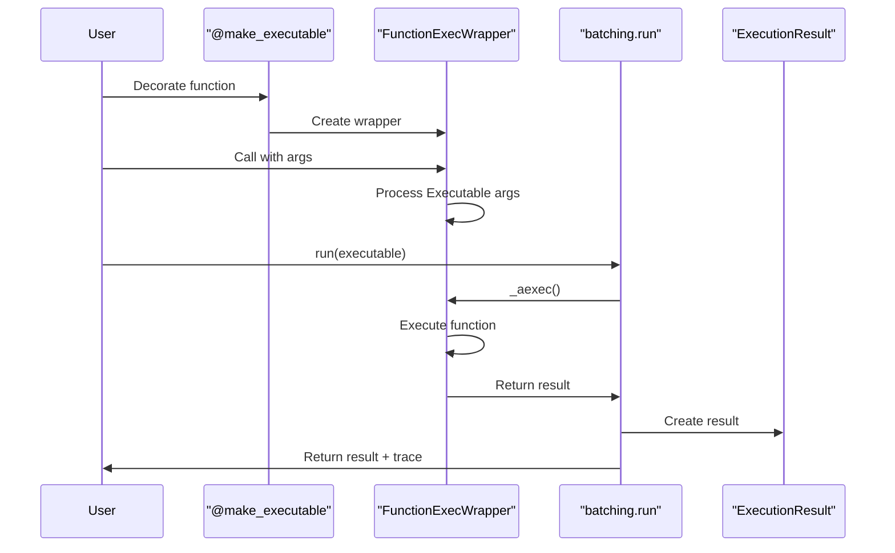

<!-- source: DeepWiki mcp.deepwiki.com · repo google-deepmind/onetwo · page 2 Core Architecture · fetched 2026-10-26 -->

# Core Architecture

Relevant source files

The following files were used as context for generating this wiki page:

- [onetwo/core/content.py](onetwo/core/content.py)
- [onetwo/core/content_test.py](onetwo/core/content_test.py)
- [onetwo/core/executing.py](onetwo/core/executing.py)
- [onetwo/core/executing_test.py](onetwo/core/executing_test.py)
- [onetwo/core/results.py](onetwo/core/results.py)
- [onetwo/core/results_test.py](onetwo/core/results_test.py)

This document provides an overview of OneTwo's foundational systems that enable asynchronous execution, multimodal content handling, and result tracking. These core components form the execution model that powers all higher-level features in OneTwo.

For information about LLM backends and built-in functions, see [LLM Integration](#3). For advanced prompting strategies and agents, see [Advanced Features](#4). For evaluation and testing systems, see [Evaluation and Testing](#5).

## Overview

OneTwo's core architecture consists of four primary systems that work together to provide a flexible execution framework:

1. **Content System** - Handles multimodal content representation
2. **Execution Framework** - Provides asynchronous execution capabilities  
3. **Results and Tracing** - Tracks execution outcomes and debugging information
4. **Performance Systems** - Optimizes execution through caching and batching

## Core Architecture Components

Sources: [onetwo/core/content.py:148-602](), [onetwo/core/executing.py:49-52](), [onetwo/core/executing.py:731-847](), [onetwo/core/results.py:76-151]()

## Content System Architecture

The content system provides a unified representation for multimodal data that can include text, images, and other media types.

Sources: [onetwo/core/content.py:33-108](), [onetwo/core/content.py:148-318](), [onetwo/core/content.py:320-553](), [onetwo/core/content.py:555-602]()

Key features of the content system:

- **Type Safety**: Validates content types against expected formats
- **Multimodal Support**: Handles text, images, and binary data uniformly
- **Role Management**: Associates content with roles (USER, MODEL, SYSTEM)
- **String Operations**: Provides familiar string manipulation methods on multimodal content

For detailed information about content handling, see [Content System](#2.1).

## Execution Framework Architecture

The execution framework enables functions to be converted into asynchronous, composable executables that can be run individually or in complex patterns.

Sources: [onetwo/core/executing.py:511-669](), [onetwo/core/executing.py:731-847](), [onetwo/core/executing.py:675-729]()

Key execution capabilities:

- **Automatic Conversion**: Functions become asynchronous executables via `@make_executable`
- **Argument Processing**: Automatically executes `Executable` arguments before function calls
- **Composition Patterns**: Supports serial and parallel execution of multiple executables
- **Streaming Support**: Enables real-time processing of intermediate results

For detailed information about execution patterns, see [Execution Framework](#2.2).

## Results and Tracing System

The results system captures execution outcomes, debug information, and evaluation metrics in a hierarchical structure.

Sources: [onetwo/core/results.py:76-252](), [onetwo/core/results.py:362-446](), [onetwo/core/results.py:687-1057]()

Key result tracking features:

- **Hierarchical Structure**: Nested results capture multi-stage execution flows  
- **Debug Information**: Includes timing, inputs, outputs, and error details
- **Evaluation Metrics**: Extends basic results with targets and performance metrics
- **Rich Rendering**: HTML and text formatters for interactive exploration

For detailed information about results and tracing, see [Results and Tracing](#2.3).

## System Integration Flow

This diagram shows how the core components work together during a typical execution:

Sources: [onetwo/core/executing.py:511-669](), [onetwo/core/executing.py:866-942](), [onetwo/core/batching.py]()

## Performance and Scalability

OneTwo's core architecture includes several performance optimization systems:

| System | Purpose | Key Components |
|--------|---------|----------------|
| **Batching** | Group multiple requests for efficient processing | `@batch_method`, `BatchQueue` |
| **Caching** | Avoid redundant computations | `@cache_method`, `SimpleCache` |
| **Parallel Execution** | Execute independent tasks concurrently | `parallel()`, `par_iter()` |
| **Streaming** | Process results incrementally | `safe_stream()`, `stream_updates()` |

For detailed information about performance optimizations, see [Performance Systems](#2.4).

## Next Steps

The core architecture provides the foundation for all OneTwo functionality. To learn about specific subsystems:

- **Content handling details**: [Content System](#2.1)
- **Execution patterns**: [Execution Framework](#2.2)  
- **Result tracking**: [Results and Tracing](#2.3)
- **Performance optimization**: [Performance Systems](#2.4)
- **LLM integration**: [LLM Integration](#3)
- **Advanced strategies**: [Advanced Features](#4)

Sources: [onetwo/core/content.py](), [onetwo/core/executing.py](), [onetwo/core/results.py]()

---

