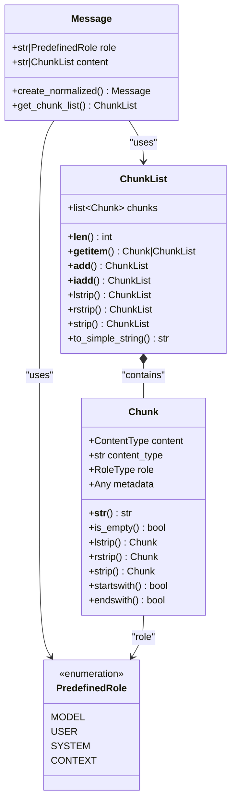
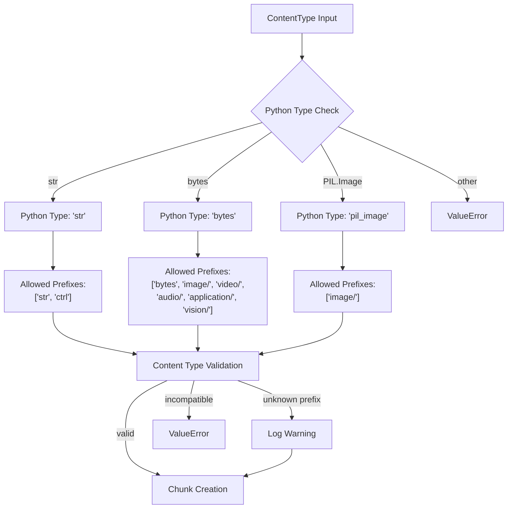
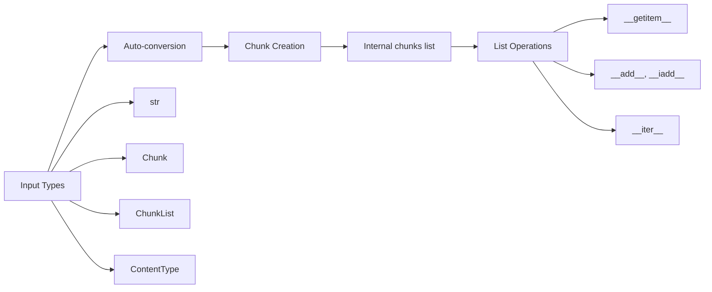
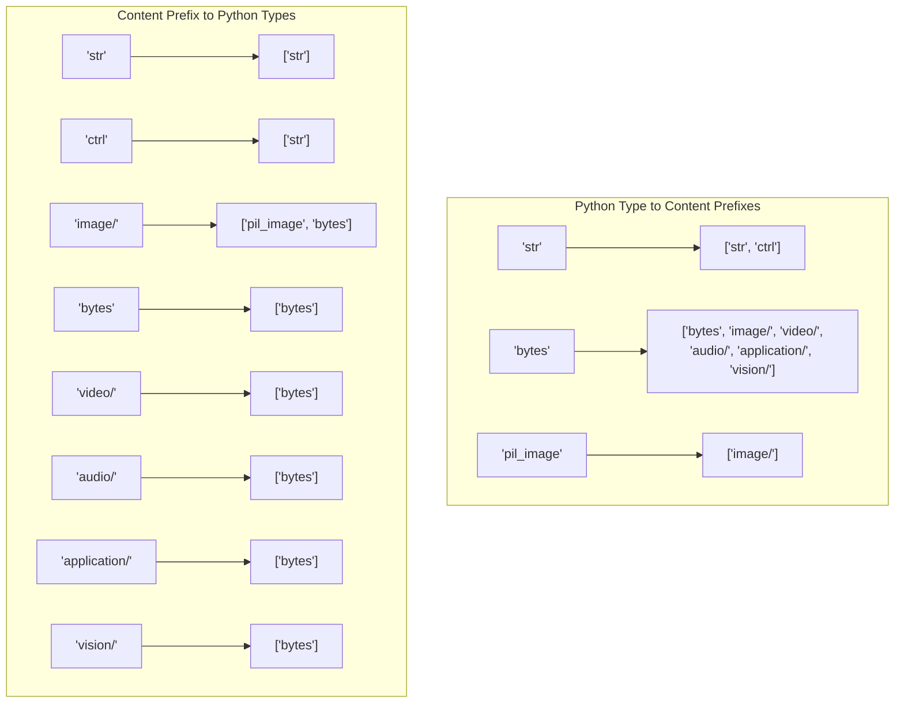

<!-- source: DeepWiki mcp.deepwiki.com · repo google-deepmind/onetwo · page 2.1 Content System · fetched 2026-10-26 -->

# Content System

<details>
<summary>Relevant source files</summary>

The following files were used as context for generating this wiki page:

- [onetwo/core/content.py](onetwo/core/content.py)
- [onetwo/core/content_test.py](onetwo/core/content_test.py)

</details>


## Purpose and Scope

The Content System provides the foundational data structures for handling multimodal content in OneTwo prompts and conversations. It defines three core classes that work together to represent text, images, and other media types in a type-safe, composable manner: `Chunk` for individual content pieces, `ChunkList` for collections of chunks, and `Message` for chat conversations.

This system handles content type validation, role assignment for chat scenarios, and provides string manipulation methods for text processing. For information about how content flows through the execution framework, see [Execution Framework](#2.2). For details on how content is formatted for different LLM backends, see [Prompt Formatting](#3.3).

## Core Architecture

### Class Relationships

The Content System consists of three main classes that form a hierarchical structure for representing multimodal content:



Sources: [onetwo/core/content.py:148-318](), [onetwo/core/content.py:320-553](), [onetwo/core/content.py:555-602](), [onetwo/core/content.py:130-143]()

### Content Type System

The Content System implements a robust type validation mechanism that maps Python types to content type prefixes:



Sources: [onetwo/core/content.py:45-74](), [onetwo/core/content.py:77-107](), [onetwo/core/content.py:170-203]()

## Core Classes

### Chunk Class

The `Chunk` class represents a single piece of multimodal content with associated metadata and type information.

#### Key Attributes

| Attribute | Type | Description |
|-----------|------|-------------|
| `content` | `ContentType` | The actual content (str, bytes, or PIL.Image.Image) |
| `content_type` | `str` | MIME-like type identifier (auto-inferred if not provided) |
| `role` | `RoleType` | Role assignment for chat messages (optional) |
| `metadata` | `Any` | Additional metadata for downstream processing |

#### Content Type Inference

When a `Chunk` is created without an explicit `content_type`, the system automatically infers the appropriate type:

- `str` content → `'str'` content type
- `bytes` content → `'bytes'` content type  
- `PIL.Image.Image` content → `'image/jpeg'` content type

#### String Operations

The `Chunk` class provides string manipulation methods that operate only on string content:

```python
# Example usage patterns (from test file)
chunk = Chunk('abccbbabbctest')
stripped = chunk.lstrip('abc')  # Returns Chunk('test')
```

Sources: [onetwo/core/content.py:148-318](), [onetwo/core/content_test.py:216-264]()

### ChunkList Class

The `ChunkList` class manages collections of `Chunk` objects, providing list-like operations and aggregate string manipulation.

#### Core Operations

The class supports standard container operations with automatic type conversion:



#### String Processing

`ChunkList` implements sophisticated string processing that handles multimodal content:

- `lstrip()` - Removes leading empty chunks and strips the first non-empty chunk
- `rstrip()` - Removes trailing empty chunks and strips the last non-empty chunk, propagating if entire chunks are stripped
- `to_simple_string()` - Extracts only string and control token content, filtering out binary data

Sources: [onetwo/core/content.py:320-553](), [onetwo/core/content_test.py:173-198](), [onetwo/core/content_test.py:281-446]()

### Message Class

The `Message` class represents chat conversation messages with role-based content organization.

#### Content Normalization

The `Message.create_normalized()` method optimizes content representation:

```mermaid
flowchart TD
    Input["Input Content"] --> TypeCheck{"Content Type?"}
    
    TypeCheck -->|str| StringContent["Keep as string"]
    TypeCheck -->|ChunkList| ChunkListCheck{"Single string chunk<br/>with no metadata?"}
    TypeCheck -->|Sequence[Chunk]| SequenceCheck{"Single string chunk<br/>with no metadata?"}
    
    ChunkListCheck -->|Yes| Normalize["Normalize to string"]
    ChunkListCheck -->|No| KeepChunkList["Keep as ChunkList"]
    
    SequenceCheck -->|Yes| Normalize
    SequenceCheck -->|No| ConvertToChunkList["Convert to ChunkList"]
    
    StringContent --> Result["Message with normalized content"]
    Normalize --> Result
    KeepChunkList --> Result
    ConvertToChunkList --> Result
```

#### Role Management

Messages use the `PredefinedRole` enum for standardized role assignment:

| Role | Purpose |
|------|---------|
| `USER` | User input messages |
| `MODEL` | LLM-generated responses |
| `SYSTEM` | System prompts and instructions |
| `CONTEXT` | Contextual information |

Sources: [onetwo/core/content.py:555-602](), [onetwo/core/content.py:130-143](), [onetwo/core/content_test.py:480-547]()

## Content Type Validation System

### Type Mapping Tables

The Content System maintains bidirectional mappings between Python types and content type prefixes:



### Validation Flow

The validation process ensures type safety and provides helpful error messages:

1. **Content Analysis** - Determine Python type from content using `_get_python_and_content_type_from_content()`
2. **Type Inference** - Set default content type if not provided
3. **Prefix Extraction** - Extract content type prefix using `_get_content_type_prefix()`
4. **Compatibility Check** - Verify Python type is compatible with content type prefix
5. **Error Handling** - Log warnings for unknown types, raise errors for incompatible combinations

Sources: [onetwo/core/content.py:45-74](), [onetwo/core/content.py:77-128](), [onetwo/core/content_test.py:36-172]()

## Usage Patterns

### Basic Content Creation

```python
# String content with automatic type inference
text_chunk = Chunk("Hello world")  # content_type='str'

# Binary content with explicit type
image_chunk = Chunk(image_bytes, content_type='image/jpeg')

# Control tokens for special model instructions
control_chunk = Chunk("<special_token>", content_type='ctrl')
```

### Multimodal Prompt Assembly

```python
# Building a multimodal prompt
prompt = ChunkList([
    "Please analyze this image: ",
    Chunk(image_data, content_type='image/png'),
    "\nWhat do you see?"
])
```

### Chat Message Construction

```python
# Simple string message
user_msg = Message.create_normalized(PredefinedRole.USER, "Hello")

# Multimodal message with normalization
content = ChunkList([text, image_chunk])
user_msg = Message.create_normalized(PredefinedRole.USER, content)
```

Sources: [onetwo/core/content_test.py:55-74](), [onetwo/core/content_test.py:173-198](), [onetwo/core/content_test.py:482-528]()

---

