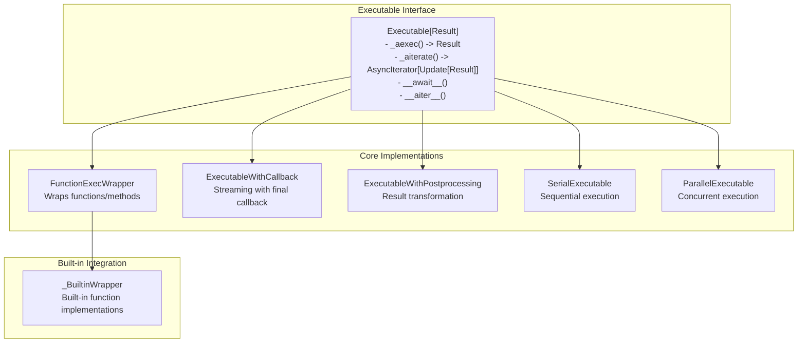
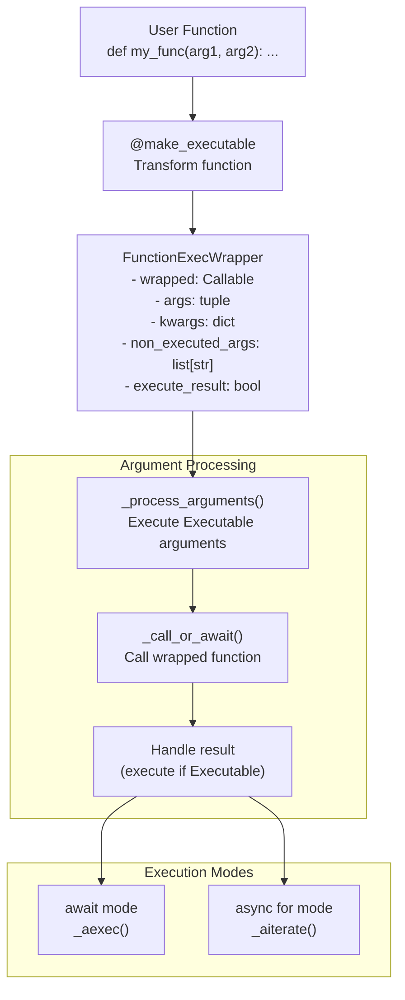
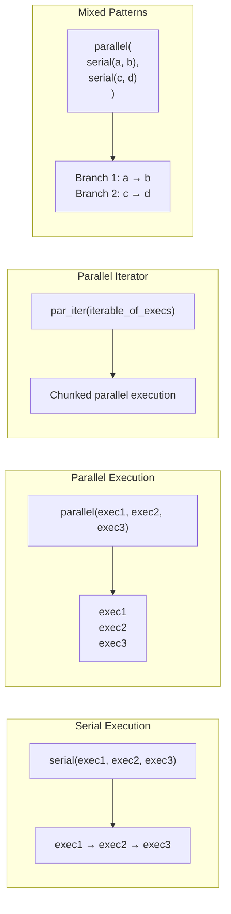
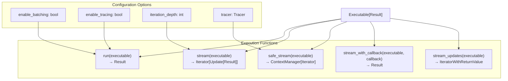
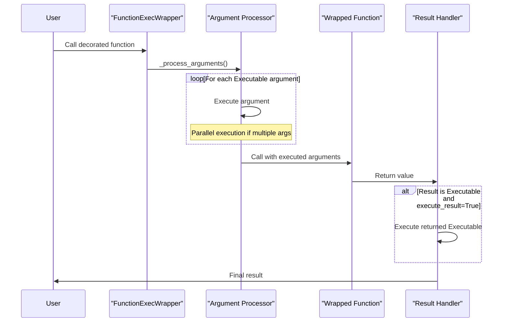
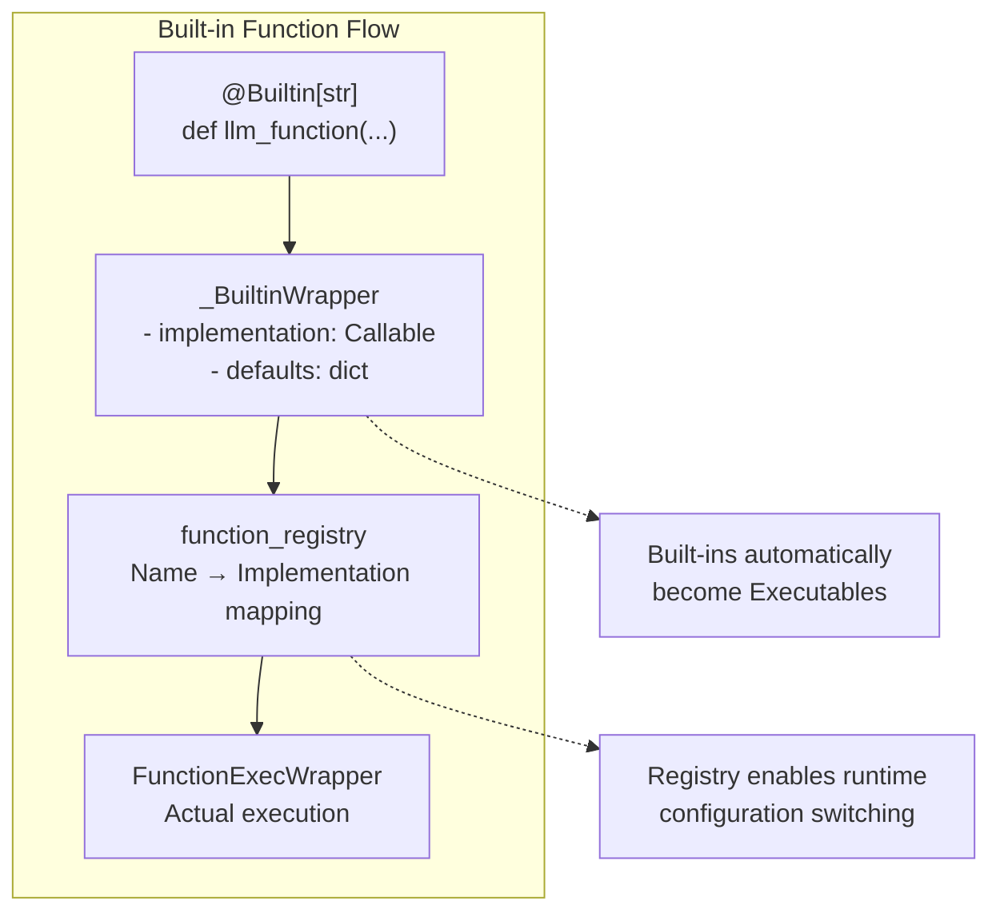

<!-- source: DeepWiki mcp.deepwiki.com · repo google-deepmind/onetwo · page 2.2 Execution Framework · fetched 2026-10-26 -->

# Execution Framework

<details>
<summary>Relevant source files</summary>

The following files were used as context for generating this wiki page:

- [onetwo/builtins/builtins_base.py](onetwo/builtins/builtins_base.py)
- [onetwo/builtins/builtins_base_test.py](onetwo/builtins/builtins_base_test.py)
- [onetwo/core/executing.py](onetwo/core/executing.py)
- [onetwo/core/executing_impl.py](onetwo/core/executing_impl.py)
- [onetwo/core/executing_impl_test.py](onetwo/core/executing_impl_test.py)
- [onetwo/core/executing_test.py](onetwo/core/executing_test.py)

</details>


The Execution Framework provides OneTwo's core infrastructure for asynchronous, composable execution of functions and methods. It enables functions to be executed individually, in serial chains, or in parallel batches while supporting both streaming and batch execution modes. This framework serves as the foundation for all LLM interactions, agent operations, and evaluation pipelines in OneTwo.

For information about the data structures used to represent execution results, see [Results and Tracing](#2.3). For performance optimizations like caching and batching, see [Performance Systems](#2.4).

## The Executable Interface

The `Executable` interface is the central abstraction that unifies both awaitable operations and async iterators. Every executable can be used with `await` to get a final result or with `async for` to stream intermediate updates.



Sources: [onetwo/core/executing_impl.py:48-99](), [onetwo/core/executing.py:58-114](), [onetwo/core/executing.py:731-768]()

The `Executable` interface supports dual execution modes:
- **Awaitable mode**: Use `await executable` to get the final result
- **Iterator mode**: Use `async for update in executable` to stream intermediate results

## The make_executable Decorator

The `make_executable` decorator transforms ordinary functions and methods into `Executable` objects, enabling them to participate in OneTwo's execution framework.



Sources: [onetwo/core/executing.py:510-669](), [onetwo/core/executing.py:731-968]()

### Key Features of make_executable

| Feature | Description | Configuration |
|---------|-------------|---------------|
| **Automatic Argument Execution** | Executes `Executable` arguments before calling the function | `non_executed_args` parameter |
| **Result Execution** | Executes returned `Executable` objects | `execute_result` parameter |
| **Copy Control** | Controls deep-copying behavior | `copy_self`, `non_copied_args` |
| **Iteration Chaining** | Streams updates from specific arguments | `iterate_argument` parameter |

Example usage:
```python
@make_executable
def process_text(text: str, model_call: Executable[str]) -> str:
    # model_call will be automatically executed
    result = await model_call  # This happens automatically
    return f"Processed: {result}"

@make_executable('raw_input')  # Don't execute raw_input
def chain_processing(raw_input: Executable[str], processor: str) -> str:
    # raw_input won't be auto-executed, allowing manual control
    pass
```

## Execution Patterns

OneTwo supports several execution patterns for composing multiple operations:



Sources: [onetwo/core/executing.py:675-728]()

### Serial Execution
```python
# Execute one after another
result = await serial(
    llm.generate_text("First prompt"),
    llm.generate_text("Second prompt"),
    llm.generate_text("Third prompt")
)
# Returns: [result1, result2, result3]
```

### Parallel Execution
```python
# Execute concurrently
result = await parallel(
    llm.generate_text("Prompt A"),
    llm.generate_text("Prompt B"), 
    llm.generate_text("Prompt C")
)
# Returns: [resultA, resultB, resultC]
```

## Execution Functions

The framework provides multiple ways to execute `Executable` objects:



Sources: [onetwo/core/executing.py:47](), [onetwo/core/executing.py:165-278](), [onetwo/core/executing.py:341-404](), [onetwo/core/executing.py:443-504]()

### Execution Function Details

| Function | Use Case | Returns | Thread Safety |
|----------|----------|---------|---------------|
| `run()` | Simple execution to completion | Final result | ✓ |
| `stream()` | Streaming with manual iteration | Iterator of updates | ⚠️ Deprecated |
| `safe_stream()` | Streaming with proper cleanup | Context manager | ✓ |
| `stream_with_callback()` | Streaming with callback per update | Final result | ✓ |
| `stream_updates()` | Streaming with return value access | Special iterator | ✓ |

### Iteration Depth Control

The `iteration_depth` parameter controls how deeply nested executables are streamed:

- `iteration_depth=0`: Execute sub-executables in one step
- `iteration_depth=1`: Stream one level of sub-executables  
- `iteration_depth=-1`: Stream all levels (unlimited depth)

## Argument Processing and Execution Flow

The execution framework automatically handles complex argument dependencies:



Sources: [onetwo/core/executing.py:866-941](), [onetwo/core/executing.py:943-965]()

### Deep Copy Behavior

The framework supports sophisticated copying behavior for safe parallel execution:

- **Default**: Deep copy all arguments and `self` for methods
- **`copy_self=False`**: Preserve method instance references
- **`non_copied_args`**: Specify arguments to reference (not copy)

This enables safe parallel execution while avoiding unnecessary copying of large or shared objects.

## Integration with Built-in Functions

The execution framework integrates seamlessly with OneTwo's built-in function system:



Sources: [onetwo/builtins/builtins_base.py:95-294](), [onetwo/builtins/builtins_base.py:459-502]()

The `@make_executable` decorator is automatically applied to built-in implementations, ensuring they return `Executable` objects that can be composed with other operations.

## Error Handling and Resource Management

The framework provides robust error handling and resource cleanup:

- **Context Managers**: `safe_stream()` ensures proper thread cleanup on exceptions
- **Exception Propagation**: Errors in parallel execution can be collected or halt processing
- **Resource Cleanup**: Automatic cleanup of background threads and async tasks

Example of safe streaming:
```python
with safe_stream(complex_executable) as iterator:
    for update in iterator:
        # Process update
        if some_condition:
            break  # Threads properly cleaned up
```

The execution framework forms the foundation for all high-level OneTwo operations, providing a consistent, composable interface for asynchronous execution while handling the complexities of argument processing, parallel execution, and resource management.

Sources: [onetwo/core/executing.py:116-163](), [onetwo/core/executing.py:280-304]()

---

