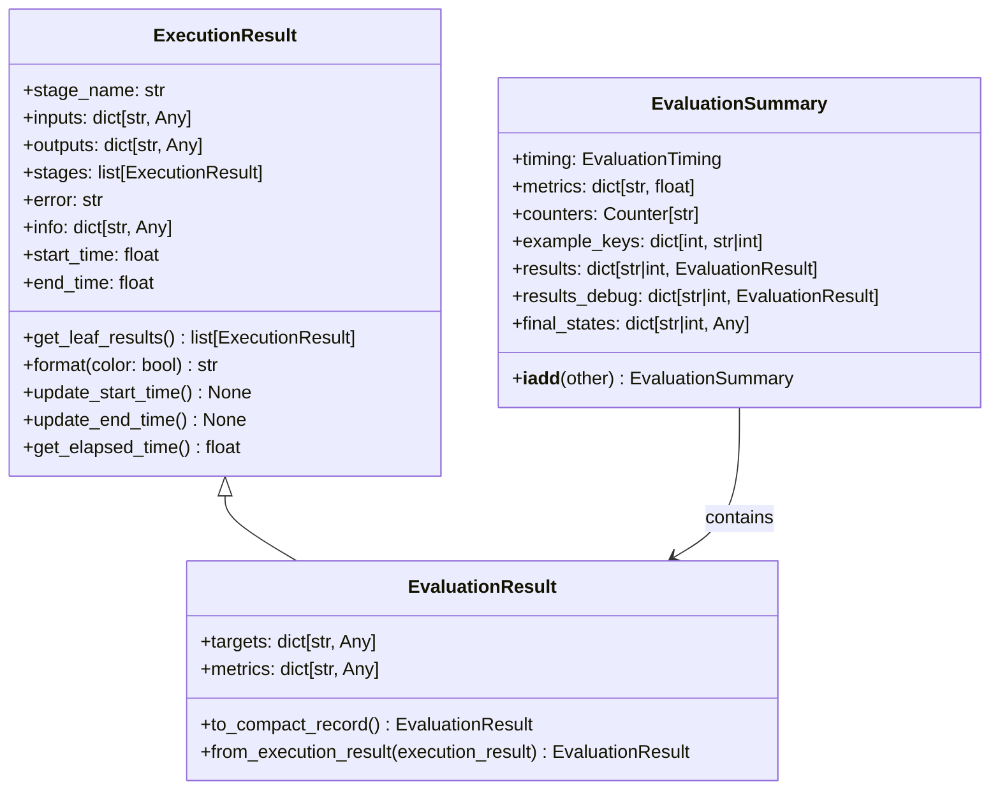
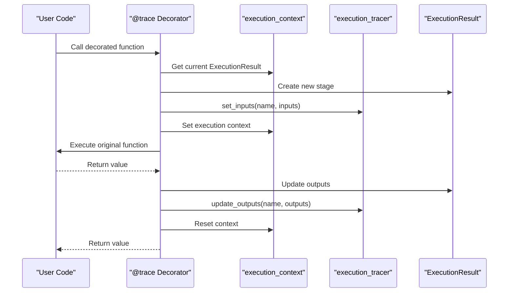
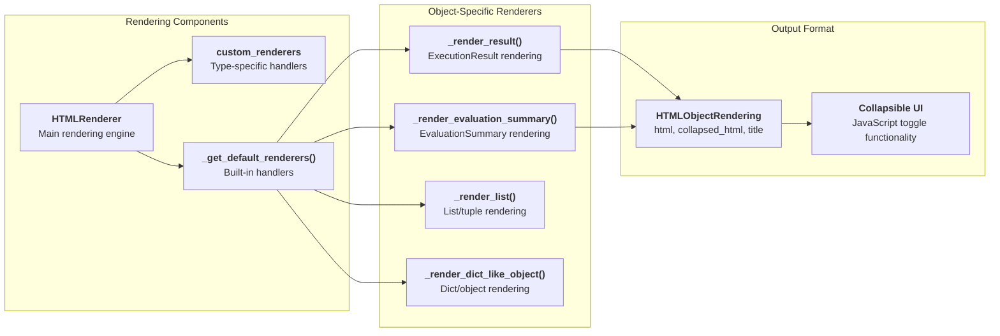
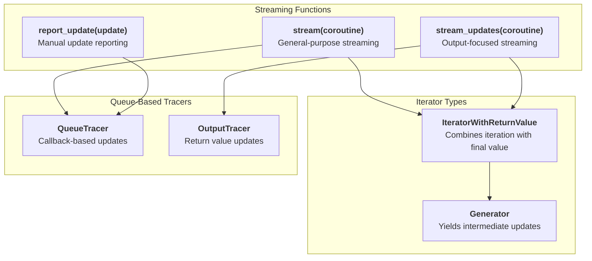
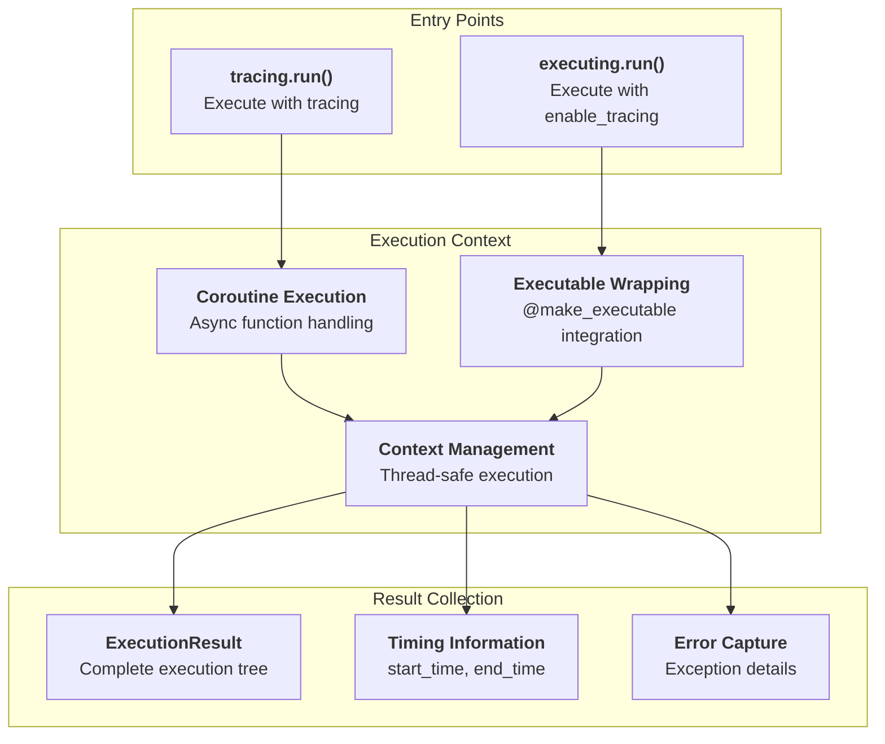

<!-- source: DeepWiki mcp.deepwiki.com · repo google-deepmind/onetwo · page 2.3 Results and Tracing · fetched 2026-10-26 -->

# Results and Tracing

<details>
<summary>Relevant source files</summary>

The following files were used as context for generating this wiki page:

- [onetwo/core/results.py](onetwo/core/results.py)
- [onetwo/core/results_test.py](onetwo/core/results_test.py)
- [onetwo/core/tracing.py](onetwo/core/tracing.py)
- [onetwo/core/tracing_test.py](onetwo/core/tracing_test.py)

</details>


This page documents OneTwo's result storage and execution tracing systems. These systems capture the complete execution tree of prompting strategies, including inputs, outputs, timing information, and hierarchical stage decomposition. For information about evaluation metrics and strategy comparison, see [Strategy Evaluation](#5.1). For agent-specific result handling, see [Agent Evaluation](#5.2).

## Core Result Data Structures

OneTwo provides three primary data structures for storing execution results, each serving different purposes in the prompting workflow.

### ExecutionResult

The `ExecutionResult` class serves as the foundational data structure for capturing prompt execution details. It represents a single execution stage with complete input/output tracking and hierarchical nesting capabilities.



**Sources:** [onetwo/core/results.py:77-251]()

### EvaluationResult and EvaluationSummary

`EvaluationResult` extends `ExecutionResult` with evaluation-specific fields including target values and computed metrics. `EvaluationSummary` aggregates results across multiple examples in an evaluation run.

| Field | Purpose | Example |
|-------|---------|---------|
| `targets` | Expected/golden outputs | `{"answer": "Paris"}` |
| `metrics` | Computed evaluation metrics | `{"accuracy": 0.85}` |
| `counters` | Example counts per metric | `{"accuracy_count": 100}` |
| `results` | Compact evaluation results | Results without detailed traces |
| `results_debug` | Full evaluation results | Results with complete execution traces |

**Sources:** [onetwo/core/results.py:363-446](), [onetwo/core/results.py:466-601]()

## Tracing System

OneTwo's tracing system captures execution hierarchies through decorators and context variables, enabling detailed debugging and analysis of prompting strategies.

### Tracer Architecture

```mermaid
graph TD
    subgraph "Tracer Interface"
        Tracer["`**Tracer**<br/>Abstract Base Class`"]
        Tracer --> add_stage["add_stage(): Tracer"]
        Tracer --> set_inputs["set_inputs(name, inputs)"]
        Tracer --> update_outputs["update_outputs(name, outputs)"]
    end
    
    subgraph "Tracer Implementations"
        ExecutionResultTracer["`**ExecutionResultTracer**<br/>Creates ExecutionResult tree`"]
        StringTracer["`**StringTracer**<br/>Prints to IO stream`"]
        QueueTracer["`**QueueTracer**<br/>Sends updates to callback`"]
        OutputTracer["`**OutputTracer**<br/>Streams return values`"]
    end
    
    subgraph "Context Variables"
        execution_context["`**execution_context**<br/>Current ExecutionResult`"]
        execution_tracer["`**execution_tracer**<br/>Current Tracer instance`"]
    end
    
    Tracer <|.. ExecutionResultTracer
    Tracer <|.. StringTracer
    Tracer <|.. QueueTracer
    QueueTracer <|-- OutputTracer
    
    ExecutionResultTracer --> execution_context
    StringTracer --> execution_tracer
    QueueTracer --> execution_tracer
```

**Sources:** [onetwo/core/tracing.py:49-131](), [onetwo/core/tracing.py:46-62]()

### Trace Decorator

The `@trace` decorator automatically captures function execution in the result hierarchy. It supports synchronous functions, coroutines, and async iterators.

```python
@trace
def my_function(x, y):
    return x + y

@trace(name="custom_stage", skip=["sensitive_param"])
async def my_async_function(data, sensitive_param):
    return process(data)
```

The decorator handles:
- **Input capture**: Function arguments stored in `ExecutionResult.inputs`
- **Output capture**: Return values stored in `ExecutionResult.outputs`
- **Timing**: Automatic `start_time` and `end_time` recording
- **Hierarchy**: Nested function calls create child stages
- **Context management**: Thread-safe execution context handling

**Sources:** [onetwo/core/tracing.py:335-607]()

### Execution Flow



**Sources:** [onetwo/core/tracing.py:378-607]()

## HTML Rendering

The `HTMLRenderer` class provides rich visualization of execution results with collapsible hierarchies and custom object rendering.

### Rendering Pipeline



**Sources:** [onetwo/core/results.py:687-1261]()

### Rendering Features

| Feature | Description | Configuration |
|---------|-------------|---------------|
| **Hierarchical Expansion** | Collapsible result trees | `levels_to_expand` parameter |
| **Custom Renderers** | Type-specific rendering logic | `custom_renderers` list |
| **LLM Request/Reply** | Special formatting for prompts | Automatic for `generate_text` stages |
| **Compact Representations** | Collapsed view for large objects | `_max_collapsed_rendering_length` |

**Sources:** [onetwo/core/results.py:700-727]()

## Streaming and Updates

OneTwo supports streaming execution updates for real-time monitoring of long-running prompting strategies.

### Streaming Architecture



**Sources:** [onetwo/core/tracing.py:161-247](), [onetwo/core/tracing.py:137-159]()

### Usage Patterns

**Streaming Execution Updates:**
```python
async def my_strategy():
    await report_update("Starting phase 1")
    result1 = await phase1()
    await report_update("Starting phase 2") 
    result2 = await phase2()
    return combine(result1, result2)

iterator = stream_updates(my_strategy())
for update in iterator:
    print(f"Progress: {update}")
final_result = iterator.value
```

**Streaming with Custom Tracers:**
```python
def callback(update):
    print(f"Received: {update}")

iterator = stream(my_coroutine(), tracer=QueueTracer, iteration_depth=2)
for update in iterator:
    process_update(update)
```

**Sources:** [onetwo/core/tracing.py:222-247](), [onetwo/core/tracing.py:250-257]()

## Integration with Execution Framework

Results and tracing integrate seamlessly with OneTwo's execution framework through the `run()` function and executable decorators.

### Execution Integration



**Sources:** [onetwo/core/tracing.py:271-302](), [onetwo/core/tracing.py:475-503]()

### Key Integration Points

| Integration | Purpose | Implementation |
|-------------|---------|----------------|
| **@make_executable** | Executable tracing | `_wrap_executable_to_trace_outputs()` |
| **Context Variables** | Thread-safe state | `execution_context`, `execution_tracer` |
| **Timing Integration** | Performance tracking | `update_start_time()`, `update_end_time()` |
| **Error Handling** | Exception capture | `ExecutionResult.error` field |

The integration ensures that whether using `tracing.run()` directly or `executing.run()` with `enable_tracing=True`, the same comprehensive tracing capabilities are available across all OneTwo prompting strategies.

**Sources:** [onetwo/core/tracing.py:287-302](), [onetwo/core/results.py:238-250]()

---

