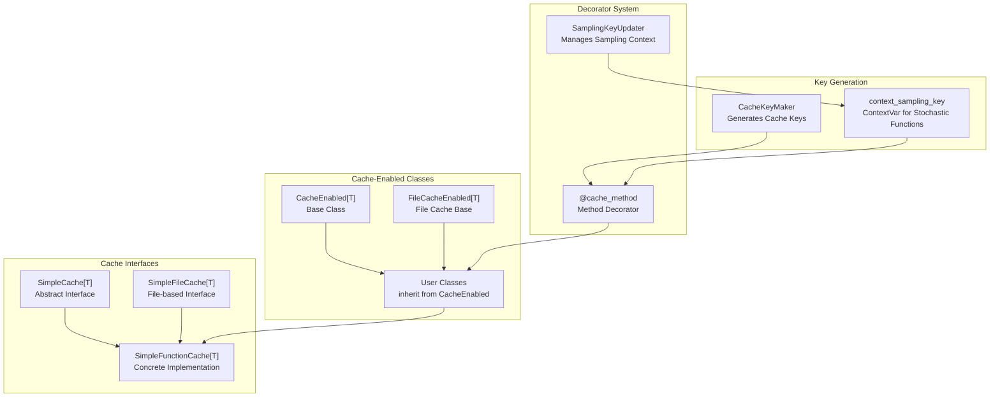
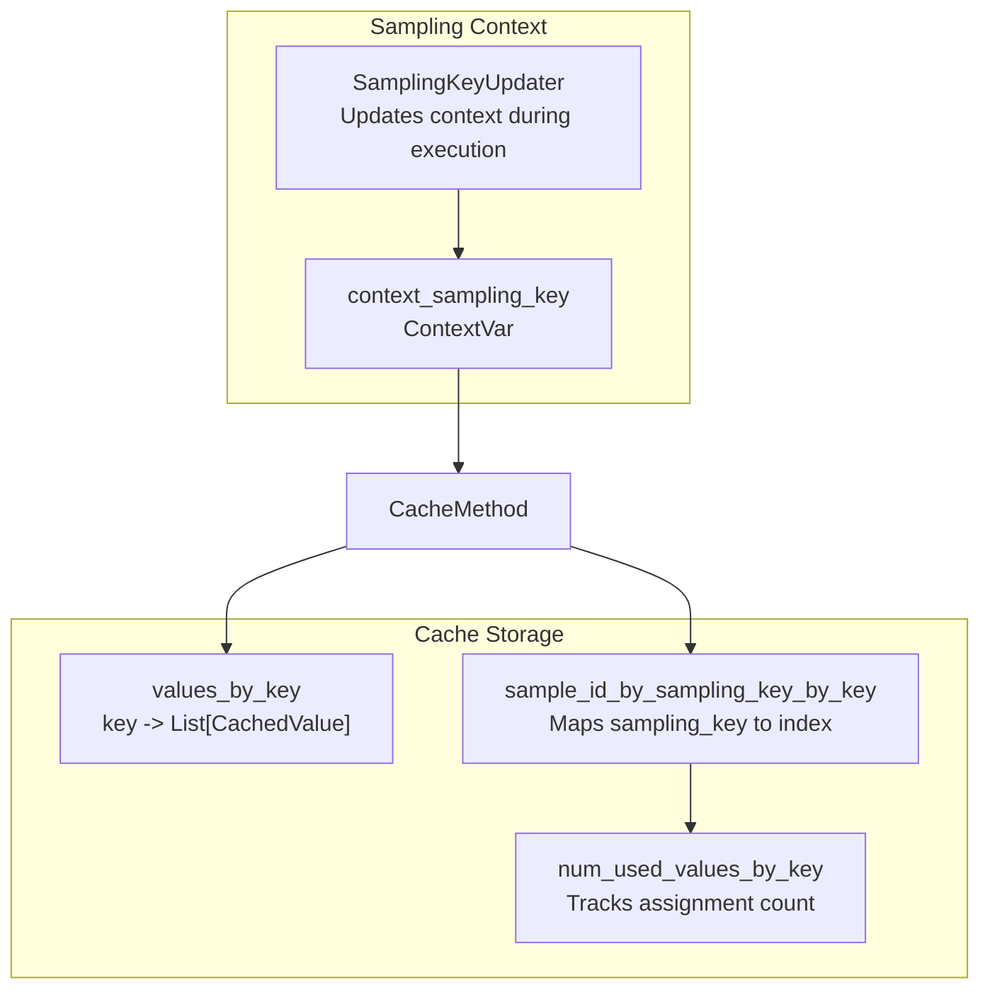
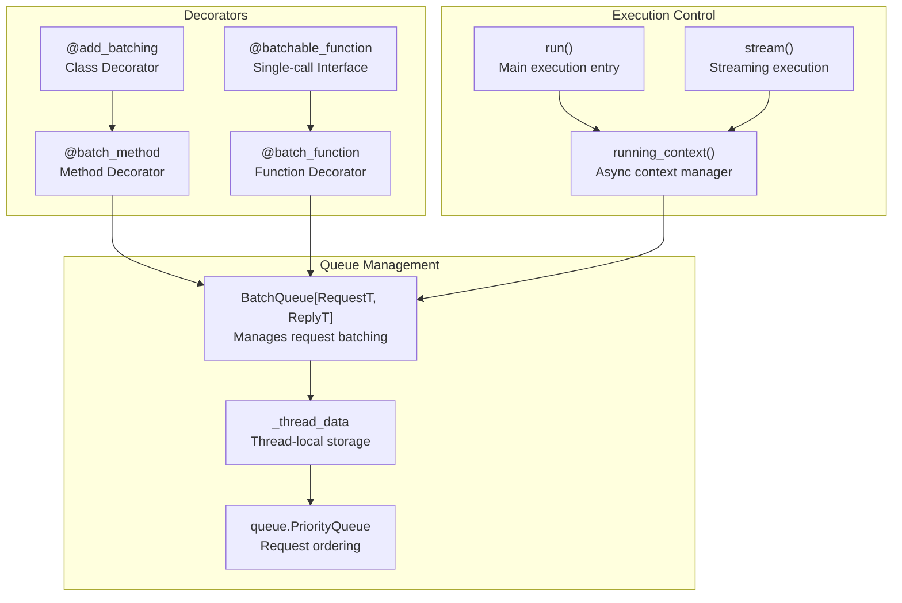
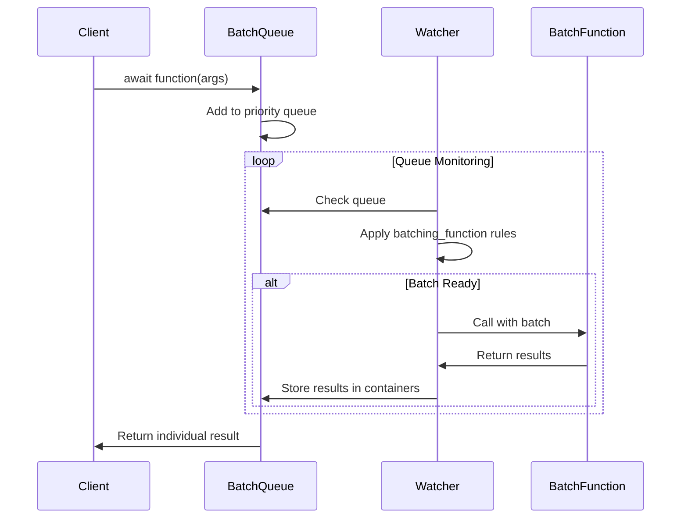
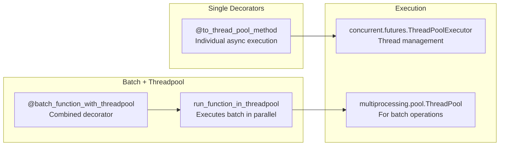
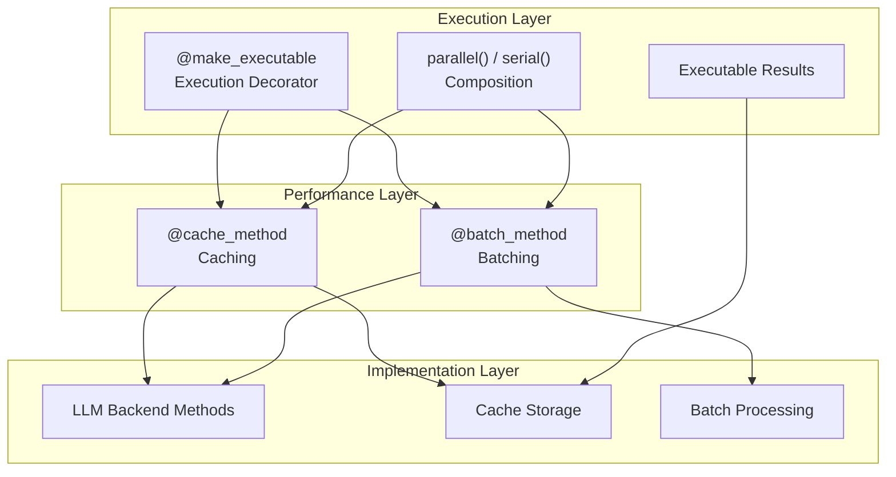

<!-- source: DeepWiki mcp.deepwiki.com · repo google-deepmind/onetwo · page 2.4 Performance Systems · fetched 2026-10-26 -->

# Performance Systems

<details>
<summary>Relevant source files</summary>

The following files were used as context for generating this wiki page:

- [onetwo/core/batching.py](onetwo/core/batching.py)
- [onetwo/core/batching_test.py](onetwo/core/batching_test.py)
- [onetwo/core/caching.py](onetwo/core/caching.py)
- [onetwo/core/caching_test.py](onetwo/core/caching_test.py)

</details>


This document covers OneTwo's performance optimization systems, including caching and batching mechanisms that reduce redundant computations and improve throughput for LLM operations. These systems integrate with the execution framework (see [Execution Framework](#2.2)) to provide transparent performance improvements.

For evaluation and testing performance, see [Testing Infrastructure](#5.3). For tracing and debugging performance, see [Results and Tracing](#2.3).

## Caching System

The caching system provides automatic memoization for expensive operations, particularly LLM calls. It supports both deterministic and stochastic (sampled) functions with persistent file-based storage.

### Core Architecture



Sources: [onetwo/core/caching.py:148-201](), [onetwo/core/caching.py:252-289](), [onetwo/core/caching.py:373-452]()

### Cache Key Generation

Cache keys are generated from function arguments and metadata using `CacheKeyMaker`:

| Component | Purpose | Configuration |
|-----------|---------|---------------|
| `hashed` | Arguments too large for keys (e.g., arrays) | Sequence of parameter names |
| `dropped` | Arguments to exclude from caching | Sequence of parameter names |
| `_name` | Function identifier in cache | Set by `@cache_method` decorator |

The key generation process creates JSON-serialized representations of function calls:


Sources: [onetwo/core/caching.py:342-371](), [onetwo/core/caching.py:425-451]()

### Stochastic Function Support

The caching system handles stochastic functions (those that may return different results for the same inputs) using sampling keys:



Sources: [onetwo/core/caching.py:57-59](), [onetwo/core/caching.py:782-829](), [onetwo/core/caching.py:869-874]()

### Usage Patterns

Classes inherit from `CacheEnabled` and implement `_cache_handler`:

```python
@dataclasses.dataclass
class MyLLMBackend(caching.CacheEnabled[str]):
    def __post_init__(self):
        self._cache_handler = caching.SimpleFunctionCache(
            cache_filename='my_cache.json'
        )
    
    @caching.cache_method(is_sampled=True)
    async def generate_text(self, prompt: str) -> str:
        # Expensive LLM call
        return await self._actual_llm_call(prompt)
```

Sources: [onetwo/core/caching_test.py:91-107](), [onetwo/core/caching.py:541-596]()

## Batching System

The batching system automatically groups multiple function calls into batches for more efficient processing, particularly useful for LLM APIs that support batch operations.

### Batching Architecture



Sources: [onetwo/core/batching.py:246-277](), [onetwo/core/batching.py:557-595](), [onetwo/core/batching.py:929-967]()

### Batch Processing Flow



Sources: [onetwo/core/batching.py:325-387](), [onetwo/core/batching.py:451-527]()

### Batching Strategies

| Strategy | Configuration | Use Case |
|----------|---------------|----------|
| Size-based | `batch_size=N` | Simple batching by count |
| Function-based | `batching_function=func` | Custom compatibility rules |
| Threadpool | `@batch_function_with_threadpool` | CPU-intensive operations |

The `batching_function` signature is `(batch, new_request) -> (can_add, is_full)`:

```python
def custom_batching(batch: Sequence[dict], req: dict) -> tuple[bool, bool]:
    # Only batch requests with same model
    can_add = not batch or batch[0]['model'] == req['model']
    is_full = len(batch) >= 5  # Max batch size
    return can_add, is_full
```

Sources: [onetwo/core/batching.py:226-244](), [onetwo/core/batching_test.py:47-57]()

### ThreadPool Integration

For CPU-intensive operations, OneTwo provides threadpool decorators:



Sources: [onetwo/core/batching.py:1545-1610](), [onetwo/core/batching.py:1383-1456](), [onetwo/core/batching.py:1240-1297]()

## Integration with Execution Framework

Performance systems integrate seamlessly with OneTwo's execution framework:



Sources: [onetwo/core/caching.py:177-187](), [onetwo/core/caching.py:694-717](), [onetwo/core/batching.py:1084-1101]()

### Decorator Stacking

Performance decorators can be combined in specific orders:

```python
@executing.make_executable
@caching.cache_method(is_sampled=True)
@batching.batch_method_with_threadpool(batch_size=10)
def expensive_llm_call(self, prompt: str) -> str:
    # Implementation processes batches in threadpool
    # Results are cached for future calls
    # Executable interface for composition
```

The execution order is: Executable → Cache → Batch → Implementation.

Sources: [onetwo/core/caching_test.py:446-454](), [onetwo/core/batching_test.py:960-974]()

## Performance Monitoring

Both systems provide built-in monitoring capabilities:

### Cache Metrics

The `_CacheData` class tracks cache performance:

| Metric | Description |
|--------|-------------|
| `get_hit` | Successful cache lookups |
| `get_miss` | Cache misses requiring computation |
| `add_new` | New cache entries |
| `add_redundant` | Duplicate cache attempts |

Sources: [onetwo/core/caching.py:831-874](), [onetwo/core/caching_test.py:480-612]()

### Batch Metrics

Batching queues provide debug information when `debug=True`:

```python
# Access batch call history
batch_queue = instance.batching_queues['method_name']
calls_made = batch_queue.calls  # List of batched requests
```

Sources: [onetwo/core/batching.py:412-413](), [onetwo/core/batching_test.py:241-244]()

### Memory and Storage

- **Cache files**: JSON format with tuple preservation via custom encoders
- **Thread safety**: `threading.Lock` protects cache operations
- **Memory management**: LRU eviction not implemented (manual cleanup required)

Sources: [onetwo/core/caching.py:79-115](), [onetwo/core/caching.py:1172-1175](), [onetwo/core/caching.py:1285-1319]()

---

