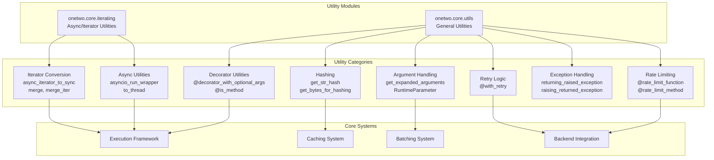
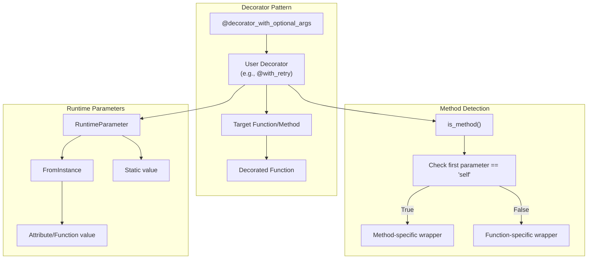
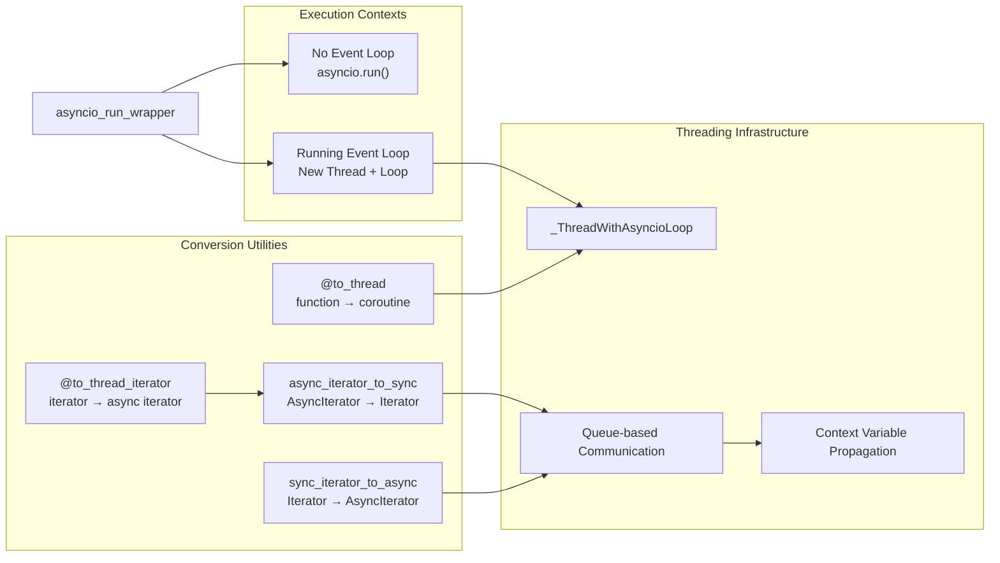
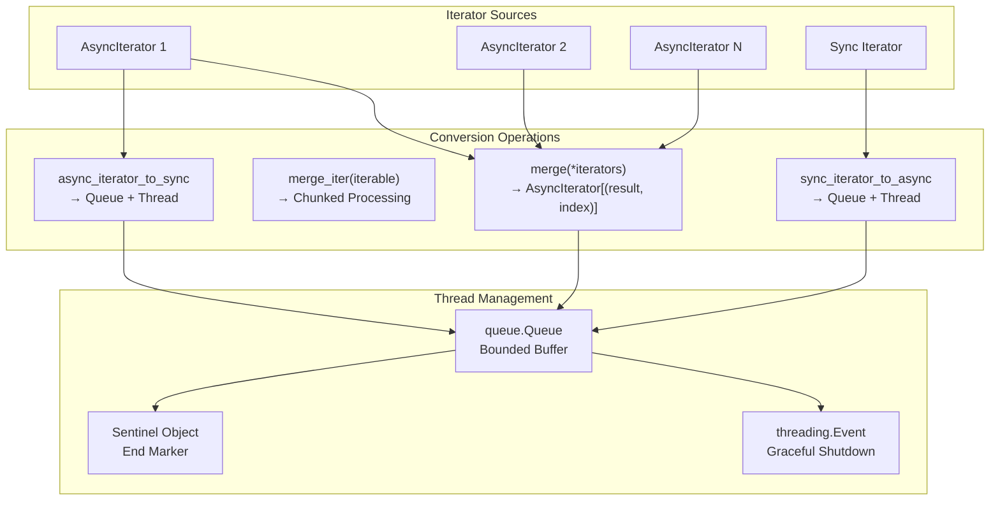
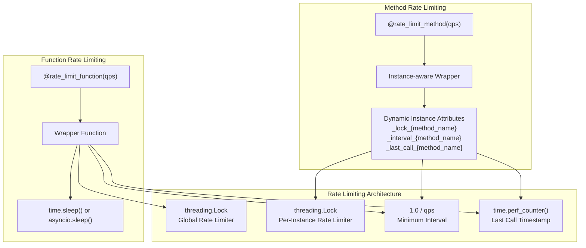
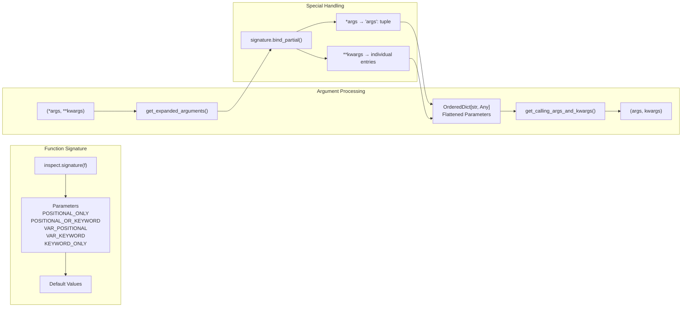
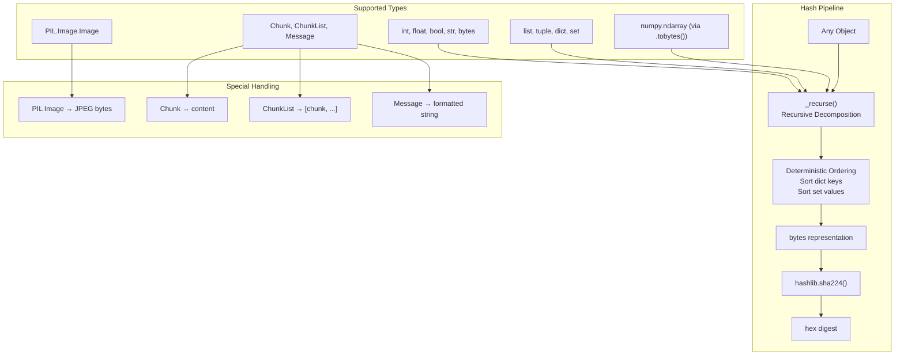
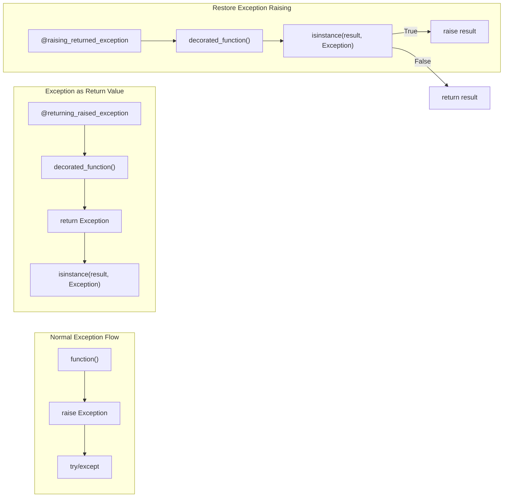
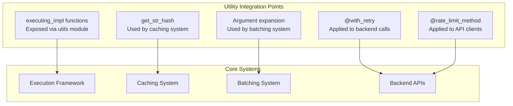

<!-- source: DeepWiki mcp.deepwiki.com · repo google-deepmind/onetwo · page 2.5 Utilities and Helpers · fetched 2026-10-26 -->

# Utilities and Helpers

<details>
<summary>Relevant source files</summary>

The following files were used as context for generating this wiki page:

- [onetwo/core/iterating.py](onetwo/core/iterating.py)
- [onetwo/core/iterating_test.py](onetwo/core/iterating_test.py)
- [onetwo/core/utils.py](onetwo/core/utils.py)
- [onetwo/core/utils_test.py](onetwo/core/utils_test.py)

</details>


This document covers the utility functions, decorators, and helper classes that provide foundational support across the OneTwo library. These utilities handle cross-cutting concerns like asynchronous execution, rate limiting, retry logic, argument processing, and type conversions that are used throughout the core systems.

For information about performance-specific utilities like caching and batching, see [Performance Systems](#2.4). For execution framework utilities, see [Execution Framework](#2.2).

## Overview

The OneTwo utilities are organized into two main modules that provide essential infrastructure for the library's operation:



Sources: [onetwo/core/utils.py:1-778](), [onetwo/core/iterating.py:1-744]()

## Decorator Utilities

The `utils` module provides sophisticated decorator infrastructure that supports optional arguments and method detection across the OneTwo codebase.

### Core Decorator Infrastructure

| Function | Purpose | Usage Pattern |
|----------|---------|---------------|
| `decorator_with_optional_args` | Meta-decorator enabling `@dec`, `@dec()`, `@dec(args)` syntax | Applied to decorator definitions |
| `is_method` | Detects if a callable is a method by checking for `self` parameter | Used within decorators for method-specific logic |
| `FromInstance` | Allows decorator parameters to be read from object attributes at runtime | Parameter specification in decorators |
| `RuntimeParameter` | Wrapper for parameters that may be static values or instance-derived | Parameter resolution in decorated methods |



Sources: [onetwo/core/utils.py:90-133](), [onetwo/core/utils.py:61-88](), [onetwo/core/utils.py:229-274]()

### Usage Example

The decorator infrastructure supports flexible parameter specification:

```python
# Static parameter
@with_retry(max_retries=3)
def my_function():
    pass

# Instance-derived parameter  
class MyClass:
    max_retries = 5
    
    @with_retry(max_retries=FromInstance(name='max_retries'))
    def my_method(self):
        pass
```

Sources: [onetwo/core/utils.py:447-552](), [onetwo/core/utils_test.py:355-425]()

## Asynchronous and Threading Utilities

The `iterating` module provides comprehensive utilities for managing asynchronous execution, threading, and iterator conversions.

### Async Execution Management

| Function | Purpose | Key Features |
|----------|---------|--------------|
| `asyncio_run_wrapper` | Runs coroutines in new thread if event loop already running | Jupyter/Colab compatibility |
| `to_thread` | Decorator converting blocking functions to async | Optional timeout support |
| `to_thread_iterator` | Decorator converting blocking iterators to async | Thread-safe iterator execution |



Sources: [onetwo/core/iterating.py:67-103](), [onetwo/core/iterating.py:683-744](), [onetwo/core/iterating.py:634-681]()

### Iterator Merging and Conversion

The module provides sophisticated iterator manipulation capabilities:

| Function | Purpose | Use Case |
|----------|---------|----------|
| `merge` | Merge multiple async iterators in parallel | Parallel execution of similar operations |
| `merge_iter` | Merge iterables of async iterators in chunks | Large-scale parallel processing |
| `async_iterator_to_sync` | Convert async iterator to sync using threading | Integration with sync code |
| `sync_iterator_to_async` | Convert sync iterator to async using threading | Non-blocking iteration |



Sources: [onetwo/core/iterating.py:140-209](), [onetwo/core/iterating.py:109-138](), [onetwo/core/iterating.py:501-562]()

## Rate Limiting and Retry Logic

The utilities provide robust rate limiting and retry mechanisms with support for both functions and methods.

### Rate Limiting

| Decorator | Scope | Thread Safety | Parameter Source |
|-----------|-------|---------------|------------------|
| `@rate_limit_function` | Function-level | Global across all calls | Static QPS value |
| `@rate_limit_method` | Method-level | Per-instance | Static or `FromInstance` |



Sources: [onetwo/core/utils.py:276-337](), [onetwo/core/utils.py:339-445]()

### Retry Logic

The `@with_retry` decorator provides exponential backoff with jitter:

| Parameter | Purpose | Default | Behavior |
|-----------|---------|---------|----------|
| `max_retries` | Maximum retry attempts | 0 | Can be static or `FromInstance` |
| `initial_base_delay` | Starting delay in seconds | 1 | Minimum wait time |
| `max_base_delay` | Maximum delay in seconds | 32 | Delay cap |
| `retriable_error_filter` | Error classification function | `lambda e: True` | Determines retry eligibility |

The retry algorithm implements exponential backoff with randomization:
- Base delay doubles after every 2 consecutive failures at the same delay level
- Actual delay = `base_delay * (1 + random.random())`
- Exception traceback information is preserved in error notes

Sources: [onetwo/core/utils.py:447-552](), [onetwo/core/utils_test.py:355-495]()

## Argument and Parameter Handling

The utilities provide sophisticated argument manipulation for decorators and function introspection.

### Argument Expansion

| Function | Purpose | Returns |
|----------|---------|---------|
| `get_expanded_arguments` | Convert `(*args, **kwargs)` to flat parameter dict | `OrderedDict[str, Any]` |
| `get_calling_args_and_kwargs` | Convert parameter dict back to `(args, kwargs)` | `tuple[tuple, dict]` |



Sources: [onetwo/core/utils.py:135-182](), [onetwo/core/utils.py:184-227]()

## Hashing and Serialization Utilities

The hashing system provides consistent, deterministic hashing for complex objects including OneTwo content types.

### Hash Function Architecture

| Function | Purpose | Supported Types |
|----------|---------|-----------------|
| `get_bytes_for_hashing` | Convert objects to bytes representation | Built-ins, PIL Images, OneTwo content |
| `get_str_hash` | Generate SHA-224 hex hash | Any hashable object |



Sources: [onetwo/core/utils.py:676-778](), [onetwo/core/utils_test.py:497-756]()

## Exception Handling Utilities

The utilities provide decorators for converting between exception raising and returning patterns.

### Exception Conversion Pattern

| Decorator | Conversion | Use Case |
|-----------|------------|----------|
| `@returning_raised_exception` | `raise Exception` → `return Exception` | Error collection without interruption |
| `@raising_returned_exception` | `return Exception` → `raise Exception` | Restore normal exception semantics |



These decorators support both sync and async functions as well as methods, with appropriate wrapper selection based on function inspection.

Sources: [onetwo/core/utils.py:554-674](), [onetwo/core/utils_test.py:810-893]()

## Integration with Core Systems

The utilities integrate seamlessly with OneTwo's core architecture:



The utilities are designed to be composable and work together. For example, a backend method might use multiple decorators:

```python
class BackendAPI:
    @with_retry(max_retries=FromInstance(name='max_retries'))
    @rate_limit_method(FromInstance(name='qps_limit'))
    async def api_call(self, request):
        # Implementation
```

Sources: [onetwo/core/utils.py:48-58](), [onetwo/core/executing_impl.py]()

---

