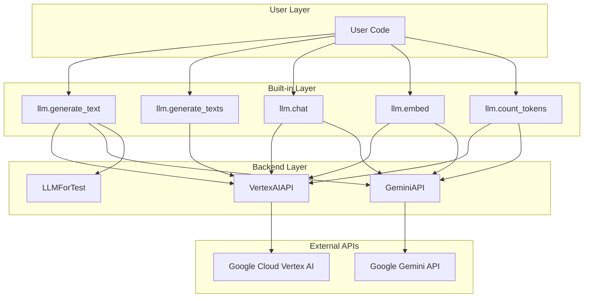
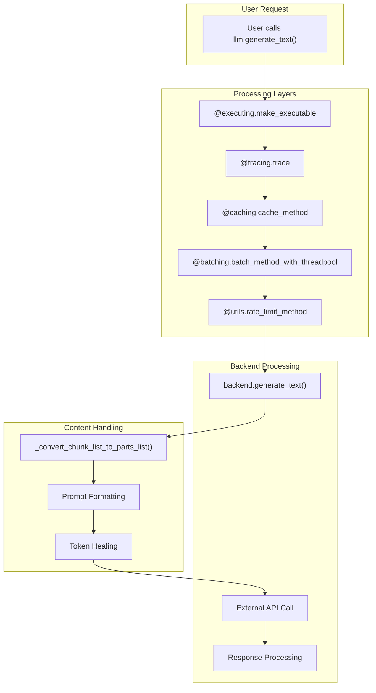
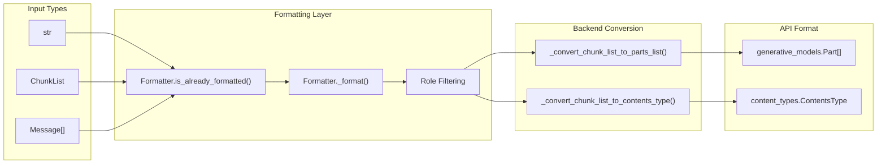

<!-- source: DeepWiki mcp.deepwiki.com · repo google-deepmind/onetwo · page 3 LLM Integration · fetched 2026-10-26 -->

# LLM Integration

<details>
<summary>Relevant source files</summary>

The following files were used as context for generating this wiki page:

- [onetwo/backends/backends_test_utils.py](onetwo/backends/backends_test_utils.py)
- [onetwo/backends/formatters.py](onetwo/backends/formatters.py)
- [onetwo/backends/gemini_api.py](onetwo/backends/gemini_api.py)
- [onetwo/backends/gemini_api_test.py](onetwo/backends/gemini_api_test.py)
- [onetwo/backends/vertexai_api.py](onetwo/backends/vertexai_api.py)
- [onetwo/backends/vertexai_api_manual_tests.py](onetwo/backends/vertexai_api_manual_tests.py)
- [onetwo/backends/vertexai_api_test.py](onetwo/backends/vertexai_api_test.py)
- [onetwo/builtins/formatting.py](onetwo/builtins/formatting.py)
- [onetwo/builtins/formatting_test.py](onetwo/builtins/formatting_test.py)
- [pyproject.toml](pyproject.toml)

</details>


This document provides a comprehensive overview of how OneTwo integrates with Large Language Models (LLMs). It covers the backend system architecture, built-in function configuration, and the flow from user code to LLM API calls.

For specific details about the `llm.*` built-in functions, see [Built-in Functions](#3.1). For backend-specific configuration and implementation details, see [Backend Systems](#3.2). For information about prompt formatting and conversation handling, see [Prompt Formatting](#3.3).

## Architecture Overview

OneTwo's LLM integration follows a layered architecture that separates user-facing APIs from backend implementations through a configuration and registration system.

### LLM Integration Architecture



Sources: [onetwo/backends/vertexai_api.py:191-216](), [onetwo/backends/gemini_api.py:200-228](), [onetwo/backends/backends_test_utils.py:302-312]()

## Backend Registration System

### Backend Registration Flow

```mermaid
graph LR
    subgraph "Backend Instance"
        BackendInit["Backend.__init__()"]
        PostInit["Backend.__post_init__()"]
        Register["Backend.register()"]
    end
    
    subgraph "Built-in Configuration"
        LLMReset["llm.reset_defaults()"]
        ConfigureGenerate["llm.generate_text.configure()"]
        ConfigureChat["llm.chat.configure()"]
        ConfigureEmbed["llm.embed.configure()"]
        ConfigureCount["llm.count_tokens.configure()"]
    end
    
    BackendInit --> PostInit
    PostInit --> Register
    Register --> LLMReset
    LLMReset --> ConfigureGenerate
    ConfigureGenerate --> ConfigureChat
    ConfigureChat --> ConfigureEmbed
    ConfigureEmbed --> ConfigureCount
```



Sources: [onetwo/backends/vertexai_api.py:191-216](), [onetwo/backends/gemini_api.py:200-228]()

## Core Components

### Backend Classes

| Backend | Class | Purpose |
|---------|-------|---------|
| Vertex AI | `VertexAIAPI` | Google Cloud Vertex AI integration |
| Gemini | `GeminiAPI` | Google Gemini API integration |
| Test | `LLMForTest` | Mock backend for testing |

### Built-in Functions

| Function | Purpose | Configured By |
|----------|---------|---------------|
| `llm.generate_text` | Single text generation | `backend.generate_text` |
| `llm.generate_texts` | Multiple sample generation | `backend.generate_texts` |
| `llm.chat` | Conversational interface | `backend.chat` or `backend.chat_via_api` |
| `llm.embed` | Text embedding | `backend.embed` |
| `llm.count_tokens` | Token counting | `backend.count_tokens` |

Sources: [onetwo/backends/vertexai_api.py:197-216](), [onetwo/backends/gemini_api.py:206-228]()

## Request Processing Flow

### LLM Request Processing Pipeline



Sources: [onetwo/backends/vertexai_api.py:292-342](), [onetwo/backends/gemini_api.py:370-418]()

## Backend Implementation Details

### VertexAI Backend Features

The `VertexAIAPI` class provides:

- **Models**: Configurable model names for generation, chat, and embedding
- **Caching**: File-based caching with `SimpleFunctionCache`
- **Batching**: Configurable batch sizes for parallel requests
- **Rate Limiting**: QPS-based rate limiting
- **Safety Settings**: Configurable safety filters
- **Multimodal Support**: Image and video content through `ChunkList`

### Gemini Backend Features

The `GeminiAPI` class provides:

- **Models**: Support for Gemini 2.0 Flash and embedding models
- **Retry Logic**: Configurable retry mechanisms
- **API Key Management**: File-based or direct API key configuration
- **Content Types**: Support for images, videos, and text
- **Truncation**: Post-generation token truncation

Sources: [onetwo/backends/vertexai_api.py:114-189](), [onetwo/backends/gemini_api.py:119-199]()

## Content and Formatting Integration

### Content Processing Flow



Sources: [onetwo/backends/vertexai_api.py:73-95](), [onetwo/backends/gemini_api.py:75-102](), [onetwo/builtins/formatting.py:130-171]()

## Configuration and Defaults

### Backend Configuration Pattern

Each backend follows a consistent configuration pattern:

1. **Initialization**: Set default parameters and credentials
2. **Post-initialization**: Initialize API clients and models
3. **Registration**: Configure built-in functions with backend methods
4. **Method Decoration**: Apply caching, batching, and rate limiting

### Default Models

| Backend | Generate Model | Chat Model | Embed Model |
|---------|----------------|------------|-------------|
| VertexAI | `gemini-1.0-pro` | `gemini-1.0-pro` | `textembedding-gecko@003` |
| Gemini | `gemini-2.0-flash` | `gemini-2.0-flash` | `embedding-001` |

Sources: [onetwo/backends/vertexai_api.py:46-52](), [onetwo/backends/gemini_api.py:50-55]()

## Error Handling and Safety

### Common Error Patterns

- **Safety Filtering**: Both backends handle safety filter responses
- **Token Limits**: Validation and truncation for token limits
- **API Errors**: Wrapped exceptions with context
- **Empty Responses**: Detection and error reporting for empty results

### Safety Configuration

```python
# Disable safety settings
SAFETY_DISABLED = {
    HarmCategory.HARM_CATEGORY_HARASSMENT: HarmBlockThreshold.BLOCK_NONE,
    HarmCategory.HARM_CATEGORY_HATE_SPEECH: HarmBlockThreshold.BLOCK_NONE,
    # ...
}
```

Sources: [onetwo/backends/vertexai_api.py:57-70](), [onetwo/backends/gemini_api.py:59-72](), [onetwo/backends/vertexai_api.py:284-289](), [onetwo/backends/gemini_api.py:358-367]()

---

