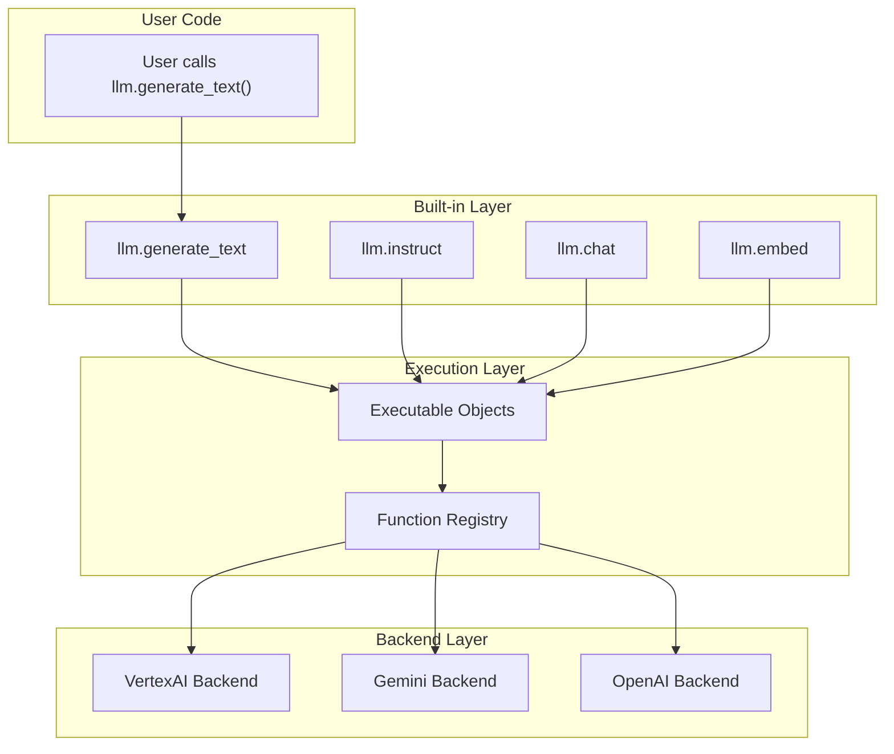
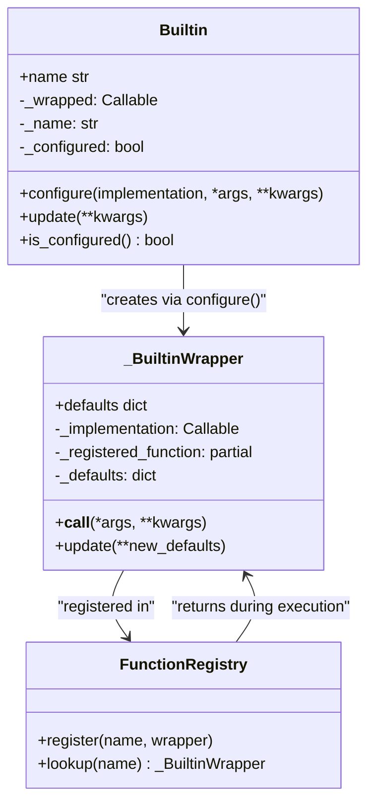
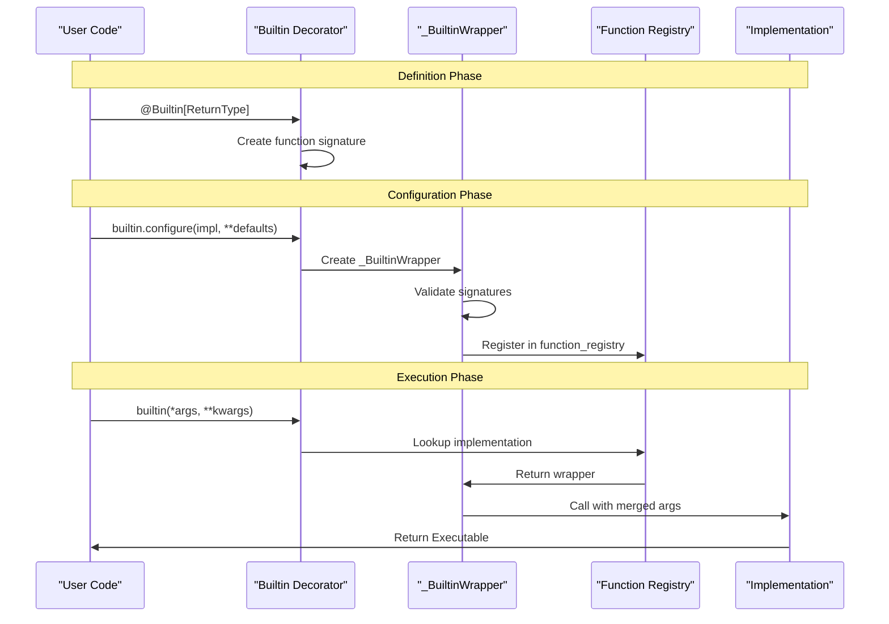
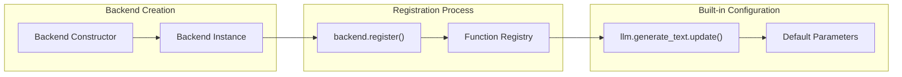
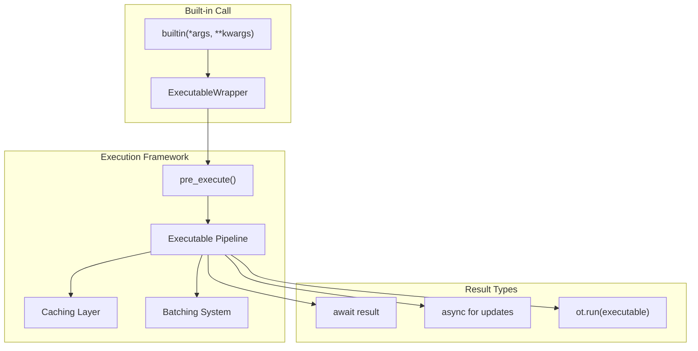

<!-- source: DeepWiki mcp.deepwiki.com · repo google-deepmind/onetwo · page 3.1 Built-in Functions · fetched 2026-10-26 -->

# Built-in Functions

<details>
<summary>Relevant source files</summary>

The following files were used as context for generating this wiki page:

- [colabs/tutorial.ipynb](colabs/tutorial.ipynb)
- [onetwo/builtins/builtins_base.py](onetwo/builtins/builtins_base.py)
- [onetwo/builtins/builtins_base_test.py](onetwo/builtins/builtins_base_test.py)
- [onetwo/core/executing_impl.py](onetwo/core/executing_impl.py)
- [onetwo/core/executing_impl_test.py](onetwo/core/executing_impl_test.py)

</details>


This document covers OneTwo's built-in functions, which provide standardized interfaces for common LLM operations. Built-in functions serve as configurable entry points that abstract away backend-specific implementation details while enabling features like caching, batching, and asynchronous execution.

For information about the underlying execution framework that powers built-ins, see [Execution Framework](#2.2). For details about LLM backend configuration, see [Backend Systems](#3.2).

## Overview

Built-in functions in OneTwo are high-level interfaces that provide consistent APIs for LLM operations regardless of the underlying backend or model. They are implemented using a two-phase system: signature definition and runtime configuration with specific implementations.

### Core LLM Built-ins

OneTwo provides four primary built-in functions for LLM interaction:

| Function | Purpose | Primary Use Case |
|----------|---------|------------------|
| `llm.generate_text()` | Raw text completion | Base models, sequence continuation |
| `llm.instruct()` | Instruction following | Single-turn instruction tasks |
| `llm.chat()` | Multi-turn conversation | Dialogue and conversational AI |
| `llm.embed()` | Text embeddings | Semantic similarity and retrieval |



Sources: [colabs/tutorial.ipynb:564-573](), [onetwo/builtins/builtins_base.py:297-346]()

## Built-in Architecture

Built-in functions use a decorator-based architecture that separates interface definition from implementation. The core components are the `Builtin` decorator and the `_BuiltinWrapper` class.

### Class Structure



Sources: [onetwo/builtins/builtins_base.py:95-295](), [onetwo/builtins/builtins_base.py:297-503]()

### Configuration Flow

The built-in system follows a two-phase lifecycle: definition and configuration.



Sources: [onetwo/builtins/builtins_base.py:371-432](), [onetwo/builtins/builtins_base.py:459-502]()

## Core Built-in Functions

### `llm.generate_text()`

Performs raw text completion by asking the model to continue a given text sequence. This function is primarily designed for base models trained on sequence completion tasks.

**Key Parameters:**
- `content`: Text or multimodal content to complete
- `max_tokens`: Maximum number of tokens to generate
- `temperature`: Sampling temperature for randomness control

```python
# Example usage from tutorial
e = llm.generate_text(
    'Three not so well known cities in France are',
    max_tokens=20,
)
result = ot.run(e)
```

Sources: [colabs/tutorial.ipynb:596-608]()

### `llm.chat()`

Handles multi-turn conversations using a sequence of `Message` objects with defined roles. The function adapts to different model chat APIs or formats the conversation appropriately for non-chat models.

**Message Structure:**
- `role`: `PredefinedRole.USER`, `PredefinedRole.MODEL`, or custom roles
- `content`: Text or multimodal content for the message

```python
# Example from tutorial
messages = [
    content_lib.Message(
        role=content_lib.PredefinedRole.USER,
        content='Pretend that you are Albert Einstein in 1911. Hi, my name is Peter.',
    ),
    content_lib.Message(
        role=content_lib.PredefinedRole.MODEL,
        content='Nice to meet you, Peter. My name is Albert.',
    ),
]
e = llm.chat(messages, max_tokens=20)
```

Sources: [colabs/tutorial.ipynb:639-664]()

### `llm.instruct()`

Formats requests as instructions for instruction-tuned models. This function converts the input into an appropriate format that signals to the model that it should follow the given instruction.

```python
# Example from tutorial
e = llm.instruct('What are three well-known cities in France?', max_tokens=50)
result = ot.run(e)
```

Sources: [colabs/tutorial.ipynb:688-695]()

### `llm.embed()`

Generates text embeddings for semantic similarity and retrieval tasks. This function is only available when using backends that support embedding models.

Sources: [colabs/tutorial.ipynb:295-297]()

## Configuration and Usage

### Backend Registration

Built-in functions require backend registration before use. The registration process connects the built-ins to specific model implementations:



Sources: [colabs/tutorial.ipynb:414-428](), [colabs/tutorial.ipynb:479-489]()

### Signature Validation

The built-in system enforces strict signature compatibility between the defined interface and the configured implementation. The validation process checks:

1. **Required Parameters**: All non-optional parameters in the builtin signature must exist in the implementation
2. **Type Annotations**: Parameter types must match between builtin and implementation signatures  
3. **Additional Parameters**: Implementation-specific parameters must have default values or be provided during configuration

```python
# Implementation signature validation
def _check_signatures(base_signature, impl_signature):
    # Validates parameter names, types, and defaults
    # Handles TypeVar normalization for generic types
    # Ensures implementation compatibility
```

Sources: [onetwo/builtins/builtins_base.py:140-201]()

### Default Parameter Handling

Built-ins support sophisticated default parameter management through the `configure()` and `update()` methods:

```python
# Configure with defaults
llm.generate_text.configure(implementation, temperature=0.0, max_tokens=100)

# Update defaults later
llm.generate_text.update(temperature=0.5)

# Runtime None handling - None values are replaced with configured defaults
result = llm.generate_text(prompt, temperature=None)  # Uses configured default
```

Sources: [onetwo/builtins/builtins_base.py:254-294](), [onetwo/builtins/builtins_base.py:434-457]()

## Executable Integration

All built-in functions return `Executable` objects rather than direct results. This integration enables:

- **Asynchronous Execution**: Built-ins can be awaited or used with async iteration
- **Caching**: Automatic request/response caching through the execution framework
- **Batching**: Parallel execution of multiple requests
- **Streaming**: Progressive result updates through async iteration



Sources: [onetwo/builtins/builtins_base.py:459-502](), [onetwo/core/executing_impl.py:48-99]()

## Advanced Features

### Registry Context Management

Built-ins support dynamic reconfiguration through registry contexts, enabling different configurations for different execution environments:

```python
# Different configurations in different contexts
with routing.RegistryContext():
    llm.generate_text.configure(fast_implementation, temperature=0.8)
    # Use fast implementation
    
with routing.RegistryContext():
    llm.generate_text.configure(accurate_implementation, temperature=0.0)
    # Use accurate implementation
```

Sources: [onetwo/builtins/builtins_base_test.py:440-488]()

### Error Handling and Validation

The built-in system includes comprehensive error handling for common configuration mistakes:

- **Partial Function Detection**: Prevents misconfiguration with `functools.partial` objects
- **Unknown Parameter Detection**: Validates that configured parameters exist in the implementation
- **Missing Required Parameters**: Ensures all required builtin parameters are implemented

Sources: [onetwo/builtins/builtins_base.py:121-128](), [onetwo/builtins/builtins_base.py:216-238]()

### Type Safety

Built-in functions maintain type safety through generic type parameters and annotation validation:

```python
@Builtin[str]  # Declares return type
def custom_builtin(input: str) -> str:
    raise NotImplementedError('Implementation provided at runtime')
```

The system validates type compatibility between builtin signatures and implementations, including support for generic `TypeVar` parameters.

Sources: [onetwo/builtins/builtins_base.py:33-93](), [onetwo/builtins/builtins_base_test.py:111-119]()

---

