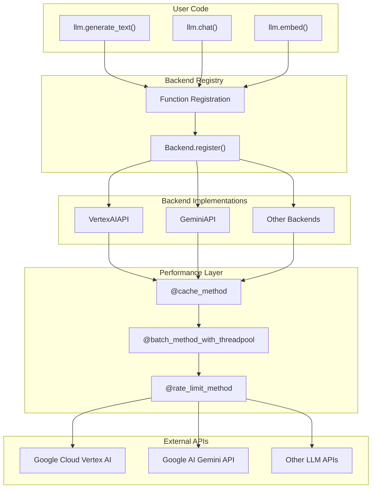
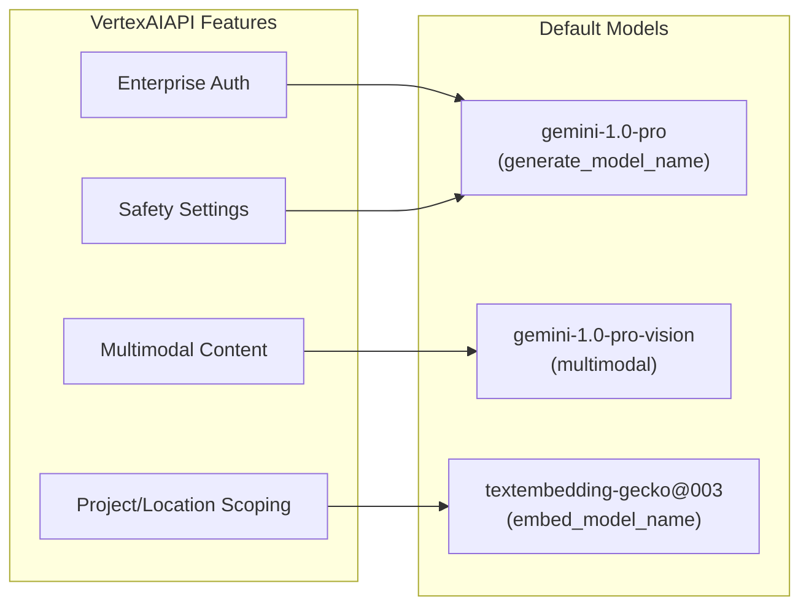
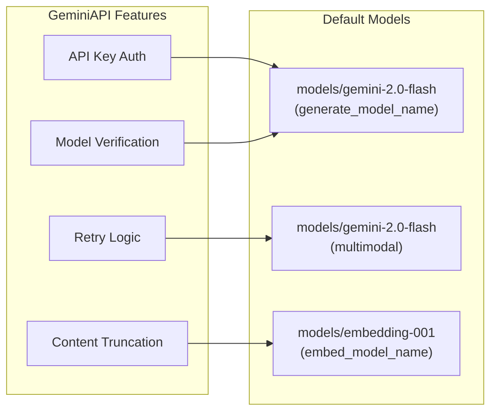
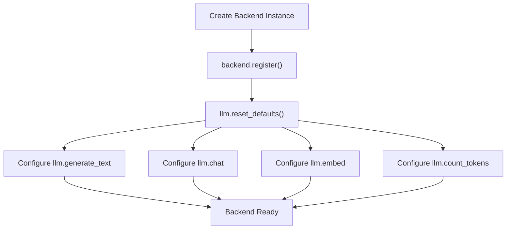
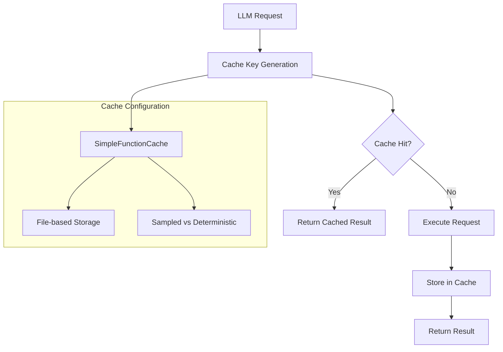
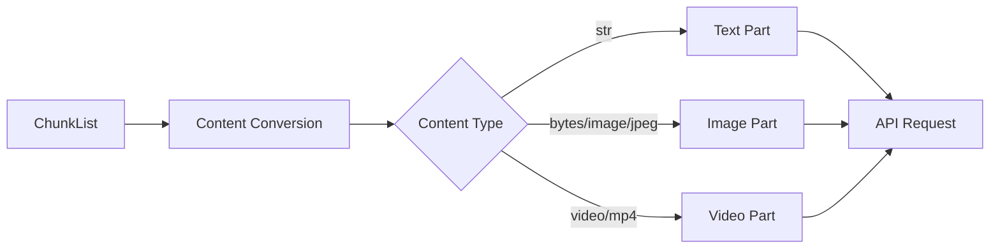

<!-- source: DeepWiki mcp.deepwiki.com · repo google-deepmind/onetwo · page 3.2 Backend Systems · fetched 2026-10-26 -->

# Backend Systems

<details>
<summary>Relevant source files</summary>

The following files were used as context for generating this wiki page:

- [onetwo/backends/gemini_api.py](onetwo/backends/gemini_api.py)
- [onetwo/backends/gemini_api_test.py](onetwo/backends/gemini_api_test.py)
- [onetwo/backends/vertexai_api.py](onetwo/backends/vertexai_api.py)
- [onetwo/backends/vertexai_api_manual_tests.py](onetwo/backends/vertexai_api_manual_tests.py)
- [onetwo/backends/vertexai_api_test.py](onetwo/backends/vertexai_api_test.py)
- [pyproject.toml](pyproject.toml)

</details>


This page documents the backend infrastructure that connects OneTwo to different Large Language Model providers. Backends handle the low-level communication with LLM APIs, including authentication, request formatting, response processing, and performance optimizations like caching and batching.

For information about the high-level LLM functions that use these backends, see [Built-in Functions](#3.1). For details about prompt formatting and conversation patterns, see [Prompt Formatting](#3.3).

## Backend Architecture Overview

OneTwo's backend system provides a standardized interface for interacting with different LLM providers. Each backend implements the `Backend` interface and integrates with OneTwo's execution framework, caching system, and batching infrastructure.



Sources: [onetwo/backends/vertexai_api.py:191-228](), [onetwo/backends/gemini_api.py:200-228]()

## Available Backend Implementations

OneTwo provides two primary backend implementations for Google's LLM services:

| Backend | API | Models Supported | Key Features |
|---------|-----|------------------|--------------|
| `VertexAIAPI` | Google Cloud Vertex AI | Gemini models via Vertex AI | Enterprise features, multimodal support |
| `GeminiAPI` | Google AI Gemini API | Gemini models via AI Studio | Developer-friendly, direct API access |

### VertexAIAPI

The `VertexAIAPI` class connects to Google Cloud Vertex AI and supports enterprise-grade features:



Sources: [onetwo/backends/vertexai_api.py:48-52](), [onetwo/backends/vertexai_api.py:115-153]()

### GeminiAPI

The `GeminiAPI` class connects to Google's AI Studio Gemini API with streamlined configuration:



Sources: [onetwo/backends/gemini_api.py:52-55](), [onetwo/backends/gemini_api.py:121-162]()

## Backend Registration and Configuration

Backends must be registered to configure OneTwo's built-in functions. The registration process maps LLM operations to backend-specific implementations:



### Basic Backend Setup

```python
# VertexAI Backend
backend = VertexAIAPI(
    project='your-project-id',
    location='us-central1',
    generate_model_name='gemini-1.5-flash',
    batch_size=4
)
backend.register()

# Gemini API Backend
backend = GeminiAPI(
    api_key='your-api-key',
    generate_model_name='models/gemini-2.0-flash',
    batch_size=8
)
backend.register()
```

Sources: [onetwo/backends/vertexai_api.py:191-216](), [onetwo/backends/gemini_api.py:200-228]()

## Performance Features

Both backends integrate with OneTwo's performance optimization systems through decorators and configuration options:

### Caching System

All backend methods are automatically cached using the `@cache_method` decorator:



Sources: [onetwo/backends/vertexai_api.py:294-298](), [onetwo/backends/gemini_api.py:372-376]()

### Batching System

Requests are automatically batched using threadpool execution:

| Configuration | Purpose | Default |
|---------------|---------|---------|
| `batch_size` | Number of concurrent requests | 1 |
| `@batch_method_with_threadpool` | Thread-based batching | Applied |
| `BatchQueue` | Request grouping | Automatic |

Sources: [onetwo/backends/vertexai_api.py:299-302](), [onetwo/backends/gemini_api.py:377-380]()

### Rate Limiting

Rate limiting is applied using the `@rate_limit_method` decorator:

```python
@utils.rate_limit_method(qps=utils.FromInstance('max_qps'))
def _generate_content(self, ...):
    # Backend implementation
```

Sources: [onetwo/backends/vertexai_api.py:244](), [onetwo/backends/gemini_api.py:321]()

## Backend-Specific Configuration

### VertexAI Configuration Options

| Parameter | Type | Purpose | Default |
|-----------|------|---------|---------|
| `project` | `str` | Google Cloud project ID | `None` |
| `location` | `str` | Compute region | `None` |
| `credentials` | `Credentials` | Auth credentials | `None` (uses ADCS) |
| `generate_model_name` | `str` | Model for text generation | `gemini-1.0-pro` |
| `embed_model_name` | `str` | Model for embeddings | `textembedding-gecko@003` |

Sources: [onetwo/backends/vertexai_api.py:155-171]()

### Gemini API Configuration Options

| Parameter | Type | Purpose | Default |
|-----------|------|---------|---------|
| `api_key` | `str` | API key string | `None` |
| `api_key_file` | `str` | Path to key file | `None` |
| `max_retries` | `int` | Retry attempts | `0` |
| `generate_model_name` | `str` | Model for text generation | `models/gemini-2.0-flash` |
| `embed_model_name` | `str` | Model for embeddings | `models/embedding-001` |

Sources: [onetwo/backends/gemini_api.py:164-179]()

### Generation Parameters

Both backends support common generation parameters that can be set as defaults or overridden per request:

| Parameter | Type | Purpose |
|-----------|------|---------|
| `temperature` | `float` | Sampling temperature |
| `max_tokens` | `int` | Maximum output tokens |
| `stop` | `Sequence[str]` | Stop sequences |
| `top_p` | `float` | Nucleus sampling parameter |
| `top_k` | `int` | Top-k sampling parameter |

Sources: [onetwo/backends/vertexai_api.py:165-170](), [onetwo/backends/gemini_api.py:174-179]()

## Content Processing and Multimodal Support

Backends handle content conversion from OneTwo's `ChunkList` format to API-specific formats:



### VertexAI Content Conversion

The `_convert_chunk_list_to_parts_list` function handles multimodal content:

```python
def _convert_chunk_list_to_parts_list(prompt: str | ChunkList) -> list[Part]:
    # Converts ChunkList to Vertex AI Part objects
    # Supports text and image content types
```

Sources: [onetwo/backends/vertexai_api.py:73-95]()

### Gemini API Content Conversion

The `_convert_chunk_list_to_contents_type` function supports additional media types:

```python
def _convert_chunk_list_to_contents_type(prompt: str | ChunkList) -> ContentsType:
    # Converts ChunkList to Gemini API ContentsType
    # Supports text, image/jpeg, and video/mp4
```

Sources: [onetwo/backends/gemini_api.py:75-102]()

## Error Handling and Safety

### Exception Handling

Both backends wrap API calls with comprehensive error handling:

```python
try:
    response = self._generate_model.generate_content(...)
except Exception as err:
    raise ValueError(f'Backend.generate_content raised err:\n{err}')
```

Sources: [onetwo/backends/vertexai_api.py:269-282](), [onetwo/backends/gemini_api.py:344-357]()

### Safety Settings

VertexAI backend provides safety configuration options:

```python
SAFETY_DISABLED = {
    HarmCategory.HARM_CATEGORY_HARASSMENT: HarmBlockThreshold.BLOCK_NONE,
    HarmCategory.HARM_CATEGORY_HATE_SPEECH: HarmBlockThreshold.BLOCK_NONE,
    # ... other categories
}
```

Sources: [onetwo/backends/vertexai_api.py:57-70]()

---

