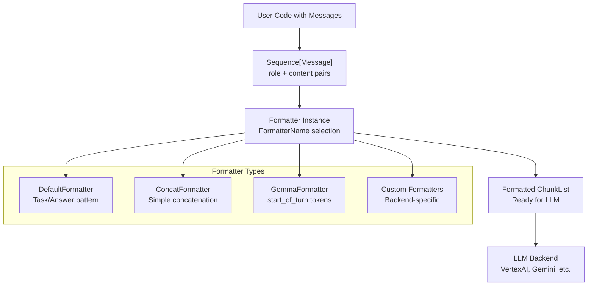
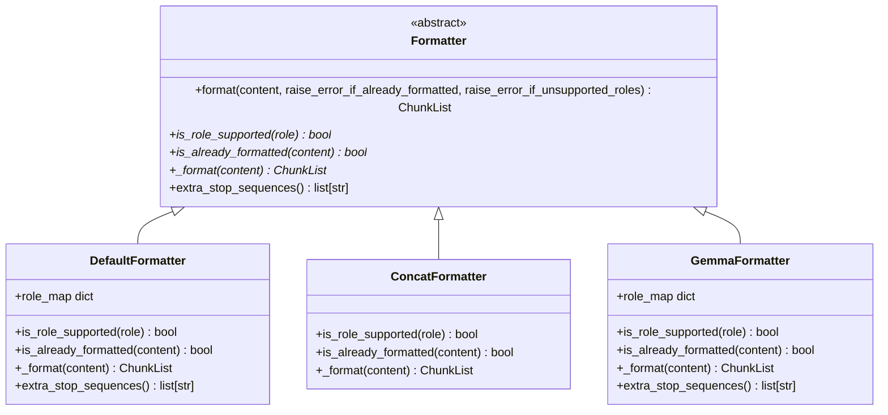
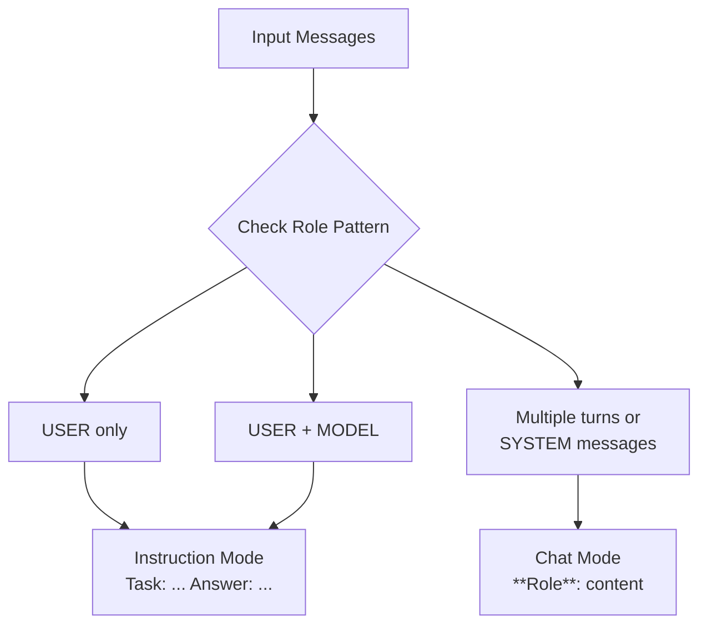
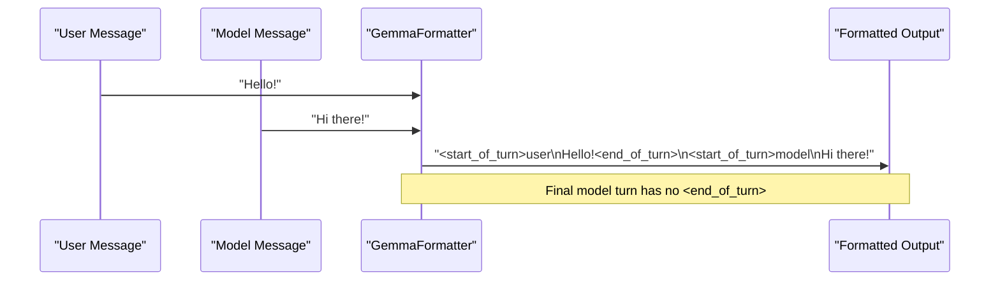
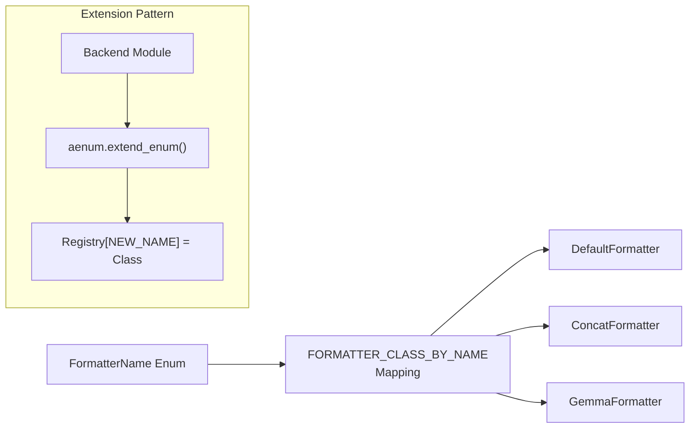
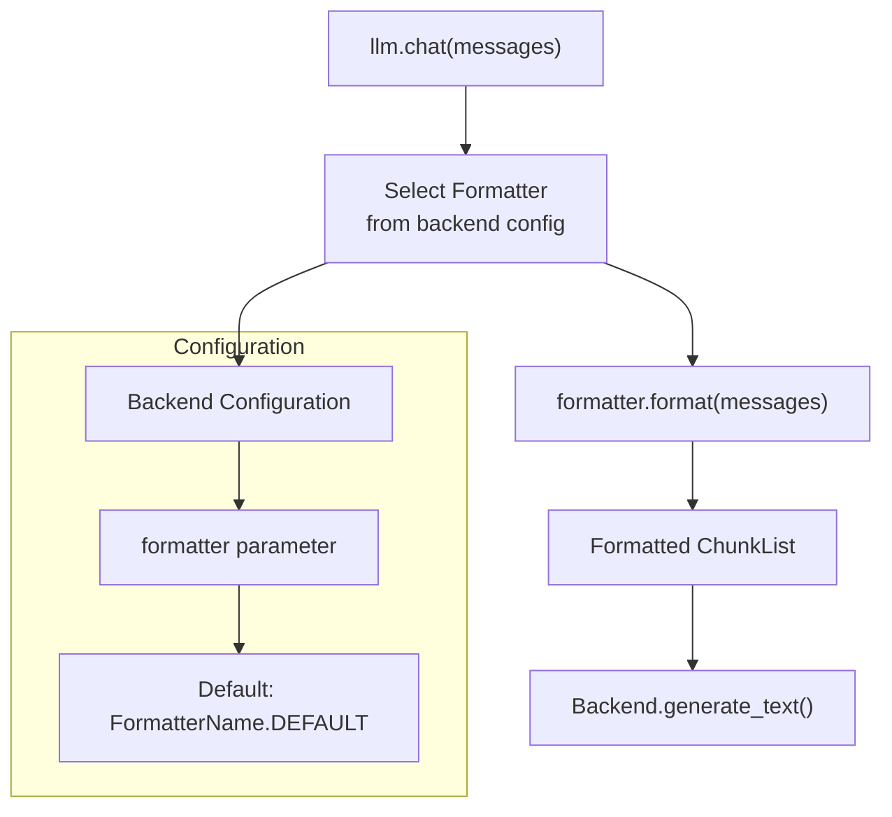

<!-- source: DeepWiki mcp.deepwiki.com · repo google-deepmind/onetwo · page 3.3 Prompt Formatting · fetched 2026-10-26 -->

# Prompt Formatting

Relevant source files

The following files were used as context for generating this wiki page:

- [onetwo/backends/backends_test_utils.py](onetwo/backends/backends_test_utils.py)
- [onetwo/backends/formatters.py](onetwo/backends/formatters.py)
- [onetwo/builtins/formatting.py](onetwo/builtins/formatting.py)
- [onetwo/builtins/formatting_test.py](onetwo/builtins/formatting_test.py)

This document covers OneTwo's prompt formatting system, which converts structured message conversations into model-specific prompts. The formatting system handles the conversion of `Message` sequences into properly formatted `ChunkList` objects that can be sent to different LLM backends.

For information about the underlying content structures (`Message`, `Chunk`, `ChunkList`), see [Content System](#2.1). For details on how formatters integrate with LLM backends, see [Backend Systems](#3.2). For usage of formatters in built-in functions like `llm.chat`, see [Built-in Functions](#3.1).

## Formatting System Overview

The prompt formatting system bridges the gap between OneTwo's structured conversation format and the specific prompt formats required by different language models. Each model family may have different conventions for representing multi-turn conversations, system instructions, and role distinctions.

*Sources: [onetwo/builtins/formatting.py:54-76](), [onetwo/backends/formatters.py:37-91]()*

## Core Formatter Architecture

The formatting system is built around an abstract `Formatter` base class that defines the interface for converting message sequences into formatted prompts.

### Formatter Base Class

The `Formatter` class provides the core abstraction for all prompt formatters:

| Method | Purpose | Implementation |
|--------|---------|----------------|
| `is_role_supported()` | Determines which message roles are supported | Abstract - must be implemented |
| `is_already_formatted()` | Checks if content is already formatted | Abstract - must be implemented |
| `_format()` | Performs the actual formatting | Abstract - must be implemented |
| `format()` | Public interface with validation | Final implementation |
| `extra_stop_sequences()` | Returns additional stop tokens | Optional override |

*Sources: [onetwo/builtins/formatting.py:54-133](), [onetwo/backends/formatters.py:37-91]()*

### FormatterName Enum

The `FormatterName` enum provides a registry of available formatters:

| Formatter | Purpose | Use Case |
|-----------|---------|----------|
| `NONE` | No formatting, just concatenate | Simple prompts |
| `DEFAULT` | Best effort formatting | General instruction-tuned models |
| `CONCAT` | Concatenates without role formatting | Raw text processing |
| `API` | Passes messages directly to model API | Native API support |
| `GEMMA` | Gemma-specific formatting | Gemma model family |

*Sources: [onetwo/builtins/formatting.py:40-52](), [onetwo/backends/formatters.py:93-94]()*

## Built-in Formatters

### DefaultFormatter

The `DefaultFormatter` provides general-purpose formatting suitable for most instruction-tuned models. It supports two main modes:

**Instruction Mode**: Single-turn question/answer format
- Used when conversation has only `USER` role or `USER` + `MODEL` roles
- Format: `Task: <question>\nAnswer: <response>`
- Optional few-shot examples when `use_fewshots=True`

**Chat Mode**: Multi-turn conversation format  
- Used for conversations with multiple turns or system messages
- Format: `**Role**: <content>\n` pattern
- Handles system instructions with special formatting

*Sources: [onetwo/builtins/formatting.py:174-304](), [onetwo/builtins/formatting_test.py:129-265]()*

### ConcatFormatter

The `ConcatFormatter` provides simple concatenation without role-based formatting:

- Supports all roles (`is_role_supported()` returns `True`)
- Never considers content already formatted
- Simply concatenates message content in order
- Useful for raw text processing or custom prompt construction

*Sources: [onetwo/builtins/formatting.py:306-329](), [onetwo/builtins/formatting_test.py:267-322]()*

## Backend-Specific Formatters

### GemmaFormatter

The `GemmaFormatter` implements Gemma model family's specific token format:

**Token Structure**:
- `<start_of_turn>role\ncontent<end_of_turn>` for completed turns
- `<start_of_turn>role\ncontent` for final model turn (no end token)
- Only supports `user` and `model` roles

**Stop Sequences**:
- Adds `<start_of_turn>` as a stop sequence to prevent continued generation

*Sources: [onetwo/backends/formatters.py:37-94]()*

## Formatter Registration and Selection

Formatters are registered in the `FORMATTER_CLASS_BY_NAME` mapping and can be extended by backend modules:

*Sources: [onetwo/builtins/formatting.py:331-334](), [onetwo/backends/formatters.py:93-94]()*

## Role Support and Validation

The formatting system includes role validation to ensure compatibility between message roles and formatter capabilities:

| Formatter | Supported Roles | Validation Behavior |
|-----------|----------------|-------------------|
| `DefaultFormatter` | USER, MODEL, SYSTEM, CONTEXT | Filters unsupported roles |
| `ConcatFormatter` | All roles | No filtering |
| `GemmaFormatter` | USER, MODEL | Strict validation |

**Error Handling**:
- `raise_error_if_unsupported_roles=True`: Throws `ValueError` for unsupported roles
- `raise_error_if_unsupported_roles=False`: Silently filters unsupported messages
- `raise_error_if_already_formatted=True`: Prevents double-formatting

*Sources: [onetwo/builtins/formatting.py:158-171](), [onetwo/builtins/formatting_test.py:106-125]()*

## Integration with LLM Functions

Formatters integrate with OneTwo's LLM built-in functions through the backend configuration system:

*Sources: [onetwo/backends/backends_test_utils.py:302-311]()*

## Creating Custom Formatters

To create a custom formatter, implement the abstract methods of the `Formatter` base class:

1. **Role Support**: Define which roles your formatter supports
2. **Format Detection**: Implement logic to detect already-formatted content  
3. **Core Formatting**: Implement the `_format()` method to transform messages
4. **Stop Sequences**: Optionally provide additional stop tokens
5. **Registration**: Add to the formatter registry for backend selection

The formatter should handle edge cases like empty messages, unsupported roles, and maintain consistency with the expected output format for your target model family.

*Sources: [onetwo/builtins/formatting.py:54-133](), [onetwo/builtins/formatting_test.py:31-56]()*

---

