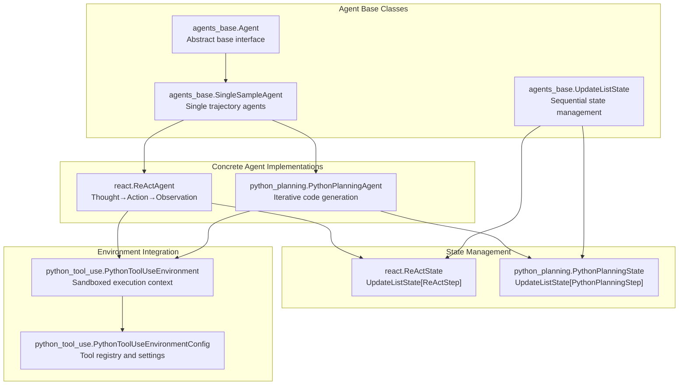
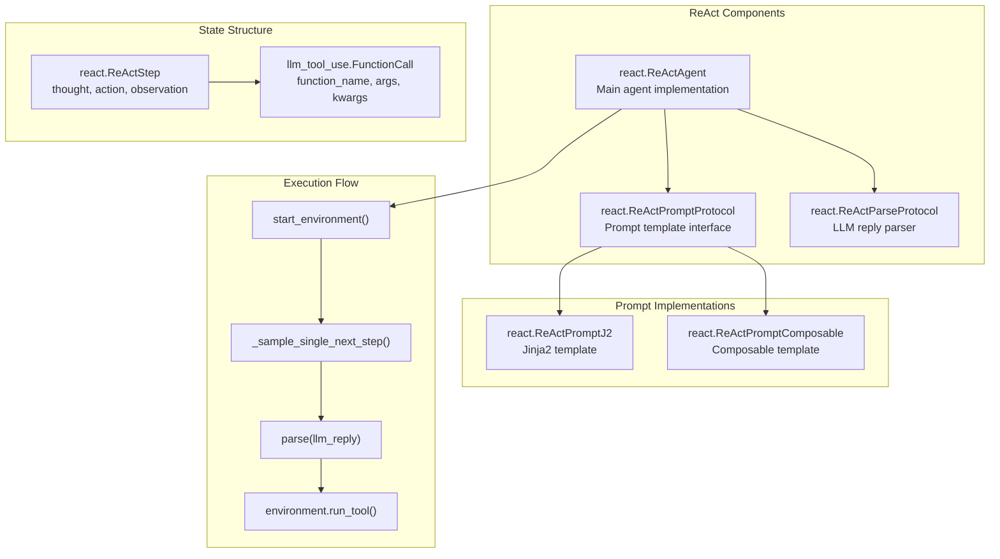
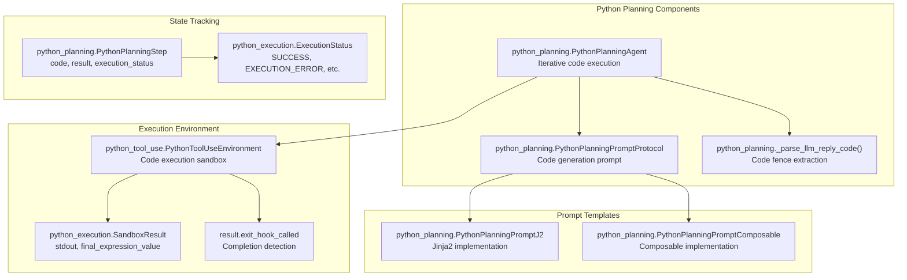
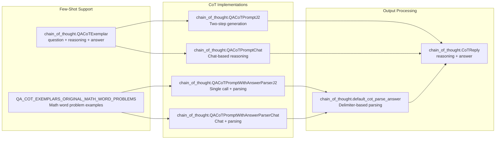
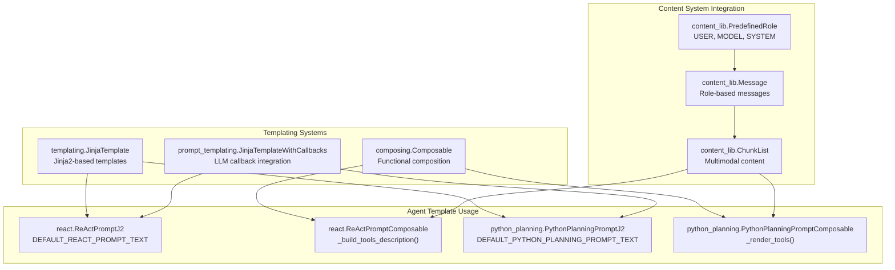
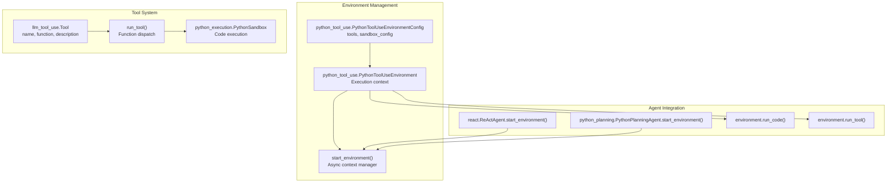

<!-- source: DeepWiki mcp.deepwiki.com · repo google-deepmind/onetwo · page 4 Advanced Features · fetched 2026-10-26 -->

# Advanced Features

<details>
<summary>Relevant source files</summary>

The following files were used as context for generating this wiki page:

- [onetwo/agents/python_planning.py](onetwo/agents/python_planning.py)
- [onetwo/agents/python_planning_test.py](onetwo/agents/python_planning_test.py)
- [onetwo/agents/react.py](onetwo/agents/react.py)
- [onetwo/agents/react_test.py](onetwo/agents/react_test.py)
- [onetwo/stdlib/reasoning/chain_of_thought.py](onetwo/stdlib/reasoning/chain_of_thought.py)
- [onetwo/stdlib/reasoning/chain_of_thought_test.py](onetwo/stdlib/reasoning/chain_of_thought_test.py)

</details>


This page documents OneTwo's sophisticated prompting strategies, agent frameworks, and composition patterns for complex multi-step reasoning tasks. These features enable the construction of agents that can perform iterative reasoning, execute tools, and compose complex prompting workflows.

For basic prompting and LLM integration, see [Built-in Functions](#3.1). For evaluation of these advanced strategies, see [Agent Evaluation](#5.2).

## Agent Framework Overview

OneTwo provides a unified agent framework that supports multiple reasoning strategies through a common interface. Agents maintain serializable state and can perform stepwise execution with support for stop/restart and parallel trajectory exploration.



Sources: [onetwo/agents/agents_base.py](), [onetwo/agents/react.py:678-686](), [onetwo/agents/python_planning.py:486-495]()

## ReAct Agent Strategy

The ReAct (Reasoning and Acting) agent implements the thought-action-observation loop, where the LLM alternates between reasoning about the problem and executing actions through tools.

### ReAct Agent Architecture



Sources: [onetwo/agents/react.py:677-719](), [onetwo/agents/react.py:306-343](), [onetwo/agents/react.py:770-846]()

### ReAct Execution Flow

The ReAct agent follows a structured execution pattern:

| Phase | Component | Description |
|-------|-----------|-------------|
| **Prompt Generation** | `ReActPromptProtocol.__call__` | Creates prompt with tools, exemplars, and current state |
| **LLM Interaction** | `llm.generate_text` or `llm.chat` | Gets reasoning and action from LLM |
| **Response Parsing** | `react_parse()` | Extracts thought, action, and determines if finished |
| **Tool Execution** | `environment.run_tool()` | Executes the selected action and captures observation |
| **State Update** | `ReActState.updates.append()` | Adds new step to agent state |

The parsing function `react_parse()` at [onetwo/agents/react.py:580-675]() handles multiple formats including `[Thought]:`, `[Act]:`, and `[Finish]:` patterns.

Sources: [onetwo/agents/react.py:770-846](), [onetwo/agents/react.py:580-675]()

## Python Planning Agent Strategy

The Python Planning agent generates and executes Python code iteratively, building up a solution through sequential code blocks with tool function calls.

### Python Planning Architecture



Sources: [onetwo/agents/python_planning.py:486-525](), [onetwo/agents/python_planning.py:324-366](), [onetwo/agents/python_planning.py:568-647]()

### Code Generation and Execution

The Python Planning agent operates through these key functions:

1. **Code Generation**: `PythonPlanningPromptProtocol.__call__()` generates the next Python code block
2. **Code Parsing**: `_parse_llm_reply_code()` at [onetwo/agents/python_planning.py:153-182]() extracts code from LLM response, handling various fence formats
3. **Code Execution**: `environment.run_code()` executes code in sandbox with tool access
4. **Result Processing**: `_get_result_str()` at [onetwo/agents/python_planning.py:93-132]() formats execution results for LLM

The agent continues until either `exit()` is called in the code or an irrecoverable error occurs.

Sources: [onetwo/agents/python_planning.py:568-647](), [onetwo/agents/python_planning.py:153-182](), [onetwo/agents/python_planning.py:93-132]()

## Chain of Thought Reasoning

OneTwo provides multiple Chain of Thought implementations for structured reasoning without tool use.

### Chain of Thought Strategy Comparison



Sources: [onetwo/stdlib/reasoning/chain_of_thought.py:105-140](), [onetwo/stdlib/reasoning/chain_of_thought.py:276-311](), [onetwo/stdlib/reasoning/chain_of_thought.py:251-273]()

### CoT Implementation Patterns

| Strategy | Template Calls | Parsing | Use Case |
|----------|---------------|---------|----------|
| `QACoTPromptJ2` | 2 (`reasoning` + `answer`) | Built-in | Clean separation of reasoning/answer |
| `QACoTPromptChat` | 2 (chat messages) | Built-in | Conversational reasoning |
| `QACoTPromptWithAnswerParserJ2` | 1 (`reasoning_and_answer`) | External parser | Single-shot with delimiter parsing |
| `QACoTPromptWithAnswerParserChat` | 1 (chat) | External parser | Chat-based single-shot |

The default answer parser at [onetwo/stdlib/reasoning/chain_of_thought.py:251-273]() handles formats like "The answer is X" with fallback to treating the entire response as the answer.

Sources: [onetwo/stdlib/reasoning/chain_of_thought.py:105-140](), [onetwo/stdlib/reasoning/chain_of_thought.py:410-471](), [onetwo/stdlib/reasoning/chain_of_thought.py:251-273]()

## Composables and Templating

OneTwo supports complex prompt composition through the composables system and multiple templating approaches.

### Template Integration Patterns



Sources: [onetwo/agents/react.py:102-167](), [onetwo/agents/react.py:387-555](), [onetwo/agents/python_planning.py:201-252](), [onetwo/agents/python_planning.py:368-483]()

### Composable Strategy Construction

The composable system enables functional prompt construction:

```python
# Example composable pattern from ReActPromptComposable
e = composables.c(content_lib.ChunkList())
e += self._build_tools_description(tools)
e += self._build_react_fewshots(exemplars, stop_prefix)
e += self._build_question(state, stop_prefix)
e += composables.store('llm_reply', composables.chat(stop=stop_sequences))
```

This pattern is used in [onetwo/agents/react.py:525-555]() and [onetwo/agents/python_planning.py:455-483]() to build complex multi-part prompts.

Sources: [onetwo/agents/react.py:525-555](), [onetwo/agents/python_planning.py:455-483]()

## Tool Environment Integration

All advanced agents integrate with the Python Tool Use Environment for executing actions in a controlled sandbox.

### Environment Architecture



Sources: [onetwo/agents/react.py:747-768](), [onetwo/agents/python_planning.py:545-566](), [onetwo/stdlib/tool_use/python_tool_use.py]()

### Usage Pattern

Both agent types follow the same environment pattern:

```python
async with agent.start_environment() as env:
    state = await agent.initialize_state(inputs)
    while not agent.is_finished(state):
        next_step = await agent._sample_single_next_step(
            state=state, environment=env
        )
        state = state.append_update(next_step)
    return agent.extract_output(state)
```

This pattern is implemented in the base agent classes and provides consistent tool access across different strategies.

Sources: [onetwo/agents/react.py:747-768](), [onetwo/agents/python_planning.py:545-566]()

# Advanced Features

This page documents OneTwo's sophisticated prompting strategies, agent frameworks, and composition patterns for complex multi-step reasoning tasks. These features enable the construction of agents that can perform iterative reasoning, execute tools, and compose complex prompting workflows.

For basic prompting and LLM integration, see [Built-in Functions](#3.1). For evaluation of these advanced strategies, see [Agent Evaluation](#5.2).

## Agent Framework Overview

OneTwo provides a unified agent framework that supports multiple reasoning strategies through a common interface. Agents maintain serializable state and can perform stepwise execution with support for stop/restart and parallel trajectory exploration.

**Agent Framework Architecture**


Sources: [onetwo/agents/agents_base.py](), [onetwo/agents/react.py:678-686](), [onetwo/agents/python_planning.py:486-495]()

## ReAct Agent Strategy

The ReAct (Reasoning and Acting) agent implements the thought-action-observation loop, where the LLM alternates between reasoning about the problem and executing actions through tools.

**ReAct Agent Architecture**


Sources: [onetwo/agents/react.py:677-719](), [onetwo/agents/react.py:306-343](), [onetwo/agents/react.py:770-846]()

### ReAct Execution Flow

The ReAct agent follows a structured execution pattern:

| Phase | Component | Description |
|-------|-----------|-------------|
| **Prompt Generation** | `ReActPromptProtocol.__call__` | Creates prompt with tools, exemplars, and current state |
| **LLM Interaction** | `llm.generate_text` or `llm.chat` | Gets reasoning and action from LLM |
| **Response Parsing** | `react_parse()` | Extracts thought, action, and determines if finished |
| **Tool Execution** | `environment.run_tool()` | Executes the selected action and captures observation |
| **State Update** | `ReActState.updates.append()` | Adds new step to agent state |

The parsing function `react_parse()` at [onetwo/agents/react.py:580-675]() handles multiple formats including `[Thought]:`, `[Act]:`, and `[Finish]:` patterns.

Sources: [onetwo/agents/react.py:770-846](), [onetwo/agents/react.py:580-675]()

## Python Planning Agent Strategy

The Python Planning agent generates and executes Python code iteratively, building up a solution through sequential code blocks with tool function calls.

**Python Planning Architecture**


Sources: [onetwo/agents/python_planning.py:486-525](), [onetwo/agents/python_planning.py:324-366](), [onetwo/agents/python_planning.py:568-647]()

### Code Generation and Execution

The Python Planning agent operates through these key functions:

1. **Code Generation**: `PythonPlanningPromptProtocol.__call__()` generates the next Python code block
2. **Code Parsing**: `_parse_llm_reply_code()` at [onetwo/agents/python_planning.py:153-182]() extracts code from LLM response, handling various fence formats
3. **Code Execution**: `environment.run_code()` executes code in sandbox with tool access
4. **Result Processing**: `_get_result_str()` at [onetwo/agents/python_planning.py:93-132]() formats execution results for LLM

The agent continues until either `exit()` is called in the code or an irrecoverable error occurs.

Sources: [onetwo/agents/python_planning.py:568-647](), [onetwo/agents/python_planning.py:153-182](), [onetwo/agents/python_planning.py:93-132]()

## Chain of Thought Reasoning

OneTwo provides multiple Chain of Thought implementations for structured reasoning without tool use.

**Chain of Thought Strategy Comparison**


Sources: [onetwo/stdlib/reasoning/chain_of_thought.py:105-140](), [onetwo/stdlib/reasoning/chain_of_thought.py:276-311](), [onetwo/stdlib/reasoning/chain_of_thought.py:251-273]()

### CoT Implementation Patterns

| Strategy | Template Calls | Parsing | Use Case |
|----------|---------------|---------|----------|
| `QACoTPromptJ2` | 2 (`reasoning` + `answer`) | Built-in | Clean separation of reasoning/answer |
| `QACoTPromptChat` | 2 (chat messages) | Built-in | Conversational reasoning |
| `QACoTPromptWithAnswerParserJ2` | 1 (`reasoning_and_answer`) | External parser | Single-shot with delimiter parsing |
| `QACoTPromptWithAnswerParserChat` | 1 (chat) | External parser | Chat-based single-shot |

The default answer parser at [onetwo/stdlib/reasoning/chain_of_thought.py:251-273]() handles formats like "The answer is X" with fallback to treating the entire response as the answer.

Sources: [onetwo/stdlib/reasoning/chain_of_thought.py:105-140](), [onetwo/stdlib/reasoning/chain_of_thought.py:410-471](), [onetwo/stdlib/reasoning/chain_of_thought.py:251-273]()

## Composables and Templating

OneTwo supports complex prompt composition through the composables system and multiple templating approaches.

**Template Integration Patterns**


Sources: [onetwo/agents/react.py:102-167](), [onetwo/agents/react.py:387-555](), [onetwo/agents/python_planning.py:201-252](), [onetwo/agents/python_planning.py:368-483]()

### Composable Strategy Construction

The composable system enables functional prompt construction. The pattern involves building up prompts incrementally using the `+=` operator on composable objects, then executing them to get results.

This pattern is used in [onetwo/agents/react.py:525-555]() and [onetwo/agents/python_planning.py:455-483]() to build complex multi-part prompts.

Sources: [onetwo/agents/react.py:525-555](), [onetwo/agents/python_planning.py:455-483]()

## Tool Environment Integration

All advanced agents integrate with the Python Tool Use Environment for executing actions in a controlled sandbox.

**Environment Architecture**


Sources: [onetwo/agents/react.py:747-768](), [onetwo/agents/python_planning.py:545-566](), [onetwo/stdlib/tool_use/python_tool_use.py]()

### Usage Pattern

Both agent types follow the same environment pattern using async context managers:

```python
async with agent.start_environment() as env:
    state = await agent.initialize_state(inputs)
    while not agent.is_finished(state):
        next_step = await agent._sample_single_next_step(
            state=state, environment=env
        )
        state = state.append_update(next_step)
    return agent.extract_output(state)
```

This pattern is implemented in the base agent classes and provides consistent tool access across different strategies.

Sources: [onetwo/agents/react.py:747-768](), [onetwo/agents/python_planning.py:545-566]()

---

