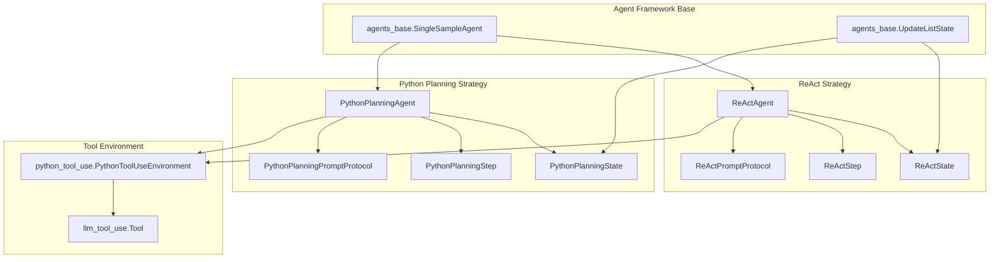
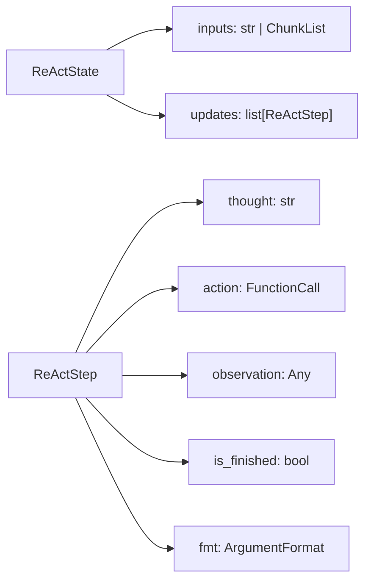
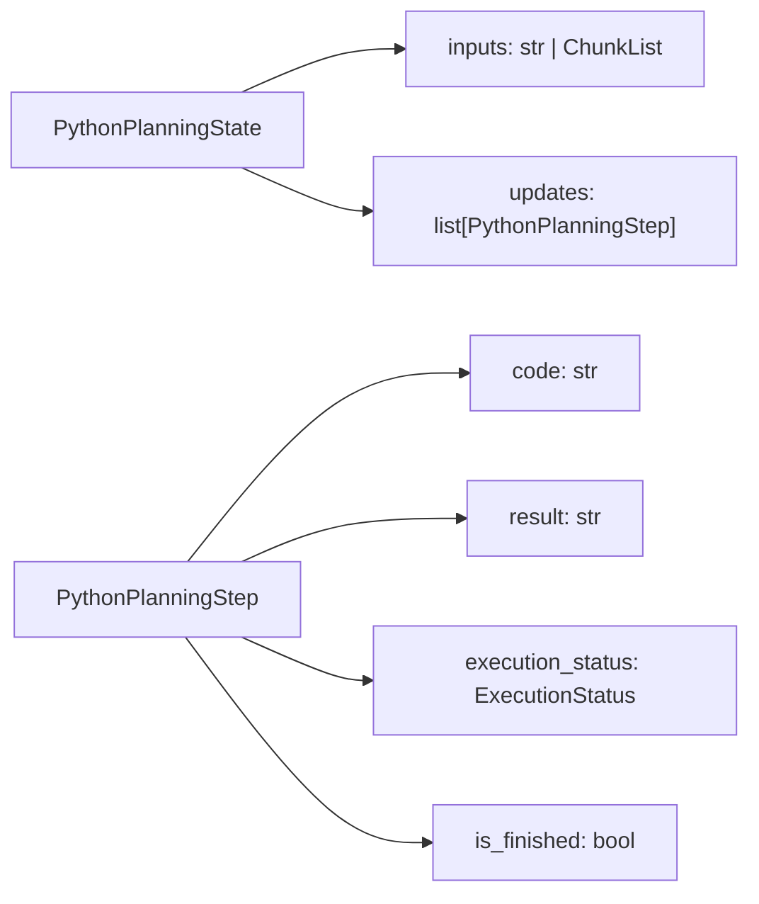
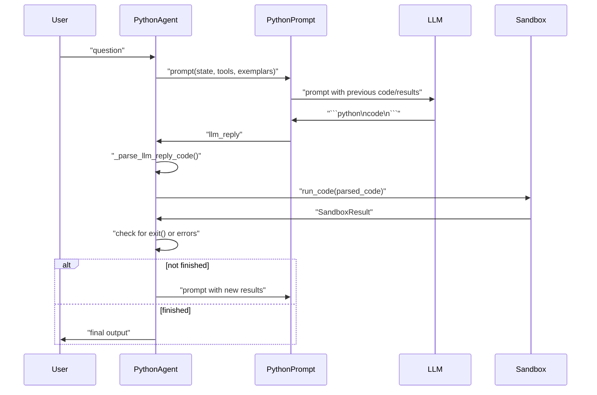
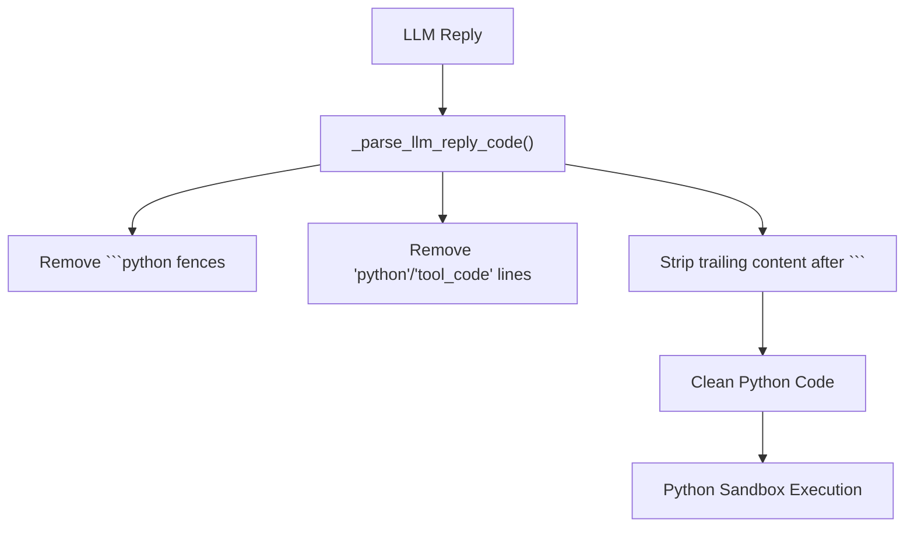
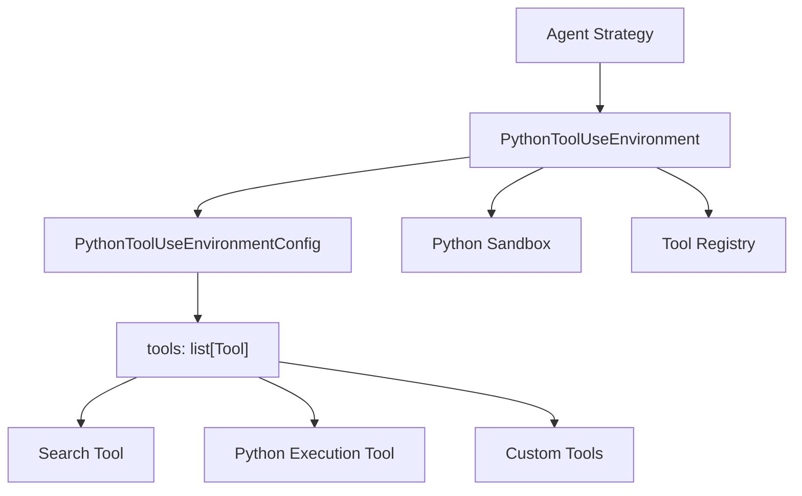

<!-- source: DeepWiki mcp.deepwiki.com · repo google-deepmind/onetwo · page 4.1 Agent Strategies · fetched 2026-10-26 -->

# Agent Strategies

Relevant source files

The following files were used as context for generating this wiki page:

- [onetwo/agents/python_planning.py](onetwo/agents/python_planning.py)
- [onetwo/agents/python_planning_test.py](onetwo/agents/python_planning_test.py)
- [onetwo/agents/react.py](onetwo/agents/react.py)
- [onetwo/agents/react_test.py](onetwo/agents/react_test.py)

This document covers the two primary agent strategies implemented in OneTwo: ReAct (Reasoning and Acting) and Python Planning. These strategies enable multi-step reasoning and tool use through iterative prompting patterns. For information about the underlying agent framework and base classes, see [Agent Evaluation](#5.2). For details about the tool execution environment, see [Python Tool Environment](#4.2).

## Overview

OneTwo provides two sophisticated agent strategies that implement different approaches to multi-step reasoning:

- **ReAct Agent**: Implements the Reasoning-and-Acting pattern with explicit thought/action/observation cycles
- **Python Planning Agent**: Uses iterative Python code generation and execution for tool orchestration

Both strategies share common architectural patterns through the agent framework, maintaining serializable state and supporting stepwise execution.

### Agent Strategy Architecture

**Sources:** [onetwo/agents/react.py:678-686](), [onetwo/agents/python_planning.py:487-495](), [onetwo/agents/agents_base.py]()

## ReAct Agent Strategy

The `ReActAgent` implements the Reasoning-and-Acting pattern where the LLM alternates between thinking, acting, and observing results. Each step explicitly separates reasoning from action execution.

### ReAct State Structure

The `ReActState` maintains the complete conversation history as a sequence of `ReActStep` objects, where each step can contain:

- **Thought**: The LLM's reasoning about what to do next
- **Action**: A structured function call to execute
- **Observation**: The result of executing the action
- **Format**: How the action should be rendered in prompts

**Sources:** [onetwo/agents/react.py:54-96](), [onetwo/agents/react.py:98-100]()

### ReAct Execution Flow

The agent continues this cycle until either:
1. The LLM explicitly calls a "Finish" action
2. Maximum steps (`max_steps`) is reached
3. An empty response triggers force-finish

**Sources:** [onetwo/agents/react.py:770-846](), [onetwo/agents/react.py:580-675]()

### ReAct Prompt Templates

The ReAct strategy supports two prompt template implementations:

| Template | Description | Key Features |
|----------|-------------|--------------|
| `ReActPromptJ2` | Jinja2-based template | String-based templating, backward compatibility |
| `ReActPromptComposable` | Composable-based template | Multimodal support, structured content handling |

Both implement the `ReActPromptProtocol` interface and generate prompts containing:
- Tool descriptions and examples
- Few-shot exemplars (`REACT_FEWSHOTS`)
- Current conversation state
- Appropriate stop sequences

**Sources:** [onetwo/agents/react.py:345-385](), [onetwo/agents/react.py:387-554](), [onetwo/agents/react.py:299-303]()

## Python Planning Agent Strategy

The `PythonPlanningAgent` implements an iterative code generation approach where the LLM writes Python code that gets executed in a sandboxed environment. This enables more complex multi-step reasoning through programmatic tool orchestration.

### Python Planning State Structure

Each `PythonPlanningStep` represents one code generation and execution cycle:

- **Code**: Python code generated by the LLM
- **Result**: Output from executing the code (stdout + final expression)
- **Execution Status**: Success, error, or timeout status
- **Finished**: Whether this step completed the task (via `exit()` call or error)

**Sources:** [onetwo/agents/python_planning.py:68-85](), [onetwo/agents/python_planning.py:87-90]()

### Python Planning Execution Flow

The agent continues until:
1. The LLM calls `exit()` in the generated code
2. An irrecoverable error occurs
3. Maximum steps (`max_steps`) is reached

**Sources:** [onetwo/agents/python_planning.py:568-647](), [onetwo/agents/python_planning.py:153-182]()

### Code Parsing and Execution

The Python Planning agent includes sophisticated code parsing to handle different LLM output formats:

The parser handles various fence formats and extracts the first code block, discarding any additional content.

**Sources:** [onetwo/agents/python_planning.py:153-182](), [onetwo/agents/python_planning_test.py:554-666]()

## Common Agent Framework Patterns

Both agent strategies share common architectural patterns through the agent framework:

### Shared Interfaces and Base Classes

| Component | ReAct | Python Planning | Description |
|-----------|-------|-----------------|-------------|
| Base Class | `SingleSampleAgent` | `SingleSampleAgent` | Provides core agent lifecycle |
| State Type | `UpdateListState[str, ReActStep]` | `UpdateListState[str, PythonPlanningStep]` | Serializable state with update history |
| Environment | `PythonToolUseEnvironment` | `PythonToolUseEnvironment` | Tool execution environment |
| Prompt Protocol | `ReActPromptProtocol` | `PythonPlanningPromptProtocol` | Standardized prompt interface |

### State Management

Both agents use the `UpdateListState` pattern where:
- `inputs` stores the original user question/task
- `updates` maintains a chronological list of steps
- Each step is serializable and contains execution details
- State can be paused, resumed, or branched for beam search

**Sources:** [onetwo/agents/agents_base.py](), [onetwo/agents/react.py:100](), [onetwo/agents/python_planning.py:90]()

### Tool Integration

Both strategies integrate with the same tool environment:

**Sources:** [onetwo/agents/react.py:765-768](), [onetwo/agents/python_planning.py:563-566](), [onetwo/stdlib/tool_use/python_tool_use.py]()

## Key Strategy Differences

| Aspect | ReAct | Python Planning |
|--------|-------|-----------------|
| **Reasoning Style** | Explicit thought/action separation | Programmatic code generation |
| **Tool Invocation** | Individual function calls | Python code with tool calls |
| **Error Handling** | Continue with error observation | Retry with corrected code |
| **State Representation** | Structured thought/action/observation | Code blocks and execution results |
| **Complexity** | Simple linear reasoning | Complex multi-step programming |
| **Debugging** | Clear step-by-step trace | Full code execution context |

### When to Use Each Strategy

**ReAct Agent** is ideal for:
- Simple reasoning tasks with clear action sequences
- Cases where explicit reasoning traces are important
- Tasks requiring individual tool calls with clear dependencies

**Python Planning Agent** is ideal for:
- Complex multi-step computations
- Tasks requiring data manipulation or analysis
- Cases where programmatic control flow is beneficial
- Scenarios needing variable storage and reuse

**Sources:** [onetwo/agents/react.py:15-32](), [onetwo/agents/python_planning.py:15-41]()

---

