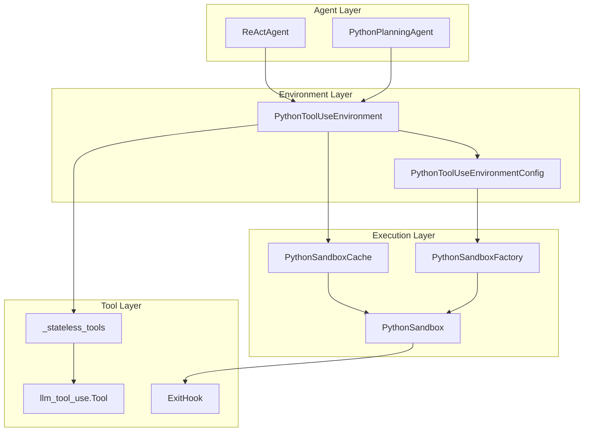
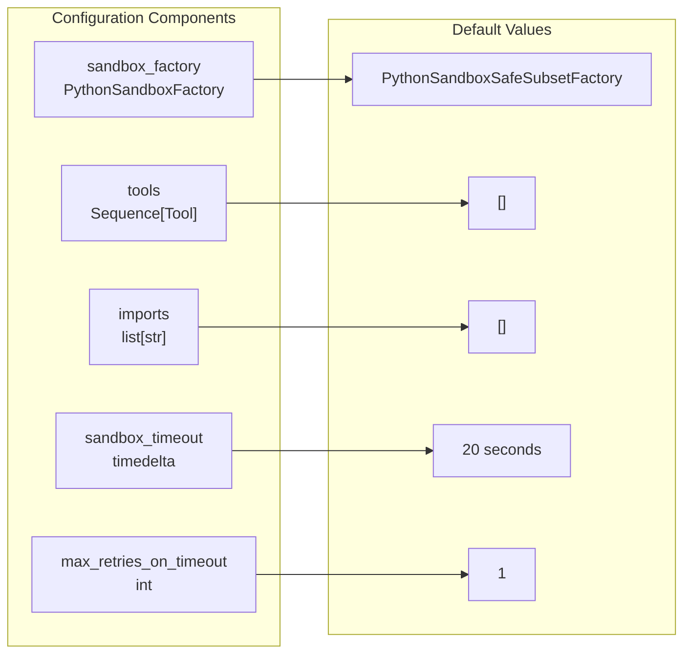
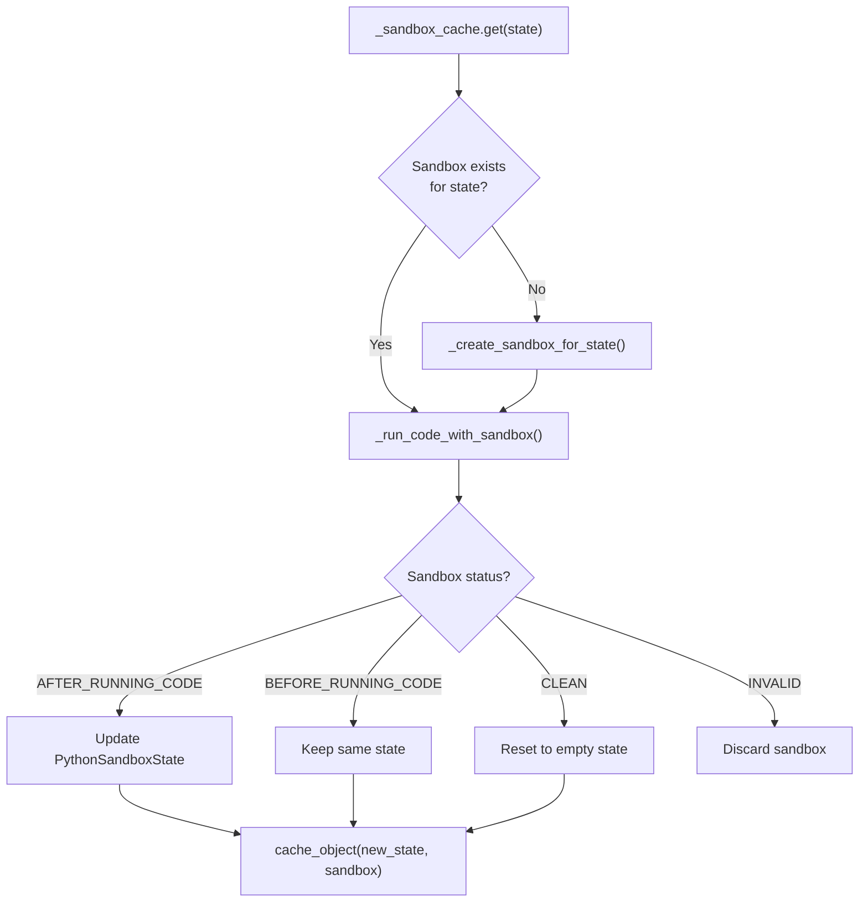
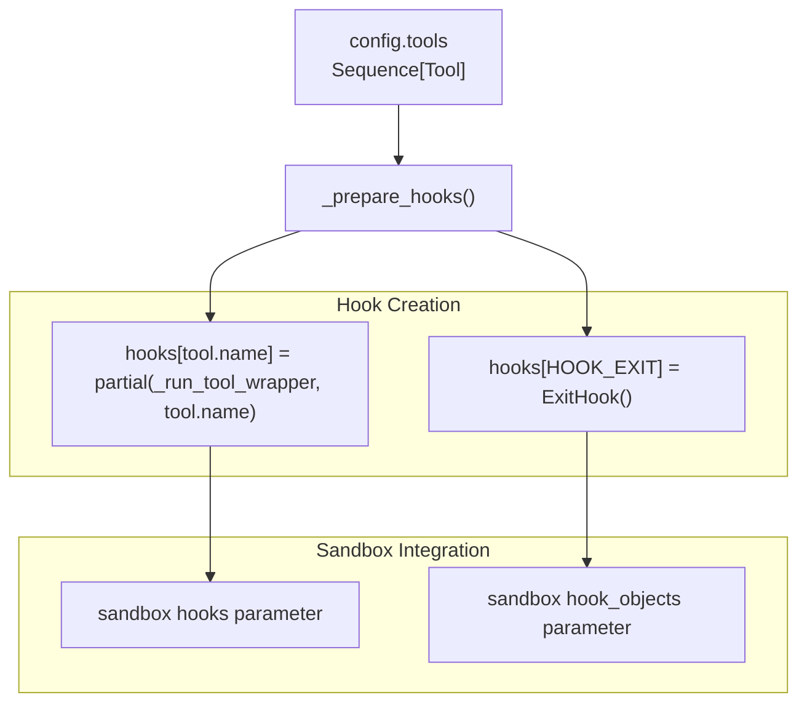
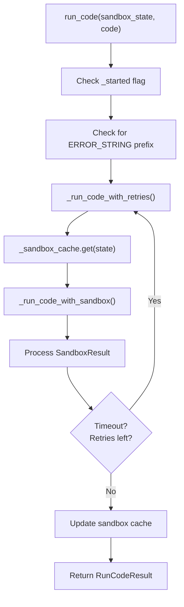

<!-- source: DeepWiki mcp.deepwiki.com · repo google-deepmind/onetwo · page 4.2 Python Tool Environment · fetched 2026-10-26 -->

# Python Tool Environment

<details>
<summary>Relevant source files</summary>

The following files were used as context for generating this wiki page:

- [onetwo/stdlib/code_execution/python_execution.py](onetwo/stdlib/code_execution/python_execution.py)
- [onetwo/stdlib/tool_use/python_tool_use.py](onetwo/stdlib/tool_use/python_tool_use.py)

</details>


This document covers the `PythonToolUseEnvironment` system that provides a sandboxed Python execution environment for agent-based strategies. This environment manages Python code execution, tool integration, and stateful sandbox caching to support multi-step reasoning tasks.

For information about the agents that use this environment, see [Agent Strategies](#4.1). For general code execution interfaces, the core sandbox abstractions are documented in the execution framework.

## Overview

The Python Tool Environment serves as a bridge between LLM-based agents and executable Python code, enabling agents to perform computational tasks, call external tools, and maintain state across multiple execution steps. The system provides isolation, caching, and tool integration while maintaining compatibility with both ReAct and Python Planning agent strategies.

**Core Architecture**



Sources: [onetwo/stdlib/tool_use/python_tool_use.py:136-196](), [onetwo/stdlib/code_execution/python_execution.py:192-294]()

## Core Components

### PythonToolUseEnvironment

The `PythonToolUseEnvironment` class manages the complete lifecycle of Python code execution and tool integration. It provides a stateful environment where agents can execute code blocks while maintaining variable state and accessing registered tools.

| Component | Type | Purpose |
|-----------|------|---------|
| `config` | `PythonToolUseEnvironmentConfig` | Configuration controlling environment behavior |
| `_sandbox_cache` | `PythonSandboxCache` | Cache managing sandbox instances by state |
| `_stateless_tools` | `dict[str, Tool]` | Registry of available tools |
| `_started` | `bool` | Flag indicating environment lifecycle state |

**Key Methods:**

- `run_code(sandbox_state, code)` - Executes Python code in appropriate sandbox
- `run_tool(tool_name, tool_args, tool_kwargs)` - Executes registered tools
- `register()` - Configures builtin function implementations
- Context manager support via `__enter__`/`__exit__`

Sources: [onetwo/stdlib/tool_use/python_tool_use.py:136-196](), [onetwo/stdlib/tool_use/python_tool_use.py:399-486]()

### Environment Configuration

The `PythonToolUseEnvironmentConfig` defines the behavior parameters for the environment, including sandbox creation, tool definitions, and execution policies.



Sources: [onetwo/stdlib/tool_use/python_tool_use.py:67-110]()

## Sandbox Management and Caching

### State-Based Caching

The environment uses a sophisticated caching mechanism where sandbox state is represented as a tuple of executed code strings (`PythonSandboxState`). This enables efficient reuse of sandboxes that have executed identical code sequences.

**Cache Operations:**



Sources: [onetwo/stdlib/tool_use/python_tool_use.py:128-131](), [onetwo/stdlib/tool_use/python_tool_use.py:359-398]()

### Sandbox Lifecycle

Sandboxes are created on-demand and configured with hooks and imports. The `_create_sandbox_for_state` method reconstructs the desired state by re-executing the complete code history.

**Creation Process:**

1. Prepare hooks (tools + exit hook)
2. Create sandbox via factory with timeout and imports
3. Start sandbox with `start_unsafe()`
4. Re-execute all code in `sandbox_state` tuple
5. Return configured sandbox

Sources: [onetwo/stdlib/tool_use/python_tool_use.py:273-312]()

## Tool Integration

### Tool Registration and Execution

Tools are registered in the environment configuration and made available both as direct callable functions and as hooks within the Python sandbox. Each tool is wrapped to ensure consistent execution through the `run_tool` method.

**Tool Hook Preparation:**



**Tool Execution Flow:**

1. Agent calls `run_tool()` or Python code calls tool hook
2. `_run_tool_wrapper()` converts arguments to tuple/dict format
3. `run_tool()` validates tool existence and calls tool function
4. Tool result returned to caller

Sources: [onetwo/stdlib/tool_use/python_tool_use.py:252-271](), [onetwo/stdlib/tool_use/python_tool_use.py:441-486]()

### Exit Hook Mechanism

The `ExitHook` provides a special mechanism for agents to signal task completion. When called from within Python code, it sets a flag that can be checked by the environment to determine if the agent has reached a solution.

```python
# ExitHook usage pattern
hook = ExitHook()  # called=False
hook()             # sets called=True
```

Sources: [onetwo/stdlib/tool_use/python_tool_use.py:113-126](), [onetwo/stdlib/tool_use/python_tool_use.py:36]()

## Code Execution Workflow

### Execution Pipeline

The code execution process involves several layers of error handling, retries, and state management:



### Result Processing

The `RunCodeResult` encapsulates the outcome of code execution, including:

| Field | Type | Description |
|-------|------|-------------|
| `code` | `str` | The executed code block |
| `sandbox_result` | `SandboxResult` | Detailed execution results from sandbox |
| `exit_hook_called` | `bool` | Whether ExitHook was triggered |

Sources: [onetwo/stdlib/tool_use/python_tool_use.py:48-64](), [onetwo/stdlib/tool_use/python_tool_use.py:399-439]()

## State Management

### Environment Lifecycle

The environment follows a strict lifecycle pattern to ensure proper resource management:

**Startup Patterns:**

```python
# Context manager (recommended)
with PythonToolUseEnvironment(config) as env:
    result = await env.run_code(state, code)

# Manual lifecycle
env = PythonToolUseEnvironment(config)
await env.start_unsafe()
try:
    result = await env.run_code(state, code)
finally:
    env.stop()
```

**State Tracking:**

- `PythonSandboxState` represents executed code history as tuple
- Cache maps states to sandbox instances
- State transitions tracked through `SandboxStatus` enum

Sources: [onetwo/stdlib/tool_use/python_tool_use.py:197-237](), [onetwo/stdlib/tool_use/python_tool_use.py:44-45]()

### Error Handling and Retries

The environment implements comprehensive error handling with automatic retry logic for timeout scenarios:

| Error Type | Handling Strategy |
|------------|------------------|
| `SANDBOX_TIMEOUT` | Retry up to `max_retries_on_timeout` |
| `PROGRAM_ERROR` | Return error in `RunCodeResult` |
| `EXECUTION_ERROR` | Capture in `SandboxResult.status_message` |
| Invalid sandbox | Discard and recreate |

Sources: [onetwo/stdlib/tool_use/python_tool_use.py:359-398](), [onetwo/stdlib/code_execution/python_execution.py:40-64]()

## Integration with Agents

### Builtin Function Configuration

The environment integrates with OneTwo's builtin system by configuring itself as the implementation for `tool_use.run_tool`:

```python
def register(self) -> None:
    tool_use.run_tool.configure(self.run_tool)
```

This allows agents to use `ot.run_tool()` calls that are automatically routed to the environment's tool execution system.

### Agent Usage Patterns

Agents typically use the environment in conjunction with state management:

1. **ReAct Agent**: Executes individual tool calls and code snippets
2. **Python Planning Agent**: Executes larger code blocks for complex reasoning
3. **State Persistence**: Environment maintains variable state across agent steps

Sources: [onetwo/stdlib/tool_use/python_tool_use.py:244-250]()

---

