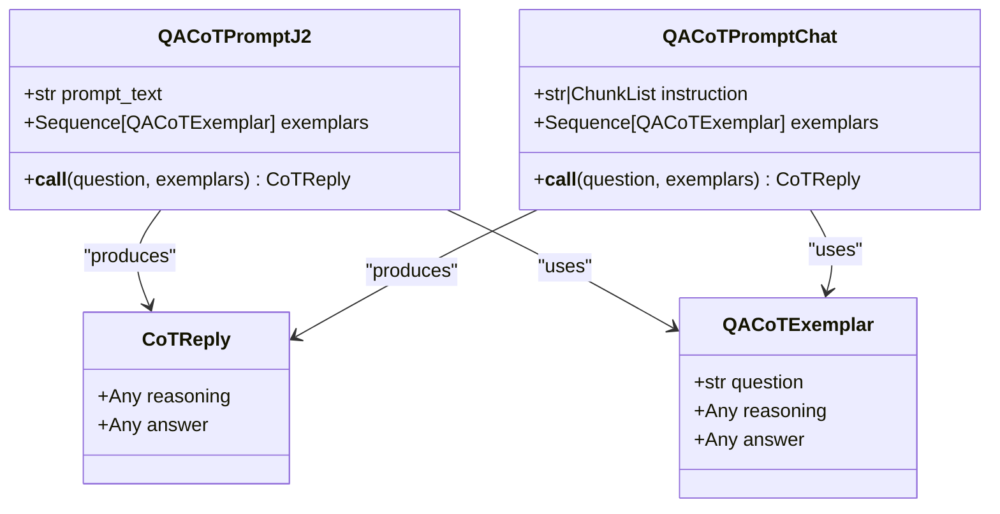
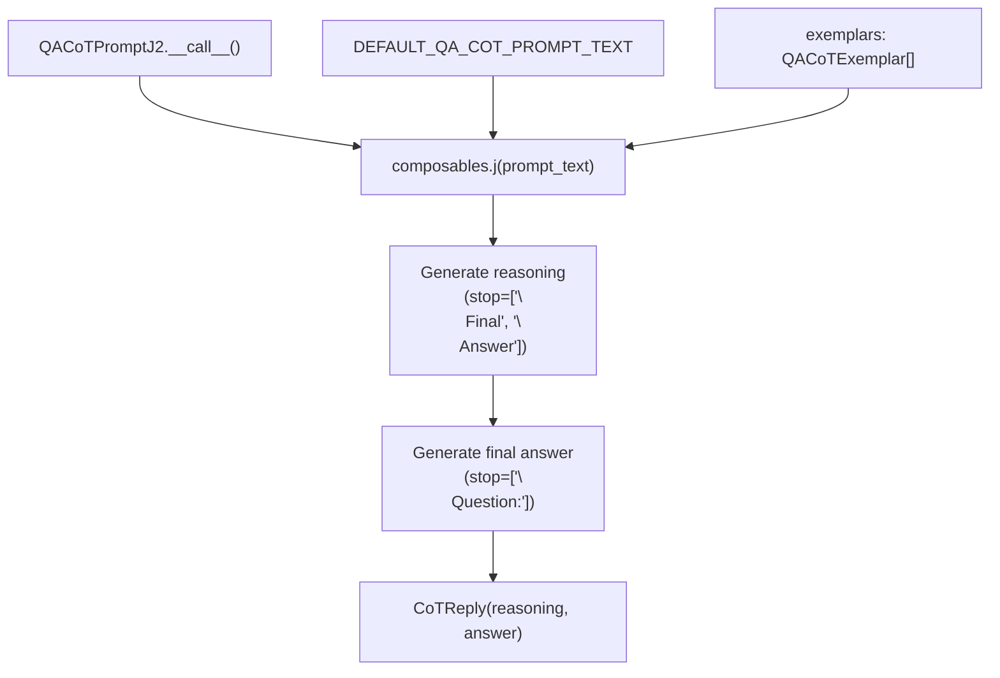
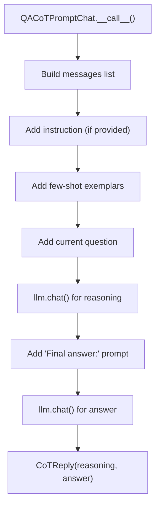
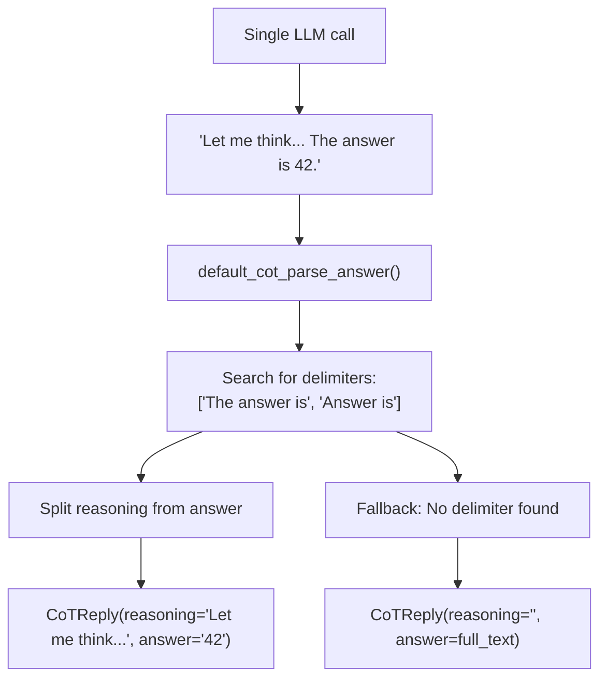
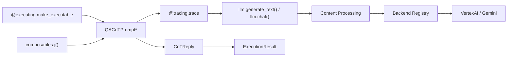

<!-- source: DeepWiki mcp.deepwiki.com · repo google-deepmind/onetwo · page 4.3 Reasoning Strategies · fetched 2026-10-26 -->

# Reasoning Strategies

<details>
<summary>Relevant source files</summary>

The following files were used as context for generating this wiki page:

- [onetwo/stdlib/reasoning/chain_of_thought.py](onetwo/stdlib/reasoning/chain_of_thought.py)
- [onetwo/stdlib/reasoning/chain_of_thought_test.py](onetwo/stdlib/reasoning/chain_of_thought_test.py)

</details>


This document covers the reasoning strategies available in OneTwo for improving LLM performance on complex tasks that require step-by-step thinking. The primary strategy implemented is Chain-of-Thought (CoT), which prompts language models to generate intermediate reasoning steps before arriving at a final answer.

For agent-based reasoning that involves tool use and multi-step planning, see [Agent Strategies](#4.1). For composable prompt templates and advanced prompting patterns, see [Composables and Templating](#4.4).

## Overview

Reasoning strategies in OneTwo help language models break down complex problems into manageable steps, leading to more accurate and interpretable results. These strategies are implemented as executable classes that can be easily integrated into larger prompting workflows.

**Sources**: [onetwo/stdlib/reasoning/chain_of_thought.py:15-35]()

## Chain-of-Thought Strategy

Chain-of-Thought is a prompting technique that encourages language models to generate explicit reasoning steps before providing a final answer. OneTwo provides several implementations of CoT with different prompt formats and parsing approaches.

### Core Data Structures

The chain-of-thought module defines key data structures for organizing reasoning workflows:

| Class | Purpose | Key Attributes |
|-------|---------|----------------|
| `CoTReply` | Bundles reasoning with final answer | `reasoning`, `answer` |
| `QACoTExemplar` | Few-shot exemplar for Q&A tasks | `question`, `reasoning`, `answer` |



**Sources**: [onetwo/stdlib/reasoning/chain_of_thought.py:48-82]()

### Implementation Variants

OneTwo provides four main chain-of-thought implementations, each suited for different use cases:

#### Template-Based Implementations

**`QACoTPromptJ2`** uses Jinja2 templates with separate generation calls for reasoning and answer:



**Sources**: [onetwo/stdlib/reasoning/chain_of_thought.py:105-139](), [onetwo/stdlib/reasoning/chain_of_thought.py:89-102]()

#### Chat-Based Implementations

**`QACoTPromptChat`** uses the chat API with message-based conversation flow:



**Sources**: [onetwo/stdlib/reasoning/chain_of_thought.py:142-229]()

#### Answer Parser Implementations

**`QACoTPromptWithAnswerParserJ2`** and **`QACoTPromptWithAnswerParserChat`** generate reasoning and answer in a single call, then parse the result:



**Sources**: [onetwo/stdlib/reasoning/chain_of_thought.py:276-311](), [onetwo/stdlib/reasoning/chain_of_thought.py:251-273]()

### Exemplar System

Chain-of-thought strategies support few-shot learning through exemplars. The system provides predefined exemplars for mathematical reasoning tasks:

| Exemplar Set | Use Case | Source |
|--------------|----------|---------|
| `QA_COT_EXEMPLARS_ORIGINAL_MATH_WORD_PROBLEMS` | Math word problems | Original CoT paper (Appendix G) |

**Sources**: [onetwo/stdlib/reasoning/chain_of_thought.py:313-407]()

### Usage Patterns

#### Zero-Shot Chain-of-Thought

```python
# Template-based approach
cot_strategy = QACoTPromptJ2()
result = await cot_strategy(question="What is 15 + 27?")
print(f"Reasoning: {result.reasoning}")
print(f"Answer: {result.answer}")

# Chat-based approach  
cot_chat = QACoTPromptChat()
result = await cot_chat(question="What is 15 + 27?")
```

#### Few-Shot Chain-of-Thought

```python
exemplars = [
    QACoTExemplar(
        question="What is 5 + 3?",
        reasoning="I need to add 5 and 3. 5 + 3 = 8.",
        answer="8"
    )
]

cot_strategy = QACoTPromptJ2(exemplars=exemplars)
result = await cot_strategy(question="What is 15 + 27?")
```

#### Dynamic Exemplar Selection

```python
# Override default exemplars for specific questions
question_specific_exemplars = [...]
result = await cot_strategy(
    question="Complex math problem",
    exemplars=question_specific_exemplars
)
```

**Sources**: [onetwo/stdlib/reasoning/chain_of_thought_test.py:32-70](), [onetwo/stdlib/reasoning/chain_of_thought_test.py:76-138]()

### Integration with OneTwo Framework

Chain-of-thought strategies integrate seamlessly with OneTwo's execution framework:



All chain-of-thought implementations are decorated with `@executing.make_executable` and `@tracing.trace`, enabling them to participate in:

- Asynchronous execution workflows
- Result tracing and debugging  
- Performance optimization (caching, batching)
- Integration with evaluation frameworks

**Sources**: [onetwo/stdlib/reasoning/chain_of_thought.py:120-121](), [onetwo/stdlib/reasoning/chain_of_thought.py:156-157]()

### Template Customization

The default prompt templates can be customized for specific domains:

```python
custom_prompt = """

Problem: {{exemplar.question}}
Solution: {{exemplar.reasoning}}
Result: {{exemplar.answer}}


Problem: {{question}}
Solution: {{store("reasoning", generate_text(stop=["\\nResult"])) | trim }}
Result: {{store("answer", generate_text()) | trim }}
"""

custom_cot = QACoTPromptJ2(prompt_text=custom_prompt)
```

**Sources**: [onetwo/stdlib/reasoning/chain_of_thought.py:89-102](), [onetwo/stdlib/reasoning/chain_of_thought.py:237-248]()

---

