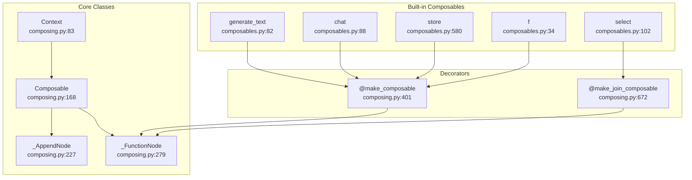
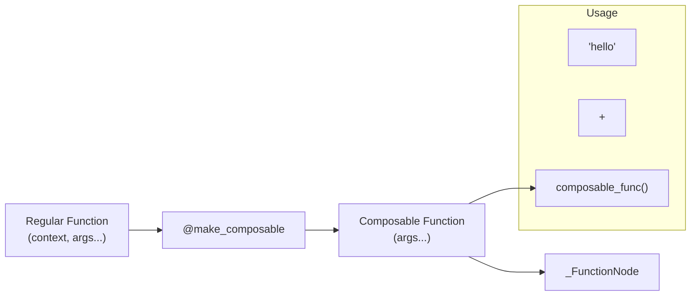
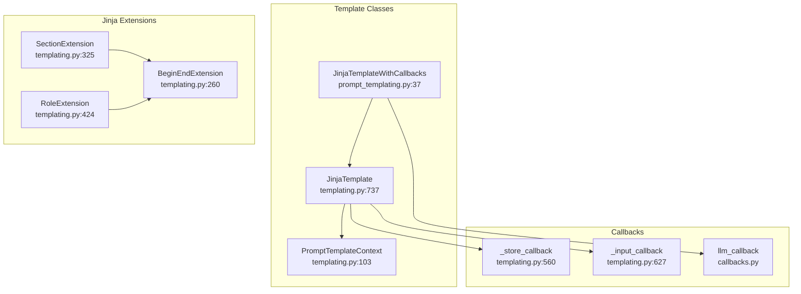

<!-- source: DeepWiki mcp.deepwiki.com · repo google-deepmind/onetwo · page 4.4 Composables and Templating · fetched 2026-10-26 -->

# Composables and Templating

<details>
<summary>Relevant source files</summary>

The following files were used as context for generating this wiki page:

- [onetwo/builtins/composables.py](onetwo/builtins/composables.py)
- [onetwo/builtins/composables_test.py](onetwo/builtins/composables_test.py)
- [onetwo/builtins/prompt_templating.py](onetwo/builtins/prompt_templating.py)
- [onetwo/core/composing.py](onetwo/core/composing.py)
- [onetwo/core/composing_test.py](onetwo/core/composing_test.py)
- [onetwo/core/templating.py](onetwo/core/templating.py)
- [onetwo/core/templating_test.py](onetwo/core/templating_test.py)

</details>


This page covers OneTwo's composable system and templating capabilities for building complex prompts. The composable system allows chaining operations using the `+` operator, while the templating system provides Jinja2-based prompt templates with LLM-specific extensions. For information about basic built-in functions, see [LLM Integration](#3). For agent-specific prompting strategies, see [Agent Strategies](#4.1).

## Composable System Overview

The composable system enables building complex prompts by chaining operations together using Python's `+` operator. This creates a computational graph that can be executed incrementally and supports streaming operations.

### Core Architecture



**Sources:** [onetwo/core/composing.py:83-166](), [onetwo/core/composing.py:168-224](), [onetwo/builtins/composables.py:20-149]()

### Context and State Management

The `Context` class manages state flow between composable operations:

| Property | Type | Purpose |
|----------|------|---------|
| `prefix` | `ChunkList` | Incrementally built content |
| `variables` | `dict[str, Any]` | Shared variables between operations |
| `to_messages()` | Method | Converts prefix to `Message` list for chat |

**Sources:** [onetwo/core/composing.py:83-166]()

### Make Composable Decorator

The `@make_composable` decorator converts functions into composable operations:



**Sources:** [onetwo/core/composing.py:401-481]()

## Built-in Composable Functions

OneTwo provides several built-in composable functions for common LLM operations:

### Text Generation and Chat

| Function | Purpose | Usage Example |
|----------|---------|---------------|
| `generate_text(**kwargs)` | Generate text continuation | `'prompt' + c.generate_text()` |
| `chat(**kwargs)` | Chat completion | `messages + c.chat()` |
| `instruct(assistant_prefix=None, **kwargs)` | Instruction following | `'task' + c.instruct()` |

### Content Manipulation

| Function | Purpose | Usage Example |
|----------|---------|---------------|
| `c(content, role=None)` | Create chunk | `c.c('text', role='user')` |
| `f(content, role=None)` | Format string with context | `c.f('var={var}')` |
| `store(name, content)` | Store result in context | `c.store('result', c.generate_text())` |

### Selection and Objects

| Function | Purpose | Usage Example |
|----------|---------|---------------|
| `select(*options)` | Select best option | `c.select('option1', 'option2')` |
| `generate_object(cls, **kwargs)` | Generate structured object | `c.generate_object(list[int])` |

**Sources:** [onetwo/builtins/composables.py:33-149]()

### Usage Examples

Basic chaining:
```python
result = executing.run('Question: ' + c.generate_text() + ' Answer: ' + c.generate_text())
```

With context variables:
```python
chain = (
    c.f('Question: {question}') + 
    c.store('answer', c.generate_text()) + 
    c.f(' The answer "{answer}" is correct.')
)
result = executing.run(chain(question='What is 2+2?'))
```

**Sources:** [onetwo/builtins/composables_test.py:80-337]()

## Templating System

The templating system provides Jinja2-based templates with LLM-specific extensions and callbacks.

### Template Architecture



**Sources:** [onetwo/core/templating.py:737-856](), [onetwo/builtins/prompt_templating.py:37-58](), [onetwo/core/templating.py:325-541]()

### JinjaTemplate Features

The `JinjaTemplate` class provides core templating functionality:

| Feature | Purpose | Template Syntax |
|---------|---------|-----------------|
| Variable substitution | Insert variables | `{{ variable_name }}` |
| Store function | Save results | `{{ store('name', content) }}` |
| Input function | Get user input | `{{ input('var_name') }}` |
| Sections | Organize content | `...` |
| Roles | Define speaker roles | `...` |

**Sources:** [onetwo/core/templating.py:737-856]()

### Template Extensions

#### Section Extension

Sections allow organizing template content with special behaviors:

- `name`: Section identifier for storing content
- `hidden`: If `True`, section content is removed from final prefix
- `to_output`: Store content in output variables (default: `True`)
- `to_context`: Store content in context variables (default: `False`)

```jinja2

Let me think about this step by step...
{{ llm() }}

```

#### Role Extension

Roles define speaker identities with optional formatting:

- `name`: Role identifier (e.g., 'user', 'assistant')
- `hidden`: Hide role content from output
- `add_tags`: Add role formatting tags

```jinja2

{{ question }}


{{ llm() }}

```

**Sources:** [onetwo/core/templating.py:325-541]()

### Template Context and Execution

The `PromptTemplateContext` manages template execution state:

| Attribute | Type | Purpose |
|-----------|------|---------|
| `input_variables` | `dict[str, Any]` | Template input parameters |
| `context_variables` | `dict[str, Any]` | Runtime variables |
| `output_variables` | `dict[str, Any]` | Final output variables |
| `prefix` | `str` | Rendered content so far |

**Sources:** [onetwo/core/templating.py:103-254]()

### JinjaTemplateWithCallbacks

The `JinjaTemplateWithCallbacks` class extends `JinjaTemplate` with LLM-specific callbacks:

| Callback | Purpose | Template Usage |
|----------|---------|---------------|
| `llm()` | Generate text | `{{ llm() }}` |
| `generate_text()` | Generate text | `{{ generate_text() }}` |
| `choose()` | Select from options | `{{ choose(options) }}` |
| `generate_object()` | Generate structured data | `{{ generate_object(cls) }}` |

**Sources:** [onetwo/builtins/prompt_templating.py:37-58]()

## Integration Between Composables and Templates

Composables and templates can be used together through the `j()` composable function:

```python
# Use Jinja template within composable chain
chain = (
    'Context: ' + 
    c.j('Question: {{ question }}\nAnswer: {{ store("answer", generate_text()) }}') +
    c.f(' The answer is {answer}')
)
```

The `j()` function:
- Renders Jinja template with current context variables
- Extracts template output variables into composable context
- Returns rendered content as a `Chunk`

**Sources:** [onetwo/builtins/composables.py:63-78]()

## Advanced Features

### Streaming and Iteration

Both composables and templates support streaming execution:

- Composables: Use `safe_stream()` with `iteration_depth` parameter
- Templates: Use `render_stream()` method for incremental rendering

### Role Tags and Formatting

Templates support role-based formatting for different output formats:

| Configuration | Purpose |
|---------------|---------|
| `role_tags` | Display formatting (e.g., HTML, colors) |
| `prefix_role_tags` | LLM input formatting |
| `add_prefix_role_tags` | Enable automatic role tag insertion |

### Error Handling

Template callbacks can handle errors gracefully:
- Errors are captured and displayed as `#ERROR#: message`
- Execution continues with error markers in output
- Error details stored in context

**Sources:** [onetwo/core/templating.py:692-714](), [onetwo/core/templating_test.py:692-714]()

---

